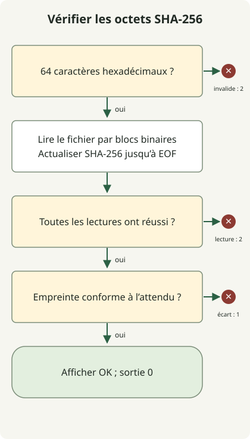

Pour vérifier un fichier téléchargé, calculez son empreinte SHA-256 et comparez-la à la valeur attendue fournie par un éditeur de confiance. Le module [hashlib](https://docs.python.org/3.11/library/hashlib.html) de Python peut traiter les octets binaires par blocs. Une correspondance compare ces octets à cette valeur ; elle n’authentifie pas l’éditeur et ne prouve pas que le programme est sûr. Adoptium documente séparément la [vérification des signatures](https://adoptium.net/installation/gpg-verification).

## Quelle somme de contrôle comparer ?

Utilisez la somme de contrôle correspondant exactement à la version, au système d’exploitation, au processeur et au format d’archive téléchargés. Le [sélecteur de versions GitHub](/en/posts/2023-09-23-linux-shellscript-github-latest/) choisit l’URL d’un fichier ; l’[exemple de métadonnées Temurin](/en/posts/2023-10-10-temurin-jdk21-delay/) vérifie aussi la syntaxe de la somme de contrôle. Aucun des deux ne calcule l’empreinte du fichier téléchargé. Les [instructions d’installation depuis une archive](https://adoptium.net/installation/archives) d’Adoptium expliquent comment obtenir la somme de contrôle associée.

Obtenez la valeur attendue par le canal de distribution fiable de l’éditeur. Calculer l’empreinte du fichier téléchargé puis utiliser ce même résultat comme valeur attendue ne permet pas de détecter un téléchargement incorrect. Si un attaquant peut remplacer à la fois le fichier et la somme de contrôle annoncée, leur correspondance n’établit pas l’authenticité. La vérification d’une signature avec une clé d’éditeur de confiance constitue une étape distincte, hors du périmètre de cet exemple.

## Comment fonctionne la vérification du fichier ?



Validez la valeur attendue, ouvrez un fichier ordinaire stable en mode binaire, mettez à jour l’empreinte par blocs jusqu’à EOF, puis comparez. Une entrée invalide ou une erreur de lecture renvoie 2 ; une différence renvoie 1 ; seule une correspondance renvoie 0. Le schéma résume la boucle de lecture des blocs en une étape. Ne modifiez ni ne remplacez le fichier pendant ou après la vérification, avant de l’utiliser. Cet outil n’effectue pas atomiquement la vérification et l’exécution.

## Exécuter un vérificateur sans paquet supplémentaire

Utilisez Python 3.11 ou ultérieur et enregistrez le programme suivant sous `verify-sha256.py`. Les commandes ci-dessous utilisent un shell POSIX. Le programme lit des fichiers locaux ; il ne les télécharge pas, ne les décompresse pas et ne les exécute pas. Il suit un lien symbolique si celui-ci pointe vers un fichier ordinaire. Il accepte une seule valeur hexadécimale de 64 caractères, y compris en majuscules, et non un manifeste de sommes de contrôle, un nom de fichier ou une URL.

### `verify-sha256.py`

```python
import hashlib
from pathlib import Path
import re
import sys


def main(argv):
    if len(argv) != 3 or not re.fullmatch(r"[0-9a-fA-F]{64}", argv[1]):
        print("usage: verify-sha256.py EXPECTED_SHA256 FILE", file=sys.stderr)
        return 2
    path = Path(argv[2])
    try:
        if not path.is_file():
            raise OSError("expected an existing regular file")
        digest = hashlib.sha256()
        with path.open("rb") as source:
            for chunk in iter(lambda: source.read(1024 * 1024), b""):
                digest.update(chunk)
    except OSError as error:
        print(f"READ ERROR: {error}", file=sys.stderr)
        return 2
    if digest.hexdigest() != argv[1].lower():
        print("MISMATCH", file=sys.stderr)
        return 1
    print("OK")
    return 0


if __name__ == "__main__":
    raise SystemExit(main(sys.argv))
```

`rb` préserve les octets d’origine, y compris les fins de ligne. Chaque lecture demande au plus 1 MiB ; le fichier n’est jamais chargé entièrement. Les sommes de contrôle invalides sont rejetées avant l’ouverture du chemin. Les chemins inexistants, les répertoires et les erreurs de lecture partagent le statut 2. Les tubes nommés et les fichiers de périphérique sortent du contrat limité aux fichiers ordinaires.

## Reproduire une correspondance et un fichier modifié

Utilisez un nouveau répertoire vide. Ce jeu de données écrit `sample.bin` avec les trois octets `abc` et `changed.bin` avec `abcd`. L’empreinte fixe de la commande correspond uniquement à `abc` ; ce n’est pas la somme de contrôle d’une archive JDK.

### `make-samples.py`

```python
from pathlib import Path

Path("sample.bin").write_bytes(b"abc")
Path("changed.bin").write_bytes(b"abcd")
```

```sh
python3 make-samples.py
expected='ba7816bf8f01cfea414140de5dae2223b00361a396177a9cb410ff61f20015ad'
python3 verify-sha256.py "$expected" sample.bin
python3 verify-sha256.py "$expected" changed.bin
printf 'exit=%s\n' "$?"
```

Le fichier correspondant affiche `OK`. Le fichier modifié affiche `MISMATCH` sur stderr, et la dernière commande affiche `exit=1`. Avec `set -e`, une différence attendue nécessite un `if` explicite ou une autre branche de gestion des erreurs ; sinon, le shell peut s’arrêter avant l’affichage du statut.

| Statut | Signification | Action suivante |
| --- | --- | --- |
| 0 | L’empreinte correspond à la valeur attendue fournie | Continuez uniquement si cette valeur provient d’une source fiable |
| 1 | Les empreintes diffèrent | Cessez d’utiliser ce fichier ; vérifiez le fichier sélectionné et le téléchargement |
| 2 | Arguments, syntaxe de somme de contrôle ou lecture du fichier invalides | Corrigez l’entrée ou l’accès au fichier, puis réessayez |

Une différence seule ne permet pas d’identifier comme cause une corruption, la sélection d’un mauvais fichier ou un remplacement malveillant. Cette vérification ne fournit ni vérification de signature ni analyse antimalware.
