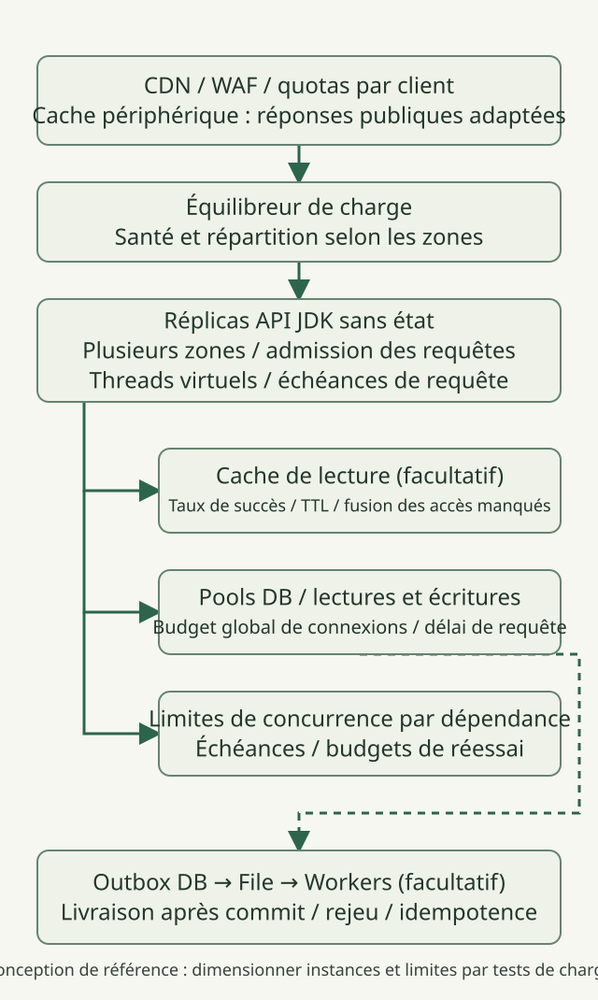
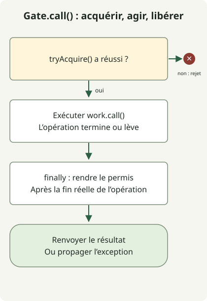

Une **API HTTP à 10 000 requêtes par seconde a besoin de budgets explicites de capacité pour les requêtes et dépendances, ainsi que d’un comportement de surcharge, avant d’avoir besoin d’un JDK plus récent**. Commencez par des réplicas API sans état répartis entre zones de disponibilité, des limites d’admission des requêtes et des limites de concurrence par dépendance. Ajoutez caches, files et réplicas de lecture selon les goulets mesurés et les exigences de cohérence. C’est un guide de conception aux calculs illustratifs, **pas le compte rendu d’un test de charge réussi à 10k RPS**.

Au 31 octobre 2026, la dernière version GA est [JDK 27](https://openjdk.org/projects/jdk/27/). Le code ci-dessous a été vérifié sur Temurin `27.0.1.0.2+1`. Distinguez nouveautés fonctionnelles et durée de support : la [feuille de route de support Oracle](https://www.oracle.com/java/technologies/java-se-support-roadmap.html) classe JDK 25 comme LTS et 27 comme non-LTS. Consultez les politiques de support des autres fournisseurs et la compatibilité des frameworks dans leurs propres documentations.

## Définir le périmètre des 10k et les critères de réussite

Ici, 10k signifie **des requêtes par seconde arrivant à l’équilibreur de charge de l’API**, hors accès statiques au CDN. Il ne s’agit ni de connexions concurrentes ni du nombre de threads virtuels. Enregistrez séparément les RPS proposés, les RPS aboutissant à un succès métier, les rejets et les échecs. Des réponses d’erreur rapides ne suffisent pas à établir la capacité.

Ces hypothèses illustrent les calculs. Ce ne sont ni des mesures d’un service réel ni des valeurs de configuration recommandées.

| Élément | Hypothèse illustrative |
| --- | --- |
| Cible de charge proposée | 10 000 RPS |
| Répartition lectures/écritures | 90% / 10% |
| Taux de succès du cache de lecture | 80% |
| Temps moyen de séjour dans l’API en régime stable | 50ms |
| Objectif de réponse | p99 inférieur à 200ms ; taux d’échec inférieur à 0.1% |
| Usage de la base | Un accès par lecture hors cache/écriture ; durée moyenne de détention de connexion de 10ms |

La [loi de Little](https://web.mit.edu/2.810/www/files/lectures/lec1-intro-2019.pdf#page=56), `L = λ × W`, s’applique aux **moyennes** sur un même périmètre dans un système stable. En supposant un débit normal de 10 000/s et un temps moyen de séjour de 0.05 seconde, on obtient environ 500 requêtes en cours en moyenne sur l’ensemble des instances. Ne remplacez pas ce temps par le p99 de 200ms pour calculer la concurrence moyenne, et ne transformez pas directement 500 en plafond strict. Les pics, les distributions de latence et la marge en cas de panne nécessitent une validation distincte.

Les accès à la base sont `9,000 × (1 − 0.8) + 1,000 = 2,800/s` ; le nombre moyen de connexions occupées est `2,800 × 0.01 = 28`. **Cela ne recommande pas un pool de taille 28.** Les instructions multiples, les verrous, les transactions et la panne du cache changent les hypothèses. Incluez aussi dans le budget de bande passante les octets de réponse, TLS, la réplication et la journalisation.

## Architecture de référence : répliquer horizontalement un petit service



Il s’agit d’une architecture proposée. L’exemple Java ci-dessous n’implémente que le principe du contrôle d’admission, pas toute l’infrastructure. Une cible de 10k RPS ne suffit pas à établir un besoin de microservices ou de partitionnement. Répliquez une application modulaire sans état, puis isolez les goulets révélés par les mesures.

- **Couche périphérique et équilibreur :** Bornez les débits de requêtes par client, les connexions, les tailles de corps de requête et les connexions lentes. Ne mettez au CDN que des réponses publiques adaptées ; concevez séparément les clés et le périmètre pour les données authentifiées. Utilisez des contrôles de santé et le drainage pour éloigner les nouvelles requêtes des réplicas non prêts.
- **Réplicas API :** Limitez le travail en cours à l’entrée des requêtes et utilisez les threads virtuels pour un code lisible d’E/S bloquantes. Les threads virtuels n’augmentent pas la capacité de la base et n’accélèrent pas les calculs CPU. Comme l’explique le [guide JDK 27](https://docs.oracle.com/en/java/javase/27/core/virtual-threads.html), contraignez séparément les ressources rares avec des mécanismes tels que les sémaphores.
- **Cache et base de données :** Un cache de lecture est facultatif. Testez l’étalement des TTL, la fusion des accès manqués simultanés et le trafic vers la base en cas de panne du cache. Examinez d’abord index, plans de requête et durée des transactions. N’utilisez des réplicas de lecture que là où le retard de réplication est acceptable.
- **Appels externes et travail asynchrone :** Donnez à chaque dépendance son propre budget de concurrence. Ne mettez en file que le travail qui n’a pas besoin de se terminer avant la réponse. Lorsque les écritures en base et la livraison de messages doivent être coordonnées, concevez une [outbox transactionnelle](https://docs.aws.amazon.com/prescriptive-guidance/latest/cloud-design-patterns/transactional-outbox.html) avec livraison réessayable et consommateurs idempotents. Les files sont aussi des ressources bornées : observez leur volume, l’âge du message le plus ancien et les échecs de traitement.

Concevez le rejet rapide et la protection des ressources comme un comportement normal d’exploitation, comme l’explique le [guide Google SRE sur la surcharge](https://sre.google/sre-book/handling-overload/). Une mise à l’échelle fondée uniquement sur le CPU peut manquer les blocages d’E/S ; observez ensemble requêtes en cours, taux de rejet, attentes d’acquisition de connexion et saturation des dépendances.

## Combien de réplicas et de connexions à la base ?

À matériel, tas, limites CPU du conteneur et répartition des requêtes fixés, mesurez `q_safe` : **le débit par réplica respectant le SLO et la marge opérationnelle convenue**. Cet article ne l’a pas mesuré.

Si des tests établissent réellement `q_safe = 2,500 RPS`, quatre réplicas couvrent arithmétiquement la cible normale. Cinq offrent un point de départ pour conserver 10k après la panne d’un réplica. Cela ne garantit pas la capacité en cas de perte d’une zone. Six réplicas, deux dans chacune de trois zones, en laissent quatre après la perte d’une zone et couvrent donc 10k sur le papier, mais la redistribution de l’équilibreur, le déséquilibre entre zones et le basculement base/cache doivent aussi être testés. Gardez une marge pendant la période précédant l’achèvement de l’autoscaling.

N’augmentez pas indépendamment les pools de base de chaque réplica. Pour chaque point d’accès à la base, maintenez `maximum simultaneously existing API replicas × per-replica pool limit + worker connections + operational reserve` dans son budget de connexions disponible. Comptez les réplicas qui se chevauchent pendant l’extension, les déploiements progressifs et les délais de grâce de terminaison. La [documentation PostgreSQL](https://www.postgresql.org/docs/18/runtime-config-connection.html) explique qu’augmenter `max_connections` accroît les allocations de ressources, y compris la mémoire partagée. Davantage de connexions ne corrige pas des requêtes lentes.

## Un exemple minimal d’admission sur threads virtuels



Le schéma suit `Gate.call()`. La méthode `main()` est une **démonstration de la sémantique d’admission sans serveur HTTP**, créant deux opérations et un rejet. La limite de deux sert au test, pas à configurer 10k RPS. Dans un vrai serveur, appliquez l’admission avant le travail coûteux et bornez aussi connexions, files du serveur et création de threads virtuels avant la barrière, via les contrôles périphériques et serveur.

### `AdmissionDemo.java`

```java
import java.util.concurrent.Callable;
import java.util.concurrent.CountDownLatch;
import java.util.concurrent.Executors;
import java.util.concurrent.RejectedExecutionException;
import java.util.concurrent.Semaphore;

public class AdmissionDemo {
    static final class Gate {
        private final Semaphore permits;
        Gate(int limit) {
            if (limit <= 0) throw new IllegalArgumentException("limit must be positive");
            permits = new Semaphore(limit);
        }
        <T> T call(Callable<T> work) throws Exception {
            if (!permits.tryAcquire()) throw new RejectedExecutionException("busy");
            try {
                return work.call();
            } finally {
                permits.release();
            }
        }
        int available() { return permits.availablePermits(); }
    }

    public static void main(String[] args) throws Exception {
        Gate gate = new Gate(2);
        CountDownLatch entered = new CountDownLatch(2);
        CountDownLatch release = new CountDownLatch(1);
        Callable<String> request = () -> gate.call(() -> {
            if (!Thread.currentThread().isVirtual()) throw new AssertionError("virtual thread required");
            entered.countDown();
            release.await();
            return "ok";
        });
        try (var tasks = Executors.newVirtualThreadPerTaskExecutor()) {
            var first = tasks.submit(request);
            var second = tasks.submit(request);
            try {
                entered.await();
                System.out.println("admitted=2");
                try {
                    gate.call(() -> "unexpected");
                    throw new AssertionError("capacity exceeded");
                } catch (RejectedExecutionException expected) {
                    System.out.println("overload=rejected");
                }
            } finally {
                release.countDown();
            }
            System.out.println("completed=" + first.get() + "," + second.get());
        }
        try {
            gate.call(() -> { throw new IllegalStateException("demonstration"); });
        } catch (IllegalStateException expected) {
            System.out.println("failure=propagated");
        }
        System.out.println("available=" + gate.available());
    }
}
```

```sh
javac --release 27 AdmissionDemo.java
java AdmissionDemo
```

Cette sortie a été observée avec `javac` et `java` de la même installation JDK 27. Aucune option de préversion n’est nécessaire.

```text
admitted=2
overload=rejected
completed=ok,ok
failure=propagated
available=2
```

L’échec de [`tryAcquire()`](https://docs.oracle.com/en/java/javase/27/docs/api/java.base/java/util/concurrent/Semaphore.html#tryAcquire()) rejette le travail au lieu de le mettre en file. `finally` rend le permis lorsque l’opération réelle se termine, et les exceptions se propagent à l’appelant. C’est **une limite de concurrence, pas un limiteur de requêtes par seconde**. Un adaptateur HTTP peut associer le rejet pour manque de capacité du service à une réponse comme 503, séparément des quotas par client. Ce code n’implémente ni correspondance de statuts HTTP, ni authentification, ni échéances, ni pools de base de données.

## Empêcher les échéances et les réessais d’amplifier la surcharge

Fixez une échéance de bout en bout et allouez le budget restant à l’acquisition en base, aux requêtes, à la connexion HTTP et aux lectures de réponse. Additionner les p99 des étapes ne donne pas le p99 de bout en bout. L’expiration chez un appelant n’arrête pas instantanément le travail réel en base ou HTTP ; vérifiez l’annulation par le pilote ou client et la restitution des ressources. Rendre un permis de concurrence alors que l’opération sous-jacente continue rompt la limite.

Réessayez à une seule couche avec un nombre borné de tentatives, une échéance globale, une attente exponentielle et de la gigue, en limitant les réessais aux erreurs adaptées et aux opérations dont l’idempotence est établie. Comme l’explique le [guide Amazon sur délais et réessais](https://aws.amazon.com/builders-library/timeouts-retries-and-backoff-with-jitter/), les réessais peuvent ajouter de la charge. Définissez d’abord la prévention des doublons et la consultation des résultats pour les paiements et commandes.

## Quels tests doivent réussir avant de revendiquer une capacité de 10k ?

Préparez le véritable serveur HTTP, des données proches de la production, TLS, l’authentification et les tailles de réponse, puis testez dans cet ordre.

1. Augmentez la charge sur un réplica pour établir `q_safe`. Enregistrez ensemble CPU, GC, allocations, sockets, verrous, attentes en base, RPS réussis et p99 de bout en bout.
2. Après préparation et préchauffage, augmentez le trafic proposé à toute l’architecture par étapes 1k→3k→5k→10k et maintenez la cible pendant une durée convenue. Incluez durée et distribution des données dans les résultats.
3. Avec un modèle de charge ouvert comme [k6 constant-arrival-rate](https://grafana.com/docs/k6/latest/using-k6/scenarios/executors/constant-arrival-rate/), ne faites correspondre 10 000 itérations/s à 10k RPS HTTP qu’après avoir confirmé **une requête HTTP par itération, redirections automatiques et réessais désactivés**. Vérifiez CPU et réseau du générateur, marge de VU et [dropped_iterations](https://grafana.com/docs/k6/latest/using-k6/scenarios/concepts/dropped-iterations/). Un test qui n’a jamais généré son entrée cible ne prouve pas la capacité du serveur.
4. Testez la perte de réplicas ou de zones, les caches froids ou défaillants, les bases et dépendances lentes, les déploiements progressifs et les pics. Excluez les réponses rejetées des succès métier et vérifiez la récupération, la vidange des files et les fuites de connexion après saturation.

Seuls le rejet à la barrière et la restitution de permis après des opérations normales ou en échec ont été exécutés pour cet article. L’architecture complète n’a pas subi de test de charge. Consultez la [comparaison des threads virtuels JDK 21/25](/en/posts/2026-10-31-virtual-threads-jdk21-jdk25/) et les [limites du contexte de requête ScopedValue](/en/posts/2026-10-31-jdk25-scopedvalue/) séparément de la validation d’une architecture de production.
