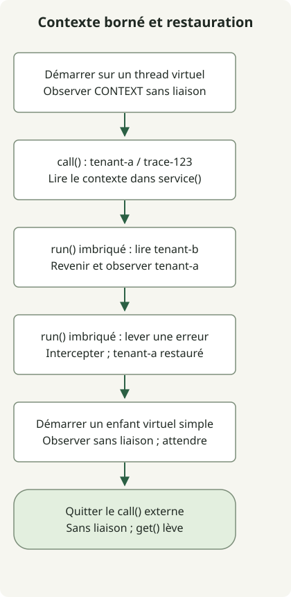

Dans JDK 25, **`ScopedValue` est une API finalisée pour lier des données, comme un contexte de requête, à une portée d’exécution bornée et les transmettre des appelants aux fonctions appelées**. Elle a été finalisée par la [JEP 506](https://openjdk.org/jeps/506), donc aucune option de préversion n’est nécessaire. Une liaison s’applique pendant l’exécution de l’opération fournie à `run()` ou `call()` ; une terminaison normale ou une exception rétablit l’état précédent.

## Quelle différence avec ThreadLocal ?

Envisagez cette API lorsque transmettre un identifiant de locataire ou de trace profondément dans le code de service imposerait sinon d’ajouter un paramètre à chaque méthode intermédiaire. Les paramètres ordinaires peuvent rester plus clairs lorsque la valeur est une entrée explicite de la logique métier.

[`ThreadLocal`](https://docs.oracle.com/en/java/javase/25/docs/api/java.base/java/lang/ThreadLocal.html) modifie la valeur du thread courant avec `set()` et la supprime avec `remove()`. Son usage à l’échelle d’une requête nécessite un nettoyage soigneux, généralement dans `finally`. Plutôt que de laisser une valeur définie, `ScopedValue` exécute l’opération qui en a besoin dans une liaison.

| Comparaison | ThreadLocal | ScopedValue |
| --- | --- | --- |
| Accès aux données | Lire et modifier une valeur stockée pour le thread courant | Lire la liaison dans la portée d’exécution dynamique courante |
| Fin de portée | Gérer explicitement le nettoyage propre à la requête | Restaurer la liaison précédente à la fin de `run()` ou de `call()` |
| Valeur différente dans une fonction appelée | `set()` peut modifier la valeur déjà stockée | Créer une nouvelle liaison dans une portée imbriquée, puis restaurer la valeur externe |
| Usages adaptés | Entre autres, état modifiable propre à un thread | Entre autres, contexte de requête transmis des appelants aux fonctions appelées |

`ScopedValue` ne remplace pas tous les usages de `ThreadLocal` et ne le rend pas obsolète. Un champ `private static final` stocke **une clé d’accès, pas la valeur du contexte elle-même**. La même clé peut donner accès à différentes valeurs selon le thread et la portée d’exécution.

## Observer la portée et la restauration dans un thread virtuel



Le schéma suit l’exemple ci-dessous. Le locataire externe est `tenant-a` ; la portée imbriquée lit `tenant-b`. L’échec d’une portée imbriquée est intercepté hors de celle-ci avant de vérifier la restauration. Cet exemple démontre la sémantique du contexte de requête sans serveur HTTP ni intégration à un framework.

Exécutez-le dans un répertoire où `javac` et `java` pointent vers la même installation JDK 25. L’environnement de vérification locale était Eclipse Temurin `25.0.5+8` sur macOS AArch64. `ScopedValue` appartient à `java.lang` et ne nécessite pas d’import explicite.

### `ScopedContextExample.java`

```java
import java.util.NoSuchElementException;
import java.util.concurrent.Executors;

public class ScopedContextExample {
    private static final ScopedValue<RequestContext> CONTEXT = ScopedValue.newInstance();
    record RequestContext(String tenant, String traceId) {}

    public static void main(String[] args) throws Exception {
        try (var tasks = Executors.newVirtualThreadPerTaskExecutor()) {
            tasks.submit(ScopedContextExample::handleRequest).get();
        }
    }

    private static String handleRequest() throws InterruptedException {
        System.out.println("virtual=" + Thread.currentThread().isVirtual());
        System.out.println("before=" + CONTEXT.isBound());
        String result = ScopedValue.where(CONTEXT,
                new RequestContext("tenant-a", "trace-123")).call(() -> {
            System.out.println("outer=" + service());
            ScopedValue.where(CONTEXT,
                    new RequestContext("tenant-b", "trace-123")).run(() ->
                System.out.println("nested=" + service()));
            System.out.println("restored=" + service());

            try {
                ScopedValue.where(CONTEXT,
                        new RequestContext("tenant-fail", "trace-123")).run(() -> {
                    throw new IllegalStateException("demonstration");
                });
            } catch (IllegalStateException expected) {
                System.out.println("after-failure=" + service());
            }

            Thread child = Thread.ofVirtual().start(() ->
                System.out.println("plain-child-bound=" + CONTEXT.isBound()));
            child.join();
            return service();
        });
        System.out.println("result=" + result);
        System.out.println("after=" + CONTEXT.isBound());
        try {
            CONTEXT.get();
        } catch (NoSuchElementException expected) {
            System.out.println("outside=" + expected.getClass().getSimpleName());
        }
        return result;
    }

    private static String service() {
        RequestContext context = CONTEXT.get();
        return context.tenant() + "/" + context.traceId();
    }
}
```

```sh
javac --release 25 ScopedContextExample.java
java ScopedContextExample
```

Cette sortie standard a été observée sans option de préversion. Appeler `get()` sur le `Future` propage les échecs de la tâche à l’appelant ; `join()` attend la sortie du thread enfant.

```text
virtual=true
before=false
outer=tenant-a/trace-123
nested=tenant-b/trace-123
restored=tenant-a/trace-123
after-failure=tenant-a/trace-123
plain-child-bound=false
result=tenant-a/trace-123
after=false
outside=NoSuchElementException
```

`service()` lit la liaison courante sans paramètre de contexte. Utilisez `run()` pour une opération sans résultat et [`Carrier.call()`](https://docs.oracle.com/en/java/javase/25/docs/api/java.base/java/lang/ScopedValue.Carrier.html#call(java.lang.ScopedValue.CallableOp)) pour une opération qui renvoie un résultat ou propage une exception. Créer simplement un `Carrier` avec `where()` n’active pas de liaison.

`restored` et `after-failure` montrent tous deux la valeur externe. Après la fin du `call()` externe, `isBound()` vaut false et un `get()` sans liaison lève `NoSuchElementException`. Quitter une liaison ne garantit ni la récupération immédiate de l’objet référencé par le ramasse-miettes ni la fermeture automatique d’une ressource `AutoCloseable`.

## Créer un thread virtuel lui fait-il hériter de la valeur ?

**Un appel ordinaire à `Thread.ofVirtual().start()` n’hérite pas automatiquement de la liaison de son parent.** L’exemple le démontre avec `plain-child-bound=false`. Ne supposez pas non plus que confier du travail à un `ExecutorService` ou à `CompletableFuture` propage automatiquement le contexte. Le premier thread virtuel de l’exemple établit sa liaison à l’intérieur de la tâche plutôt que d’en hériter.

Les [règles officielles d’héritage](https://docs.oracle.com/en/java/javase/25/docs/api/java.base/java/lang/ScopedValue.html#inheritance) décrivent la capture des liaisons à la création d’un `StructuredTaskScope` et leur héritage par les enfants démarrés via le `fork()` de cette portée. **La concurrence structurée est une API de préversion distincte dans JDK 25**, couverte par la [JEP 505](https://openjdk.org/jeps/505), et n’est pas utilisée par le code de cet article. N’interprétez pas l’exemple comme une vérification de ce mécanisme d’héritage.

## Limites à considérer pour adopter un contexte de requête

Une liaison non modifiable ne rend pas son objet référencé profondément immuable. L’exemple utilise un record contenant deux chaînes ; une collection modifiable nécessiterait une conception distincte de la concurrence. Limitez aussi l’accès à la clé.

Consultez l’API JDK 25 plutôt que de recopier sans adaptation d’anciens exemples de préversion de JDK 21 ou de versions similaires. En particulier, JDK 25 n’autorise pas `orElse(null)`. Une liaison à `null` est également distincte de l’absence de liaison.

Distinguez d’abord un `ThreadLocal` qui transmet les données de requête dans la chaîne d’appels d’un autre qui maintient un état modifiable pendant l’exécution. Pour le premier, concevez à la fois la liaison au point d’entrée et les frontières asynchrones. Les transactions des frameworks, le MDC et le contexte de sécurité ne sont pas reliés automatiquement ; cet exemple ne vérifie ni ces intégrations ni les performances. Consultez l’[article sur les fonctionnalités du JDK 21](/en/posts/2023-09-20-jdk-21-release/) pour le comportement des threads virtuels eux-mêmes.
