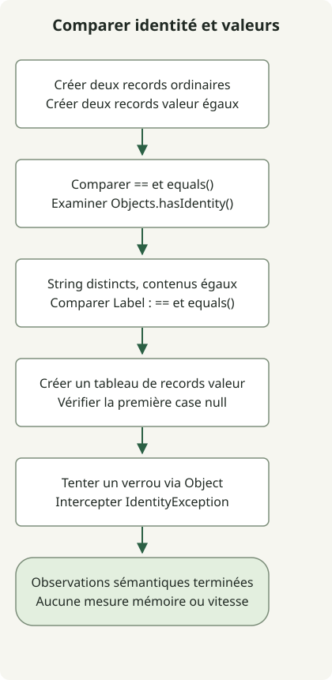

Project Valhalla est **un projet OpenJDK permettant aux données qui n’ont pas besoin d’identité d’objet d’utiliser des objets valeur, ce qui donne à la JVM davantage de liberté pour les stocker et les transmettre efficacement**. Vérifiées le 31 octobre 2026, la [page du projet](https://openjdk.org/projects/valhalla/) et la [JEP 401](https://openjdk.org/jeps/401) indiquent que la première préversion des objets valeur est intégrée au JDK 28. Cette fonctionnalité n’est pas finalisée. L’exemple ci-dessous a été exécuté sur JDK 28 EA Build 21.

## Pourquoi des classes valeur alors que Java a déjà les records ?

Les objets ordinaires ont une identité même lorsque leurs champs correspondent. Les comptes modifiables et les objets de verrouillage ont besoin de cette distinction, mais une donnée comme une coordonnée `(3, 4)` peut n’avoir besoin que de sa valeur.

Un [`record`](https://docs.oracle.com/en/java/javase/17/language/records.html) déclare des composants de données et fournit des accesseurs, des constructeurs et des méthodes comme `equals()`. Les records ordinaires existants permettent toujours à `==` de distinguer deux objets construits séparément avec des composants correspondants. Le modificateur `value` fait un choix distinct : supprimer l’identité d’objet. Il peut être combiné aux records sous la forme `value record`.

| Déclaration | Signification dans cet exemple |
| --- | --- |
| `record IdentityPoint(int x, int y)` | Conserve des identités d’objet distinctes même lorsque les composants correspondent |
| `value record ValuePoint(int x, int y)` | Les instances de la même classe ayant le même état de champs ne se distinguent pas par leur identité |
| `value record Label(String text)` | N’a pas d’identité, mais `==` et `equals()` ne donnent pas nécessairement le même résultat |

Les champs d’instance d’une classe valeur sont `final`. Cela ne rend pas automatiquement les objets référencés profondément immuables : une collection modifiable stockée dans un champ peut toujours changer de contenu. Les objets valeur restent manipulés par des références d’objet ; ils ne deviennent pas des types primitifs.

## Essayer la préversion du JDK 28



Le schéma suit le code ci-dessous. `Label` contient des objets `String` distincts au contenu identique pour mettre en évidence la comparaison des champs de référence. Enfin, le programme vérifie que placer un objet valeur dans une variable `Object` n’en fait pas un moniteur valide, et gère l’exception attendue.

Utilisez un répertoire d’expérimentation distinct où `javac` et `java` pointent vers le même build [JDK 28 EA](https://jdk.java.net/28/). Comparez le téléchargement à sa valeur SHA-256 officielle et confirmez le build avec `java --version`. JDK 17 et 21 ne peuvent pas compiler cette syntaxe. Les options de préversion sont nécessaires à la compilation comme à l’exécution.

### `ValhallaExample.java`

```java
import java.util.Objects;

public class ValhallaExample {
    record IdentityPoint(int x, int y) {}
    value record ValuePoint(int x, int y) {}
    value record Label(String text) {}

    public static void main(String[] args) {
        IdentityPoint a = new IdentityPoint(3, 4);
        IdentityPoint b = new IdentityPoint(3, 4);
        ValuePoint p = new ValuePoint(3, 4);
        ValuePoint q = new ValuePoint(3, 4);
        System.out.println("record == " + (a == b));
        System.out.println("record equals " + a.equals(b));
        System.out.println("value == " + (p == q));
        System.out.println("value equals " + p.equals(q));
        System.out.println("record identity " + Objects.hasIdentity(a));
        System.out.println("value identity " + Objects.hasIdentity(p));

        Label first = new Label(new String(new char[] {'x'}));
        Label second = new Label(new String(new char[] {'x'}));
        System.out.println("label == " + (first == second));
        System.out.println("label equals " + first.equals(second));

        ValuePoint[] points = new ValuePoint[1];
        System.out.println("array slot null " + (points[0] == null));
        Object monitor = p;
        try {
            synchronized (monitor) {
                throw new AssertionError("A value object must not be a monitor");
            }
        } catch (IdentityException expected) {
            System.out.println("monitor " + expected.getClass().getSimpleName());
        }
    }
}
```

```sh
javac --enable-preview --release 28 ValhallaExample.java
java --enable-preview ValhallaExample
```

Cette sortie a été observée sur OpenJDK `28-ea+21-1707` pour macOS AArch64. L’avertissement de préversion du compilateur est distinct de cette sortie standard.

```text
record == false
record equals true
value == true
value equals true
record identity true
value identity false
label == false
label equals true
array slot null true
monitor IdentityException
```

Les records ordinaires renvoient true pour `equals()` mais false pour `==`. Les records valeur n’ont que des champs entiers ; leur état de champs identique rend donc les deux comparaisons vraies. [`Objects.hasIdentity()`](https://download.java.net/java/early_access/jdk28/docs/api/java.base/java/util/Objects.html#hasIdentity(java.lang.Object)) expose aussi cette distinction.

## Faut-il comparer les objets valeur avec == ?

Continuez à utiliser `equals()` pour l’égalité métier. Pour les objets valeur, `==` compare l’état des champs au sein de la même classe valeur et applique récursivement `==` aux champs de référence. Les objets référencés ayant une identité restent distincts lorsqu’il s’agit d’objets séparés, même si leur contenu correspond. Les champs primitifs sont comparés par leur représentation binaire, ce qui peut aussi différer de l’égalité sémantique des nombres flottants. Consultez les [règles de comparaison des objets valeur de la JEP 401](https://openjdk.org/jeps/401#Comparing-value-objects) pour les règles précises.

Les deux objets `Label` contiennent des chaînes de même contenu : leur méthode `equals()` générée pour le record renvoie donc true. Leurs chaînes sont des objets à identité distincts : `==` renvoie donc false. N’interprétez pas `value` comme imposant à chaque champ de référence une comparaison par contenu.

La case du nouveau tableau de valeurs est `null`, et utiliser dynamiquement un objet valeur comme moniteur lève `IdentityException`. Verrouiller directement une expression dont le type est clairement une classe valeur peut en revanche être rejeté à la compilation. Vérifiez les usages sensibles à l’identité, comme les verrous et les caches fondés sur l’identité, avant la migration.

## Cela économise-t-il immédiatement de la mémoire ou permet-il `List<int>` ?

Supprimer l’identité donne à la JVM davantage de latitude pour l’**aplatissement**, qui représente une référence par l’état de ses champs plutôt que par un pointeur, et la **scalarisation**, qui transmet les valeurs sous forme de composants séparés dans des registres et des emplacements similaires. Le langage ne garantit ni une disposition particulière, ni la suppression d’allocations, ni un gain de vitesse. La sortie ci-dessus vérifie la sémantique ; elle ne mesure ni l’usage du tas ni le débit.

Valhalla s’étend sur plusieurs versions du JDK. La [feuille de route officielle](https://openjdk.org/projects/valhalla/) distingue les objets valeur du stockage sans null, des améliorations des tableaux, de l’unification des primitifs et des classes, et de la JVM paramétrique pour la spécialisation des génériques. JEP 401 seule ne réalise pas entièrement `List<int>` et ne garantit pas un stockage contigu pour chaque tableau. La [JEP 539](https://openjdk.org/jeps/539) associée fournit le support JVM de l’initialisation stricte des champs ; elle n’ajoute pas de modificateur de champ `strict` arbitraire au code source Java.

Commencez les expériences avec de petits types de données, comme des coordonnées ou des montants, qui n’ont pas besoin d’identité, en comparant le comportement sur le même build. Vérifiez les dépendances aux frameworks, à la sérialisation et aux verrous, puis mesurez allocations, GC et débit sur des charges représentatives avant d’évaluer le bénéfice. Ne traitez pas cette préversion comme une fonctionnalité finalisée et prise en charge lors du choix d’un JDK de production. Consultez le [guide des fonctionnalités du JDK](/en/posts/2023-09-20-jdk-21-release/) pour la distinction entre fonctionnalités finales et en préversion.
