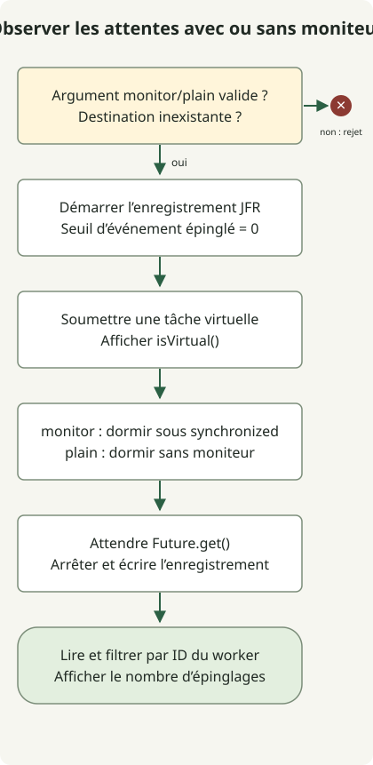

Les threads virtuels sont **des threads Java qui permettent à de nombreuses tâches de partager un ensemble plus réduit de threads du système pendant les attentes d’E/S**. Ils sont devenus définitifs dans JDK 21 par la [JEP 444](https://openjdk.org/jeps/444), et JDK 25 conserve les mêmes API de base. Une différence importante concerne l’épinglage pendant un blocage dans `synchronized` : la [JEP 491](https://openjdk.org/jeps/491) l’a amélioré dans JDK 24, et JDK 25 inclut cette amélioration.

## Qu’est-ce qui devient léger ?

Un thread virtuel a toujours besoin d’un thread système pour s’exécuter. La JVM appelle **porteur** le thread de plateforme qui l’exécute. Lorsqu’une opération bloquante prise en charge permet au thread virtuel de se détacher, le porteur peut exécuter un autre thread virtuel.

Cela aide le traitement des requêtes comportant de nombreuses attentes concurrentes. Cela n’accélère pas les calculs CPU et ne réduit pas automatiquement la latence d’une requête individuelle. Le [guide officiel d’adoption](https://docs.oracle.com/en/java/javase/25/core/virtual-threads.html) recommande un thread virtuel par tâche et déconseille de réutiliser les threads virtuels dans un petit pool. La capacité des connexions à la base de données et les quotas d’API externes ne croissent pas avec le nombre de threads ; limitez ces ressources séparément avec des mécanismes tels que sémaphores et pools de connexions.

## Différences entre JDK 21 et 25

| Domaine | JDK 21 | JDK 25 |
| --- | --- | --- |
| API de threads virtuels | Finales ; aucune option de préversion | Finales ; API de création de base conservées |
| Blocage dans `synchronized` | Peut épingler le porteur et limiter le passage à l’échelle | Inclut l’amélioration du JDK 24 apportée par JEP 491 |
| Suppression de tout épinglage | Non | Non ; il reste des chemins comme du code natif rappelant du Java qui bloque |
| Diagnostic | JFR et mécanismes comme `jdk.tracePinnedThreads` | JFR conservé et enrichi ; `jdk.tracePinnedThreads` n’a aucun effet |
| `ScopedValue` | Préversion | Final par JEP 506 |
| Concurrence structurée | Préversion | Toujours une préversion distincte ; ne supposez pas la compatibilité avec les anciennes API |

Lisez ensemble le [guide JDK 21](https://docs.oracle.com/en/java/javase/21/core/virtual-threads.html), JEP 491 et l’[article ScopedValue](/en/posts/2026-10-31-jdk25-scopedvalue/) pour distinguer ces changements. La finalisation des threads virtuels, de ScopedValue et de la concurrence structurée ne suit pas un calendrier commun unique.

L’épinglage empêche un thread virtuel en attente de libérer son porteur. Dans JDK 25, l’usage ordinaire de `synchronized` ne justifie pas à lui seul de remplacer chaque moniteur par `ReentrantLock`. Toutefois, **libérer un porteur diffère de libérer un verrou de moniteur**. Des E/S lentes dans `synchronized` empêchent toujours les autres tâches d’acquérir ce verrou : la taille des sections critiques et la contention restent donc importantes.

## Observer le même code avec JFR



Le code compare un mode `monitor`, qui exécute `Thread.sleep(100)` dans `synchronized`, à un mode `plain`, qui dort sans ce bloc. Il n’effectue aucune véritable requête réseau ou de base de données. Il fixe le seuil d’événement à zéro avec [Recording](https://docs.oracle.com/en/java/javase/21/docs/api/jdk.jfr/jdk/jfr/Recording.html), puis utilise [RecordingFile](https://docs.oracle.com/en/java/javase/21/docs/api/jdk.jfr/jdk/jfr/consumer/RecordingFile.html) pour compter uniquement les événements du thread de travail.

Pour chaque JDK, enregistrez le fichier dans un nouveau répertoire et utilisez `javac` et `java` de la même installation. Un JDK HotSpot incluant JFR est nécessaire ; aucune option de préversion n’est utilisée. Le programme crée `monitor.jfr` et `plain.jfr` et refuse de s’exécuter si le fichier de destination existe déjà.

### `VirtualThreadProbe.java`

```java
import java.nio.file.Files;
import java.nio.file.Path;
import java.time.Duration;
import java.util.concurrent.Executors;
import jdk.jfr.Recording;
import jdk.jfr.consumer.RecordingFile;

public class VirtualThreadProbe {
    public static void main(String[] args) throws Exception {
        if (args.length != 1 || !(args[0].equals("monitor") || args[0].equals("plain"))) {
            throw new IllegalArgumentException("Usage: VirtualThreadProbe monitor|plain");
        }
        String mode = args[0];
        Path destination = Path.of(mode + ".jfr");
        if (Files.exists(destination)) {
            throw new IllegalStateException("Use a new directory: recording already exists");
        }
        Object monitor = new Object();
        long workerId;
        try (var recording = new Recording()) {
            recording.enable("jdk.VirtualThreadPinned").withThreshold(Duration.ZERO);
            recording.start();
            try (var tasks = Executors.newVirtualThreadPerTaskExecutor()) {
                workerId = tasks.submit(() -> {
                    Thread current = Thread.currentThread();
                    System.out.println("virtual=" + current.isVirtual());
                    if (mode.equals("monitor")) {
                        synchronized (monitor) { Thread.sleep(100); }
                    } else {
                        Thread.sleep(100);
                    }
                    return current.threadId();
                }).get();
            }
            recording.stop();
            recording.dump(destination);
        }
        long pinnedEvents = 0;
        try (var events = new RecordingFile(destination)) {
            while (events.hasMoreEvents()) {
                var event = events.readEvent();
                if (event.getEventType().getName().equals("jdk.VirtualThreadPinned")
                        && event.getThread() != null
                        && event.getThread().getJavaThreadId() == workerId) {
                    pinnedEvents++;
                }
            }
        }
        System.out.println(mode + "-pinned-events=" + pinnedEvents);
    }
}
```

```sh
javac --release 21 VirtualThreadProbe.java
java VirtualThreadProbe monitor
java VirtualThreadProbe plain
```

Cette sortie a été observée sur Eclipse Temurin `21.0.13+9` pour macOS AArch64.

```text
virtual=true
monitor-pinned-events=1
virtual=true
plain-pinned-events=0
```

Eclipse Temurin `25.0.5+8` sur la même plateforme a produit :

```text
virtual=true
monitor-pinned-events=0
virtual=true
plain-pinned-events=0
```

`Future.get()` attend la fin et propage les échecs de la tâche à l’appelant. L’enregistrement est arrêté et écrit avant sa lecture ; l’agrégation n’entre donc pas en concurrence avec un enregistrement actif. Le nombre de porteurs n’a pas été contraint et les durées totales d’exécution n’ont pas été comparées. Les nombres d’événements décrivent cette seule tâche ; ne généralisez pas les nombres exacts à d’autres JVM, correctifs ou conditions d’instrumentation sans vérification.

## Que faut-il encore vérifier après une mise à niveau ?

L’absence d’événements sur JDK 25 s’applique précisément à **l’attente dans un moniteur de cet exemple**. Elle ne vérifie pas les chemins restants impliquant des appels natifs, des appels de fonctions étrangères ou l’initialisation de classes. Définir `-Djdk.tracePinnedThreads=full`, utile dans JDK 21, n’a aucun effet dans JDK 25 ; utilisez plutôt les événements JFR et les instantanés de threads propres à cette version.

Commencez l’adoption par des charges dominées par l’attente d’E/S et examinez ensemble les pools de base de données, la concurrence des appels externes, les délais et l’annulation. Les calculs CPU intensifs, les longues sections critiques et les gros caches par thread peuvent rester des goulets. Mesurez débit, latence dans la queue de la distribution, mémoire et contention des verrous sous une charge de production représentative ; ne calculez pas un ratio d’amélioration des performances depuis ce petit programme d’observation. Pour le contexte associé à l’exécution sur thread virtuel, poursuivez avec les règles de liaison et de frontières asynchrones de l’article ScopedValue.
