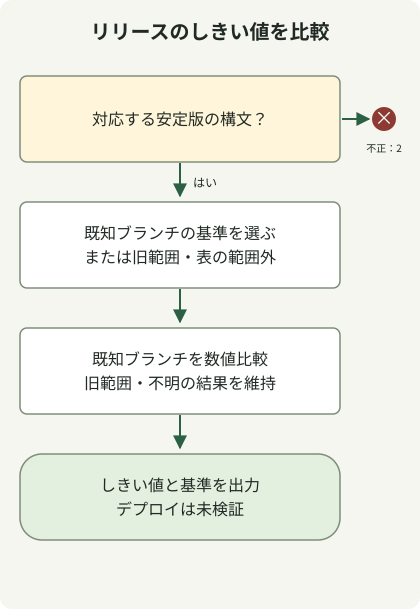

GitLab2Shellへの対処では、**GitLab CE/EEをCVE-2026-110264の修正リリースへアップグレードし、デプロイ先への適用を検証します**。[GitLabの10月21日付アドバイザリ](https://docs.gitlab.com/releases/patches/patch-release-gitlab-19-5-1-released/)は、正規表現コンパイル中の整数オーバーフローにより、特定の条件で認証なしのリモートコード実行が可能になると説明しています。GitLab ShellやRunnerだけを更新しても、CE/EEサーバーへの対処は完了しません。

## 最初にCVEと製品バージョンを対応付ける

この記事は、GitLabの公式通知にある**CVE-2026-110264**を扱います。評価は10.0（CVSS v3.1）です。同時期に公開された他のGitLab CVEや、似た名前のShellコンポーネントと区別してください。[GitLabが作成したCVEレコード](https://cveawg.mitre.org/api/cve/CVE-2026-110264)も、同じ影響範囲と修正のしきい値を記録しています。

| GitLab CE/EEブランチ | このCVEを修正した最初のリリース |
| --- | --- |
| 18.11 | 18.11.13 |
| 19.0 | 19.0.10 |
| 19.1 | 19.1.9 |
| 19.2 | 19.2.9 |
| 19.3 | 19.3.6 |
| 19.4 | 19.4.3 |
| 19.5 | 19.5.1 |

通知は、7.0から18.11.13未満までと、表にある各ブランチの最初の修正リリースより前を影響対象としています。この表は2026年10月30日に確認した**最初の修正のしきい値**であり、インストールすべき最新バージョンを固定した一覧ではありません。GitLab.comとGitLab Dedicatedについては、通知に別の適用情報があります。Self-Managed向けのアップグレード手順を、これらのサービスへ無差別に適用しないでください。

## 申告されたバージョン文字列をオフラインで比較する



図は以下の比較コードに対応しています。登録されたブランチを比較する前に、入力を検証します。影響を受ける古いブランチにはアップグレード経路が必要で、表にないブランチは不明のままです。どの結果も、サーバーの状態やパッチの出自を認証するものではありません。

Python 3.11以降で、新しいディレクトリにこのファイルを保存します。ネットワークリクエスト、サービス検出、悪用を行わず、公式の上流CE/EEリリースバージョンの数値比較を補助します。`19.5.1`、`19.5.1-ee`、`19.5.1-ee.0`などを受け付けますが、プレリリース、ナイトリー、供給元独自の形式を推測しません。

### `release-threshold.py`

```python
import re
import sys

FIRST_FIX = {
    (18, 11): 13,
    (19, 0): 10,
    (19, 1): 9,
    (19, 2): 9,
    (19, 3): 6,
    (19, 4): 3,
    (19, 5): 1,
}
NUMBER = r"(0|[1-9][0-9]{0,2})"
VERSION = rf"{NUMBER}\.{NUMBER}\.{NUMBER}(?:-(?:ce|ee)(?:\.[0-9]{{1,3}})?)?"


def main(argv):
    match = re.fullmatch(VERSION, argv[1]) if len(argv) == 2 else None
    if match is None:
        print("usage: release-threshold.py VERSION (stable CE/EE release format)", file=sys.stderr)
        return 2
    major, minor, patch = map(int, match.groups())
    branch = (major, minor)
    if branch in FIRST_FIX:
        baseline = f"{major}.{minor}.{FIRST_FIX[branch]}"
        state = "met" if patch >= FIRST_FIX[branch] else "below"
        status = 0 if state == "met" else 1
    elif (7, 0) <= branch < (18, 11):
        baseline, state, status = "upgrade-path-required", "below", 1
    else:
        baseline, state, status = "not-covered", "outside-table", 2
    print(f"release-threshold={state}")
    print(f"baseline={baseline}")
    print("deployment-and-release-provenance=not-verified")
    return status


if __name__ == "__main__":
    raise SystemExit(main(sys.argv))
```

```sh
python3 release-threshold.py 19.5.1-ee.0
```

ローカルでの実行では、以下の出力と終了ステータス0が返りました。

```text
release-threshold=met
baseline=19.5.1
deployment-and-release-provenance=not-verified
```

ステータス0は、**入力された数値が、このCVEで公表された修正のしきい値を満たす**ことだけを意味します。ステータス1は公表されたしきい値未満、ステータス2は未対応の形式または表にないブランチを意味します。リリースの実在、パッケージが公式かどうか、ノードがそのバージョンを実行しているかは確認しません。バックポートや独自ビルドには、供給元による別のパッチ証拠が必要です。

## インストールの証拠と稼働中の適用を結び付ける

[公式の保守ドキュメント](https://docs.gitlab.com/administration/raketasks/maintenance/)では、Linuxパッケージは`sudo gitlab-rake gitlab:env:info`、ソースインストールは`bundle exec rake gitlab:env:info RAILS_ENV=production`を使って、GitLab、Ruby、コンポーネントの情報を収集する方法を説明しています。複数ノードの環境では、Railsをホストするノードで実行します。出力には内部パスやアドレスが含まれ得るため、アクセスを制限した運用記録で管理してください。

この記事では、これらのコマンドを本番サーバーに対して実行していません。実際の対処では、情報を完全なパッケージリビジョン、デプロイ済みイメージダイジェスト、各Web・バックグラウンドノードと結び付け、アップグレード後に全対象への適用を検証します。一つのHTTPバナーや別ノードのコマンド出力は、デプロイ全体の証拠にはなりません。

## 現行のパッチを選び、移行を完了する

インストール済みバージョンから[公式のアップグレード経路](https://docs.gitlab.com/update/upgrade_paths/)をたどり、必須の各中間バージョンでバックグラウンド移行の完了を待ってから先に進みます。古い環境では、表の最も高いバージョンへ直接移行できない場合があります。バックアップと復旧、拡張機能の互換性、停止時間、複数ノードの手順をまとめて計画します。

最初の修正と現行のパッチを区別してください。[10月29日のパッチ通知](https://docs.gitlab.com/releases/patches/patch-release-gitlab-19-5-3-released/)は、19.5.3と19.4.5などの後続リリースと一部のデータベース移行を挙げ、19.5.2と19.4.4はスキップしたと明記しています。スクリプトはリリース一覧を照会しないため、それらの文字列でも数値比較を行います。実際のインストール候補は、必ず公式配布記録から選んでください。

アップグレード後は、稼働バージョン、移行完了、通常のログイン、リポジトリアクセス、ジョブ処理を個別に確認します。アドバイザリにあるOnigmoワーカーのクラッシュとOrg-mode描画エラーの急増は、調査の手掛かりです。どちらも単独では侵害を証明も否定もしません。ログ、プロセス、デプロイの証拠を保全し、侵害が疑われる場合は別に調査します。

同時期のJava証明書への対処は別の問題です。JDKを使用するビルド・連携サービスでは、[eMudhraとJVMトラストストアの確認](/en/posts/2026-10-30-jdk-emudhra-truststore/)も参照してください。
