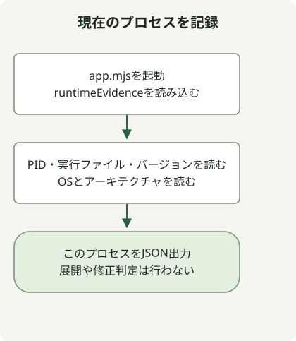

Node2Shellへの対処では、Node.jsを修正済みランタイムに置き換え、信頼できないBrotliデータを展開するすべてのワーカーへの適用を検証します。[Node.jsのセキュリティアドバイザリ](https://nodejs.org/en/blog/vulnerability/october-2026-security-releases)は、**CVE-2026-111497**を、同梱Brotliデコーダーの範囲外書き込みとしています。npmパッケージの更新とランタイムの置き換えは別の作業です。

## Brotliの利用はすべて同じ影響を受けますか？

関係する経路は、圧縮入力を**展開**するものです。攻撃者が供給した不正なBrotliデータを`node:zlib`で処理すると、プロセスメモリが破損し、クラッシュ、メモリ情報の漏えい、リモートコード実行につながる可能性があります。送信応答をBrotliで圧縮することや、HTTP/2を有効にすることだけでは、その経路の存在を示せません。Node.jsプロジェクトは、この問題をHighに分類しています。

リクエスト本文に加え、外部HTTP応答、アップロード、ファイル、キュージョブの自動展開も追跡します。たとえば、[body-parserのドキュメント](https://expressjs.com/en/resources/middleware/body-parser/)には、Brotliの自動展開が記載されています。インストール済みミドルウェアのバージョンとオプションを確認してください。アプリケーションコードに`brotliDecompress`が見つからなくても、影響を受けないとは示せません。バックグラウンドジョブは、インターネットに公開された待ち受けポートがなくても外部データを展開できます。

## どのNode.jsリリースに修正が含まれますか？

以下の表は、2026年10月30日に確認した、このCVEの修正を含む公式セキュリティリリースです。最新の推奨バージョンを固定するものではありません。デプロイ時には、同じ供給元のサポート対象リリースと追加通知を確認してください。

| Node.jsブランチ | 公式の修正済みリリース |
| --- | --- |
| 22.x | [22.23.4](https://nodejs.org/en/blog/release/v22.23.4) |
| 24.x | [24.22.1](https://nodejs.org/en/blog/release/v24.22.1) |
| 26.x | [26.12.1](https://nodejs.org/en/blog/release/v26.12.1) |

ディストリビューション、組み込み製品、独自ビルドでは、供給元の完全なパッケージリビジョンと修正の証拠を使用します。これらの数値のしきい値を別のメジャーブランチに適用しないでください。Node.jsのアドバイザリは、サポート終了済みのブランチも影響対象としています。表にないことは安全性の根拠になりません。

特に、`process.versions.brotli`だけでは不十分です。[修正済みNode.js 24.22.1のBrotliバージョンソース](https://github.com/nodejs/node/blob/v24.22.1/deps/brotli/c/common/version.h)には、引き続き`1.2.0`と宣言されています。[リリース記録](https://nodejs.org/en/blog/release/v24.22.1)は、チェリーピックされた修正を明記しています。ライブラリの表示に頼らず、修正済みランタイム成果物の出自を確認します。

## プロセス自体から証拠を記録する



図は、以下のサンプルアプリケーションの起動に対応しています。同じプロセス内の情報を読み取り、バージョン比較、サービス検出、修正状況の判定を行わずにJSONを出力します。新しいCLI呼び出しの出力は、既存サービスから得た証拠の代わりにはなりません。

Node.js 22以降で、新しいディレクトリに次の二つのファイルを保存します。[processリファレンス](https://nodejs.org/docs/latest-v24.x/api/process.html)に記載されたプロパティを読み取り、ネットワークリクエスト、展開、環境変数の出力は行いません。

### `runtime-evidence.mjs`

```javascript
export function runtimeEvidence() {
  return {
    scope: 'this-process-only',
    pid: process.pid,
    executable: process.execPath,
    node: process.version,
    brotliLabel: process.versions.brotli ?? null,
    platform: process.platform,
    arch: process.arch,
  };
}
```

### `app.mjs`

```javascript
import {runtimeEvidence} from './runtime-evidence.mjs';

console.log(JSON.stringify(runtimeEvidence(), null, 2));
```

```sh
node app.mjs
```

ローカルでの確認には公式のNode.js 24.22.1コンテナを使用し、`node`が`v24.22.1`、`brotliLabel`が`1.2.0`のJSONが返りました。PID、パス、OS、アーキテクチャは環境によって異なります。これは、修正済みビルドにも古いBrotli表示が残り得ることを示すものであり、悪用や本番デプロイをテストしたものではありません。

実際のサービスでは、デプロイ手順を通して同等の起動ログを導入し、その運用ログへのアクセスを制限します。記録とサービスマネージャー、プロセス、イメージダイジェストを対応付けます。パスやPIDを公開HTTP応答に含めるべきではありません。別の診断プロセスを起動しても、既存ワーカーの置き換えは検証できません。

## パッケージのインストール後に何が残りますか？

1. 各サービスのNode.js実行ファイル、供給元、完全なパッケージバージョンまたはイメージダイジェスト、プロセス、ワーカー、レプリカを記録します。ホストの`node -v`やDockerfileのタグだけでは、稼働コンテナのランタイムを確定できません。
2. 入力をBrotliデコーダーへ接続するライブラリを追跡します。ランタイムの修正状況と入力の影響範囲を分けて扱います。調査範囲内で展開経路が見つからなくても、未修正ランタイムにパッチが適用されるわけではありません。
3. 信頼できる経路から互換性のある修正済みランタイムを入手します。コンテナイメージを再ビルドして展開し、プロセスマネージャーやマネージドプラットフォームが実際に使用する実行ファイルも置き換えます。システムのBrotliライブラリ更新で、同梱コピーも置き換わるとは仮定しないでください。
4. すべてのワーカーとレプリカで新たな稼働証拠を検証し、通常のAPI呼び出し、外部応答の処理、バックグラウンドジョブ、エラー率を確認します。インストールファイルの置き換えや、古いレプリカを残した状態は、適用を検証できたことにはなりません。

パッチ適用が遅れる場合は、実際のデータ経路で、信頼できないBrotli展開を拒否または迂回することを検討します。`br`を`Accept-Encoding`から除くだけでは、すべての入力経路を遮断できません。正常データの圧縮・展開の往復が成功したことや、`npm audit`に問題がないことも、このCVEが修正済みである根拠にはなりません。

## PHP2Shellと同じ問題ですか？

別の欠陥です。PHP2Shellの二つのCVEはPHPエンジンのリクエスト状態に関わり、Node2ShellはBrotliデコーダーに関わります。ただし、同じBrotli CVEが他の製品にも現れる可能性があるため、製品ごとのアドバイザリに従ってください。[PHP2Shell対応ガイド](/en/posts/2026-10-30-php2shell-runtime-patching/)では、PHPのWindows向けBrotli再ビルドとPHPエンジンの修正の違いを説明しています。

クラッシュだけでは侵害を証明できず、痕跡がないことも侵害を否定する根拠にはなりません。侵害が疑われる場合は、アクセスを制限した場所に証拠を保全し、パッチ適用とは別に調査または信頼できるソースからの再構築を行います。
