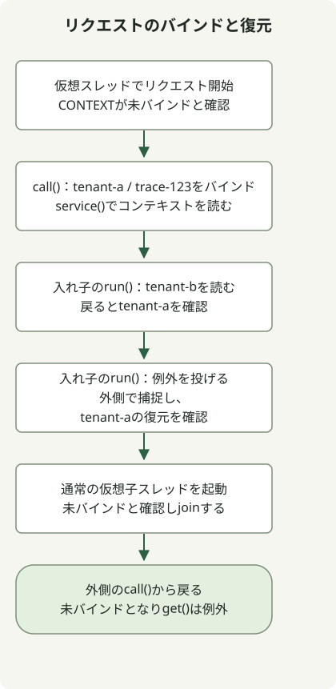

JDK 25では、**`ScopedValue`は、リクエストコンテキストなどのデータを限定された実行スコープへ結び付け、呼び出し元から呼び出し先へ渡すための確定済みAPI**です。[JEP 506](https://openjdk.org/jeps/506)で確定したため、プレビューフラグは不要です。バインディングは`run()`または`call()`へ渡した処理の実行中に有効で、正常終了でも例外でも以前の状態へ戻ります。

## ThreadLocalとはどう違いますか？

テナントIDやトレースIDをサービスコードの深い場所へ渡す際、途中のすべてのメソッドに引数を追加する必要がある場合に検討します。その値が業務ロジックの明示的な入力なら、通常の引数のほうが分かりやすい場合もあります。

[`ThreadLocal`](https://docs.oracle.com/en/java/javase/25/docs/api/java.base/java/lang/ThreadLocal.html)は、`set()`で現在のスレッドの値を変更し、`remove()`で削除します。リクエストスコープで使う場合は、通常`finally`で慎重に後始末する必要があります。`ScopedValue`は、値を設定したままにする代わりに、その値を必要とする処理をバインディング内で実行します。

| 比較項目 | ThreadLocal | ScopedValue |
| --- | --- | --- |
| データアクセス | 現在のスレッドに保存された値を読み書きします | 現在の動的実行スコープのバインディングを読みます |
| スコープ終了 | リクエスト単位の後始末を明示的に管理します | `run()`または`call()`の終了時に以前のバインディングへ戻します |
| 呼び出し先で異なる値を使う | `set()`で既存の保存値を変更できます | 入れ子のスコープで再バインドし、その後外側の値へ戻します |
| 適した用途 | スレッドごとの変更可能な状態などです | 呼び出し元から呼び出し先へ渡すリクエストコンテキストなどです |

`ScopedValue`は`ThreadLocal`のすべての用途を置き換えるものでも、非推奨にするものでもありません。`private static final`フィールドに保存されるのは、**コンテキストの値自体ではなく、アクセス用のキー**です。同じキーでも、実行中のスレッドとスコープに応じて異なる値を参照できます。

## 仮想スレッドでスコープと復元を観察する



図は以下の例に対応しています。外側のテナントは`tenant-a`で、入れ子のスコープは`tenant-b`を読みます。失敗する入れ子のスコープは、その外側で例外を捕捉してから復元を確認します。この例は、HTTPサーバーやフレームワーク連携なしに、リクエストコンテキストの意味を示します。

`javac`と`java`が同じJDK 25インストール先を指すディレクトリで実行します。ローカルの検証環境は、Eclipse Temurin `25.0.5+8`のmacOS AArch64版でした。`ScopedValue`は`java.lang`に属するため、明示的なimportは不要です。

### `ScopedContextExample.java`

```java
import java.util.NoSuchElementException;
import java.util.concurrent.Executors;

public class ScopedContextExample {
    private static final ScopedValue<RequestContext> CONTEXT = ScopedValue.newInstance();
    record RequestContext(String tenant, String traceId) {}

    public static void main(String[] args) throws Exception {
        try (var tasks = Executors.newVirtualThreadPerTaskExecutor()) {
            tasks.submit(ScopedContextExample::handleRequest).get();
        }
    }

    private static String handleRequest() throws InterruptedException {
        System.out.println("virtual=" + Thread.currentThread().isVirtual());
        System.out.println("before=" + CONTEXT.isBound());
        String result = ScopedValue.where(CONTEXT,
                new RequestContext("tenant-a", "trace-123")).call(() -> {
            System.out.println("outer=" + service());
            ScopedValue.where(CONTEXT,
                    new RequestContext("tenant-b", "trace-123")).run(() ->
                System.out.println("nested=" + service()));
            System.out.println("restored=" + service());

            try {
                ScopedValue.where(CONTEXT,
                        new RequestContext("tenant-fail", "trace-123")).run(() -> {
                    throw new IllegalStateException("demonstration");
                });
            } catch (IllegalStateException expected) {
                System.out.println("after-failure=" + service());
            }

            Thread child = Thread.ofVirtual().start(() ->
                System.out.println("plain-child-bound=" + CONTEXT.isBound()));
            child.join();
            return service();
        });
        System.out.println("result=" + result);
        System.out.println("after=" + CONTEXT.isBound());
        try {
            CONTEXT.get();
        } catch (NoSuchElementException expected) {
            System.out.println("outside=" + expected.getClass().getSimpleName());
        }
        return result;
    }

    private static String service() {
        RequestContext context = CONTEXT.get();
        return context.tenant() + "/" + context.traceId();
    }
}
```

```sh
javac --release 25 ScopedContextExample.java
java ScopedContextExample
```

この標準出力は、プレビューオプションなしで観測しました。`get()`を`Future`に対して呼ぶとタスクの失敗が呼び出し元へ伝わり、`join()`は子スレッドの出力を待ちます。

```text
virtual=true
before=false
outer=tenant-a/trace-123
nested=tenant-b/trace-123
restored=tenant-a/trace-123
after-failure=tenant-a/trace-123
plain-child-bound=false
result=tenant-a/trace-123
after=false
outside=NoSuchElementException
```

`service()`は、コンテキスト引数なしで現在のバインディングを読みます。結果を返さない処理には`run()`を使い、結果を返すか例外を伝える処理には[`Carrier.call()`](https://docs.oracle.com/en/java/javase/25/docs/api/java.base/java/lang/ScopedValue.Carrier.html#call(java.lang.ScopedValue.CallableOp))を使います。`Carrier`を`where()`で作るだけでは、バインディングは有効になりません。

`restored`と`after-failure`はいずれも外側の値を示します。外側の`call()`が終わると`isBound()`はfalseとなり、未バインドの`get()`は`NoSuchElementException`を投げます。バインディングを抜けても、参照先が即座にGCされる保証はなく、`AutoCloseable`リソースも自動では閉じません。

## 仮想スレッドを作ると値を継承しますか？

**通常の`Thread.ofVirtual().start()`は、親のバインディングを自動継承しません。** 例では`plain-child-bound=false`でこれを示しています。`ExecutorService`や`CompletableFuture`に処理を渡す場合も、コンテキストが自動伝播すると仮定しないでください。例の最初の仮想スレッドは、バインディングを継承するのではなく、タスク内で設定しています。

[公式の継承規則](https://docs.oracle.com/en/java/javase/25/docs/api/java.base/java/lang/ScopedValue.html#inheritance)は、`StructuredTaskScope`の作成時にバインディングを取得し、そのスコープの`fork()`で開始した子へ継承する動作を説明しています。**構造化並行処理は、JDK 25の別のプレビューAPI**で、[JEP 505](https://openjdk.org/jeps/505)の対象です。この記事のコードでは使用しません。この例が、その継承機構を検証したものだと解釈しないでください。

## リクエストコンテキストを導入する際の境界

バインディングを変更できなくても、参照先が深く不変になるわけではありません。この例では二つの文字列を含むレコードを使います。変更可能なコレクションには、別の並行処理設計が必要です。キーにアクセスできる範囲も狭くします。

JDK 25のAPIを確認し、JDK 21などの古いプレビュー例をそのままコピーしないでください。特に、JDK 25では`orElse(null)`を許可しません。また、`null`へのバインディングと、バインディングがないことは異なります。

まず、呼び出し階層に沿ってリクエストデータを渡す`ThreadLocal`と、実行中の変更可能な状態を保持する用途を区別します。前者では、入口のバインディングと非同期処理の境界の両方を設計します。フレームワークのトランザクション、MDC、セキュリティコンテキストは自動連携しません。この例は、それらの連携や性能を検証していません。仮想スレッド自体の動作は、[JDK 21の機能記事](/en/posts/2023-09-20-jdk-21-release/)を参照してください。
