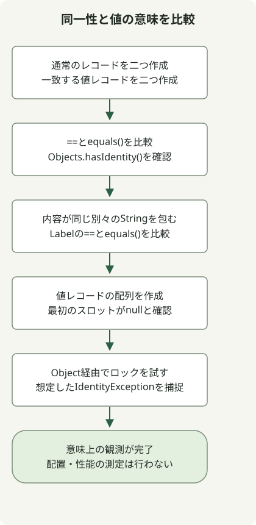

Project Valhallaは、**オブジェクトの同一性を必要としないデータを値オブジェクトとして扱い、JVMがより効率よく格納・受け渡しできる余地を広げるOpenJDKプロジェクト**です。2026年10月31日時点の[プロジェクトページ](https://openjdk.org/projects/valhalla/)と[JEP 401](https://openjdk.org/jeps/401)では、最初の値オブジェクトのプレビューがJDK 28に統合されています。確定済みの機能ではありません。以下の例はJDK 28 EA Build 21で実行しました。

## Javaには既にレコードがあるのに、なぜ値クラスが必要ですか？

通常のオブジェクトは、フィールドが一致していても同一性を持ちます。変更可能な口座やロック用オブジェクトにはその区別が必要ですが、座標`(3, 4)`などのデータには値だけが必要な場合があります。

[`record`](https://docs.oracle.com/en/java/javase/17/language/records.html)はデータコンポーネントを宣言し、アクセサー、コンストラクター、`equals()`などのメソッドを提供します。既存の通常のレコードでは、コンポーネントが一致していても、別々に構築した二つのオブジェクトを`==`で区別できます。`value`修飾子は、オブジェクトの同一性を取り除くという別の選択です。レコードと組み合わせて`value record`にできます。

| 宣言 | この例での意味 |
| --- | --- |
| `record IdentityPoint(int x, int y)` | コンポーネントが一致しても、それぞれのオブジェクトの同一性を維持します |
| `value record ValuePoint(int x, int y)` | 同じクラスでフィールド状態が同じインスタンスを、同一性では区別しません |
| `value record Label(String text)` | 同一性を持ちませんが、`==`と`equals()`が一致するとは限りません |

値クラスのインスタンスフィールドは`final`です。ただし、参照先のオブジェクトまで自動的に深く不変になるわけではありません。フィールドに格納された変更可能なコレクションは、内容を変更できます。値オブジェクトは引き続きオブジェクト参照で扱い、プリミティブ型にはなりません。

## JDK 28プレビューを試す



図は以下のコードに対応しています。`Label`には、内容が一致する別々の`String`オブジェクトを入れ、参照フィールドの比較を示します。最後に、値オブジェクトを`Object`変数へ移しても有効なモニターにはならないことを確認し、想定される例外を処理します。

`javac`と`java`が同じ[JDK 28 EA](https://jdk.java.net/28/)ビルドを指す、専用の実験ディレクトリを使用します。ダウンロードを公式のSHA-256と照合し、`java --version`でビルドを確認します。JDK 17と21では、この構文をコンパイルできません。コンパイル時と実行時の両方に、プレビュー用フラグが必要です。

### `ValhallaExample.java`

```java
import java.util.Objects;

public class ValhallaExample {
    record IdentityPoint(int x, int y) {}
    value record ValuePoint(int x, int y) {}
    value record Label(String text) {}

    public static void main(String[] args) {
        IdentityPoint a = new IdentityPoint(3, 4);
        IdentityPoint b = new IdentityPoint(3, 4);
        ValuePoint p = new ValuePoint(3, 4);
        ValuePoint q = new ValuePoint(3, 4);
        System.out.println("record == " + (a == b));
        System.out.println("record equals " + a.equals(b));
        System.out.println("value == " + (p == q));
        System.out.println("value equals " + p.equals(q));
        System.out.println("record identity " + Objects.hasIdentity(a));
        System.out.println("value identity " + Objects.hasIdentity(p));

        Label first = new Label(new String(new char[] {'x'}));
        Label second = new Label(new String(new char[] {'x'}));
        System.out.println("label == " + (first == second));
        System.out.println("label equals " + first.equals(second));

        ValuePoint[] points = new ValuePoint[1];
        System.out.println("array slot null " + (points[0] == null));
        Object monitor = p;
        try {
            synchronized (monitor) {
                throw new AssertionError("A value object must not be a monitor");
            }
        } catch (IdentityException expected) {
            System.out.println("monitor " + expected.getClass().getSimpleName());
        }
    }
}
```

```sh
javac --enable-preview --release 28 ValhallaExample.java
java --enable-preview ValhallaExample
```

この出力は、OpenJDK `28-ea+21-1707`のmacOS AArch64版で観測しました。コンパイラーのプレビュー通知は、この標準出力とは別です。

```text
record == false
record equals true
value == true
value equals true
record identity true
value identity false
label == false
label equals true
array slot null true
monitor IdentityException
```

通常のレコードは`equals()`でtrue、`==`でfalseを返します。値レコードには整数フィールドしかないため、フィールド状態が一致すれば両方の比較がtrueになります。[`Objects.hasIdentity()`](https://download.java.net/java/early_access/jdk28/docs/api/java.base/java/util/Objects.html#hasIdentity(java.lang.Object))でも、この違いを確認できます。

## 値オブジェクトは==で比較すべきですか？

ドメイン上の等価性には、引き続き`equals()`を使います。値オブジェクトの`==`は、同じ値クラス内のフィールド状態を比較し、参照フィールドには再帰的に`==`を適用します。同一性を持つ参照先は、内容が一致しても別々のオブジェクトなら区別されます。プリミティブフィールドはビットパターンで比較されるため、浮動小数点の意味上の等価性と異なる場合もあります。厳密な規則は、[JEP 401の値オブジェクト比較規則](https://openjdk.org/jeps/401#Comparing-value-objects)を参照してください。

二つの`Label`オブジェクトの文字列は内容が一致するため、自動生成されたレコードの`equals()`はtrueを返します。それらの文字列は同一性を持つ別々のオブジェクトなので、`==`はfalseを返します。`value`によって、すべての参照フィールドが内容に基づく比較になると解釈しないでください。

新しい値配列のスロットは`null`で、値オブジェクトを動的にモニターとして使うと`IdentityException`が発生します。型が明らかに値クラスである式を直接ロックしようとすると、代わりにコンパイル時に拒否される場合があります。移行前に、ロックや同一性に基づくキャッシュなど、同一性に依存する用途を確認します。

## すぐにメモリを節約したり`List<int>`を使えたりしますか？

同一性を取り除くことで、JVMには、ポインターの代わりにフィールド状態で参照を表す**フラット化**や、レジスターなどで値を個別の構成要素として渡す**スカラー化**の余地が生まれます。言語は、特定のレイアウト、割り当ての除去、高速化を保証しません。上の出力が確認するのは意味論であり、ヒープ使用量やスループットは測定していません。

Valhallaは複数のJDKリリースにまたがります。[公式ロードマップ](https://openjdk.org/projects/valhalla/)は、値オブジェクトと、null制限ストレージ、配列の拡張、プリミティブとクラスの統合、ジェネリクス特殊化のためのParametric JVMを分けています。JEP 401だけで`List<int>`が完成したり、すべての配列で連続格納が保証されたりするわけではありません。併設の[JEP 539](https://openjdk.org/jeps/539)は、厳密なフィールド初期化を支えるJVM機能を提供します。Javaソースへ任意の`strict`フィールド修飾子を追加するものではありません。

同一性を必要としない座標や金額などの小さなデータ型から実験を始め、同じビルドで動作を比較します。フレームワーク、シリアライズ、ロックへの依存を確認し、代表的な負荷で割り当て、GC、スループットを測定してから効果を判断します。本番JDKの選定時に、このプレビューを確定済みのサポート対象機能として扱わないでください。確定機能とプレビューの違いについては、[JDK機能ガイド](/en/posts/2023-09-20-jdk-21-release/)を参照してください。
