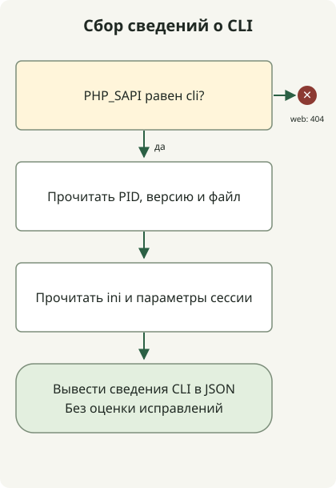

Устранение PHP2Shell не заканчивается обновлением CMS или плагина. Получите сборку PHP с исправлениями [CVE-2026-109618](https://github.com/php/php-src/security/advisories/GHSA-w8hw-w9fx-j79w) и [CVE-2026-109619](https://github.com/php/php-src/security/advisories/GHSA-6wmf-4rv5-p3rp), затем убедитесь, что её использует каждый воркер, обслуживающий веб-запросы. Команда `php -v` в терминале сообщает лишь о CLI, выбранном в этом терминале.

## Что затрагивает PHP2Shell?

Обе CVE относятся к состоянию запросов и времени жизни памяти в движке PHP. Первая связана с некорректным состоянием, используемым при очистке после того, как обработка нехватки памяти прервала инициализацию. Вторая связана с внутренним состоянием, которое сохраняется после освобождения памяти запроса и используется последующим запросом в том же воркере. При соответствующих условиях возможно удалённое выполнение кода без аутентификации.

[Уведомление команды PHP](https://www.php.net/archive/2026.php) включает PHP-FPM, php-cgi, FrankenPHP и LiteSpeed, а также mod_php в число веб-развёртываний, которые нужно исследовать. Конкретный SAPI не служит основанием исключить сервис из проверки. И наоборот, одна лишь строка уязвимой версии не доказывает наличие достижимого пути эксплуатации в этом сервисе.

## Какую версию сравнивать?

Это **первые выпуски исходного кода upstream с исправлением двух первоначальных CVE**, проверенные 30 октября 2026 года. Перед установкой проверьте актуальный поддерживаемый выпуск того же поставщика и последующие уведомления.

| Ветка PHP | Первый выпуск исходного кода с исправлением обеих CVE |
| --- | --- |
| 8.2 | 8.2.35 |
| 8.3 | 8.3.36 |
| 8.4 | 8.4.27 |
| 8.5 | 8.5.12 |

Для пакетов дистрибутива сравнивайте полную ревизию пакета с уведомлением поставщика, а не короткую версию PHP. Например, [Ubuntu USN-8948-1](https://ubuntu.com/security/notices/USN-8948-1) указывает `8.3.6-0ubuntu0.24.04.13` как исправленный пакет `php8.3-fpm` для Ubuntu 24.04. Сравнение этого номера с upstream `8.3.36` приводит к неверной классификации обратного переноса исправления. Уведомление не удостоверяет произвольные пользовательские сборки с такой же строкой версии.

PHP 8.1 и более старые версии больше не поддерживаются проектом PHP. Проверьте поддержку поставщика и доказательства обратного переноса исправления либо перейдите на поддерживаемую ветку. Опубликованное исправление исходного кода и доказательство того, что сервер использует это исправление, — разные вещи.

## Сбор сведений о CLI без подмены сведений о веб-процессах



Схема соответствует приведённому ниже сборщику. Под веб-SAPI он завершается, не выводя информацию. Под CLI записывает исполняемый файл, версию и конфигурацию, не определяя наличие исправления. Идентификация сервиса, установка исправления и перезапуск — отдельные эксплуатационные этапы, которые этот код не выполняет.

При использовании PHP 8.2 или новее сохраните файл в новом каталоге за пределами корня веб-документов. Он читает сведения только о текущем процессе через [константы PHP](https://www.php.net/manual/en/reserved.constants.php) и [ini_get](https://www.php.net/manual/en/function.ini-get.php); не отправляет запросы, не меняет настройки и не запускает сессии. Публиковать страницу `phpinfo()` не требуется.

### `runtime-evidence.php`

```php
<?php
if (PHP_SAPI !== 'cli') {
    http_response_code(404);
    exit;
}

$evidence = [
    'scope' => 'this-cli-process-only',
    'pid' => getmypid(),
    'version' => PHP_VERSION,
    'sapi' => PHP_SAPI,
    'binary' => PHP_BINARY,
    'loadedIni' => php_ini_loaded_file() ?: null,
    'uploadProgress' => ini_get('session.upload_progress.enabled'),
    'serializeHandler' => ini_get('session.serialize_handler'),
];
echo json_encode($evidence, JSON_PRETTY_PRINT | JSON_THROW_ON_ERROR), PHP_EOL;
```

```sh
php runtime-evidence.php
php -n -d session.upload_progress.enabled=0 runtime-evidence.php
```

Первая команда читает конфигурацию выбранного CLI. Вторая пропускает ini-файлы и отключает отслеживание загрузки только для этого запуска CLI. **Она не меняет настройки веб-сервера и не проверяет действующую конфигурацию веб-воркера.**

Локальная проверка выполнялась в изолированном контейнере PHP CLI и подтвердила вывод JSON со значением `sapi`, равным `cli`. Вторая команда вернула `null` для `loadedIni` и строку `"0"` для `uploadProgress`. Пути, PID, версия и значения по умолчанию зависят от среды. Эти результаты не устанавливают наличие исправления в рабочем сервисе и не воспроизводят эксплуатацию.

## Проверяйте установку и работающие воркеры отдельно

1. Проследите настройки upstream веб-сервера, FastCGI или модуля, чтобы определить фактический исполняемый файл PHP, пулы, контейнеры и реплики. Не предполагайте, что CLI хоста и веб-среда исполнения установлены по одному пути.
2. Сопоставьте поставщика этой среды исполнения и полную ревизию пакета или хеш образа с уведомлением. Для собственной сборки установите связь между коммитом исправления и развёрнутым артефактом.
3. Разверните совместимую исправленную сборку и замените воркеры затронутого пула или сервиса либо его контейнеры. Сначала проверьте область изменений, если среда исполнения общая с другими сервисами.
4. Проверьте связь новых процессов с исправленной сборкой на всех целевых узлах. Проверьте обычные страницы, вход и сессии, загрузки и частоту ошибок. Не считайте частичное развёртывание или отсутствие сведений о работающих процессах завершённой работой.

Разделение статусов «исправленный артефакт определён» и «использование работающими процессами проверено» во внутреннем учёте ресурсов помогает найти пропущенные воркеры. Один сбой процесса не доказывает компрометацию, а отсутствие журналов ошибок не исключает её. При подозрении на компрометацию сохраните свидетельства и проведите расследование отдельно от установки исправлений.

## Отдельно учитывайте последующую проблему с сессиями и пересборку Windows

[Последующее уведомление PHP от 23 октября](https://www.php.net/archive/2026.php) отдельно отслеживает **CVE-2026-115560**. Оно касается сочетания настройки `session.serialize_handler` в `php_binary` или `php_serialize`, кода приложения, который переключает её на `php` перед вызовом `session_start()`, и оставшегося включённым отслеживания загрузки. Уведомление предлагает `session.upload_progress.enabled=0` до следующего регулярного исправления. Эта настройка не доказывает полного устранения обеих первоначальных CVE. Проверьте действующую конфигурацию веб-SAPI и влияние на функции.

[Уведомление для Windows от 26 октября](https://www.php.net/archive/2026.php) объявляет пакеты `8.5.12-1`, `8.4.27-1`, `8.3.36-1` и `8.2.35-1`, включающие исправление Brotli для **CVE-2026-111497**. В них пересобраны зависимости без изменения версии исходного кода PHP, поэтому одного `PHP_VERSION` недостаточно для их различения. Развёртывания Windows с автоматической распаковкой ответов cURL должны проверить и это исправление пакета. О той же CVE Brotli в Node.js читайте в [руководстве по реагированию на Node2Shell](/en/posts/2026-10-30-node2shell-brotli-runtime-patching/).
