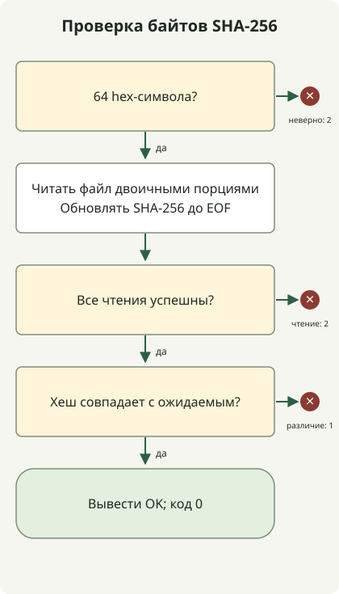

Чтобы проверить скачанный файл, вычислите его хеш SHA-256 и сравните с ожидаемым значением от издателя, которому вы доверяете. Модуль Python [hashlib](https://docs.python.org/3.11/library/hashlib.html) позволяет обрабатывать двоичные байты порциями. Совпадение подтверждает соответствие этих байтов указанному значению; оно не удостоверяет издателя и не доказывает безопасность программы. Adoptium отдельно описывает [проверку подписи](https://adoptium.net/installation/gpg-verification).

## С какой контрольной суммой сравнивать?

Используйте контрольную сумму именно для скачанного выпуска, ОС, процессора и формата архива. [Скрипт выбора выпуска GitHub](/en/posts/2023-09-23-linux-shellscript-github-latest/) выбирает URL файла; [пример с метаданными Temurin](/en/posts/2023-10-10-temurin-jdk21-delay/) также проверяет синтаксис контрольной суммы. Ни один из них не вычисляет хеш скачанного файла. В [инструкции Adoptium по установке из архивов](https://adoptium.net/installation/archives) описано получение соответствующей контрольной суммы.

Получайте ожидаемое значение через доверенный канал распространения издателя. Если вычислить хеш скачанного файла и использовать этот же результат как ожидаемое значение, неправильную загрузку обнаружить не удастся. Если злоумышленник может заменить и файл, и опубликованную контрольную сумму, их совпадение не подтверждает подлинность. Проверка подписи доверенным ключом издателя — отдельный этап, который выходит за рамки этого примера.

## Как работает проверка файла?



Проверьте ожидаемое значение, откройте неизменяемый во время проверки обычный файл в двоичном режиме, обновляйте хеш порциями до EOF и сравните результат. Неверный ввод или ошибка чтения возвращает 2; несовпадение — 1; только совпадение — 0. На схеме цикл чтения порциями сведён к одному шагу. Не изменяйте и не заменяйте файл во время проверки или после неё до использования. Этот инструмент не обеспечивает атомарную проверку с последующим выполнением.

## Запуск проверки без дополнительных пакетов

Используйте Python 3.11 или новее и сохраните приведённый ниже код в `verify-sha256.py`. Следующие команды рассчитаны на оболочку POSIX. Программа читает локальные файлы; она не скачивает, не распаковывает и не запускает их. Она следует по символической ссылке, если та указывает на обычный файл. На вход принимается одно шестнадцатеричное значение из 64 символов, в том числе в верхнем регистре, а не файл со списком контрольных сумм, имя файла или URL.

### `verify-sha256.py`

```python
import hashlib
from pathlib import Path
import re
import sys


def main(argv):
    if len(argv) != 3 or not re.fullmatch(r"[0-9a-fA-F]{64}", argv[1]):
        print("usage: verify-sha256.py EXPECTED_SHA256 FILE", file=sys.stderr)
        return 2
    path = Path(argv[2])
    try:
        if not path.is_file():
            raise OSError("expected an existing regular file")
        digest = hashlib.sha256()
        with path.open("rb") as source:
            for chunk in iter(lambda: source.read(1024 * 1024), b""):
                digest.update(chunk)
    except OSError as error:
        print(f"READ ERROR: {error}", file=sys.stderr)
        return 2
    if digest.hexdigest() != argv[1].lower():
        print("MISMATCH", file=sys.stderr)
        return 1
    print("OK")
    return 0


if __name__ == "__main__":
    raise SystemExit(main(sys.argv))
```

Режим `rb` сохраняет исходные байты, включая окончания строк. Каждая операция чтения запрашивает не более 1 MiB; файл целиком в память не загружается. Неверные контрольные суммы отклоняются до открытия пути. Отсутствующие пути, каталоги и ошибки чтения возвращают один статус 2. Именованные каналы и файлы устройств не входят в поддерживаемую категорию обычных файлов.

## Воспроизведение совпадения и изменения файла

Используйте новый пустой каталог. Эти тестовые данные создают `sample.bin` с тремя байтами `abc` и `changed.bin` с `abcd`. Фиксированный хеш в команде относится только к `abc`; это не контрольная сумма архива JDK.

### `make-samples.py`

```python
from pathlib import Path

Path("sample.bin").write_bytes(b"abc")
Path("changed.bin").write_bytes(b"abcd")
```

```sh
python3 make-samples.py
expected='ba7816bf8f01cfea414140de5dae2223b00361a396177a9cb410ff61f20015ad'
python3 verify-sha256.py "$expected" sample.bin
python3 verify-sha256.py "$expected" changed.bin
printf 'exit=%s\n' "$?"
```

Файл с совпадающим хешем выводит `OK`. Изменённый файл выводит `MISMATCH` в stderr, а последняя команда — `exit=1`. При использовании `set -e` ожидаемое несовпадение требует явного `if` или другой ветви обработки ошибки; иначе оболочка может завершиться до вывода статуса.

| Статус | Значение | Следующее действие |
| --- | --- | --- |
| 0 | Хеш совпадает с переданным ожидаемым значением | Продолжайте только при получении ожидаемого значения из доверенного источника |
| 1 | Хеши различаются | Прекратите использовать файл; проверьте выбранный файл выпуска и загрузку |
| 2 | Неверные аргументы, синтаксис контрольной суммы или ошибка чтения файла | Исправьте ввод или доступ к файлу и повторите попытку |

Само по себе несовпадение не позволяет установить причину: повреждение, неверный файл выпуска или злонамеренную замену. Эта проверка не проверяет подпись и не сканирует на вредоносное ПО.
