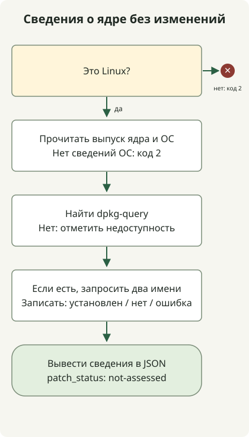

**Fragnesia (CVE-2026-46300) — уязвимость локального повышения привилегий в ядре Linux.** Примените исправления для правильного дистрибутива и семейства ядра, затем убедитесь, что они активны в работающем ядре. [Официальное описание Ubuntu](https://ubuntu.com/security/CVE-2026-46300) также отмечает возможный выход из контейнера при соответствующих условиях. Использование Linux не означает одинаковой подверженности всех систем.

## Даёт ли это сразу root злоумышленнику из интернета?

Эта CVE представляет собой локальное повышение привилегий. Она требует возможности выполнять код в системе и достигать уязвимого пути ядра. Отличайте её от удалённого выполнения кода в веб-приложении. [Официальные данные CISA KEV](https://www.cisa.gov/sites/default/files/feeds/known_exploited_vulnerabilities.json) отмечают риск цепочки с PHP2Shell CVE-2026-109618 и CVE-2026-109619. Проверяйте отдельно [исправление среды исполнения PHP](/en/posts/2026-10-30-php2shell-runtime-patching/) и ядра хоста.

[Исходная запись CVE](https://cveawg.mitre.org/api/cve/CVE-2026-46300) описывает потерю маркера общего фрагмента страницы при объединении буферов сокета. Последующая обработка ESP может принять общие страницы за частные и изменить их на месте. CVE опубликована 23 мая 2026 года; CISA добавила её в KEV 28 октября. Дефект не был впервые введён в октябре. Толкуйте срок KEV 31 октября в пределах применимой директивы, а не как универсальный срок изменений для всех сервисов.

## Какое ядро нужно обновлять?

Не сужайте область исправления до одной CVE в отрыве от остальных. [Заметки команды безопасности Ubuntu](https://ubuntu.com/security/CVE-2026-46300#notes) рекомендуют поставлять связанные исправления вместе с CVE-2026-43284. Ещё одно исправление пути передачи фрагментов отслеживается как [CVE-2026-43503](https://ubuntu.com/security/CVE-2026-43503). [CVE-2026-43284](https://ubuntu.com/security/CVE-2026-43284) — отдельная запись семейства Dirty Frag. Предпочитайте полный исправленный пакет поставщика; применение одного выбранного коммита не доказывает завершения.

Далее приведены отдельные пороги исправления Ubuntu для **пакета исходного кода linux**, проверенные 31 октября 2026 года. Сначала сопоставьте установленный двоичный пакет с его исходным пакетом и семейством ядра.

| Выпуск Ubuntu | Порог исправления linux |
| --- | --- |
| 22.04 LTS | 5.15.0-181.191 |
| 24.04 LTS | 6.8.0-124.124 |
| 26.04 LTS | 7.0.0-22.22 |

Не используйте эти пороги для ядер AWS, Azure, HWE, OEM или реального времени: имена пакетов, поддерживаемые семейства и обратные переносы поставщиков различаются. Для RHEL следуйте статусу продукта и RHSA из [бюллетеня Red Hat](https://access.redhat.com/security/vulnerabilities/RHSB-2026-003). [Собственный бюллетень AWS](https://aws.amazon.com/security/security-bulletins/2026-030-aws/) объясняет незатронутый статус Amazon Linux и Bottlerocket их конфигурацией espintcp. Не распространяйте это утверждение на произвольные собственные ядра или другие дистрибутивы на EC2.

## Сначала соберите сведения о работающем ядре



Схема соответствует сборщику ниже. Он требует [Python 3.10 или новее](https://docs.python.org/3/library/platform.html#platform.freedesktop_os_release). В Linux с [dpkg-query](https://manpages.debian.org/trixie/dpkg/dpkg-query.1.en.html) он запрашивает только два имени пакетов, полученных из выпуска работающего ядра. Он не использует сеть, права администратора, загрузку модулей или изменения системы. **Это не детектор уязвимости и не заключение о завершении исправления.** Недостающие сведения никогда не выдаются за безопасность.

### `kernel-evidence.py`

```python
import json
import platform
import shutil
import subprocess


def collect():
    result = {"patch_status": "not-assessed", "scope": "current-execution-context"}
    if platform.system() != "Linux":
        return {**result, "error": "linux-required"}, 2
    try:
        release = platform.release()
        distro = platform.freedesktop_os_release()
    except OSError:
        return {**result, "error": "os-evidence-unavailable"}, 2
    result.update(running_kernel=release,
                  os={key: distro.get(key) for key in ("ID", "VERSION_ID")}, queries=[])
    command = shutil.which("dpkg-query")
    if not command:
        return {**result, "package_query": "dpkg-query-unavailable"}, 0
    result["package_query"] = "dpkg-query"
    for name in ("linux-image-" + release, "linux-image-unsigned-" + release):
        row = {"package": name}
        try:
            answer = subprocess.run(
                [command, "-W", "-f=${Package}\t${Version}\t${db:Status-Status}\n", name],
                capture_output=True, text=True, timeout=5, check=False)
        except (OSError, subprocess.TimeoutExpired):
            row["state"] = "query-error"
        else:
            fields = answer.stdout.rstrip("\n").split("\t")
            if answer.returncode == 1:
                row["state"] = "not-found"
            elif answer.returncode != 0:
                row["state"] = "query-error"
            elif len(fields) != 3 or fields[0] != name or not fields[1]:
                row["state"] = "unexpected-output"
            elif fields[2] != "installed":
                row["state"] = "not-installed"
            else:
                row.update(state="installed", version=fields[1])
        result["queries"].append(row)
    return result, 0


if __name__ == "__main__":
    evidence, status = collect()
    print(json.dumps(evidence, ensure_ascii=False, indent=2, sort_keys=True))
    raise SystemExit(status)
```

```sh
python3 kernel-evidence.py
```

Среда не на Linux или недоступные сведения об ОС возвращают код завершения 2. Даже при завершённом сборе в Linux отдельный запрос пакета может завершиться ошибкой: читайте package_query и каждое state. Код завершения 0 не доказывает завершения исправления. Эти два запроса не могут определить пакет-владелец для RPM или собственных ядер.

Следующий вывод был **получен запуском и проверен на синтетических входных данных**: Ubuntu 24.04, работающее ядро 6.8.0-124-generic, первый пакет установлен, второй отсутствует. Это не сведения с рабочего хоста Ubuntu. Проверки выполнения воспроизводят этот вывод и ветви ошибок запросов; они не проверяют реальную уязвимость ядра, применение исправления или эксплуатацию.

```text
{
  "os": {
    "ID": "ubuntu",
    "VERSION_ID": "24.04"
  },
  "package_query": "dpkg-query",
  "patch_status": "not-assessed",
  "queries": [
    {
      "package": "linux-image-6.8.0-124-generic",
      "state": "installed",
      "version": "6.8.0-124.124"
    },
    {
      "package": "linux-image-unsigned-6.8.0-124-generic",
      "state": "not-found"
    }
  ],
  "running_kernel": "6.8.0-124-generic",
  "scope": "current-execution-context"
}
```

В контейнере ОС и база пакетов могут принадлежать контейнеру, тогда как ядро — общему хосту. Повторите сбор через путь управления хостом или ВМ. Недавно установленный пакет ядра также может отличаться от работающего ядра. Этот сборщик запрашивает только имена, связанные с текущим выпуском; он не перечисляет все установленные ядра. Он не проверяет подписи пакетов, целостность или статус livepatch.

## Что проверить после установки исправлений?

1. Сопоставьте дистрибутив ресурса, работающее ядро и семейство пакета с CVE или уведомлением безопасности поставщика. Не сравнивайте версии разных семейств простым строковым сравнением.
2. Примените исправленные пакеты через поддерживаемые репозитории или образы, затем поэтапно замените или перезагрузите узлы. [Ubuntu USN-8388-1](https://ubuntu.com/security/notices/USN-8388-1) требует перезагрузки после обычного обновления и рассматривает изменения ABI для сторонних модулей ядра. Если полагаетесь только на livepatch, отдельно проверьте поддержку и фактическое применение для CVE и работающего ядра.
3. После перезапуска соберите те же сведения, сравните активное ядро со свидетельствами исправления поставщика и проверьте состояние сервисов, хранилища и сети. Один перезапуск pod Kubernetes не заменяет ядро узла.
4. Исследуйте также возможный первоначальный доступ и закрепление. Успешная установка исправлений не доказывает отсутствия существующего веб-шелла или украденных учётных данных.

Если немедленное обновление невозможно, обратитесь к [рекомендациям Ubuntu по временным мерам](https://ubuntu.com/blog/dirty-frag-linux-vulnerability-fixes-available) и инструкциям поставщика. Ограничения модулей могут конфликтовать с такими функциями, как VPN/IPsec; уже загруженные или встроенные пути требуют отдельной оценки. Отсутствие в списке модулей не устанавливает незатронутый статус. Снижение подверженности и ограничение недоверенного кода — временные меры, а не замена установки исправленных пакетов.
