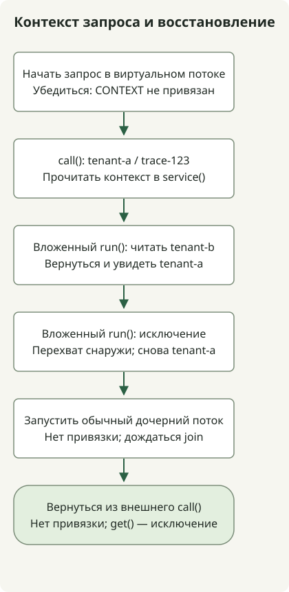

В JDK 25 **`ScopedValue` — окончательный API для привязки данных, например контекста запроса, к ограниченной области выполнения и передачи их от вызывающего к вызываемому коду**. Он получил окончательный статус в [JEP 506](https://openjdk.org/jeps/506), поэтому флаги предварительных возможностей не нужны. Привязка действует во время выполнения операции, переданной в `run()` или `call()`; нормальное завершение или исключение восстанавливает предыдущее состояние.

## Чем он отличается от ThreadLocal?

Рассмотрите его, если передача идентификатора арендатора или трассировки в глубину сервисного кода иначе потребует добавлять параметр в каждый промежуточный метод. Обычные параметры могут оставаться понятнее, если значение является явным входом бизнес-логики.

[`ThreadLocal`](https://docs.oracle.com/en/java/javase/25/docs/api/java.base/java/lang/ThreadLocal.html) изменяет значение текущего потока через `set()` и удаляет его через `remove()`. Использование в пределах запроса требует аккуратной очистки, обычно в `finally`. Вместо того чтобы оставлять значение установленным, `ScopedValue` запускает нуждающуюся в нём операцию внутри привязки.

| Критерий | ThreadLocal | ScopedValue |
| --- | --- | --- |
| Доступ к данным | Чтение и изменение значения, сохранённого для текущего потока | Чтение привязки в текущей динамической области выполнения |
| Конец области | Явное управление очисткой данных запроса | Восстановление предыдущей привязки при завершении `run()` или `call()` |
| Другое значение в вызываемом коде | `set()` может изменить существующее сохранённое значение | Повторная привязка во вложенной области с последующим восстановлением внешнего значения |
| Подходящие применения | В частности, изменяемое состояние на поток | В частности, контекст запроса, передаваемый от вызывающего к вызываемому коду |

`ScopedValue` не заменяет все применения `ThreadLocal` и не объявляет его устаревшим. Поле `private static final` хранит **ключ доступа, а не само значение контекста**. Один ключ может разрешаться в разные значения в зависимости от выполняющего потока и области.

## Наблюдение области и восстановления в виртуальном потоке



Схема соответствует примеру ниже. Внешний арендатор — `tenant-a`; вложенная область читает `tenant-b`. Ошибка вложенной области перехватывается за её пределами перед проверкой восстановления. Пример демонстрирует семантику контекста запроса без HTTP-сервера или интеграции с фреймворком.

Запустите его в каталоге, где `javac` и `java` указывают на одну установку JDK 25. Средой локальной проверки была Eclipse Temurin `25.0.5+8` на macOS AArch64. `ScopedValue` относится к `java.lang` и не требует явного импорта.

### `ScopedContextExample.java`

```java
import java.util.NoSuchElementException;
import java.util.concurrent.Executors;

public class ScopedContextExample {
    private static final ScopedValue<RequestContext> CONTEXT = ScopedValue.newInstance();
    record RequestContext(String tenant, String traceId) {}

    public static void main(String[] args) throws Exception {
        try (var tasks = Executors.newVirtualThreadPerTaskExecutor()) {
            tasks.submit(ScopedContextExample::handleRequest).get();
        }
    }

    private static String handleRequest() throws InterruptedException {
        System.out.println("virtual=" + Thread.currentThread().isVirtual());
        System.out.println("before=" + CONTEXT.isBound());
        String result = ScopedValue.where(CONTEXT,
                new RequestContext("tenant-a", "trace-123")).call(() -> {
            System.out.println("outer=" + service());
            ScopedValue.where(CONTEXT,
                    new RequestContext("tenant-b", "trace-123")).run(() ->
                System.out.println("nested=" + service()));
            System.out.println("restored=" + service());

            try {
                ScopedValue.where(CONTEXT,
                        new RequestContext("tenant-fail", "trace-123")).run(() -> {
                    throw new IllegalStateException("demonstration");
                });
            } catch (IllegalStateException expected) {
                System.out.println("after-failure=" + service());
            }

            Thread child = Thread.ofVirtual().start(() ->
                System.out.println("plain-child-bound=" + CONTEXT.isBound()));
            child.join();
            return service();
        });
        System.out.println("result=" + result);
        System.out.println("after=" + CONTEXT.isBound());
        try {
            CONTEXT.get();
        } catch (NoSuchElementException expected) {
            System.out.println("outside=" + expected.getClass().getSimpleName());
        }
        return result;
    }

    private static String service() {
        RequestContext context = CONTEXT.get();
        return context.tenant() + "/" + context.traceId();
    }
}
```

```sh
javac --release 25 ScopedContextExample.java
java ScopedContextExample
```

Этот стандартный вывод наблюдался без параметров предварительных возможностей. Вызов `get()` у `Future` передаёт ошибки задачи вызывающему коду; `join()` дожидается вывода дочернего потока.

```text
virtual=true
before=false
outer=tenant-a/trace-123
nested=tenant-b/trace-123
restored=tenant-a/trace-123
after-failure=tenant-a/trace-123
plain-child-bound=false
result=tenant-a/trace-123
after=false
outside=NoSuchElementException
```

`service()` читает текущую привязку без параметра контекста. Используйте `run()` для операции без результата и [`Carrier.call()`](https://docs.oracle.com/en/java/javase/25/docs/api/java.base/java/lang/ScopedValue.Carrier.html#call(java.lang.ScopedValue.CallableOp)) для операции, возвращающей результат или передающей исключение. Само создание `Carrier` через `where()` не активирует привязку.

И `restored`, и `after-failure` показывают внешнее значение. После завершения внешнего `call()` метод `isBound()` возвращает false, а `get()` без привязки вызывает `NoSuchElementException`. Выход из привязки не гарантирует немедленной сборки мусора для объекта по ссылке и не закрывает автоматически ресурс `AutoCloseable`.

## Наследует ли значение создаваемый виртуальный поток?

**Обычный `Thread.ofVirtual().start()` не наследует автоматически привязку родителя.** Пример показывает это через `plain-child-bound=false`. Не предполагайте также автоматической передачи контекста при передаче работы в `ExecutorService` или `CompletableFuture`. Первый виртуальный поток примера устанавливает привязку внутри задачи, а не наследует её.

[Официальные правила наследования](https://docs.oracle.com/en/java/javase/25/docs/api/java.base/java/lang/ScopedValue.html#inheritance) описывают захват привязок при создании `StructuredTaskScope` и их наследование дочерними задачами, запущенными через `fork()` этой области. **Структурированная конкурентность — отдельный предварительный API в JDK 25**, описанный в [JEP 505](https://openjdk.org/jeps/505); код этой статьи его не использует. Не считайте пример проверкой этого механизма наследования.

## Границы применения контекста запроса

Неизменяемая привязка не делает объект по ссылке глубоко неизменяемым. В примере используется record с двумя строками; изменяемая коллекция потребовала бы отдельного проектирования конкурентного доступа. Ограничивайте также доступ к ключу.

Проверяйте API JDK 25, а не копируйте без изменений старые примеры предварительных версий JDK 21 и подобных выпусков. В частности, JDK 25 не допускает `orElse(null)`. Привязка к `null` также отличается от отсутствия привязки.

Сначала отличите `ThreadLocal`, передающий данные запроса по цепочке вызовов, от ThreadLocal, поддерживающего изменяемое состояние во время выполнения. Для первого спроектируйте и привязку в точке входа, и асинхронные границы. Транзакции фреймворка, MDC и контекст безопасности автоматически не подключаются; этот пример не проверяет такие интеграции или производительность. О поведении самих виртуальных потоков читайте в [статье о возможностях JDK 21](/en/posts/2023-09-20-jdk-21-release/).
