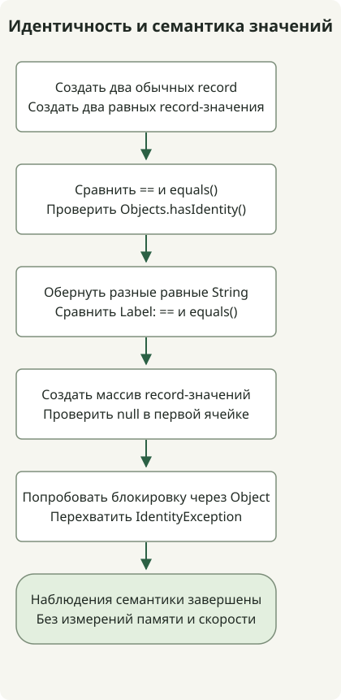

Project Valhalla — **проект OpenJDK, который позволяет данным, не нуждающимся в идентичности объекта, использовать объекты-значения, предоставляя JVM больше свободы для эффективного хранения и передачи**. По состоянию на 31 октября 2026 года [страница проекта](https://openjdk.org/projects/valhalla/) и [JEP 401](https://openjdk.org/jeps/401) показывают, что первая предварительная версия объектов-значений интегрирована в JDK 28. Это ещё не окончательная возможность. Пример ниже запускался на JDK 28 EA Build 21.

## Зачем классы-значения, если в Java уже есть record?

Обычные объекты имеют идентичность даже при совпадении полей. Изменяемым счетам и объектам блокировки это различие нужно, но таким данным, как координата `(3, 4)`, может требоваться только значение.

[`record`](https://docs.oracle.com/en/java/javase/17/language/records.html) объявляет компоненты данных и предоставляет методы доступа, конструкторы и методы вроде `equals()`. В существующих обычных record оператор `==` по-прежнему различает два отдельно созданных объекта с совпадающими компонентами. Модификатор `value` делает отдельный выбор: удаляет идентичность объекта. Его можно сочетать с record как `value record`.

| Объявление | Значение в этом примере |
| --- | --- |
| `record IdentityPoint(int x, int y)` | Сохраняет разные идентичности объектов даже при совпадающих компонентах |
| `value record ValuePoint(int x, int y)` | Экземпляры одного класса с одинаковым состоянием полей не различаются по идентичности |
| `value record Label(String text)` | Не имеет идентичности, но результаты `==` и `equals()` всё равно могут различаться |

Поля экземпляров класса-значения являются `final`. Это не делает объекты по ссылкам автоматически глубоко неизменяемыми: изменяемая коллекция в поле всё ещё может менять своё содержимое. Объекты-значения по-прежнему обрабатываются через ссылки на объекты; они не становятся примитивными типами.

## Попробуйте предварительную версию JDK 28



Схема соответствует коду ниже. `Label` содержит разные объекты `String` с одинаковым содержимым, чтобы показать сравнение ссылочных полей. В конце программа проверяет, что помещение объекта-значения в переменную `Object` не делает его допустимым монитором, и обрабатывает ожидаемое исключение.

Используйте отдельный каталог для эксперимента, где `javac` и `java` указывают на одну сборку [JDK 28 EA](https://jdk.java.net/28/). Сравните загрузку с её официальным SHA-256 и подтвердите сборку через `java --version`. JDK 17 и 21 не могут скомпилировать этот синтаксис. Флаги предварительных возможностей нужны и при компиляции, и при запуске.

### `ValhallaExample.java`

```java
import java.util.Objects;

public class ValhallaExample {
    record IdentityPoint(int x, int y) {}
    value record ValuePoint(int x, int y) {}
    value record Label(String text) {}

    public static void main(String[] args) {
        IdentityPoint a = new IdentityPoint(3, 4);
        IdentityPoint b = new IdentityPoint(3, 4);
        ValuePoint p = new ValuePoint(3, 4);
        ValuePoint q = new ValuePoint(3, 4);
        System.out.println("record == " + (a == b));
        System.out.println("record equals " + a.equals(b));
        System.out.println("value == " + (p == q));
        System.out.println("value equals " + p.equals(q));
        System.out.println("record identity " + Objects.hasIdentity(a));
        System.out.println("value identity " + Objects.hasIdentity(p));

        Label first = new Label(new String(new char[] {'x'}));
        Label second = new Label(new String(new char[] {'x'}));
        System.out.println("label == " + (first == second));
        System.out.println("label equals " + first.equals(second));

        ValuePoint[] points = new ValuePoint[1];
        System.out.println("array slot null " + (points[0] == null));
        Object monitor = p;
        try {
            synchronized (monitor) {
                throw new AssertionError("A value object must not be a monitor");
            }
        } catch (IdentityException expected) {
            System.out.println("monitor " + expected.getClass().getSimpleName());
        }
    }
}
```

```sh
javac --enable-preview --release 28 ValhallaExample.java
java --enable-preview ValhallaExample
```

Этот вывод наблюдался на OpenJDK `28-ea+21-1707` для macOS AArch64. Сообщение компилятора о предварительных возможностях не входит в этот стандартный вывод.

```text
record == false
record equals true
value == true
value equals true
record identity true
value identity false
label == false
label equals true
array slot null true
monitor IdentityException
```

Обычные record возвращают true для `equals()`, но false для `==`. Record-значения имеют только целочисленные поля, поэтому при совпадающем состоянии полей оба сравнения возвращают true. [`Objects.hasIdentity()`](https://download.java.net/java/early_access/jdk28/docs/api/java.base/java/util/Objects.html#hasIdentity(java.lang.Object)) также показывает это различие.

## Следует ли сравнивать объекты-значения через ==?

Продолжайте использовать `equals()` для равенства в предметной области. Для объектов-значений `==` сравнивает состояние полей в пределах одного класса-значения и рекурсивно применяет `==` к ссылочным полям. Объекты с идентичностью, на которые ведут ссылки, остаются различимыми, если это отдельные объекты, даже при совпадающем содержимом. Примитивные поля сравниваются по битовому представлению, что также может отличаться от семантического равенства чисел с плавающей точкой. Точные правила см. в [правилах сравнения объектов-значений JEP 401](https://openjdk.org/jeps/401#Comparing-value-objects).

Два объекта `Label` содержат строки с одинаковым содержимым, поэтому сгенерированный `equals()` record возвращает true. Их строки — разные объекты с идентичностью, поэтому `==` возвращает false. Не трактуйте `value` как требование сравнивать каждое ссылочное поле по содержимому.

Ячейка нового массива значений равна `null`, а динамическое использование объекта-значения как монитора вызывает `IdentityException`. Прямая блокировка выражения, тип которого явно является классом-значением, вместо этого может быть отклонена при компиляции. Перед миграцией проверьте операции, зависящие от идентичности, такие как блокировки и кеши на основе идентичности.

## Даёт ли это сразу экономию памяти или `List<int>`?

Удаление идентичности даёт JVM возможность применять **flattening** — представление ссылки через состояние полей вместо указателя — и **scalarization** — передачу значений отдельными компонентами в регистрах и подобных местах. Язык не гарантирует конкретную компоновку, устранение выделений памяти или ускорение. Вывод выше проверяет семантику; он не измеряет использование кучи или пропускную способность.

Valhalla охватывает несколько выпусков JDK. [Официальный план](https://openjdk.org/projects/valhalla/) отделяет объекты-значения от хранения с запретом null, улучшений массивов, объединения примитивов и классов и Parametric JVM для специализации обобщений. Один JEP 401 не завершает реализацию `List<int>` и не гарантирует непрерывное хранение каждого массива. Сопутствующий [JEP 539](https://openjdk.org/jeps/539) добавляет поддержку строгой инициализации полей в JVM; он не вводит произвольный модификатор полей `strict` в исходном коде Java.

Начните эксперименты с небольших типов данных, которым не нужна идентичность, например координат или денежных сумм, сравнивая поведение на одной сборке. Проверьте зависимости фреймворков, сериализации и блокировок, затем измерьте выделение памяти, GC и пропускную способность на представительных нагрузках, прежде чем судить о пользе. При выборе рабочей JDK не считайте эту предварительную версию окончательной поддерживаемой возможностью. О различии окончательных и предварительных возможностей читайте в [руководстве по возможностям JDK](/en/posts/2023-09-20-jdk-21-release/).
