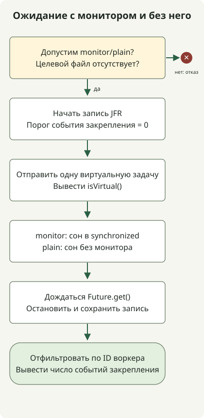

Виртуальные потоки — **потоки Java, позволяющие множеству задач совместно использовать меньшее число потоков ОС во время ожидания ввода-вывода**. Они получили окончательный статус в JDK 21 через [JEP 444](https://openjdk.org/jeps/444), и JDK 25 сохраняет те же базовые API. Важное отличие — закрепление при блокирующей операции внутри `synchronized`: [JEP 491](https://openjdk.org/jeps/491) улучшил это в JDK 24, и JDK 25 включает это улучшение.

## Что становится легковесным?

Виртуальному потоку всё равно нужен поток ОС для выполнения. JVM называет выполняющий его платформенный поток **несущим потоком (carrier)**. Когда поддерживаемая блокирующая операция позволяет виртуальному потоку отсоединиться, несущий поток может выполнять другой виртуальный поток.

Это помогает обработке запросов со множеством одновременных ожиданий. Это не ускоряет вычисления CPU и не сокращает автоматически задержку отдельного запроса. [Официальное руководство по внедрению](https://docs.oracle.com/en/java/javase/25/core/virtual-threads.html) рекомендует виртуальный поток на задачу и не рекомендует повторно использовать виртуальные потоки в небольшом пуле. Ёмкость подключений к БД и лимиты внешних API не растут с числом потоков; ограничивайте эти ресурсы отдельно, например семафорами и пулами соединений.

## Различия JDK 21 и 25

| Область | JDK 21 | JDK 25 |
| --- | --- | --- |
| API виртуальных потоков | Окончательные; без флагов предварительных возможностей | Окончательные; базовые API создания сохранены |
| Блокирование внутри `synchronized` | Может закрепить несущий поток и ограничить масштабируемость | Включает улучшение JDK 24 по JEP 491 |
| Устранение любого закрепления | Нет | Нет; остаются пути вроде нативного кода, вызывающего обратно Java с блокированием |
| Диагностика | JFR и механизмы вроде `jdk.tracePinnedThreads` | JFR сохранён и улучшен; `jdk.tracePinnedThreads` не действует |
| `ScopedValue` | Предварительная возможность | Окончательный через JEP 506 |
| Структурированная конкурентность | Предварительная возможность | По-прежнему отдельная предварительная возможность; совместимость с прежними API не предполагается |

Читайте вместе [руководство JDK 21](https://docs.oracle.com/en/java/javase/21/core/virtual-threads.html), JEP 491 и [статью о ScopedValue](/en/posts/2026-10-31-jdk25-scopedvalue/), чтобы различать эти изменения. Виртуальные потоки, ScopedValue и структурированная конкурентность получают окончательный статус не по одному общему графику.

Закрепление не даёт ожидающему виртуальному потоку освободить несущий поток. В JDK 25 одно лишь обычное использование `synchronized` не повод заменять каждый монитор на `ReentrantLock`. Однако **освободить несущий поток — не то же самое, что освободить блокировку монитора**. Медленный ввод-вывод внутри `synchronized` по-прежнему не даёт другим задачам захватить эту блокировку, поэтому размер критических секций и конкуренция за блокировки остаются важны.

## Наблюдение одного кода через JFR



Код сравнивает режим `monitor`, выполняющий `Thread.sleep(100)` внутри `synchronized`, с режимом `plain`, который засыпает без этого блока. Реальных запросов к сети или БД он не делает. Он устанавливает порог событий в ноль через [Recording](https://docs.oracle.com/en/java/javase/21/docs/api/jdk.jfr/jdk/jfr/Recording.html), затем через [RecordingFile](https://docs.oracle.com/en/java/javase/21/docs/api/jdk.jfr/jdk/jfr/consumer/RecordingFile.html) подсчитывает события только рабочего потока.

Для каждой JDK сохраняйте файл в новом каталоге и используйте `javac` и `java` из одной установки. Требуется HotSpot JDK с JFR; флаги предварительных возможностей не используются. Программа создаёт `monitor.jfr` и `plain.jfr` и отказывается запускаться, если целевой файл уже существует.

### `VirtualThreadProbe.java`

```java
import java.nio.file.Files;
import java.nio.file.Path;
import java.time.Duration;
import java.util.concurrent.Executors;
import jdk.jfr.Recording;
import jdk.jfr.consumer.RecordingFile;

public class VirtualThreadProbe {
    public static void main(String[] args) throws Exception {
        if (args.length != 1 || !(args[0].equals("monitor") || args[0].equals("plain"))) {
            throw new IllegalArgumentException("Usage: VirtualThreadProbe monitor|plain");
        }
        String mode = args[0];
        Path destination = Path.of(mode + ".jfr");
        if (Files.exists(destination)) {
            throw new IllegalStateException("Use a new directory: recording already exists");
        }
        Object monitor = new Object();
        long workerId;
        try (var recording = new Recording()) {
            recording.enable("jdk.VirtualThreadPinned").withThreshold(Duration.ZERO);
            recording.start();
            try (var tasks = Executors.newVirtualThreadPerTaskExecutor()) {
                workerId = tasks.submit(() -> {
                    Thread current = Thread.currentThread();
                    System.out.println("virtual=" + current.isVirtual());
                    if (mode.equals("monitor")) {
                        synchronized (monitor) { Thread.sleep(100); }
                    } else {
                        Thread.sleep(100);
                    }
                    return current.threadId();
                }).get();
            }
            recording.stop();
            recording.dump(destination);
        }
        long pinnedEvents = 0;
        try (var events = new RecordingFile(destination)) {
            while (events.hasMoreEvents()) {
                var event = events.readEvent();
                if (event.getEventType().getName().equals("jdk.VirtualThreadPinned")
                        && event.getThread() != null
                        && event.getThread().getJavaThreadId() == workerId) {
                    pinnedEvents++;
                }
            }
        }
        System.out.println(mode + "-pinned-events=" + pinnedEvents);
    }
}
```

```sh
javac --release 21 VirtualThreadProbe.java
java VirtualThreadProbe monitor
java VirtualThreadProbe plain
```

Этот вывод наблюдался на Eclipse Temurin `21.0.13+9` для macOS AArch64.

```text
virtual=true
monitor-pinned-events=1
virtual=true
plain-pinned-events=0
```

Eclipse Temurin `25.0.5+8` на той же платформе выдала:

```text
virtual=true
monitor-pinned-events=0
virtual=true
plain-pinned-events=0
```

`Future.get()` ожидает завершения и передаёт ошибки задачи вызывающему коду. Запись останавливается и сохраняется до чтения, поэтому агрегация не конкурирует с активной записью. Количество несущих потоков не ограничивалось, а общая длительность выполнения не сравнивалась. Количество событий описывает только эту задачу; не переносите точные числа на другие JVM, исправления или условия инструментирования без проверки.

## Что нужно проверять и после обновления?

Ноль событий на JDK 25 относится именно к **ожиданию внутри монитора в этом примере**. Это не проверяет оставшиеся пути с нативными вызовами, вызовами внешних функций или инициализацией классов. Параметр `-Djdk.tracePinnedThreads=full`, полезный в JDK 21, не действует в JDK 25; используйте вместо него события JFR и дампы потоков этой версии.

Начинайте внедрение с нагрузок, где преобладают ожидания ввода-вывода, и совместно анализируйте пулы БД, конкурентность внешних вызовов, тайм-ауты и отмену. Работа с высокой загрузкой CPU, длинные критические секции и большие кеши на каждый поток могут оставаться узкими местами. Измеряйте пропускную способность, хвостовую задержку, память и конкуренцию за блокировки под представительной рабочей нагрузкой; не рассчитывайте коэффициент ускорения по этой небольшой программе наблюдения. О контексте, связанном с выполнением виртуальных потоков, читайте далее правила привязки и асинхронных границ в статье ScopedValue.
