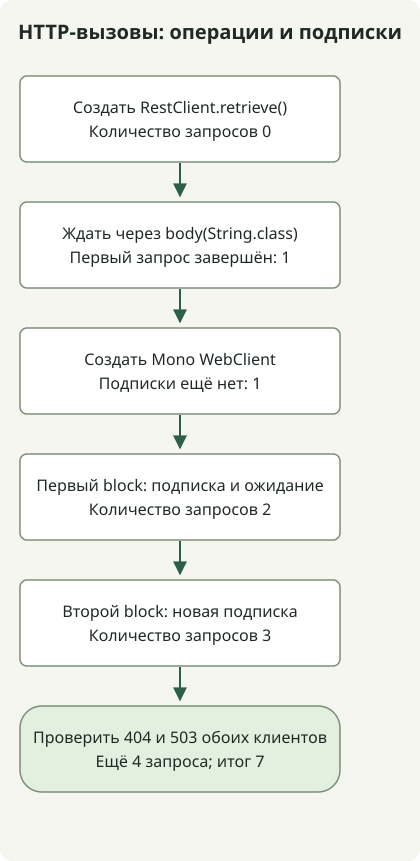

**Начните с RestClient, если синхронному сервисному коду нужен один HTTP-ответ перед продолжением. Рассмотрите WebClient, если нужны реактивная композиция или потоковая передача.** Оба предлагают цепочечные API, но [RestClient синхронен, а WebClient — неблокирующий реактивный клиент](https://docs.spring.io/spring-framework/reference/integration/rest-clients.html). Подбирайте клиент под модель выполнения приложения, а не количество запросов.


RestClient появился в Spring Framework 6.1; WebClient доступен с 5.0. Сначала проверьте, поддерживает ли ваша версия Framework выбранный клиент. При обновлении проекта Boot следуйте совместимой комбинации, управляемой Boot. Исполняемый пример ниже фиксирует Framework 7.0.10.

## Какой клиент подходит под какое требование?

| Критерий | RestClient | WebClient |
| --- | --- | --- |
| Результат | Терминальная операция, например извлечение тела, ожидает ответ и возвращает значение | Mono или Flux представляет результат; подписка запускает запрос |
| Естественное применение | Последовательный синхронный код в Spring MVC или пакетных заданиях | WebFlux, реактивная композиция и потоковая передача, например SSE |
| Передача ошибок | Стандартная обработка retrieve вызывает RestClientResponseException для 4xx и 5xx | Стандартная обработка retrieve выдаёт ошибку WebClientResponseException для 4xx и 5xx |
| Дополнительная сложность | Проще проследить обычный стек вызовов | Требует понимания операторов, подписки, отмены и передачи контекста |
| Контроль конкурентности | Отдельное проектирование исполнителей или конкурентности виртуальных потоков | Отдельное ограничение конкурентности композиции, например flatMap, и бюджетов соединений и ожидания |

Эта таблица начинается с обычных вызовов API, накапливающих ответ в памяти. RestClient также может читать потоки байтов через низкоуровневую обработку ответа, но WebClient естественнее подходит для реактивных потоков элементов и управления спросом. Использование WebClient не требует перевода сервера на WebFlux: Spring MVC тоже поддерживает реактивные возвращаемые типы. [Рекомендации Spring по HTTP-клиентам](https://spring.io/blog/2025/09/30/the-state-of-http-clients-in-spring/) проводят то же различие между типичными синхронными вызовами и реактивными или потоковыми требованиями.

Синхронный сервис на виртуальных потоках может сохранить последовательный код RestClient. Виртуальные потоки не делают его API неблокирующим и не увеличивают ёмкость нижележащих сервисов или лимиты соединений. Рассматривайте [область применения виртуальных потоков](/en/posts/2026-10-31-virtual-threads-jdk21-jdk25/) вместе с [ограничениями ёмкости зависимостей](/en/posts/2026-10-31-jdk-10k-rps-architecture/).

## Сравнение момента выполнения с одинаковыми HTTP-ответами



Схема показывает основные проверки метода main; настройка локального сервера, конфигурация клиентов и очистка опущены. **RestClient не отправляет запрос при одном лишь вызове retrieve().** Здесь body(String.class) выполняет запрос и ждёт результат. WebClient выполняет свой стандартный Mono запроса при подписке. Две подписки на этот Mono без операторов кеширования или совместного использования отправляют два запроса.

Этот самостоятельный консольный пример выполнялся с Spring Framework 7.0.10, Reactor Core 3.8.8, JDK 17 и Gradle 8.4. Это не приложение Spring Boot. Оба клиента явно используют JDK HttpClient, чтобы убрать различия выбора коннектора по умолчанию. В проекте Boot предпочитайте зависимости, управляемые этой версией Boot, а не переопределяйте их этим BOM.

### `settings.gradle`

```groovy
rootProject.name = 'http-client-comparison'
```

### `build.gradle`

```groovy
plugins { id 'application' }
repositories { mavenCentral() }
dependencies {
    implementation platform('org.springframework:spring-framework-bom:7.0.10')
    implementation 'org.springframework:spring-webflux'
}
java {
    sourceCompatibility = JavaVersion.VERSION_17
    targetCompatibility = JavaVersion.VERSION_17
}
application { mainClass = 'ClientComparison' }
```

### `src/main/java/ClientComparison.java`

```java
import com.sun.net.httpserver.HttpServer;
import java.net.InetSocketAddress;
import java.net.http.HttpClient;
import java.nio.charset.StandardCharsets;
import java.time.Duration;
import java.util.concurrent.atomic.AtomicInteger;
import org.springframework.http.client.JdkClientHttpRequestFactory;
import org.springframework.http.client.reactive.JdkClientHttpConnector;
import org.springframework.web.client.RestClient;
import org.springframework.web.client.RestClientResponseException;
import org.springframework.web.reactive.function.client.WebClient;
import org.springframework.web.reactive.function.client.WebClientResponseException;
import reactor.core.publisher.Mono;

public class ClientComparison {
    static void check(boolean condition) {
        if (!condition) throw new AssertionError("HTTP contract failed");
    }
    public static void main(String[] args) throws Exception {
        var requests = new AtomicInteger();
        var server = HttpServer.create(new InetSocketAddress("127.0.0.1", 0), 0);
        server.createContext("/", exchange -> {
            requests.incrementAndGet();
            String path = exchange.getRequestURI().getPath();
            int status = path.equals("/missing") ? 404 : path.equals("/unavailable") ? 503 : 200;
            byte[] body = (status == 200 ? "hello" : "error").getBytes(StandardCharsets.UTF_8);
            exchange.getResponseHeaders().set("Content-Type", "text/plain;charset=UTF-8");
            exchange.sendResponseHeaders(status, body.length);
            try (var output = exchange.getResponseBody()) { output.write(body); }
        });
        server.start();
        try {
            String base = "http://127.0.0.1:" + server.getAddress().getPort();
            var jdk = HttpClient.newBuilder().connectTimeout(Duration.ofSeconds(2)).build();
            var factory = new JdkClientHttpRequestFactory(jdk);
            factory.setReadTimeout(Duration.ofSeconds(2));
            var connector = new JdkClientHttpConnector(jdk);
            connector.setReadTimeout(Duration.ofSeconds(2));
            var rest = RestClient.builder().baseUrl(base).requestFactory(factory).build();
            var web = WebClient.builder().baseUrl(base).clientConnector(connector).build();

            var response = rest.get().uri("/hello").retrieve();
            check(requests.get() == 0);
            System.out.println("before-rest-terminal=" + requests.get());
            String sync = response.body(String.class);
            check("hello".equals(sync) && requests.get() == 1);
            System.out.println("rest=" + sync);

            Mono<String> pending = web.get().uri("/hello").retrieve().bodyToMono(String.class);
            check(requests.get() == 1);
            System.out.println("before-subscribe=" + requests.get());
            String first = pending.block(Duration.ofSeconds(5));
            check("hello".equals(first) && requests.get() == 2);
            System.out.println("web=" + first);
            System.out.println("after-first-subscribe=" + requests.get());
            String second = pending.block(Duration.ofSeconds(5));
            check("hello".equals(second) && requests.get() == 3);
            System.out.println("web-again=" + second);
            System.out.println("after-second-subscribe=" + requests.get());

            for (int status : new int[]{404, 503}) {
                String path = status == 404 ? "/missing" : "/unavailable";
                try {
                    rest.get().uri(path).retrieve().body(String.class);
                    throw new AssertionError("RestClient should fail");
                } catch (RestClientResponseException error) {
                    check(error.getStatusCode().value() == status);
                    System.out.println("rest-" + status + "=" + error.getStatusCode().value());
                }
                try {
                    web.get().uri(path).retrieve().bodyToMono(String.class).block(Duration.ofSeconds(5));
                    throw new AssertionError("WebClient should fail");
                } catch (WebClientResponseException error) {
                    check(error.getStatusCode().value() == status);
                    System.out.println("web-" + status + "=" + error.getStatusCode().value());
                }
            }
            check(requests.get() == 7);
            System.out.println("requests=" + requests.get());
        } finally { server.stop(0); }
    }
}
```

### Запуск и проверка

```sh
gradle --no-daemon --console=plain -q clean run
```

Первая загрузка зависимостей требует доступа к сети. Во время выполнения HTTP-запросы идут только на сервер 127.0.0.1 на временном порту. Далее приведён наблюдавшийся стандартный вывод приложения в указанной среде; Gradle или реализации журналирования могут выдавать отдельную диагностику.

```text
before-rest-terminal=0
rest=hello
before-subscribe=1
web=hello
after-first-subscribe=2
web-again=hello
after-second-subscribe=3
rest-404=404
web-404=404
rest-503=503
web-503=503
requests=7
```

Изменение с 0 до 1 показывает, что терминальная операция RestClient завершила первый запрос. Сразу после создания Mono счётчик остаётся 1. Каждый block подписывается, увеличивая его до 2, а затем до 3. Четыре последующих запроса проверяют обработку 404 и 503, всего 7. Эти количества проверяют контракты выполнения и ошибок; они не сравнивают пропускную способность, задержку или производительность цикла событий.

## Делает ли block поведение клиентов одинаковым?

Добавление block к WebClient заставляет **вызывающий код ждать результата**. Оно не делает реализацию нижележащего транспорта идентичной RestClient. Как объясняет [документация синхронного использования](https://docs.spring.io/spring-framework/reference/web/webflux-webclient/client-synchronous.html), возвращайте Mono или Flux из реактивного контроллера и позволяйте фреймворку подписываться. Вызовы block выше ограничены консольным main, наблюдающим поведение. Вызов RestClient или ожидание через block в цикле событий может занять его обрабатывающий поток или вызвать исключение, запрещающее блокирование неблокирующего потока.

Если приложение уже использует фильтры, аутентификацию и инструментирование WebClient, одни синхронные вызовы не требуют немедленной замены. Сравните стоимость добавления реактивных зависимостей и обработки подписок для нового синхронного вызова со стоимостью сохранения существующей конфигурации. Избегайте неограниченных подписок при объединении нескольких удалённых вызовов. [Реактивное управление спросом в WebFlux](https://docs.spring.io/spring-framework/reference/web/webflux/new-framework.html) согласует скорости производства и потребления; оно не обеспечивает автоматически лимиты RPS или соединений нижележащего сервиса.

## Что проверить перед рабочим использованием?

Обоим клиентам нужны бюджеты соединения, чтения ответа и всего вызова, а также политика статусов ошибок. Лимит соединения 2 секунды, лимиты чтения 2 секунды и ожидание block 5 секунд в примере — настройки воспроизведения, а не одинаковая семантика тайм-аутов или рекомендуемые рабочие значения. Область действия каждого тайм-аута чтения см. в документации [фабрики запросов](https://docs.spring.io/spring-framework/docs/7.0.10/javadoc-api/org/springframework/http/client/JdkClientHttpRequestFactory.html) и [реактивного коннектора](https://docs.spring.io/spring-framework/docs/7.0.10/javadoc-api/org/springframework/http/client/reactive/JdkClientHttpConnector.html). Эти быстрые локальные ответы не проверяют тайм-ауты, TLS или передачу отмены.

Пример проверяет стандартную обработку retrieve для ответов 4xx и 5xx обоих клиентов. Для явных политик статусов используйте onStatus. Не предполагайте, что низкоуровневые API exchange применяют стандартную обработку статусов retrieve. Примеры [обработки ответа WebClient](/en/posts/2023-09-19-springboot-test-webclient/) и [тайм-аутов и ограниченных повторов](/en/posts/2026-10-30-webclient-timeout-retry/) дают последующие контракты. Ограничивайте повторы идемпотентностью, количеством попыток и общим бюджетом времени; отдельно проверяйте пустые тела, большие ответы и ошибки соединения.

Существующий код RestTemplate — отдельный вопрос миграции. Spring Framework 7.0 рекомендует RestClient и объявляет RestTemplate устаревшим; WebClient не объявлен устаревшим. После выбора клиента проверьте аутентификацию, инструментирование и настройки соединений на фактическом составе запросов.
