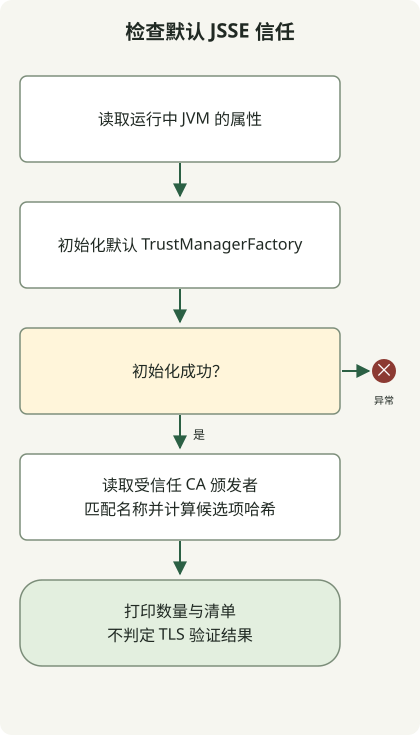

JDK eMudhra 修复要求**同时检查运行应用的 JDK 以及它实际使用的信任库**。[Oracle 公告](https://ops.java/emudhra/)和 [Temurin 公告](https://adoptium.net/news/2026/10/temurin-october-2026-emudhra/)说明了更新后的发行版及对相关 CA 的不信任处理，但两者实现不同。浏览器防护或主机 JDK 更新，不能证明容器或独立 JVM 已采用修复。

## 导入过期的服务器证书就能解决吗？

这次事件与普通的服务器证书过期不同。eMudhra 中间 CA 密钥遭泄露，造成可能信任伪造证书的路径，需要移除相关信任或采用供应商建议的防护。[Oracle 的 CVE-2026-91403 安全警报](https://www.oracle.com/security-alerts/alert-cve-2026-91403.html)提供了受影响产品和补丁指南。不要将 Oracle 的产品/版本表不加区分地应用于其他发行版。

`PKIX path building failed` 并不是此事件的唯一诊断标志。应区分服务器证书链不完整、信任库错误、私有 CA 和供应商信任变更。仅为消除错误而禁用验证或导入未经核实的 CA，可能破坏防护。

## 分别阅读各供应商公告

以下反映了 2026年10月30日核对的公告内容。部署时应重新检查产品、操作系统、完整构建和当前后续公告。

| 供应商 | 需要检查的区别 |
| --- | --- |
| [Oracle JDK](https://ops.java/emudhra/) | 移除相关根证书的更新，以及更新延迟时单独提供的临时缓解措施 |
| [Eclipse Temurin](https://adoptium.net/news/2026/10/temurin-october-2026-emudhra/) | 使用 Mozilla CA 数据；不再信任 `emSign ECC Root CA - G3` 和 `AAA Certificate Services`。已修复构建包括 21.0.13+9 和 17.0.21+9 |
| [Ubuntu OpenJDK](https://ubuntu.com/blog/emudhra-ca-compromise-fixes-available) | 与系统 CA 库集成；当前的同步缺陷要求在更新 `ca-certificates` 后，对 Java 信任库额外执行手动操作 |

Temurin 公告说明，仅存在 `emSign Root CA - G1` 不能证明修复失败。将通用 `CheckCerts` 根证书清单视为统一通过标准，可能误判不同发行版。仅凭根证书别名、名称和数量，不能认证防护状态。

## 读取当前 JVM 默认的 JSSE 信任信息



图示对应下面的只读收集器。它初始化默认 `TrustManagerFactory` 并搜索 CA 名称。名称匹配只是与供应商指南比较指纹的起点，不代表易受攻击或安全的结论。如果默认信任管理器初始化失败，程序会以异常终止。

使用 JDK 17 或更高版本，将此文件保存在新目录中。它只使用公开的 [TrustManagerFactory](https://docs.oracle.com/en/java/javase/21/docs/api/java.base/javax/net/ssl/TrustManagerFactory.html) 和 [X509TrustManager](https://docs.oracle.com/en/java/javase/21/docs/api/java.base/javax/net/ssl/X509TrustManager.html) API。不会修改文件、发送网络请求、添加或删除证书，也不会绕过 TLS 验证。

### `TrustInventory.java`

```java
import java.security.KeyStore;
import java.security.MessageDigest;
import java.security.cert.X509Certificate;
import java.util.HexFormat;
import java.util.Locale;
import javax.net.ssl.TrustManager;
import javax.net.ssl.TrustManagerFactory;
import javax.net.ssl.X509TrustManager;

public class TrustInventory {
    public static void main(String[] args) throws Exception {
        System.out.println("java.version=" + System.getProperty("java.version"));
        System.out.println("java.vendor=" + System.getProperty("java.vendor"));
        System.out.println("java.home=" + System.getProperty("java.home"));
        System.out.println("configuredTrustStore=" +
            System.getProperty("javax.net.ssl.trustStore", "<default JSSE lookup>"));
        TrustManagerFactory factory = TrustManagerFactory.getInstance(
            TrustManagerFactory.getDefaultAlgorithm());
        factory.init((KeyStore) null);
        System.out.println("trustManagerProvider=" + factory.getProvider().getName());
        MessageDigest sha256 = MessageDigest.getInstance("SHA-256");
        int issuers = 0;
        int matches = 0;
        for (TrustManager manager : factory.getTrustManagers()) {
            if (!(manager instanceof X509TrustManager x509)) continue;
            for (X509Certificate cert : x509.getAcceptedIssuers()) {
                issuers++;
                String subject = cert.getSubjectX500Principal().getName();
                String lower = subject.toLowerCase(Locale.ROOT);
                if (lower.contains("emsign") || lower.contains("aaa certificate services")) {
                    String fingerprint = HexFormat.of().withUpperCase()
                        .formatHex(sha256.digest(cert.getEncoded()));
                    System.out.println("candidate=" + subject + "\tSHA256=" + fingerprint);
                    matches++;
                }
            }
        }
        System.out.println("acceptedIssuers=" + issuers);
        System.out.println("nameMatches=" + matches);
        System.out.println("assessment=inventory-only; no validation verdict");
    }
}
```

```sh
javac --release 17 TrustInventory.java
java TrustInventory
```

本地 JDK 检查编译了程序，并确认默认清单输出。另行生成的测试 CA 信任库也用于检查名称候选项与 SHA-256 指纹、无关名称的信任库以及空信任库。这些测试 CA 并非实际的 eMudhra 证书；执行成功不能认证生产 JVM 已受到保护。

报告的 `java.home` 属于**刚刚启动的 JVM**。`configuredTrustStore` 为 `<default JSSE lookup>` 表示未指定系统属性，不代表没有找到信任库。输出不包含信任库密码。

## 默认查找可能不同于应用配置

[SunJSSE 参考文档](https://docs.oracle.com/en/java/javase/25/security/java-secure-socket-extension-jsse-reference-guide.html)区分了显式 `javax.net.ssl.trustStore` 与默认 `jssecacerts`/`cacerts` 查找。本程序在新 JVM 中读取该默认初始化路径。它不会自动发现应用创建的 `SSLContext`/`TrustManager` 实例、框架设置或原生 TLS 库。

候选项为零不是安全结论。根据提供者和构建的不同，不存在的信任库路径可能回退到其他信任库、产生空清单，或初始化失败。本地 JDK 检查观察到了默认信任库回退和密码不匹配导致的失败。其他名称或验证路径也可能被遗漏。反之，列出某个名称并不能证明 TLS 验证一定接受其证书链。此代码不执行阻止列表、吊销或证书路径检查。

## 更新后检查正常连接和拒绝行为

1. 识别实际服务的 JDK 供应商、完整构建、可执行文件、JVM 启动选项和镜像摘要，包括自定义信任库及应用特定的 TLS 设置。
2. 部署供应商已修复的构建。如果维护独立信任库，应按供应商指南比较其内容。手动删除前，先确认备份、指纹和连接影响。由于 Ubuntu 当前的同步缺陷，更新 `ca-certificates` 后还需要执行额外的 [Java 根 CA 库更新流程](https://ubuntu.com/blog/emudhra-ca-compromise-fixes-available#updating-the-java-root-ca-store)。保留本地配置的 CA，并准备在重新生成后将其重新添加。
3. 替换或重启每个 JVM 及副本。修改某个安装的 `cacerts` 不会自动更新另一套 JDK 或已经运行的进程。
4. 同时验证普通 HTTPS 成功，以及供应商指定的受影响证书链遭拒绝。TLS 结果不能替代对签名 JAR 的验证。

本文没有连接外部测试主机，也没有验证实际受影响证书链遭拒绝。不要仅凭收集器输出就将这些检查记为已完成。生产环境应遵循[供应商特定的验证指南](https://adoptium.net/news/2026/10/temurin-october-2026-emudhra/)，并配合证书替换计划。

GitLab 正则表达式 RCE 与此次证书问题不同。有关 GitLab 升级指南，请参阅 [CVE-2026-110264 响应指南](/en/posts/2026-10-30-gitlab2shell-cve-2026-110264/)。
