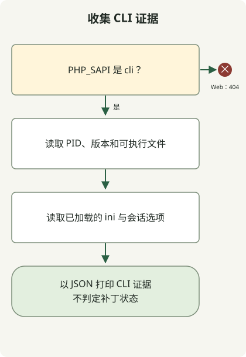

PHP2Shell 修复并不止于更新 CMS 或插件。需要获取修复了 [CVE-2026-109618](https://github.com/php/php-src/security/advisories/GHSA-w8hw-w9fx-j79w) 和 [CVE-2026-109619](https://github.com/php/php-src/security/advisories/GHSA-6wmf-4rv5-p3rp) 的 PHP 构建，然后验证所有处理 Web 请求的工作进程都在使用它。终端中的 `php -v` 只报告该终端选中的 CLI。

## PHP2Shell 影响什么？

这两个 CVE 涉及 PHP 引擎中的请求状态和内存生命周期。第一个涉及内存不足处理打断初始化后，清理阶段使用了无效状态。第二个涉及请求内存释放后内部状态仍然存留，并被同一工作进程中的后续请求使用。在受影响的条件下，可能发生未经身份验证的远程代码执行。

[PHP 团队公告](https://www.php.net/archive/2026.php)列出的待调查 Web 服务部署包括 PHP-FPM、php-cgi、FrankenPHP、LiteSpeed 以及 mod_php。不能因使用某种 SAPI 就排除服务。反过来，仅有易受攻击的版本字符串，也不能证明该服务存在可达的利用路径。

## 应当比较哪个版本？

以下是**修复最初两个 CVE 的首个上游源码发行版**，核对日期为 2026年10月30日。安装前，请检查同一供应商当前受支持的版本及后续公告。

| PHP 分支 | 首个修复两个 CVE 的源码发行版 |
| --- | --- |
| 8.2 | 8.2.35 |
| 8.3 | 8.3.36 |
| 8.4 | 8.4.27 |
| 8.5 | 8.5.12 |

对于发行版软件包，应将完整软件包修订号与供应商公告比较，而非简短的 PHP 版本号。例如，[Ubuntu USN-8948-1](https://ubuntu.com/security/notices/USN-8948-1)将 `8.3.6-0ubuntu0.24.04.13` 列为 Ubuntu 24.04 已修复的 `php8.3-fpm` 软件包。如果拿这个编号与上游 `8.3.36` 比较，就会误判回移补丁。该公告并不能认证任意显示相同版本字符串的自定义构建。

PHP 项目已不再支持 PHP 8.1 及更早版本。请核实供应商支持和回移补丁证据，或迁移到受支持的分支。源码补丁已经发布，与证明服务器正在运行该补丁，是两回事。

## 收集 CLI 证据，但不要将其当作 Web 证据



图示对应下面的收集器。在 Web SAPI 下，它不打印信息就退出。在 CLI 下，它记录可执行文件、版本和配置，但不判断补丁状态。服务识别、打补丁和重启是独立的运维步骤，此代码不会执行这些操作。

使用 PHP 8.2 或更高版本，将文件保存在文档根目录之外的新目录中。它只通过 [PHP 常量](https://www.php.net/manual/en/reserved.constants.php)和 [ini_get](https://www.php.net/manual/en/function.ini-get.php)读取当前进程，不发送请求、不修改设置，也不启动会话。无需发布 `phpinfo()` 页面。

### `runtime-evidence.php`

```php
<?php
if (PHP_SAPI !== 'cli') {
    http_response_code(404);
    exit;
}

$evidence = [
    'scope' => 'this-cli-process-only',
    'pid' => getmypid(),
    'version' => PHP_VERSION,
    'sapi' => PHP_SAPI,
    'binary' => PHP_BINARY,
    'loadedIni' => php_ini_loaded_file() ?: null,
    'uploadProgress' => ini_get('session.upload_progress.enabled'),
    'serializeHandler' => ini_get('session.serialize_handler'),
];
echo json_encode($evidence, JSON_PRETTY_PRINT | JSON_THROW_ON_ERROR), PHP_EOL;
```

```sh
php runtime-evidence.php
php -n -d session.upload_progress.enabled=0 runtime-evidence.php
```

第一条命令读取所选 CLI 的配置。第二条跳过 ini 文件，且仅对此次 CLI 调用禁用上传进度。**它既不修改 Web 服务器设置，也不检查 Web 工作进程的有效配置**。

本地检查在隔离的 PHP CLI 容器中运行，确认 JSON 输出中 `sapi` 为 `cli`。第二条命令的 `loadedIni` 返回 `null`，`uploadProgress` 返回字符串 `"0"`。路径、PID、版本和默认值因环境而异。这些结果不能确立生产服务的补丁状态，也没有复现利用过程。

## 分别验证安装和运行中的工作进程

1. 沿 Web 服务器上游、FastCGI 或模块配置，识别实际使用的 PHP 可执行文件、进程池、容器和副本。不要假定主机 CLI 和 Web 运行时共用安装路径。
2. 将该运行时的供应商、完整软件包修订号或镜像摘要与公告对照。对于自定义构建，需要建立修复提交与部署产物之间的对应关系。
3. 部署兼容的已修复构建，替换受影响进程池或服务的工作进程，或相应容器。如果其他服务共享运行时，先检查变更范围。
4. 在每个目标上验证新进程与已修复构建的对应关系。检查正常页面、登录与会话行为、上传及错误率。部分发布或缺少运行进程证据不能算作完成。

在内部资产记录中，将“已识别修复产物”和“已验证运行采用”分开，有助于找出遗漏的工作进程。单次崩溃不能证明入侵，缺少错误日志也不能排除入侵。如果怀疑遭到入侵，请保留证据，并将调查与打补丁分开进行。

## 单独处理会话后续问题和 Windows 重新构建

[10月23日的 PHP 后续公告](https://www.php.net/archive/2026.php)单独跟踪 **CVE-2026-115560**。其涉及以下条件的组合：`session.serialize_handler` 配置为 `php_binary` 或 `php_serialize`，应用代码在调用 `session_start()` 前将其切换为 `php`，且上传进度仍然启用。公告建议在下一次常规修复之前设置 `session.upload_progress.enabled=0`。该设置不能证明最初两个 CVE 已完全解决。应检查 Web SAPI 的有效配置及对功能的影响。

[10月26日的 Windows 公告](https://www.php.net/archive/2026.php)宣布发布 `8.5.12-1`、`8.4.27-1`、`8.3.36-1` 和 `8.2.35-1` 软件包，纳入 **CVE-2026-111497** 的 Brotli 修复。这些版本重新构建依赖项，但不改变 PHP 源码版本，因此仅靠 `PHP_VERSION` 无法区分。使用 cURL 自动解压响应的 Windows 部署也需要核查这项软件包修复。有关 Node.js 中同一 Brotli CVE 的说明，请继续阅读 [Node2Shell 响应指南](/en/posts/2026-10-30-node2shell-brotli-runtime-patching/)。
