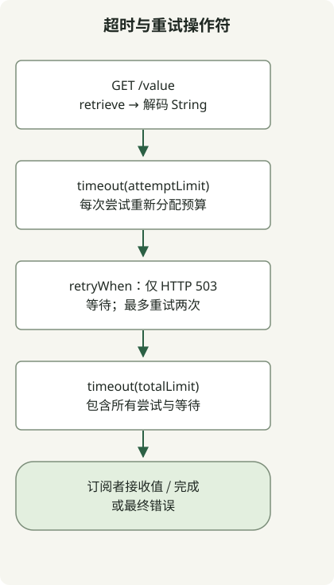

在 `retryWhen` 之前放置单次尝试的 `timeout`，在其后放置总 `timeout`，将重试等待计入整体预算。只重试 API 契约允许的失败：本 GET 示例仅对 HTTP 503 最多重试两次，遇到超时或其他错误就停止。Spring 将[传输超时](https://docs.spring.io/spring-framework/reference/6.2/web/webflux-webclient/client-builder.html)与 Reactor 的[发布者超时](https://projectreactor.io/docs/core/3.7.12/api/reactor/core/publisher/Mono.html)分别说明。

## 每项设置限制什么？

| 设置 | 本例中的范围 |
| --- | --- |
| `CONNECT_TIMEOUT_MILLIS` | 建立 TCP 连接；不覆盖完整的 DNS、连接池获取或 TLS 预算 |
| `responseTimeout` | 接收响应时两次网络读取之间的最大间隔；不是完整响应体的截止时间 |
| 第一个 `timeout(attemptLimit)` | 一次订阅直至响应体解码；每次重试重新计时 |
| 最后一个 `timeout(totalLimit)` | 完整订阅，包括所有尝试及重试等待 |
| `StepVerifier.verify(GUARD)` | 测试运行器的最大等待时间；不配置客户端 |

Reactor Netty 的 [responseTimeout 文档](https://projectreactor.io/docs/netty/1.2.11/api/reactor/netty/http/client/HttpClient.html)描述的是读取间隔，因此持续传输数据的响应总时长可能超过该时间。外层发布者超时提供独立的整体截止时间。取消会停止此次订阅，但不会撤销远程服务已经执行的工作。

## 先限制重试，再增加失败场景



图示概括操作符的嵌套，而非每个 HTTP 事件。每次尝试要么成功，要么发出错误。只有仍有重试次数的 503 错误才会在等待后触发重新订阅；其他错误立即停止。外层超时可以取消正在进行的尝试或重试等待。

[`Retry.fixedDelay(2, delay)`](https://projectreactor.io/docs/core/release/api/reactor/util/retry/Retry.html)允许在首次尝试后重试两次：每次订阅最多三次应用层尝试。`.onRetryExhaustedThrow` 传播最后的 503 异常，而不是重试耗尽的包装异常。`.disableRetry(true)` 禁用 Reactor Netty 针对 TCP 中止的独立自动重试，因此不会在这些计数中增加隐藏的传输层重试。

示例执行 GET，并有意仅重试 503。超时并不证明服务器什么都没做。没有明确的幂等性契约时，不要将此策略复制到付款或其他写入操作。它不处理 `Retry-After`，不重试 429，不使用指数退避或抖动，也不协调各调用方的重试。较短的固定等待让测试更快；生产环境的限制和退避应根据 API 契约与负载预算选择。

## 创建独立项目

使用新的空目录、JDK 17 和 Gradle 8.4。示例固定使用 Boot BOM 3.5.7 和 MockWebServer 4.12.0，以对应[响应契约测试](/en/posts/2023-09-19-springboot-test-webclient/)。这些是复现输入，不是当前生产版本建议。首次解析依赖使用 Maven Central；HTTP 测试仅使用回环地址。不包含运行中的 Boot 应用或 Gradle wrapper。

### `settings.gradle`

```groovy
rootProject.name = 'webclient-timeout-retry'
```

### `build.gradle`

```groovy
plugins { id 'java' }
repositories { mavenCentral() }
dependencies {
    implementation platform('org.springframework.boot:spring-boot-dependencies:3.5.7')
    implementation 'org.springframework.boot:spring-boot-starter-webflux'
    testImplementation 'org.springframework.boot:spring-boot-starter-test'
    testImplementation 'io.projectreactor:reactor-test'
    testImplementation 'com.squareup.okhttp3:mockwebserver:4.12.0'
    testRuntimeOnly 'org.junit.platform:junit-platform-launcher'
}
test { useJUnitPlatform() }
```

## 将两个截止时间放在不同位置

保存以下实现。构造函数接收调用方选择的正时长，测试提供明确值。响应超时和 1,000 ms 的 TCP 连接超时属于传输工厂。

### `src/main/java/RetryClient.java`

```java
import java.time.Duration;
import io.netty.channel.ChannelOption;
import org.springframework.http.client.reactive.ReactorClientHttpConnector;
import org.springframework.web.reactive.function.client.WebClient;
import org.springframework.web.reactive.function.client.WebClientResponseException;
import reactor.core.publisher.Mono;
import reactor.netty.http.client.HttpClient;
import reactor.util.retry.Retry;

public class RetryClient {
    private final WebClient client;
    private final Duration attemptLimit;
    private final Duration totalLimit;
    private final Duration retryDelay;

    public RetryClient(WebClient client, Duration attemptLimit,
                       Duration totalLimit, Duration retryDelay) {
        this.client = client;
        this.attemptLimit = attemptLimit;
        this.totalLimit = totalLimit;
        this.retryDelay = retryDelay;
    }

    public static WebClient transport(String baseUrl, Duration responseLimit) {
        HttpClient http = HttpClient.create()
            .disableRetry(true)
            .option(ChannelOption.CONNECT_TIMEOUT_MILLIS, 1000)
            .responseTimeout(responseLimit);
        return WebClient.builder().baseUrl(baseUrl)
            .clientConnector(new ReactorClientHttpConnector(http)).build();
    }

    public Mono<String> get() {
        return Mono.defer(() -> client.get().uri("/value")
                .retrieve().bodyToMono(String.class))
            .timeout(attemptLimit)
            .retryWhen(Retry.fixedDelay(2, retryDelay)
                .filter(error -> error instanceof WebClientResponseException response
                    && response.getStatusCode().value() == 503)
                .onRetryExhaustedThrow((spec, signal) -> signal.failure()))
            .timeout(totalLimit);
    }
}
```

## 复现九项策略契约

七项测试使用真正的 WebClient 和本地 MockWebServer。两项使用模拟 exchange 与 Reactor 虚拟时间，验证操作符的时序而不依赖网络调度。虚拟时间不测试 Reactor Netty 的真实套接字超时。传输测试检查被包装的读取超时原因，而发布者超时产生 `TimeoutException`。

### `src/test/java/RetryClientTest.java`

```java
import java.io.IOException;
import java.time.Duration;
import java.util.concurrent.TimeUnit;
import java.util.concurrent.TimeoutException;
import java.util.concurrent.atomic.AtomicInteger;
import io.netty.handler.timeout.ReadTimeoutException;
import okhttp3.mockwebserver.MockResponse;
import okhttp3.mockwebserver.MockWebServer;
import okhttp3.mockwebserver.SocketPolicy;
import org.junit.jupiter.api.AfterEach;
import org.junit.jupiter.api.BeforeAll;
import org.junit.jupiter.api.BeforeEach;
import org.junit.jupiter.api.Test;
import org.springframework.http.HttpStatus;
import org.springframework.web.reactive.function.client.ClientResponse;
import org.springframework.web.reactive.function.client.WebClient;
import org.springframework.web.reactive.function.client.WebClientRequestException;
import org.springframework.web.reactive.function.client.WebClientResponseException;
import reactor.core.publisher.Mono;
import reactor.netty.http.client.HttpClient;
import reactor.test.StepVerifier;
import static org.junit.jupiter.api.Assertions.*;

class RetryClientTest {
    private MockWebServer server;
    private WebClient client;
    private static final Duration GUARD = Duration.ofSeconds(10);

    @BeforeAll
    static void warmUp() {
        HttpClient.create().warmup().block(GUARD);
    }

    @BeforeEach
    void start() throws IOException {
        server = new MockWebServer();
        server.start();
        client = RetryClient.transport(server.url("/").toString(), Duration.ofSeconds(5));
    }

    @AfterEach
    void stop() throws IOException {
        server.shutdown();
    }

    RetryClient policy() {
        return new RetryClient(client, Duration.ofSeconds(3),
            Duration.ofSeconds(8), Duration.ofMillis(10));
    }

    void expectStatus(int status) {
        StepVerifier.create(policy().get())
            .expectErrorSatisfies(error -> assertEquals(status,
                assertInstanceOf(WebClientResponseException.class, error).getStatusCode().value()))
            .verify(GUARD);
    }

    @Test
    void successUsesOneRequest() {
        server.enqueue(new MockResponse().setBody("ok"));
        StepVerifier.create(policy().get()).expectNext("ok").expectComplete().verify(GUARD);
        assertEquals(1, server.getRequestCount());
    }

    @Test
    void two503ResponsesThenSuccessUseThreeRequests() {
        server.enqueue(new MockResponse().setResponseCode(503));
        server.enqueue(new MockResponse().setResponseCode(503));
        server.enqueue(new MockResponse().setBody("ok"));
        StepVerifier.create(policy().get()).expectNext("ok").expectComplete().verify(GUARD);
        assertEquals(3, server.getRequestCount());
    }

    @Test
    void exhausted503PreservesLastStatusAfterThreeRequests() {
        for (int i = 0; i < 3; i++) server.enqueue(new MockResponse().setResponseCode(503));
        expectStatus(503);
        assertEquals(3, server.getRequestCount());
    }

    @Test
    void notFoundIsNotRetried() {
        server.enqueue(new MockResponse().setResponseCode(404));
        expectStatus(404);
        assertEquals(1, server.getRequestCount());
    }

    @Test
    void otherServerErrorsAreNotRetried() {
        server.enqueue(new MockResponse().setResponseCode(500));
        expectStatus(500);
        assertEquals(1, server.getRequestCount());
    }

    @Test
    void attemptTimeoutIsNotRetried() {
        server.enqueue(new MockResponse().setSocketPolicy(SocketPolicy.NO_RESPONSE));
        RetryClient limited = new RetryClient(client, Duration.ofSeconds(1),
            Duration.ofSeconds(8), Duration.ofMillis(10));
        StepVerifier.create(limited.get()).expectError(TimeoutException.class).verify(GUARD);
        assertEquals(1, server.getRequestCount());
    }

    @Test
    void responseReadTimeoutIsNotRetried() {
        server.enqueue(new MockResponse().setSocketPolicy(SocketPolicy.NO_RESPONSE));
        WebClient shortRead = RetryClient.transport(server.url("/").toString(), Duration.ofMillis(250));
        RetryClient limited = new RetryClient(shortRead, Duration.ofSeconds(3),
            Duration.ofSeconds(8), Duration.ofMillis(10));
        StepVerifier.create(limited.get()).expectErrorSatisfies(error -> {
            assertInstanceOf(WebClientRequestException.class, error);
            assertInstanceOf(ReadTimeoutException.class, error.getCause());
        }).verify(GUARD);
        assertEquals(1, server.getRequestCount());
    }

    @Test
    void totalBudgetIncludesRetryDelay() {
        AtomicInteger attempts = new AtomicInteger();
        StepVerifier.withVirtualTime(() -> {
            WebClient synthetic = WebClient.builder().exchangeFunction(request -> Mono.defer(() -> {
                attempts.incrementAndGet();
                return Mono.just(ClientResponse.create(HttpStatus.SERVICE_UNAVAILABLE).build());
            })).build();
            return new RetryClient(synthetic, Duration.ofSeconds(1),
                Duration.ofMillis(1500), Duration.ofSeconds(1)).get();
        }).thenAwait(Duration.ofMillis(1500)).expectError(TimeoutException.class).verify(GUARD);
        assertEquals(2, attempts.get());
    }

    @Test
    void attemptBudgetRestartsAfterRetry() {
        AtomicInteger attempts = new AtomicInteger();
        StepVerifier.withVirtualTime(() -> {
            WebClient synthetic = WebClient.builder().exchangeFunction(request -> Mono.defer(() -> {
                int attempt = attempts.incrementAndGet();
                return Mono.delay(Duration.ofMillis(400)).map(tick -> attempt == 1
                    ? ClientResponse.create(HttpStatus.SERVICE_UNAVAILABLE).build()
                    : ClientResponse.create(HttpStatus.OK).body("ok").build());
            })).build();
            return new RetryClient(synthetic, Duration.ofMillis(500),
                Duration.ofSeconds(2), Duration.ofMillis(200)).get();
        }).thenAwait(Duration.ofSeconds(1)).expectNext("ok").expectComplete().verify(GUARD);
        assertEquals(2, attempts.get());
    }
}
```

## 运行项目并阅读结果

```sh
gradle --no-daemon clean test
```

本地复现使用 JDK 17.0.8.1 和 Gradle 8.4。九项测试全部通过。请查看 `build/reports/tests/test/index.html` 或 `build/test-results/test/TEST-RetryClientTest.xml` 中的断言；单凭 `BUILD SUCCESSFUL` 无法知道运行了多少测试。

| 场景 | 已检查的结果 |
| --- | --- |
| 立即成功 | 一次 HTTP 请求、`ok`，然后完成 |
| 503 → 503 → 成功 | 三次 HTTP 请求、`ok`，然后完成 |
| 每次尝试均为 503 | 三次 HTTP 请求，保留最终的 503 |
| 404 / 500 | 各一次 HTTP 请求，保留状态 |
| 无响应，单次尝试限制一秒 | `TimeoutException`，一次 HTTP 请求 |
| 无响应，响应读取限制 250 ms | 包含 `ReadTimeoutException` 的 `WebClientRequestException`，一次请求 |
| 总预算 1.5 s，重试等待一秒 | 两次模拟尝试；超时在第三次之前取消等待 |
| 尝试 400 ms，等待 200 ms，再尝试 400 ms | 每次尝试均在 500 ms 内；虚拟时间推进 1 s 后检查成功与完成 |

这些检查不复现 TCP 建连超时、DNS 失败、TLS 协商、连接池耗尽、重定向或分布式副作用。连接限制已经配置，但未在此通过实验验证。操作系统调度会影响实际耗时；测试断言错误类型和请求次数，而非精确的时钟毫秒数。状态、媒体类型及 JSON 处理请继续阅读 [WebClient 响应契约示例](/en/posts/2023-09-19-springboot-test-webclient/)。
