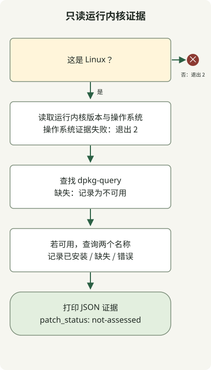

**Fragnesia（CVE-2026-46300）是 Linux 内核中的本地权限提升漏洞**。应针对正确的发行版和内核系列应用修复，再验证修复已在运行中的内核生效。[Ubuntu 官方说明](https://ubuntu.com/security/CVE-2026-46300)还指出，在适用条件下可能发生容器逃逸。运行 Linux 并不意味着所有系统的暴露情况都相同。

## 互联网攻击者能直接借此获得 root 吗？

此 CVE 是本地权限提升，要求攻击者能够在系统上运行代码，并到达有漏洞的内核路径。应将它与 Web 应用中的远程代码执行区分开。[CISA 官方 KEV 数据](https://www.cisa.gov/sites/default/files/feeds/known_exploited_vulnerabilities.json)记录了将其与 PHP2Shell CVE-2026-109618 和 CVE-2026-109619 串联利用的风险。应分别检查 [PHP 运行时补丁](/en/posts/2026-10-30-php2shell-runtime-patching/)和主机内核补丁。

[原始 CVE 记录](https://cveawg.mitre.org/api/cve/CVE-2026-46300)描述了套接字缓冲区合并期间共享页片段标记丢失的问题。后续 ESP 处理可能把共享页误认为私有页，并原地修改。此 CVE 于 2026年5月23日发布；CISA 于 10月28日将其加入 KEV。该缺陷并非在十月首次引入。应在相关指令的适用范围内解读 KEV 的 10月31日期限，不要将其视为所有服务通用的变更截止时间。

## 哪个内核需要更新？

不要孤立地把修复范围缩小到一个 CVE。[Ubuntu 安全团队说明](https://ubuntu.com/security/CVE-2026-46300#notes)建议将相关修复与 CVE-2026-43284 一起交付。另一项片段传递路径修复也以 [CVE-2026-43503](https://ubuntu.com/security/CVE-2026-43503)跟踪。[CVE-2026-43284](https://ubuntu.com/security/CVE-2026-43284)是 Dirty Frag 家族中的独立条目。应优先采用供应商完整的已修复软件包；仅应用某个选定提交，不能证明修复完成。

以下是截至 2026年10月31日核对的部分 Ubuntu **linux 源码包**修复门槛。首先将已安装的二进制软件包映射到其源码包和内核系列。

| Ubuntu 版本 | linux 修复门槛 |
| --- | --- |
| 22.04 LTS | 5.15.0-181.191 |
| 24.04 LTS | 6.8.0-124.124 |
| 26.04 LTS | 7.0.0-22.22 |

不要将这些门槛用于 AWS、Azure、HWE、OEM 或实时内核：软件包名称、支持的系列及供应商回移补丁各有不同。RHEL 应遵循 [Red Hat 公告](https://access.redhat.com/security/vulnerabilities/RHSB-2026-003)链接的产品状态和 RHSA。[AWS 自身公告](https://aws.amazon.com/security/security-bulletins/2026-030-aws/)根据 espintcp 配置说明 Amazon Linux 和 Bottlerocket 不受影响。不要将该说法扩展到任意自定义内核或运行于 EC2 的其他发行版。

## 先收集运行内核的证据



图示对应下面的收集器。它需要 [Python 3.10 或更高版本](https://docs.python.org/3/library/platform.html#platform.freedesktop_os_release)。在具备 [dpkg-query](https://manpages.debian.org/trixie/dpkg/dpkg-query.1.en.html) 的 Linux 上，仅查询从运行内核版本派生的两个软件包名。它不使用网络访问、管理员权限、模块加载或系统变更。**它既不是漏洞检测器，也不对补丁完成情况作出结论**。缺少证据绝不会被报告为安全。

### `kernel-evidence.py`

```python
import json
import platform
import shutil
import subprocess


def collect():
    result = {"patch_status": "not-assessed", "scope": "current-execution-context"}
    if platform.system() != "Linux":
        return {**result, "error": "linux-required"}, 2
    try:
        release = platform.release()
        distro = platform.freedesktop_os_release()
    except OSError:
        return {**result, "error": "os-evidence-unavailable"}, 2
    result.update(running_kernel=release,
                  os={key: distro.get(key) for key in ("ID", "VERSION_ID")}, queries=[])
    command = shutil.which("dpkg-query")
    if not command:
        return {**result, "package_query": "dpkg-query-unavailable"}, 0
    result["package_query"] = "dpkg-query"
    for name in ("linux-image-" + release, "linux-image-unsigned-" + release):
        row = {"package": name}
        try:
            answer = subprocess.run(
                [command, "-W", "-f=${Package}\t${Version}\t${db:Status-Status}\n", name],
                capture_output=True, text=True, timeout=5, check=False)
        except (OSError, subprocess.TimeoutExpired):
            row["state"] = "query-error"
        else:
            fields = answer.stdout.rstrip("\n").split("\t")
            if answer.returncode == 1:
                row["state"] = "not-found"
            elif answer.returncode != 0:
                row["state"] = "query-error"
            elif len(fields) != 3 or fields[0] != name or not fields[1]:
                row["state"] = "unexpected-output"
            elif fields[2] != "installed":
                row["state"] = "not-installed"
            else:
                row.update(state="installed", version=fields[1])
        result["queries"].append(row)
    return result, 0


if __name__ == "__main__":
    evidence, status = collect()
    print(json.dumps(evidence, ensure_ascii=False, indent=2, sort_keys=True))
    raise SystemExit(status)
```

```sh
python3 kernel-evidence.py
```

非 Linux 环境或无法获得操作系统证据时，返回退出码 2。即使 Linux 收集完成，个别软件包查询仍可能失败：应阅读 package_query 以及每一项 state。退出码 0 不能证明补丁完成。这两次查询无法识别 RPM 或自定义内核所属的软件包。

以下输出是**使用合成输入执行并检查过的结果**：Ubuntu 24.04，运行内核 6.8.0-124-generic，第一个软件包已安装，第二个不存在。它不是生产 Ubuntu 主机的证据。执行检查复现了此输出及查询失败分支，但没有测试实际内核漏洞、补丁采用或利用过程。

```text
{
  "os": {
    "ID": "ubuntu",
    "VERSION_ID": "24.04"
  },
  "package_query": "dpkg-query",
  "patch_status": "not-assessed",
  "queries": [
    {
      "package": "linux-image-6.8.0-124-generic",
      "state": "installed",
      "version": "6.8.0-124.124"
    },
    {
      "package": "linux-image-unsigned-6.8.0-124-generic",
      "state": "not-found"
    }
  ],
  "running_kernel": "6.8.0-124-generic",
  "scope": "current-execution-context"
}
```

在容器内，操作系统与软件包数据库可能属于容器，而内核属于共享主机。应通过主机或虚拟机管理路径重新收集。新安装的内核软件包也可能不同于当前运行的内核。此收集器只查询与当前版本绑定的名称，不枚举所有已安装内核，也不验证软件包签名、完整性或 livepatch 状态。

## 打补丁后应验证什么？

1. 将资产的发行版、运行内核及软件包系列映射到供应商 CVE 或安全公告。不要用简单字符串比较跨系列版本。
2. 通过受支持的软件源或镜像应用已修复软件包，然后分阶段替换或重启节点。[Ubuntu USN-8388-1](https://ubuntu.com/security/notices/USN-8388-1)要求在标准更新后重启，并说明了第三方内核模块的 ABI 变更。如果仅依赖 livepatch，应单独验证其对该 CVE 和运行内核的支持及实际应用情况。
3. 重启后收集同样的证据，将活动内核与供应商修复证据比较，并检查服务健康、存储和网络。仅重启 Kubernetes pod 不会替换节点内核。
4. 还应调查可能的初始访问及持久化。补丁成功不能证明不存在已有 webshell 或被盗凭据。

如果无法立即更新，请查阅 [Ubuntu 临时缓解指南](https://ubuntu.com/blog/dirty-frag-linux-vulnerability-fixes-available)及供应商说明。模块限制可能与 VPN/IPsec 等功能冲突；已经加载或内置的路径需要单独评估。模块列表中不存在某项，并不能证明不受影响。降低暴露和限制不可信代码是临时措施，不能替代应用已修复软件包。
