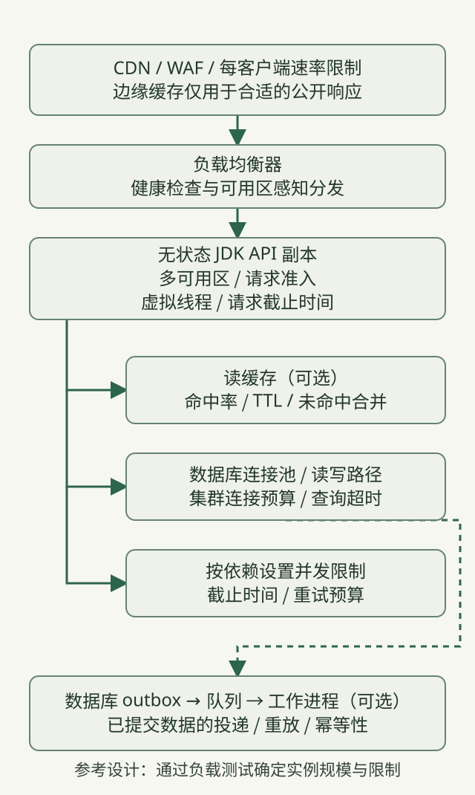
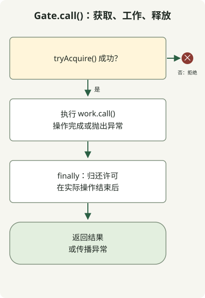

**每秒 10,000 个请求的 HTTP API，首先需要明确请求与依赖容量预算及过载行为，然后才是更新的 JDK**。从跨可用区的无状态 API 副本、请求准入限制及按依赖设置的并发限制开始。根据测得的瓶颈和一致性要求添加缓存、队列与只读副本。本文是包含示例计算的设计指南，**不是成功完成 10k RPS 负载测试的报告**。

截至 2026年10月31日，最新 GA 版本是 [JDK 27](https://openjdk.org/projects/jdk/27/)。以下代码在 Temurin `27.0.1.0.2+1` 上检查过。功能新旧与支持时长应分开看：[Oracle 支持路线图](https://www.oracle.com/java/technologies/java-se-support-roadmap.html)将 JDK 25 列为 LTS，27 列为非 LTS。其他供应商的支持策略和框架兼容性，应查阅各自文档。

## 定义 10k 的边界与成功标准

这里的 10k 指**每秒到达 API 负载均衡器的请求数**，不含静态 CDN 命中。它不是并发连接数，也不是虚拟线程数。应分别记录输入 RPS、完成的业务成功 RPS、拒绝与失败。只有快速错误响应，不能确立容量。

以下假设用于演示计算，既不是实际服务测量值，也不是建议配置值。

| 项目 | 示例假设 |
| --- | --- |
| 输入目标 | 10,000 RPS |
| 读写比例 | 90% / 10% |
| 读缓存命中率 | 80% |
| 稳态平均 API 驻留时间 | 50ms |
| 响应目标 | p99 低于 200ms；失败率低于 0.1% |
| 数据库使用 | 每次读未命中或写入访问一次；平均连接占用时间 10ms |

[利特尔法则](https://web.mit.edu/2.810/www/files/lectures/lec1-intro-2019.pdf#page=56) `L = λ × W` 适用于稳定系统内同一边界的**平均值**。假定正常吞吐量为 10,000/s，平均驻留时间为 0.05 秒，则整个集群平均约有 500 个进行中的请求。不要用 p99 的 200ms 计算平均并发，也不要直接把 500 变成硬性上限。突发、延迟分布和故障余量需要单独验证。

数据库访问量为 `9,000 × (1 − 0.8) + 1,000 = 2,800/s`；平均占用连接数为 `2,800 × 0.01 = 28`。**这不代表建议将连接池大小设为 28。**多条语句、锁、事务和缓存故障都会改变假设。带宽预算还应包含响应字节、TLS、复制及日志。

## 参考架构：水平复制小型服务



这是一个建议布局。下面的 Java 示例只实现准入控制原则，并非整套基础设施。仅凭 10k RPS 目标，不能说明需要微服务或分片。先复制无状态的模块化应用，再分离测量发现的瓶颈。

- **边缘层与负载均衡器：**限制每个客户端的请求速率、连接数、请求体大小与慢连接。CDN 仅缓存适合的公开响应；对已认证数据，单独设计缓存键与范围。使用健康检查和连接排空，避免向未就绪副本发送新请求。
- **API 副本：**在请求边界限制进行中的工作，用虚拟线程编写易读的阻塞 I/O 代码。虚拟线程不会扩大数据库容量，也不会加速 CPU 计算。正如 [JDK 27 指南](https://docs.oracle.com/en/java/javase/27/core/virtual-threads.html)所述，应通过信号量等机制单独限制稀缺资源。
- **缓存与数据库：**读缓存是可选的。测试 TTL 分散、未命中合并及缓存故障时的数据库流量。先检查索引、查询计划和事务时长。仅在可接受复制延迟的场景使用只读副本。
- **外部调用与异步工作：**为每个依赖单独设置并发预算。只将无需在响应前完成的工作入队。数据库写入与消息投递需要协调时，应设计具有可重试投递和幂等消费者的[事务型 outbox](https://docs.aws.amazon.com/prescriptive-guidance/latest/cloud-design-patterns/transactional-outbox.html)。队列也是有界资源：观察积压、最旧消息年龄及处理失败。

按照 [Google SRE 过载指南](https://sre.google/sre-book/handling-overload/)的说明，将快速拒绝和资源保护设计为正常运维行为。仅依据 CPU 扩容可能遗漏 I/O 停滞；应一并观察进行中的请求、拒绝率、连接获取等待及依赖饱和度。

## 需要多少副本和数据库连接？

在固定硬件、堆、容器 CPU 限制及请求组合下，测量 `q_safe`：**满足 SLO 及约定运维余量的单副本吞吐量**。本文没有测量它。

如果测试确实得到 `q_safe = 2,500 RPS`，四个副本在算术上可覆盖正常目标。五个副本可作为一个副本故障后仍保持 10k 的起点，但这不保证可用区故障后的容量。三个可用区各两个、共六个副本，在一个可用区故障后还剩四个，纸面上可以覆盖 10k，但负载均衡器重新分配、可用区偏斜，以及数据库与缓存故障切换也必须测试。应为自动扩缩容完成前的时间段保留余量。

不要让各副本独立增加数据库连接池。对于每个数据库端点，应保证 `maximum simultaneously existing API replicas × per-replica pool limit + worker connections + operational reserve` 不超过可用连接预算。计算时应包括扩容、滚动部署和终止宽限期内重叠存在的副本。[PostgreSQL 文档](https://www.postgresql.org/docs/18/runtime-config-connection.html)说明，提高 `max_connections` 会增加包括共享内存在内的资源分配。更多连接解决不了慢查询。

## 最小虚拟线程准入示例



图示对应 `Gate.call()`。`main()` 方法是一个**不含 HTTP 服务器的准入语义演示**，创建两个操作和一次拒绝。上限为二是测试用途，不是 10k RPS 配置。在真实服务器中，应在昂贵工作之前执行准入，同时通过边缘层和服务器控制，限制门控之前的连接、服务器队列与虚拟线程创建。

### `AdmissionDemo.java`

```java
import java.util.concurrent.Callable;
import java.util.concurrent.CountDownLatch;
import java.util.concurrent.Executors;
import java.util.concurrent.RejectedExecutionException;
import java.util.concurrent.Semaphore;

public class AdmissionDemo {
    static final class Gate {
        private final Semaphore permits;
        Gate(int limit) {
            if (limit <= 0) throw new IllegalArgumentException("limit must be positive");
            permits = new Semaphore(limit);
        }
        <T> T call(Callable<T> work) throws Exception {
            if (!permits.tryAcquire()) throw new RejectedExecutionException("busy");
            try {
                return work.call();
            } finally {
                permits.release();
            }
        }
        int available() { return permits.availablePermits(); }
    }

    public static void main(String[] args) throws Exception {
        Gate gate = new Gate(2);
        CountDownLatch entered = new CountDownLatch(2);
        CountDownLatch release = new CountDownLatch(1);
        Callable<String> request = () -> gate.call(() -> {
            if (!Thread.currentThread().isVirtual()) throw new AssertionError("virtual thread required");
            entered.countDown();
            release.await();
            return "ok";
        });
        try (var tasks = Executors.newVirtualThreadPerTaskExecutor()) {
            var first = tasks.submit(request);
            var second = tasks.submit(request);
            try {
                entered.await();
                System.out.println("admitted=2");
                try {
                    gate.call(() -> "unexpected");
                    throw new AssertionError("capacity exceeded");
                } catch (RejectedExecutionException expected) {
                    System.out.println("overload=rejected");
                }
            } finally {
                release.countDown();
            }
            System.out.println("completed=" + first.get() + "," + second.get());
        }
        try {
            gate.call(() -> { throw new IllegalStateException("demonstration"); });
        } catch (IllegalStateException expected) {
            System.out.println("failure=propagated");
        }
        System.out.println("available=" + gate.available());
    }
}
```

```sh
javac --release 27 AdmissionDemo.java
java AdmissionDemo
```

以下输出是在 `javac` 和 `java` 来自同一 JDK 27 安装的环境中观察到的。无需预览标志。

```text
admitted=2
overload=rejected
completed=ok,ok
failure=propagated
available=2
```

[`tryAcquire()`](https://docs.oracle.com/en/java/javase/27/docs/api/java.base/java/util/concurrent/Semaphore.html#tryAcquire())失败会拒绝工作，而不是将其排队。`finally` 在实际操作结束时归还许可，异常传播给调用方。这是**并发限制，不是每秒请求数限制器**。HTTP 适配器可将服务容量拒绝映射为 503 等响应，与客户端配额分开处理。此代码不实现 HTTP 状态映射、身份验证、截止时间或数据库连接池。

## 防止截止时间与重试放大过载

设置端到端截止时间，将剩余预算分配给数据库连接获取、查询、HTTP 连接与响应读取。将各阶段 p99 相加，得不到端到端 p99。调用方超时不会立即停止实际数据库或 HTTP 工作；应验证驱动或客户端取消行为及资源归还。如果底层操作仍在运行时就归还并发许可，会破坏限制。

只在一个层次重试，设置有限尝试次数、总截止时间、指数退避与抖动，并将重试限定于合适的错误和已建立幂等性的操作。正如 [Amazon 超时与重试指南](https://aws.amazon.com/builders-library/timeouts-retries-and-backoff-with-jitter/)所述，重试可能增加负载。对于支付和订单，应先定义防重复及结果查询行为。

## 声称具备 10k 容量前，必须通过哪些检查？

准备实际 HTTP 服务器、接近生产的数据、TLS、身份验证和响应大小，然后依次测试。

1. 提高单副本负载，确立 `q_safe`。同时记录 CPU、GC、分配、套接字、锁、数据库等待、成功 RPS 和端到端 p99。
2. 准备并预热后，在完整布局上按 1k→3k→5k→10k 提高输入流量，并将目标负载维持约定时长。结果中应包含持续时间和数据分布。
3. 使用 [k6 constant-arrival-rate](https://grafana.com/docs/k6/latest/using-k6/scenarios/executors/constant-arrival-rate/) 等开放工作负载模型时，只有确认**每次迭代一个 HTTP 请求，并禁用自动重定向与重试**之后，才能把 10,000 次迭代/秒对应到 10k HTTP RPS。检查负载生成器 CPU、网络、VU 余量以及 [dropped_iterations](https://grafana.com/docs/k6/latest/using-k6/scenarios/concepts/dropped-iterations/)。如果测试从未生成目标输入，就不能证明服务器容量。
4. 测试副本或可用区丢失、冷缓存或缓存故障、数据库或依赖变慢、滚动部署与突发。不要把被拒绝的响应计入业务成功，并检查饱和后的恢复、队列清空及连接泄露。

本文仅执行了门控拒绝，以及正常或失败操作后的许可归还。完整架构尚未进行负载测试。另请参阅 [JDK 21/25 虚拟线程比较](/en/posts/2026-10-31-virtual-threads-jdk21-jdk25/)与 [ScopedValue 请求上下文边界](/en/posts/2026-10-31-jdk25-scopedvalue/)，并将它们与生产架构验证分开看待。
