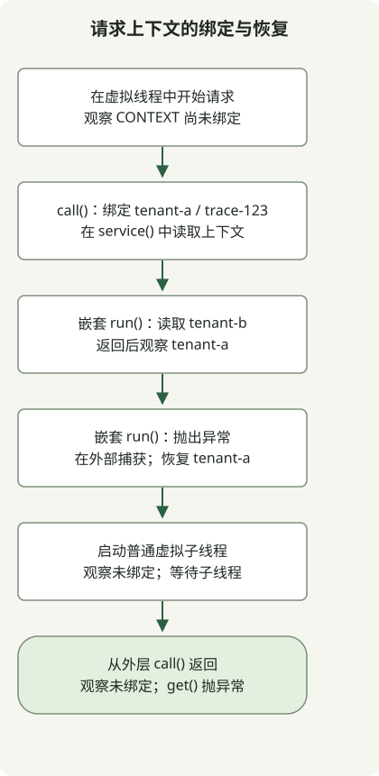

在 JDK 25 中，**`ScopedValue` 是一个已定稿的 API，用于将请求上下文等数据绑定到有界的执行作用域，并从调用方传递给被调用方**。它通过 [JEP 506](https://openjdk.org/jeps/506)定稿，因此无需预览标志。绑定在传给 `run()` 或 `call()` 的操作执行期间生效；正常完成或发生异常后，都会恢复此前状态。

## 它与 ThreadLocal 有何不同？

如果要将租户或追踪 ID 传入服务代码深处，否则就得为每个中间方法添加参数，可以考虑它。如果值是业务逻辑的显式输入，普通参数可能仍然更清晰。

[`ThreadLocal`](https://docs.oracle.com/en/java/javase/25/docs/api/java.base/java/lang/ThreadLocal.html)通过 `set()` 修改当前线程的值，通过 `remove()` 移除它。用于请求作用域时，需要谨慎清理，通常放在 `finally` 中。`ScopedValue` 不会留下已设置的值，而是在绑定内部运行需要该值的操作。

| 比较项 | ThreadLocal | ScopedValue |
| --- | --- | --- |
| 数据访问 | 读取和修改为当前线程保存的值 | 读取当前动态执行作用域内的绑定 |
| 作用域结束 | 显式管理请求作用域清理 | `run()` 或 `call()` 结束时恢复此前绑定 |
| 被调用方使用不同的值 | `set()` 可修改已有存储值 | 在嵌套作用域重新绑定，随后恢复外层值 |
| 适用场景 | 包括可变的线程私有状态等 | 包括从调用方传给被调用方的请求上下文等 |

`ScopedValue` 既不取代 `ThreadLocal` 的所有用途，也不将其弃用。`private static final` 字段保存的是**访问键，而非上下文值本身**。同一个键可根据执行线程和作用域解析到不同的值。

## 在虚拟线程中观察作用域与恢复



图示对应下面的示例。外层租户是 `tenant-a`；嵌套作用域读取 `tenant-b`。发生失败的嵌套作用域，其异常在该作用域外被捕获，然后检查恢复情况。此示例无需 HTTP 服务器或框架集成，即可展示请求上下文语义。

在 `javac` 和 `java` 指向同一套 JDK 25 安装的目录中运行。本地验证环境是 macOS AArch64 上的 Eclipse Temurin `25.0.5+8`。`ScopedValue` 属于 `java.lang`，无需显式导入。

### `ScopedContextExample.java`

```java
import java.util.NoSuchElementException;
import java.util.concurrent.Executors;

public class ScopedContextExample {
    private static final ScopedValue<RequestContext> CONTEXT = ScopedValue.newInstance();
    record RequestContext(String tenant, String traceId) {}

    public static void main(String[] args) throws Exception {
        try (var tasks = Executors.newVirtualThreadPerTaskExecutor()) {
            tasks.submit(ScopedContextExample::handleRequest).get();
        }
    }

    private static String handleRequest() throws InterruptedException {
        System.out.println("virtual=" + Thread.currentThread().isVirtual());
        System.out.println("before=" + CONTEXT.isBound());
        String result = ScopedValue.where(CONTEXT,
                new RequestContext("tenant-a", "trace-123")).call(() -> {
            System.out.println("outer=" + service());
            ScopedValue.where(CONTEXT,
                    new RequestContext("tenant-b", "trace-123")).run(() ->
                System.out.println("nested=" + service()));
            System.out.println("restored=" + service());

            try {
                ScopedValue.where(CONTEXT,
                        new RequestContext("tenant-fail", "trace-123")).run(() -> {
                    throw new IllegalStateException("demonstration");
                });
            } catch (IllegalStateException expected) {
                System.out.println("after-failure=" + service());
            }

            Thread child = Thread.ofVirtual().start(() ->
                System.out.println("plain-child-bound=" + CONTEXT.isBound()));
            child.join();
            return service();
        });
        System.out.println("result=" + result);
        System.out.println("after=" + CONTEXT.isBound());
        try {
            CONTEXT.get();
        } catch (NoSuchElementException expected) {
            System.out.println("outside=" + expected.getClass().getSimpleName());
        }
        return result;
    }

    private static String service() {
        RequestContext context = CONTEXT.get();
        return context.tenant() + "/" + context.traceId();
    }
}
```

```sh
javac --release 25 ScopedContextExample.java
java ScopedContextExample
```

以下标准输出是在不启用预览选项的情况下观察到的。对 `Future` 调用 `get()` 会将任务失败传播给调用方；`join()` 等待子线程输出。

```text
virtual=true
before=false
outer=tenant-a/trace-123
nested=tenant-b/trace-123
restored=tenant-a/trace-123
after-failure=tenant-a/trace-123
plain-child-bound=false
result=tenant-a/trace-123
after=false
outside=NoSuchElementException
```

`service()` 无需上下文参数即可读取当前绑定。无返回值的操作使用 `run()`，返回结果或传播异常的操作使用 [`Carrier.call()`](https://docs.oracle.com/en/java/javase/25/docs/api/java.base/java/lang/ScopedValue.Carrier.html#call(java.lang.ScopedValue.CallableOp))。仅通过 `where()` 创建 `Carrier` 并不会激活绑定。

`restored` 和 `after-failure` 都显示外层值。外层 `call()` 完成后，`isBound()` 为 false，未绑定时调用 `get()` 会抛出 `NoSuchElementException`。退出绑定既不保证被引用对象立即被垃圾回收，也不会自动关闭 `AutoCloseable` 资源。

## 创建虚拟线程会继承该值吗？

**普通的 `Thread.ofVirtual().start()` 不会自动继承父线程的绑定**。示例通过 `plain-child-bound=false` 展示这一点。也不要假定将工作交给 `ExecutorService` 或 `CompletableFuture` 就会自动传播上下文。示例中的第一个虚拟线程是在任务内部建立绑定，而非继承绑定。

[官方继承规则](https://docs.oracle.com/en/java/javase/25/docs/api/java.base/java/lang/ScopedValue.html#inheritance)说明，创建 `StructuredTaskScope` 时会捕获绑定，通过该作用域的 `fork()` 启动的子任务会继承绑定。**结构化并发在 JDK 25 中是另一个独立的预览 API**，由 [JEP 505](https://openjdk.org/jeps/505)说明，本文代码未使用它。不要把此示例理解为验证了该继承机制。

## 采用请求上下文时的边界

绑定不可更改，不代表其引用对象深度不可变。示例使用包含两个字符串的 record；如果是可变集合，则需要另行设计并发访问。也应限制访问键的可见范围。

请检查 JDK 25 API，不要原样复制 JDK 21 等旧版本的预览示例。尤其是 JDK 25 不允许 `orElse(null)`。绑定到 `null` 与没有绑定也不同。

先区分某个 `ThreadLocal` 是沿调用链传递请求数据，还是在执行期间维护可变状态。对于前者，应同时设计入口绑定与异步边界。框架事务、MDC 和安全上下文不会自动关联；此示例没有验证这些集成或性能。虚拟线程本身的行为请继续阅读 [JDK 21 功能文章](/en/posts/2023-09-20-jdk-21-release/)。
