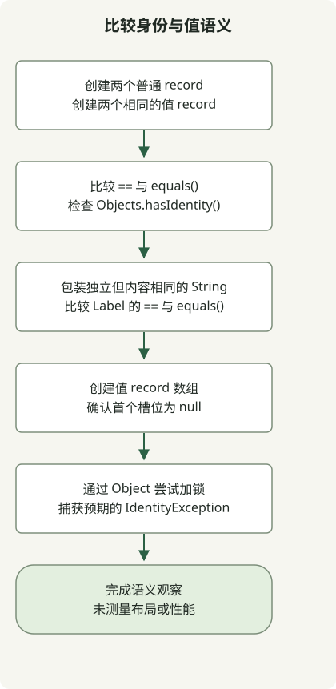

Project Valhalla 是**一个 OpenJDK 项目，让不需要对象身份的数据使用值对象，使 JVM 能更自由地高效存储和传递这些数据**。截至 2026年10月31日核对，[项目页面](https://openjdk.org/projects/valhalla/)和 [JEP 401](https://openjdk.org/jeps/401)显示，首个值对象预览已集成到 JDK 28。这不是已定稿功能。下面的示例在 JDK 28 EA Build 21 上运行。

## Java 已有 record，为何还需要值类？

普通对象即使字段相同，也具有各自的身份。可变账户和锁对象需要这种区别，但坐标 `(3, 4)` 之类的数据可能只需要其值。

[`record`](https://docs.oracle.com/en/java/javase/17/language/records.html)声明数据组件，并提供访问器、构造函数和 `equals()` 等方法。现有普通 record 仍允许 `==` 区分两个分别构造、组件相同的对象。`value` 修饰符做出的是另一个选择：移除对象身份。它可以与 record 组合为 `value record`。

| 声明 | 本例中的含义 |
| --- | --- |
| `record IdentityPoint(int x, int y)` | 即使组件相同，仍保留不同的对象身份 |
| `value record ValuePoint(int x, int y)` | 同一类且字段状态相同的实例，不再以身份区分 |
| `value record Label(String text)` | 没有身份，但 `==` 与 `equals()` 仍不一定一致 |

值类的实例字段是 `final`。这不会自动使其引用的对象深度不可变：字段中保存的可变集合仍可改变内容。值对象仍通过对象引用处理，并不会变成基本类型。

## 尝试 JDK 28 预览



图示对应下面的代码。`Label` 包含内容相同但彼此独立的 `String` 对象，用于展示引用字段的比较。最后，程序检查将值对象放入 `Object` 变量并不会使其成为有效的监视器，并处理预期异常。

使用独立的实验目录，使 `javac` 与 `java` 指向同一个 [JDK 28 EA](https://jdk.java.net/28/) 构建。将下载文件与官方 SHA-256 比较，并通过 `java --version` 确认构建。JDK 17 和 21 无法编译此语法。编译与运行时都需要预览标志。

### `ValhallaExample.java`

```java
import java.util.Objects;

public class ValhallaExample {
    record IdentityPoint(int x, int y) {}
    value record ValuePoint(int x, int y) {}
    value record Label(String text) {}

    public static void main(String[] args) {
        IdentityPoint a = new IdentityPoint(3, 4);
        IdentityPoint b = new IdentityPoint(3, 4);
        ValuePoint p = new ValuePoint(3, 4);
        ValuePoint q = new ValuePoint(3, 4);
        System.out.println("record == " + (a == b));
        System.out.println("record equals " + a.equals(b));
        System.out.println("value == " + (p == q));
        System.out.println("value equals " + p.equals(q));
        System.out.println("record identity " + Objects.hasIdentity(a));
        System.out.println("value identity " + Objects.hasIdentity(p));

        Label first = new Label(new String(new char[] {'x'}));
        Label second = new Label(new String(new char[] {'x'}));
        System.out.println("label == " + (first == second));
        System.out.println("label equals " + first.equals(second));

        ValuePoint[] points = new ValuePoint[1];
        System.out.println("array slot null " + (points[0] == null));
        Object monitor = p;
        try {
            synchronized (monitor) {
                throw new AssertionError("A value object must not be a monitor");
            }
        } catch (IdentityException expected) {
            System.out.println("monitor " + expected.getClass().getSimpleName());
        }
    }
}
```

```sh
javac --enable-preview --release 28 ValhallaExample.java
java --enable-preview ValhallaExample
```

以下输出是在 macOS AArch64 上使用 OpenJDK `28-ea+21-1707` 观察到的。编译器的预览提示与这段标准输出分开。

```text
record == false
record equals true
value == true
value equals true
record identity true
value identity false
label == false
label equals true
array slot null true
monitor IdentityException
```

普通 record 的 `equals()` 返回 true，但 `==` 返回 false。值 record 只有整数字段，因此字段状态匹配时，两种比较都返回 true。[`Objects.hasIdentity()`](https://download.java.net/java/early_access/jdk28/docs/api/java.base/java/util/Objects.html#hasIdentity(java.lang.Object))也能展示这种区别。

## 应当用 == 比较值对象吗？

领域相等性仍应使用 `equals()`。对于值对象，`==` 在同一值类内比较字段状态，并递归对引用字段应用 `==`。有身份的被引用对象如果是独立对象，即使内容相同，仍能区分。基本类型字段按位模式比较，这也可能与浮点数的语义相等性不同。精确规则请参阅 [JEP 401 中的值对象比较规则](https://openjdk.org/jeps/401#Comparing-value-objects)。

两个 `Label` 对象中的字符串内容相同，因此自动生成的 record `equals()` 返回 true。但它们的字符串是不同的身份对象，所以 `==` 返回 false。不要把 `value` 理解成让所有引用字段都按内容比较。

新建值数组的槽位是 `null`，在运行时将值对象用作监视器会抛出 `IdentityException`。如果直接锁定一个类型明确为值类的表达式，则可能在编译时被拒绝。迁移前应检查锁定和基于身份的缓存等身份敏感用法。

## 这会立即节省内存或支持 List<int> 吗？

移除身份为 JVM 提供了进行**扁平化**和**标量化**的空间：前者用字段状态而非指针表示引用，后者将值作为独立组件在寄存器等位置传递。语言不保证特定布局、消除分配或提速。上面的输出检查语义，没有测量堆用量或吞吐量。

Valhalla 跨越多个 JDK 发行版。[官方路线图](https://openjdk.org/projects/valhalla/)将值对象与非空受限存储、数组增强、统一基本类型和类，以及用于泛型特化的 Parametric JVM 分开。仅靠 JEP 401 不会完成 `List<int>`，也不保证每个数组连续存储。配套的 [JEP 539](https://openjdk.org/jeps/539)为严格字段初始化提供 JVM 支持，并没有在 Java 源码中添加可任意使用的 `strict` 字段修饰符。

可以从不需要身份的坐标、金额等小型数据类型开始实验，在同一构建上比较行为。检查框架、序列化与锁定依赖，再以代表性工作负载测量分配、GC 和吞吐量，之后判断收益。选择生产 JDK 时，不要将此预览当成已经定稿且受支持的功能。有关正式功能与预览功能的区别，请继续阅读 [JDK 功能指南](/en/posts/2023-09-20-jdk-21-release/)。
