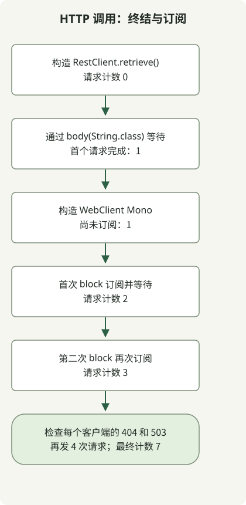

**同步服务代码需要获得一个 HTTP 响应才能继续时，先考虑 RestClient；需要响应式组合或流式处理时，考虑 WebClient。**两者都提供链式调用 API，但 [RestClient 是同步客户端，WebClient 是非阻塞的响应式客户端](https://docs.spring.io/spring-framework/reference/integration/rest-clients.html)。应根据应用的执行模型选择客户端，而不是请求量。


RestClient 在 Spring Framework 6.1 中引入；WebClient 从 5.0 起可用。首先检查 Framework 版本是否支持选定客户端。升级 Boot 项目时，遵循 Boot 管理的兼容组合。下面的可运行示例固定使用 Framework 7.0.10。

## 哪个客户端适合哪种需求？

| 判断标准 | RestClient | WebClient |
| --- | --- | --- |
| 结果 | 提取响应体等终结操作等待响应并返回值 | Mono 或 Flux 表示结果；订阅触发请求 |
| 自然适用的场景 | Spring MVC 或批处理任务中的顺序同步代码 | WebFlux、响应式组合及 SSE 等流式处理 |
| 错误传递 | 默认 retrieve 处理对 4xx 和 5xx 抛出 RestClientResponseException | 默认 retrieve 处理对 4xx 和 5xx 发出 WebClientResponseException 错误 |
| 额外成本 | 更容易沿传统调用栈理解 | 需要理解操作符、订阅、取消与上下文传播 |
| 并发控制 | 单独设计执行器或虚拟线程并发 | 单独限制 flatMap 等组合的并发，以及连接和等待预算 |

此表以在内存中聚合响应的普通 API 调用为起点。RestClient 也可以通过底层响应处理读取字节流，但响应式元素流和需求控制更适合 WebClient。使用 WebClient 并不要求将服务器改为 WebFlux：Spring MVC 也能使用响应式返回类型。[Spring 的 HTTP 客户端指南](https://spring.io/blog/2025/09/30/the-state-of-http-clients-in-spring/)同样区分了典型同步调用与响应式或流式需求。

使用虚拟线程的同步服务可以保留顺序的 RestClient 代码。虚拟线程不会让它的 API 变成非阻塞，也不会增加下游容量或连接上限。请结合[虚拟线程的作用范围](/en/posts/2026-10-31-virtual-threads-jdk21-jdk25/)与[依赖容量限制](/en/posts/2026-10-31-jdk-10k-rps-architecture/)考虑。

## 用相同 HTTP 响应比较执行时机



图示展示 main 方法的核心检查，省略本地服务器搭建、客户端配置及清理。**RestClient 不会仅因调用 retrieve() 就发送请求。**此处由 body(String.class) 执行请求并等待结果。WebClient 在订阅时执行其默认请求 Mono。如果没有缓存或共享操作符，对此 Mono 订阅两次会发送两个请求。

这个独立控制台示例使用 Spring Framework 7.0.10、Reactor Core 3.8.8、JDK 17 和 Gradle 8.4 执行过。它不是 Spring Boot 应用。两个客户端都显式使用 JDK HttpClient，以消除默认连接器选择的差异。在 Boot 项目中，应优先使用该 Boot 版本管理的依赖，不要用此 BOM 覆盖它们。

### `settings.gradle`

```groovy
rootProject.name = 'http-client-comparison'
```

### `build.gradle`

```groovy
plugins { id 'application' }
repositories { mavenCentral() }
dependencies {
    implementation platform('org.springframework:spring-framework-bom:7.0.10')
    implementation 'org.springframework:spring-webflux'
}
java {
    sourceCompatibility = JavaVersion.VERSION_17
    targetCompatibility = JavaVersion.VERSION_17
}
application { mainClass = 'ClientComparison' }
```

### `src/main/java/ClientComparison.java`

```java
import com.sun.net.httpserver.HttpServer;
import java.net.InetSocketAddress;
import java.net.http.HttpClient;
import java.nio.charset.StandardCharsets;
import java.time.Duration;
import java.util.concurrent.atomic.AtomicInteger;
import org.springframework.http.client.JdkClientHttpRequestFactory;
import org.springframework.http.client.reactive.JdkClientHttpConnector;
import org.springframework.web.client.RestClient;
import org.springframework.web.client.RestClientResponseException;
import org.springframework.web.reactive.function.client.WebClient;
import org.springframework.web.reactive.function.client.WebClientResponseException;
import reactor.core.publisher.Mono;

public class ClientComparison {
    static void check(boolean condition) {
        if (!condition) throw new AssertionError("HTTP contract failed");
    }
    public static void main(String[] args) throws Exception {
        var requests = new AtomicInteger();
        var server = HttpServer.create(new InetSocketAddress("127.0.0.1", 0), 0);
        server.createContext("/", exchange -> {
            requests.incrementAndGet();
            String path = exchange.getRequestURI().getPath();
            int status = path.equals("/missing") ? 404 : path.equals("/unavailable") ? 503 : 200;
            byte[] body = (status == 200 ? "hello" : "error").getBytes(StandardCharsets.UTF_8);
            exchange.getResponseHeaders().set("Content-Type", "text/plain;charset=UTF-8");
            exchange.sendResponseHeaders(status, body.length);
            try (var output = exchange.getResponseBody()) { output.write(body); }
        });
        server.start();
        try {
            String base = "http://127.0.0.1:" + server.getAddress().getPort();
            var jdk = HttpClient.newBuilder().connectTimeout(Duration.ofSeconds(2)).build();
            var factory = new JdkClientHttpRequestFactory(jdk);
            factory.setReadTimeout(Duration.ofSeconds(2));
            var connector = new JdkClientHttpConnector(jdk);
            connector.setReadTimeout(Duration.ofSeconds(2));
            var rest = RestClient.builder().baseUrl(base).requestFactory(factory).build();
            var web = WebClient.builder().baseUrl(base).clientConnector(connector).build();

            var response = rest.get().uri("/hello").retrieve();
            check(requests.get() == 0);
            System.out.println("before-rest-terminal=" + requests.get());
            String sync = response.body(String.class);
            check("hello".equals(sync) && requests.get() == 1);
            System.out.println("rest=" + sync);

            Mono<String> pending = web.get().uri("/hello").retrieve().bodyToMono(String.class);
            check(requests.get() == 1);
            System.out.println("before-subscribe=" + requests.get());
            String first = pending.block(Duration.ofSeconds(5));
            check("hello".equals(first) && requests.get() == 2);
            System.out.println("web=" + first);
            System.out.println("after-first-subscribe=" + requests.get());
            String second = pending.block(Duration.ofSeconds(5));
            check("hello".equals(second) && requests.get() == 3);
            System.out.println("web-again=" + second);
            System.out.println("after-second-subscribe=" + requests.get());

            for (int status : new int[]{404, 503}) {
                String path = status == 404 ? "/missing" : "/unavailable";
                try {
                    rest.get().uri(path).retrieve().body(String.class);
                    throw new AssertionError("RestClient should fail");
                } catch (RestClientResponseException error) {
                    check(error.getStatusCode().value() == status);
                    System.out.println("rest-" + status + "=" + error.getStatusCode().value());
                }
                try {
                    web.get().uri(path).retrieve().bodyToMono(String.class).block(Duration.ofSeconds(5));
                    throw new AssertionError("WebClient should fail");
                } catch (WebClientResponseException error) {
                    check(error.getStatusCode().value() == status);
                    System.out.println("web-" + status + "=" + error.getStatusCode().value());
                }
            }
            check(requests.get() == 7);
            System.out.println("requests=" + requests.get());
        } finally { server.stop(0); }
    }
}
```

### 运行并检查

```sh
gradle --no-daemon --console=plain -q clean run
```

首次下载依赖需要网络访问。运行时 HTTP 请求仅发往临时端口上的 127.0.0.1 服务器。以下是应用在所述环境中观察到的标准输出；Gradle 或日志实现可能另行输出诊断信息。

```text
before-rest-terminal=0
rest=hello
before-subscribe=1
web=hello
after-first-subscribe=2
web-again=hello
after-second-subscribe=3
rest-404=404
web-404=404
rest-503=503
web-503=503
requests=7
```

计数从 0 变为 1，表示 RestClient 的终结操作完成了第一个请求。刚构造 Mono 后，计数仍为 1。每次 block 都会订阅，使计数先增至 2，再增至 3。之后四个请求检查 404 和 503 处理，合计 7 个。这些计数验证的是执行和错误契约，不比较吞吐量、延迟或事件循环性能。

## block 会让两种客户端行为相同吗？

对 WebClient 添加 block 会让**调用方等待结果**，但不会使底层传输实现与 RestClient 相同。正如[同步使用文档](https://docs.spring.io/spring-framework/reference/web/webflux-webclient/client-synchronous.html)所述，应从响应式控制器返回 Mono 或 Flux，让框架负责订阅。上面的 block 调用仅限于用于观察行为的控制台 main。在事件循环上调用 RestClient 或通过 block 等待，可能占用其处理线程，或引发禁止在非阻塞线程上阻塞的异常。

如果应用已经在使用 WebClient 的过滤器、身份验证和插桩，仅仅需要同步调用，并不意味着必须立即替换。对于新的同步调用，应比较引入响应式依赖及订阅处理的成本，与保留现有配置的成本。组合多个远程调用时，避免无界订阅。[WebFlux 的响应式需求控制](https://docs.spring.io/spring-framework/reference/web/webflux/new-framework.html)协调生产与消费速率，但不会自动强制执行下游服务的 RPS 或连接限制。

## 生产使用前应检查什么？

两个客户端都需要连接、响应读取和整个调用的预算，以及错误状态策略。示例中 2 秒的连接限制、2 秒的读取限制和 5 秒的 block 等待是复现设置，不代表超时语义等价，也不是生产推荐值。各读取超时的范围，请查阅[请求工厂](https://docs.spring.io/spring-framework/docs/7.0.10/javadoc-api/org/springframework/http/client/JdkClientHttpRequestFactory.html)与[响应式连接器](https://docs.spring.io/spring-framework/docs/7.0.10/javadoc-api/org/springframework/http/client/reactive/JdkClientHttpConnector.html)文档。这些快速本地响应并未验证超时、TLS 或取消传播。

示例检查两个客户端对 4xx 和 5xx 响应的默认 retrieve 处理。明确的状态策略使用 onStatus。不要假定底层 exchange API 会应用 retrieve 的默认状态处理。[WebClient 响应处理](/en/posts/2023-09-19-springboot-test-webclient/)及[超时与有界重试](/en/posts/2026-10-30-webclient-timeout-retry/)示例提供了后续契约。按幂等性、尝试次数及总时间预算限制重试；单独测试空响应体、大响应及连接失败。

现有 RestTemplate 代码是另一项迁移问题。Spring Framework 7.0 推荐 RestClient，并将 RestTemplate 标记为弃用；WebClient 未被弃用。选定客户端后，应结合实际请求组合验证身份认证、插桩与连接设置。
