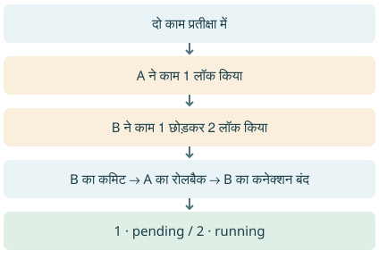

---
{
  "state": "draft",
  "language": "hi",
  "translationKey": "2026-11-26-postgres-skip-locked-queue",
  "title": "PostgreSQL में SKIP LOCKED वाली कार्य कतार का वर्कर बीच में बंद हो जाए तो क्या होता है?",
  "description": "दो सत्रों में देखें कि वर्कर लॉक किया गया काम कैसे छोड़ता है और रोलबैक या कमिट के बाद कनेक्शन बंद होने पर काम की स्थिति क्या रहती है।",
  "sourcePath": "src/content/posts/en/2026-11-26-postgres-skip-locked-queue.md",
  "sourceSha256": "47e798b84fdcc29b4f58d8c6e35bed1ea56c2145f4c9767e14b18888eee939d8"
}
---

जब A पहले काम पर लॉक रखता है, तब B `SKIP LOCKED` की मदद से अगला काम ले सकता है। लेकिन काम लेने का बदलाव कमिट करते ही B बंद हो जाए तो काम `running` स्थिति में रह जाता है। पंक्ति पर लॉक लगाकर वर्कर काम बाँट सकते हैं। कोई दूसरा वर्कर कब काम सँभाल सकता है, इसका हिसाब कतार को अलग से रखना पड़ता है।

## दोनों सत्रों में एक-एक काम लें

सत्र A को अभ्यास के लिए बने खाली डेटाबेस से जोड़ें और नीचे का SQL ऑटो-कमिट मोड में चलाएँ। सत्र B को भी उसी डेटाबेस से जोड़ें। दोनों में डिफ़ॉल्ट आइसोलेशन स्तर `READ COMMITTED` रखें।

```sql
CREATE TABLE queue_demo (
  id bigint GENERATED ALWAYS AS IDENTITY PRIMARY KEY,
  status text NOT NULL DEFAULT 'pending'
);
INSERT INTO queue_demo (status) VALUES ('pending'), ('pending');
```

अगला ब्लॉक पहले A में चलाएँ और ट्रांज़ैक्शन खुला रखें। अब वही ब्लॉक B में चलाएँ। दोनों सत्रों में लौटी पंक्तियाँ देखने तक कमिट न करें।

```sql
BEGIN;
WITH next_job AS (
  SELECT id FROM queue_demo
  WHERE status = 'pending'
  ORDER BY id
  LIMIT 1
  FOR UPDATE SKIP LOCKED
)
UPDATE queue_demo AS job
SET status = 'running'
FROM next_job
WHERE job.id = next_job.id
RETURNING job.id, job.status;
```



`ORDER BY id` तय करता है कि वर्कर किन पंक्तियों को पहले देखेंगे। B पहले कमिट कर सकता है, इसलिए काम पूरे होने का क्रम अलग हो सकता है। PostgreSQL के दस्तावेज़ में पंक्ति लॉक करने का यह तरीका उन कतारों के लिए बताया गया है जहाँ कई उपभोक्ता एक ही पंक्ति लेने की कोशिश करते हैं। [PostgreSQL SELECT में लॉकिंग क्लॉज़](https://www.postgresql.org/docs/current/sql-select.html#SQL-FOR-UPDATE-SHARE)

## काम लेने के बाद कमिट करें और कनेक्शन बंद करें

B में `COMMIT;` और फिर A में `ROLLBACK;` चलाएँ। B का कनेक्शन बंद करें और A से बची हुई स्थिति देखें।

```sql
SELECT id, status FROM queue_demo ORDER BY id;
```

यह प्रयोग एक अलग स्थानीय PostgreSQL 17.12 डेटाबेस पर दो कनेक्शन के साथ किया गया। काम लेने पर A ने `(1, running)` और B ने `(2, running)` लौटाया। आखिरी क्वेरी का परिणाम यह था।

```text
id | status
1  | pending
2  | running
```

A के रोलबैक ने स्थिति में हुआ बदलाव भी रद्द कर दिया। B के कमिट ने लॉक हटा दिया और बदलाव सहेज लिया। अगला वर्कर केवल `pending` पंक्तियाँ खोजता है, इसलिए काम 2 अब भी छूट जाता है।

## समय सीमा बीतने पर काम दूसरे वर्कर को सौंपें

उत्पादन में काम लेते समय छोटे ट्रांज़ैक्शन में समय सीमा और प्रयास का नया ID दर्ज करें तथा प्रयासों की गिनती बढ़ाएँ। वास्तविक काम कमिट करने के बाद करें। जब चलते हुए काम की समय सीमा बीत जाए, तो रिकवरी वर्कर लॉक लेकर उसकी स्थिति फिर जाँचे। यदि और प्रयास की अनुमति हो, तो नए प्रयास ID और समय सीमा के साथ काम सौंपे। सीमा पर पहुँच चुके काम को जाँच के लिए विफल चिह्नित करें।

देर से लौटा वर्कर काम पूरा दर्ज करते समय काम के ID, चल रही स्थिति और अपने प्रयास के ID का मिलान करे। यदि काम किसी और को सौंपा जा चुका है, तो कोई पंक्ति अपडेट नहीं होगी। फिर भी ईमेल भेजने के बाद और काम पूरा दर्ज करने से पहले वर्कर बंद हो सकता है। हर पुनःप्रयास में उसी ईमेल के लिए एक ही आइडेम्पोटेंसी कुंजी इस्तेमाल करें और सुनिश्चित करें कि मेल सेवा उससे दोबारा भेजना रोके। काम सौंपने पर प्रयास का ID बदलता है, भेजने की कुंजी वही रहती है।
