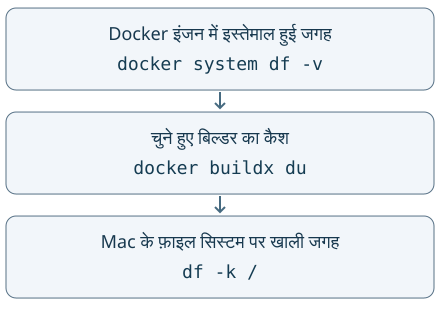

---
{
  "state": "draft",
  "language": "hi",
  "translationKey": "2026-11-27-docker-desktop-mac-disk-space",
  "title": "Docker का कैश हटाने पर भी Mac में खाली जगह क्यों नहीं बढ़ती?",
  "description": "बिल्ड कैश से खाली हो सकने वाली जगह, Docker.raw को आवंटित ब्लॉक और Mac के वॉल्यूम पर उपलब्ध जगह अलग-अलग मापें।",
  "sourcePath": "src/content/posts/en/2026-11-27-docker-desktop-mac-disk-space.md",
  "sourceSha256": "22ef396043237437e56056391cb42357c8f9bc5784eef9279e396ccf768d1ecd"
}
---

Docker अपनी वर्चुअल मशीन में रखी इमेज और कैश से खाली हो सकने वाली जगह बताता है। macOS होस्ट के फ़ाइल सिस्टम पर खाली जगह मापता है। वर्चुअल मशीन की डिस्क इमेज `Docker.raw` को आवंटित ब्लॉक वहाँ इस्तेमाल की गई जगह में गिने जाते हैं। किसी लेयर का उपयोग एक इमेज भी करती है तो बिल्ड कैश से उसकी प्रविष्टि हटाने पर भी वह डिस्क पर रह सकती है। [Docker Desktop के सामान्य प्रश्न](https://docs.docker.com/desktop/troubleshoot-and-support/faqs/macfaqs/) · [Buildx du](https://docs.docker.com/reference/cli/docker/buildx/du/)

## हर आँकड़ा कहाँ मापा जाता है?

Mac पर Docker Desktop चलाएँ और स्थानीय कॉन्टेक्स्ट तथा बिल्डर की जाँच करें। सूची में तारांकन चिह्न चुने हुए बिल्डर को दर्शाता है।

```sh
docker context show
docker buildx ls
docker system df -v
docker buildx du
df -k /
```



पहली रिपोर्ट इमेज, कंटेनर, वॉल्यूम और बिल्ड कैश का उपयोग दिखाती है। दूसरी में `Reclaimable` चुने हुए बिल्डर के उस कैश की मात्रा है जिसे हटाया जा सकता है। आखिरी कमांड में `Available` Mac के रूट फ़ाइल सिस्टम पर खाली जगह दिखाता है, KiB में। [Docker system df](https://docs.docker.com/reference/cli/docker/system/df/)

## Docker.raw वास्तव में कितनी जगह लेती है?

Docker Desktop में Settings → Resources → Advanced खोलकर डिस्क इमेज का स्थान देखें। उदाहरण में अपनी फ़ाइल का पथ रखें। `ls -klsh` के पहले कॉलम में आवंटित जगह KiB में और आकार वाले कॉलम में फ़ाइल का तार्किक आकार दिखता है। आखिरी कमांड उस फ़ाइल सिस्टम पर खाली जगह दिखाती है जिस पर इमेज रखी है, भले ही वह कोई दूसरा वॉल्यूम हो।

```sh
image="$HOME/Library/Containers/com.docker.docker/Data/vms/0/data/Docker.raw"
ls -klsh "$image"
stat -f 'bytes=%z blocks=%b' "$image"
df -k "$image"
```

स्थानीय Mac पर केवल पढ़कर की गई जाँच में `desktop-linux` ने 61.76 MB बिल्ड कैश हटाने योग्य बताया। डिस्क इमेज का तार्किक आकार 63,999,836,160 बाइट था। उसे 12,272,488 ब्लॉक आवंटित थे। प्रति ब्लॉक 512 बाइट के हिसाब से यह लगभग 6.28 GB है।

केवल बिल्ड कैश साफ़ करना हो तो पहले चुने हुए बिल्डर की जाँच करें। सफ़ाई से ठीक पहले और उसके कुछ मिनट बाद उन्हीं कमांड के परिणामों की तुलना करें। इस जाँच में कैश हटाया नहीं गया था, इसलिए यह नहीं मापा गया कि Mac पर कितनी जगह वापस मिली। [Buildx prune](https://docs.docker.com/reference/cli/docker/buildx/prune/)

[संबंधित लेख · du और df से Mac की डिस्क सफ़ाई का असर मापना (अंग्रेज़ी)](../2026-11-27-mac-disk-cleanup-du-df/)
