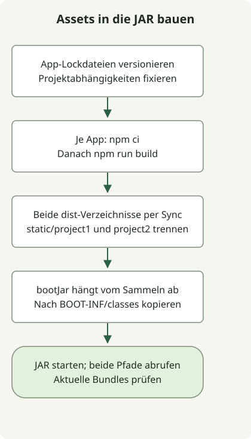

Um mehrere Vue-Apps in eine Spring-Boot-JAR zu packen, erhält jede App eine eigene `npm ci`- und Build-Aufgabe. Die erzeugten Dateien werden unter `build/` gesammelt und anschließend zu `bootJar` hinzugefügt. Verwenden Sie die Installationsaufgabe einer App nicht für die anderen und schreiben Sie erzeugte Bundles nicht direkt nach `src/main/resources`.

Dieses ausführbare Beispiel stellt zwei Apps unter `/project1/index.html` und `/project2/index.html` bereit. Die Reproduktionsumgebung besteht aus JDK17.0.8.1, Gradle8.4, Node24.13.0/npm11.6.2, Boot3.5.7, Vue3.5.44 und Vite8.3.5. Diese Versionen sind für die Reproduktion festgelegt und keine Empfehlung aktueller Produktionsabhängigkeiten. Prüfen Sie die [Laufzeitanforderungen von Vite](https://vite.dev/guide/) und die der gewählten Boot-Version separat.

## Verarbeitungsablauf



Jede Vue-App erzeugt ihre eigene Ausgabe. Eine Gradle-Sync-Aufgabe sammelt nur diese Ausgaben; anschließend legt bootJar sie unter getrennten statischen Pfaden ab.

## Aufgaben je App und Paketierung

Speichern Sie diese Dateien in einem leeren Projekt. Jede App hat ihre eigene `package.json`, Lockdatei, `node_modules` und `dist`. `prepare.sh` kopiert das gemeinsame HTML/JS in die zweite App und erzeugt beide Lockdateien.

### `settings.gradle`

```groovy
rootProject.name = 'multi-frontend'
```

### `build.gradle`

```groovy
plugins {
    id 'java'
    id 'org.springframework.boot' version '3.5.7'
}
group = 'example'
version = '1.0.0'
repositories { mavenCentral() }
dependencies {
    implementation platform('org.springframework.boot:spring-boot-dependencies:3.5.7')
    implementation 'org.springframework.boot:spring-boot-starter-web'
}

def apps = ['project1', 'project2']
def npmCommand = System.getProperty('os.name').toLowerCase().contains('windows') ? 'npm.cmd' : 'npm'
def frontendBuilds = apps.collect { app ->
    def frontend = layout.projectDirectory.dir("frontend/${app}")
    def install = tasks.register("${app}NpmCi", Exec) {
        workingDir frontend
        commandLine npmCommand, 'ci', '--no-audit', '--no-fund'
        inputs.files(frontend.file('package.json'), frontend.file('package-lock.json'))
        outputs.dir(frontend.dir('node_modules'))
    }
    tasks.register("${app}Build", Exec) {
        dependsOn install
        workingDir frontend
        commandLine npmCommand, 'run', 'build'
        inputs.files(fileTree(frontend) {
            exclude 'node_modules/**', 'dist/**'
        })
        outputs.dir(frontend.dir('dist'))
    }
}
def collectFrontend = tasks.register('collectFrontend', Sync) {
    dependsOn frontendBuilds
    into layout.buildDirectory.dir('frontend-resources')
    apps.each { app ->
        from("frontend/${app}/dist") { into "static/${app}" }
    }
}
tasks.named('bootJar') {
    dependsOn collectFrontend
    from(collectFrontend) { into 'BOOT-INF/classes' }
}
```

### `src/main/java/example/Application.java`

```java
package example;

import org.springframework.boot.SpringApplication;
import org.springframework.boot.autoconfigure.SpringBootApplication;

@SpringBootApplication
public class Application {
    public static void main(String[] args) {
        SpringApplication.run(Application.class, args);
    }
}
```

### `frontend/project1/package.json`

```json
{
  "name": "project1",
  "private": true,
  "type": "module",
  "scripts": {
    "build": "vite build --base=/project1/"
  },
  "dependencies": {
    "vue": "3.5.44"
  },
  "devDependencies": {
    "vite": "8.3.5"
  }
}
```

### `frontend/project2/package.json`

```json
{
  "name": "project2",
  "private": true,
  "type": "module",
  "scripts": {
    "build": "vite build --base=/project2/"
  },
  "dependencies": {
    "vue": "3.5.44"
  },
  "devDependencies": {
    "vite": "8.3.5"
  }
}
```

### `frontend/project1/index.html`

```html
<!doctype html>
<html lang="en"><head><meta charset="UTF-8"><title>Vue build example</title></head>
<body><div id="app"></div><script type="module" src="/src/main.js"></script></body></html>
```

### `frontend/project1/src/main.js`

```js
import { createApp, h } from 'vue';
createApp({ render: () => h('h1', `Vue app at ${import.meta.env.BASE_URL}`) }).mount('#app');
```

### `prepare.sh`

```sh
#!/bin/sh
set -eu
mkdir -p frontend/project2/src
cp frontend/project1/index.html frontend/project2/index.html
cp frontend/project1/src/main.js frontend/project2/src/main.js
for app in project1 project2; do
    (cd "frontend/$app" && npm install --package-lock-only --ignore-scripts --no-audit --no-fund)
done
```

Führen Sie `prepare.sh` beim erstmaligen Vorbereiten dieses Beispiels aus und versionieren Sie beide erzeugten `package-lock.json`-Dateien. Spätere CI-Builds verwenden `npm ci` mit den gespeicherten Lockdateien. Erzeugen Sie diese nicht bei jedem Build neu.

## Bauen und ausführen

Führen Sie im Projektstamm Folgendes aus, während Node/npm über PATH erreichbar sind:

```sh
node --version
npm --version
sh prepare.sh
gradle --no-daemon clean bootJar
java -jar build/libs/multi-frontend-1.0.0.jar
```

Verwenden Sie bei einem bestehenden Projekt mit Wrapper die ausgewählte Gradle-Version über `./gradlew`. Rufen Sie nach dem Start `http://localhost:8080/project1/index.html` und `http://localhost:8080/project2/index.html` auf. Die Seiten zeigen entsprechend `Vue app at /project1/` und `Vue app at /project2/`.

[Vites base-Option](https://vite.dev/guide/build.html#public-base-path) gibt jeder App passende Asset-URLs. Sie konfiguriert kein serverseitiges SPA-Routing. Dieses Beispiel verwendet ausdrückliche `index.html`-URLs; direkte Aufrufe mit History-Router oder ein anderer Kontextpfad erfordern weitere Konfiguration.

## Die tatsächlichen JAR-Pfade prüfen

```text
BOOT-INF/classes/static/project1/index.html
BOOT-INF/classes/static/project1/assets/...
BOOT-INF/classes/static/project2/index.html
BOOT-INF/classes/static/project2/assets/...
```

Nach den Builds je App sammelt `collectFrontend` mit `Sync` ausschließlich aktuelle Ausgaben. `bootJar` fügt sie unter dem Klassenpfad der ausführbaren JAR hinzu. Siehe [Dateiverarbeitung mit Gradle](https://docs.gradle.org/current/userguide/working_with_files.html) und [Boot-Archivpaketierung](https://docs.spring.io/spring-boot/3.5/gradle-plugin/packaging.html).

Beide Apps wurden mit dieser Konfiguration gebaut und paketiert; die laufende JAR lieferte ihre HTML- und JS-Assets über HTTP aus. Anschließend wurde eine Datei im `public`-Verzeichnis einer App entfernt und die JAR ohne `clean` neu gebaut, um zu prüfen, dass die veraltete Datei nicht erhalten blieb. Die Lockdateien beider Apps wurden separat geprüft.

## An ein bestehendes Projekt anpassen

- Passen Sie die Liste `apps` an die Verzeichnisse an und stellen Sie jede Lockdatei bereit.
- Halten Sie die erzeugten Namensräume `static/project1` und `static/project2` von manuell geschriebenen Ressourcen getrennt.
- Ergänzen Sie für Vue-SFCs das zur App passende Plugin und die Vite-Konfiguration. Dieses kleine Beispiel verwendet Vue-Renderfunktionen.
- Die Integration zielt auf die ausführbare `bootJar`, nicht auf die einfache `jar`. Prüfen Sie das Artefakt, das Sie ausliefern werden.

Prüfen Sie bei einer bestehenden Anwendung die [Grundlagen der Java- und Jakarta-Migration für Spring Boot](/en/posts/2023-09-08-springboot3-migration/) unabhängig von der Paketierung. Führt sie auch Batch-Jobs aus, beachten Sie die [Migration des Batch-Repositorys und die Neustartprüfungen](/en/posts/2023-10-27-springbatch5-migration/); das Ausliefern von Frontend-Assets aus einer JAR validiert keine gespeicherten Jobdaten.

Zur releasegesteuerten Automatisierung siehe [Auswahl von GitHub-Releases und Assets](/en/posts/2023-09-23-linux-shellscript-github-latest/) und den [Eingabevertrag des numerischen Vergleichers](/en/posts/2023-11-17-linux-shellscript-version-compare/). Der [Leitfaden zu POSIX-sh-Funktionen](/en/posts/2023-09-20-linux-shellscript-function-error/) behandelt die Interpreterauswahl für Vorbereitungsskripte.
