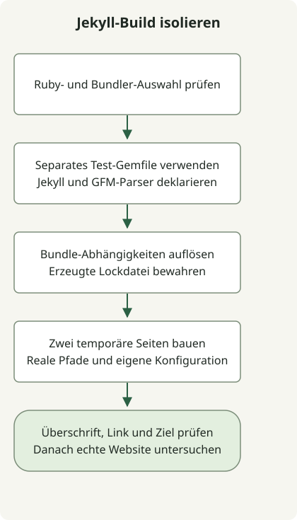

Prüfen Sie vor einer Änderung der Berechtigungen, welches Ruby läuft, welcher Bundler den Abhängigkeitskontext verwaltet und ob eine kleine Website gerendert wird. Der aktuelle Build dieser Website verwendet Astro; das folgende Jekyll-Beispiel dient der Diagnose des erhaltenen Ruby-Archivs.

Die ursprüngliche Installation verwendete Ruby 3.2.2. Diese Versionslinie hat inzwischen ihr [Supportende erreicht](https://www.ruby-lang.org/en/downloads/branches/), daher dient die alte Version der Kompatibilitätsreproduktion und ist keine Empfehlung für eine Neuinstallation. Wählen Sie vor der Übernahme ein gepflegtes Ruby, das mit den Gems Ihres Projekts kompatibel ist.

## Vor der Gem-Installation den Interpreter auswählen



[Die macOS-Anleitung von Jekyll](https://jekyllrb.com/docs/installation/macos/) empfiehlt eine separate Ruby-Umgebung statt des System-Ruby. Dieses Repository verwendete früher rbenv. Dessen [Regeln zur Versionsauswahl](https://github.com/rbenv/rbenv#readme) unterscheiden eine projektspezifische `.ruby-version`, `RBENV_VERSION` und den globalen Standard.

Führen Sie diese Befehle im Projektverzeichnis aus:

```sh
command -v ruby
ruby --version
rbenv version
rbenv which ruby
gem env home
bundle --version
```

Wenn `ruby` nicht über den erwarteten Manager ausgewählt wird, korrigieren Sie die Shell-Initialisierung, bevor Sie etwas installieren. Verwenden Sie `rbenv init` gemäß der Anleitung Ihrer installierten rbenv-Version; kopieren Sie keinen fremden Home-Pfad in Ihr Shell-Profil. Eine projektspezifische Auswahl ist einer Änderung aller Ruby-Projekte mit `rbenv global` vorzuziehen.

## Ein Bundle mit zwei gerenderten Seiten testen

Diese Kompatibilitätsprüfung wurde mit Ruby3.2.2, Bundler2.4.19, Jekyll3.9.3 und kramdown-parser-gfm1.1.0 ausgeführt. Dies sind dokumentierte Altversionen und keine Grundlage unterstützter Versionen. Das Gemfile fixiert die beiden direkten Gems; die resultierende Gemfile.lock hält transitive Versionen für Ihre Plattform fest.

Erstellen Sie ein separates Testverzeichnis und speichern Sie diese vollständigen Dateien dort. Ersetzen Sie nicht das vorhandene Gemfile des Repositorys.

### `Gemfile`

```ruby
source 'https://rubygems.org'
gem 'jekyll', '= 3.9.3'
gem 'kramdown-parser-gfm', '= 1.1.0'
```

### `jekyll_probe.rb`

```ruby
require 'jekyll'
require 'tmpdir'
require 'fileutils'
require 'json'

Dir.mktmpdir('jekyll-probe-') do |root|
  root = File.realpath(root)
  source = File.join(root, 'source')
  destination = File.join(root, 'output')
  FileUtils.mkdir_p(File.join(source, '_layouts'))
  File.write(File.join(source, '_layouts', 'default.html'), '<!doctype html><html lang="en"><body>{{ content }}</body></html>')
  File.write(File.join(source, 'index.md'), "---\nlayout: default\ntitle: Probe\n---\n# Bundled build\n\n[Guide](/guide/)\n")
  File.write(File.join(source, 'guide.md'), "---\nlayout: default\npermalink: /guide/\n---\n# Local guide\n")
  config = Jekyll.configuration('config' => [], 'source' => source, 'destination' => destination, 'quiet' => true)
  Dir.chdir(source) { Jekyll::Site.new(config).process }
  home = File.read(File.join(destination, 'index.html'))
  guide = File.read(File.join(destination, 'guide', 'index.html'))
  raise 'Missing rendered heading' unless home.include?('<h1') && home.include?('Bundled build')
  raise 'Missing guide link' unless home.include?('href="/guide/"')
  raise 'Missing guide output' unless guide.include?('Local guide')
  puts JSON.generate('ruby' => RUBY_VERSION, 'jekyll' => Jekyll::VERSION, 'pages' => 2, 'result' => 'passed')
end
```

Führen Sie mit dem ausgewählten Ruby und Bundler in diesem Verzeichnis Folgendes aus:

```sh
bundle install
bundle exec ruby jekyll_probe.rb
```

Sind die exakten Gems bereits installiert, kann `bundle lock --local` vor demselben Ausführungsbefehl aus diesem lokalen Bestand auflösen. Ein fehlendes Gem kann es nicht beschaffen. Bewahren Sie bei der Reproduktion eines Fehlers die Lockdatei auf und prüfen Sie Änderungen vor einer Aktualisierung. [Bundlers Anwendungsleitfaden](https://guides.rubygems.org/using_bundler_in_applications/) erläutert die Rolle von Gemfile und Lockdatei.

Das beobachtete Ergebnis war:

```json
{"ruby":"3.2.2","jekyll":"3.9.3","pages":2,"result":"passed"}
```

Die Prüfung baut in einem temporären Verzeichnis, verwendet dessen realen Pfad, um eine macOS-Symlink-Abweichung bei `/var` zu vermeiden, deaktiviert die standardmäßige Suche nach Konfigurationsdateien und wechselt während des Renderns in ihre eigene Quelle. Sie prüft eine Überschrift, einen Link und die Zielseite. Temporäre Dateien werden anschließend entfernt; das vollständige Archiv, sein Theme, Plugins, CSS und Deployment liegen außerhalb dieser Prüfung.

## Verfügbarkeit und Bundle-Zugehörigkeit unterscheiden

Bei dieser Reproduktion ließ sich Jekyll laden, doch die Markdown-Konvertierung schlug fehl, weil das Bundle `kramdown-parser-gfm` nicht deklarierte. Ein irgendwo auf dem Rechner installiertes Gem und dessen Verfügbarkeit innerhalb von `bundle exec` sind getrennte Bedingungen. Das Ergänzen des Parsers im Gemfile dieser Prüfung ermöglichte die Konvertierung.

Eine erfolgreiche Prüfung mit zwei Seiten grenzt die weitere Untersuchung auf Konfiguration, Theme, Plugins und Eingaben der tatsächlichen Website ein. Ein Fehler beim Laden einer nativen Erweiterung gehört zu einer anderen Ebene: Verwenden Sie die [Diagnoseprüfung für Ruby und C++](/en/posts/2026-04-07-ruby-rbenv-jekyll-build-troubleshooting/). Für den aktiven Veröffentlichungsprozess dieser Website siehe den [Astro-Workflow zur Kandidatenprüfung](/en/posts/2026-04-07-jekyll-github-actions-content-pipeline/).
