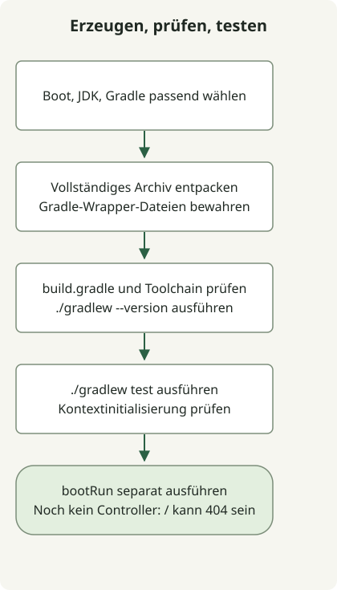

Testen Sie ein mit Spring Initializr erstelltes Projekt zunächst mit dem generierten Gradle Wrapper, bevor Sie sich auf die IDE verlassen. Prüfen Sie Erzeugung, Auflösung der Abhängigkeiten, JDK-Kompatibilität und Anwendungsstart getrennt, damit sich Fehler leichter eingrenzen lassen.

Dieses Beispiel verwendet ein Boot-4.1.2-Projekt mit Java 17 und Gradle Groovy, das am 27. Oktober 2026 tatsächlich von [start.spring.io](https://start.spring.io/) erzeugt wurde. Sein Wrapper wählte Gradle 9.8.2. Standardwerte und verfügbare Versionen des Dienstes ändern sich; nehmen Sie daher nicht an, dass diese Kombination dauerhaft verfügbar bleibt.

## Verarbeitungsablauf



Erzeugen Sie das vollständige Archiv, bevor Sie dessen Wrapper ausführen. Ein Kontexttest und eine separat laufende HTTP-Anwendung belegen unterschiedliche Dinge.

## Projekteinstellungen auswählen

| Einstellung | Beispiel | Bedeutung |
| --- | --- | --- |
| Projekt / Sprache | Gradle - Groovy / Java | Build-Werkzeuge und Quellsprache |
| Spring Boot | 4.1.2 | Eine endgültige Version, die beim Erzeugen dieses Beispiels verfügbar war |
| Java / Paketierung | 17 / Jar | Quell-Toolchain und Paketierung |
| Group / Artifact | example / demo | Projektkennungen |
| Paketname | example.demo | Anwendungspaket |
| Abhängigkeiten | Spring Web | Abhängigkeiten für einen HTTP-Endpunkt |

Klicken Sie in der Oberfläche auf Generate oder laden Sie das Archiv über diese URL herunter. **Prüfen Sie den Erfolg jedes Befehls, bevor Sie den nächsten ausführen.** Verwenden Sie ein leeres Arbeitsverzeichnis, um kein bestehendes Projekt zu überschreiben.

```sh
curl --fail --show-error --location 'https://start.spring.io/starter.zip?type=gradle-project&language=java&bootVersion=4.1.2&baseDir=demo&groupId=example&artifactId=demo&name=Demo&packageName=example.demo&packaging=jar&javaVersion=17&dependencies=web' --output demo.zip
unzip demo.zip
cd demo
./gradlew --version
./gradlew test
```

Die Generierungs-API kann eine Version ablehnen, sobald der Dienst sie nicht mehr anbietet. Prüfen Sie die [aktuellen Dienstmetadaten](https://start.spring.io/metadata/client) und die [Initializr-Referenz](https://docs.spring.io/initializr/docs/current/reference/html/) und wählen Sie kompatible Boot-, JDK- und Gradle-Versionen gemeinsam aus. Ein stillschweigender Ersatz durch die neuesten Standardwerte ändert die Reproduktionsbedingungen.

## Vier zentrale erzeugte Dateien prüfen

Dies sind die vier zentralen Dateien mit vereinfachter Formatierung. Das vollständige Archiv enthält außerdem Wrapper-Skripte, die Wrapper-JAR samt Einstellungen und Ressourcendateien. Nur diese vier Dateien in ein leeres Verzeichnis zu kopieren erzeugt kein `./gradlew`.

### `settings.gradle`

```groovy
rootProject.name = 'demo'
```

### `build.gradle`

```groovy
plugins {
    id 'java'
    id 'org.springframework.boot' version '4.1.2'
    id 'io.spring.dependency-management' version '1.1.7'
}
group = 'example'
version = '0.0.1-SNAPSHOT'
java {
    toolchain { languageVersion = JavaLanguageVersion.of(17) }
}
repositories { mavenCentral() }
dependencies {
    implementation 'org.springframework.boot:spring-boot-starter-webmvc'
    testImplementation 'org.springframework.boot:spring-boot-starter-webmvc-test'
    testRuntimeOnly 'org.junit.platform:junit-platform-launcher'
}
tasks.named('test') { useJUnitPlatform() }
```

### `src/main/java/example/demo/DemoApplication.java`

```java
package example.demo;

import org.springframework.boot.SpringApplication;
import org.springframework.boot.autoconfigure.SpringBootApplication;

@SpringBootApplication
public class DemoApplication {
    public static void main(String[] args) {
        SpringApplication.run(DemoApplication.class, args);
    }
}
```

### `src/test/java/example/demo/DemoApplicationTests.java`

```java
package example.demo;

import org.junit.jupiter.api.Test;
import org.springframework.boot.test.context.SpringBootTest;

@SpringBootTest
class DemoApplicationTests {
    @Test
    void contextLoads() {}
}
```

Das erzeugte Boot-4.1.2-Projekt verwendet `spring-boot-starter-webmvc` und `spring-boot-starter-webmvc-test`. Beginnen Sie mit der für Ihre gewählte Version erzeugten Konfiguration, statt Fragmente verschiedener Boot-Generationen zu vermischen. Die [Anforderungen von Boot 4.1.2](https://docs.spring.io/spring-boot/4.1/system-requirements.html) nennen Java 17 oder neuer sowie Gradle 8.x ab 8.14 oder 9.x.

## Tests und Anwendungsstart unterscheiden

Ein erfolgreiches `contextLoads()` bedeutet, dass der Testkontext startet. Solange kein Controller existiert, deutet eine 404-Antwort von `/` nicht auf einen Startfehler hin. Starten Sie die Anwendung separat und beenden Sie sie mit Strg+C in diesem Terminal.

```sh
./gradlew bootRun
```

Versionieren Sie die erzeugte `build.gradle` zusammen mit den [Gradle-Wrapper-Dateien](https://docs.gradle.org/current/userguide/gradle_wrapper.html). Die Gradle-Version ist unabhängig von der Java-Version in `java.toolchain`. Prüfen Sie mit `./gradlew --version` die JVM, auf der Gradle läuft, und unterscheiden Sie diese vom für Kompilierung und Anwendungsausführung gewählten JDK.

Fahren Sie mit dem [Öffnen des Projekts in IntelliJ und Bereitstellen von HTTP](/en/posts/2023-09-10-springboot-intellij-import/) fort. Warum Boot und Framework unterschiedliche Versionsnummern verwenden, erläutert die [Spring-Boot-Releasegeschichte und die Beziehung der Versionen](/en/posts/2023-09-13-springboot-history/).
