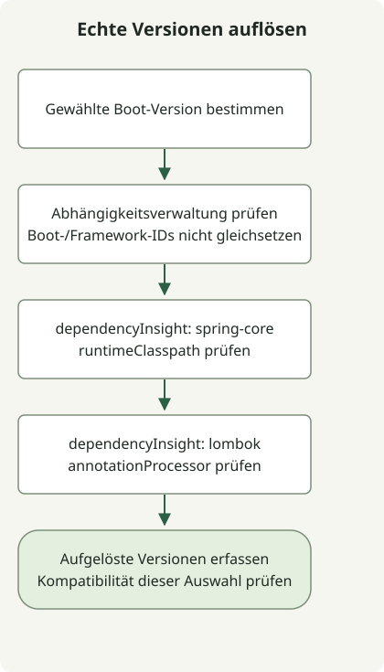

Spring Boot und Spring Framework sind separate Projekte mit unterschiedlichen Versionsnummern. Boot ergänzt Framework um automatische Konfiguration, Abhängigkeitsverwaltung und ausführbare Paketierung. Boot 3.1 als Framework 6.1 zu lesen ist daher unzuverlässig; prüfen Sie stattdessen die BOM der ausgewählten Boot-Version und den aufgelösten Abhängigkeitsgraphen.

## Verarbeitungsablauf



Der Ablauf fasst die Prüfung von Abhängigkeiten zusammen, nicht eine Release-Zeitleiste. Boot, Framework und Lombok haben eigene Versionsidentitäten und Abhängigkeitskonfigurationen.

## Änderungen ausgewählter endgültiger Versionen

Diese Zeitleiste hebt Funktionsübergänge hervor, statt jede Veröffentlichung aufzulisten. Unterscheiden Sie die erste endgültige Version von späteren Patches mit erweiterter JDK-Kompatibilität.

| Spring Boot | Erste endgültige Version | Ausgewählte Änderungen und offizielle Ankündigung |
| --- | --- | --- |
| 1.2 | 2014-12-11 | [`@SpringBootApplication` und Servlet-3.1-Unterstützung](https://spring.io/blog/2014/12/11/spring-boot-1-2-0-released/) |
| 1.3 | 2015-11-16 | [DevTools, automatische Cache-Konfiguration und direkt ausführbare JARs](https://spring.io/blog/2015/11/16/spring-boot-1-3-0-released/) |
| 1.4 | 2016-07-28 | [Startfehleranalyse und verbesserte Testunterstützung](https://spring.io/blog/2016/07/28/spring-boot-1-4-released/) |
| 2.0 | 2018-03-01 | [Framework 5.0, Java 8 als Basis und reaktive Webunterstützung](https://spring.io/blog/2018/03/01/spring-boot-2-0-goes-ga/) |
| 3.0 | 2022-11-24 | [Framework 6.0, Java 17 als Basis, Jakarta und native Images](https://spring.io/blog/2022/11/24/spring-boot-3-0-goes-ga/) |
| 3.1 | 2023-05-18 | [Testcontainers zur Entwicklungszeit und Docker-Compose-Integration](https://spring.io/blog/2023/05/18/spring-boot-3-1-0-available-now/) |
| 3.2 | 2023-11-23 | [Unterstützung für virtuelle Threads, RestClient und JdbcClient](https://spring.io/blog/2023/11/23/spring-boot-3-2-0-available-now/) |
| 4.0 | 2025-11-20 | [Framework 7, Modularisierung, JSpecify und API-Versionierung](https://spring.io/blog/2025/11/20/spring-boot-4-0-0-available-now/) |

Beispielsweise nennt die [Liste verwalteter Abhängigkeiten von Boot 3.1.0](https://docs.spring.io/spring-boot/docs/3.1.0/reference/html/dependency-versions.html) `spring-core` 6.0.9. Boot- und Framework-Nebenversionen müssen nicht übereinstimmen. Auch die Zuordnung von Boot 2.4 zu einer nicht existierenden Framework-5.4-Linie ist falsch.

## Starter, BOMs und Build-Plugins

Ein Starter bündelt die für eine Funktion benötigten Abhängigkeiten. Eine BOM verwaltet Versionen; sie fügt nicht automatisch jede aufgelistete Bibliothek Ihrem Projekt hinzu. Boots Build-Plugin stellt Aufgaben wie `bootRun` und die Paketierung ausführbarer JARs bereit.

Für Gradle beschreibt der [Boot-Leitfaden zur Abhängigkeitsverwaltung](https://docs.spring.io/spring-boot/4.1/gradle-plugin/managing-dependencies.html) das Dependency-Management-Plugin und native BOM-Unterstützung. Allein das Anwenden des Boot-Plugins belegt nicht, dass alle Gradle-Konfigurationen Abhängigkeiten ohne Versionsangabe akzeptieren. Prüfen Sie auch separate Konfigurationen wie Annotation-Prozessoren.

## Die tatsächlichen Projektversionen prüfen

Führen Sie diese Befehle im endgültigen Projekt aus den [Initializr-](/en/posts/2023-09-07-springboot-initializer/) und [Lombok-Leitfäden](/en/posts/2023-09-15-springboot-intellij-lombok/) aus.

```sh
./gradlew dependencyInsight --configuration runtimeClasspath --dependency spring-core
./gradlew dependencyInsight --configuration annotationProcessor --dependency lombok
```

Das lokale Beispiel löst Boot 4.1.2, `spring-core` 7.0.10 und Lombok 1.18.48 auf. Unterschiedliche Nummern spiegeln unterschiedliche Projekte wider. `dependencyInsight` zeigt die ausgewählte Version und die dafür verantwortlichen Abhängigkeitspfade oder Regeln und hilft so bei Konfliktuntersuchungen. Diese Werte dokumentieren dieses Beispiel, keine künftigen Standardwerte oder universelle Projektkombination.

Die Zeitleiste ist keine aktuelle Support-Lebenszyklustabelle. Prüfen Sie beim Erstellen oder Aktualisieren eines Projekts Anforderungen, Abhängigkeitskompatibilität und Supportrichtlinie der gewählten Version separat. Siehe [Java-17- und Jakarta-Migration](/en/posts/2023-09-08-springboot3-migration/) für den Wechsel zu Boot 3 oder [IntelliJ- und Gradle-Ausführungsprüfungen](/en/posts/2023-09-10-springboot-intellij-import/) für die lokale Ausführung.
