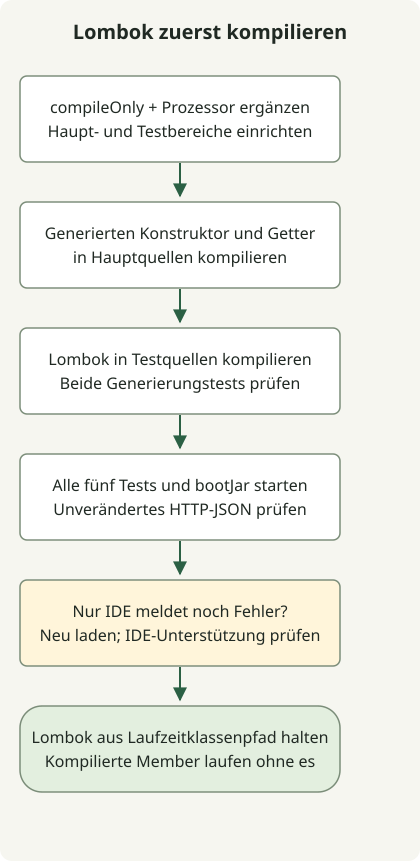

Wenn Lombok-Methoden fehlen, führen Sie zuerst `./gradlew clean test` aus, um festzustellen, ob auch der Build scheitert. Die IDE-Unterstützung hilft dem Editor, generierte Member zu erkennen; Gradles Annotation-Processor-Konfiguration erzeugt sie während der Kompilierung. Keines ersetzt das andere.

Dieses Beispiel setzt das [Initializr-Projekt](/en/posts/2023-09-07-springboot-initializer/) und das [HTTP-Beispiel](/en/posts/2023-09-10-springboot-intellij-import/) fort. Es verwendet Boot 4.1.2, Gradle 9.8.2 und JDK 17; die BOM wählte Lombok 1.18.48. Dies dokumentiert eine funktionierende Kombination, ohne Kompatibilität jeder JDK-/Lombok-Paarung zu garantieren.

## Verarbeitungsablauf



Prüfen Sie generierte Konstruktoren und Getter in Haupt- und Testkompilierung separat. Korrigieren Sie die IDE-Erkennung, nachdem die Wrapper-Tests bestehen.

## Gradle-Kompilierung konfigurieren

Hängen Sie diesen Block an die vorhandene `build.gradle` an; vermeiden Sie doppelte Deklarationen, falls sie bereits vorhanden sind.

```groovy
dependencies {
    compileOnly 'org.projectlombok:lombok'
    annotationProcessor 'org.projectlombok:lombok'
    testCompileOnly 'org.projectlombok:lombok'
    testAnnotationProcessor 'org.projectlombok:lombok'
}
```

Die [offizielle Gradle-Einrichtung](https://projectlombok.org/setup/gradle) trennt Kompilierabhängigkeiten und Prozessoren für Haupt- und Testquellen. Die beiden Testdeklarationen sind nur nötig, wenn die Testquellen selbst Lombok-Annotationen verwenden. Die folgenden Tests prüfen auch diesen Pfad.

Deklarationen ohne Versionsangabe funktionieren hier, weil das Projekt das Boot-Plugin und `io.spring.dependency-management` anwendet, das [Boots BOM importiert](https://docs.spring.io/spring-boot/4.1/gradle-plugin/managing-dependencies.html). Verwenden Sie in einem einfachen Gradle-Projekt dieselbe kompatible explizite Version in den nötigen Deklarationen oder konfigurieren Sie die Abhängigkeitsverwaltung für diese Konfigurationen separat.

## Generierten Konstruktor und Getter verwenden

Ergänzen Sie `Greeting`, ersetzen Sie den vorhandenen Controller durch diese Version, behalten Sie die HTTP-Tests bei und ergänzen Sie die Lombok-spezifische Testklasse.

### `src/main/java/example/demo/Greeting.java`

```java
package example.demo;

import lombok.Getter;
import lombok.RequiredArgsConstructor;

@Getter
@RequiredArgsConstructor
public class Greeting {
    private final String message;
}
```

### `src/main/java/example/demo/GreetingController.java`

```java
package example.demo;

import org.springframework.web.bind.annotation.GetMapping;
import org.springframework.web.bind.annotation.RestController;

@RestController
public class GreetingController {
    @GetMapping("/greeting")
    public Greeting greeting() {
        return new Greeting("Hello, Gradle");
    }
}
```

### `src/test/java/example/demo/LombokGenerationTest.java`

```java
package example.demo;

import lombok.Getter;
import lombok.RequiredArgsConstructor;
import org.junit.jupiter.api.Test;

import static org.junit.jupiter.api.Assertions.*;

class LombokGenerationTest {
    @Getter
    @RequiredArgsConstructor
    static class Expected {
        private final String message;
    }

    @Test
    void mainSourceConstructorAndGetterAreGenerated() {
        assertEquals("Hello, Gradle", new Greeting("Hello, Gradle").getMessage());
    }

    @Test
    void testSourceConstructorAndGetterAreGenerated() {
        assertEquals("test fixture", new Expected("test fixture").getMessage());
    }
}
```

```sh
./gradlew clean test bootJar
./gradlew dependencyInsight --configuration annotationProcessor --dependency lombok
```

Es gibt nun fünf Tests: einen Kontexttest, zwei HTTP-Tests und zwei Lombok-Generierungstests. Sie rufen generierte Konstruktoren und Getter in Haupt- und Testquellen auf. `/greeting` muss weiterhin dasselbe JSON liefern, wodurch auch die Serialisierung über den generierten Getter geprüft wird.

Da Lombok `compileOnly` ist, enthält die ausführbare JAR dieses Beispiels es nicht als Laufzeitbibliothek. Die Installation eines IDE-Plugins allein lässt die Gradle-Kompilierung nicht bestehen. Lombok als Laufzeitabhängigkeit unter `implementation` hinzuzufügen ist in dieser Einrichtung nicht nötig, um den bereits kompilierten Getter zu nutzen.

## Wenn nur die IDE Fehler meldet

Laden Sie das Gradle-Projekt neu, wenn die Wrapper-Tests bestehen. [JetBrains dokumentiert](https://www.jetbrains.com/help/idea/annotation-processors-support.html), dass der Import von Prozessoren aus Build-Dateien die Annotation-Verarbeitung automatisch aktiviert. Ein Kontrollkästchen manuell zu ändern ist daher kein universell notwendiger Schritt.

Prüfen Sie als Nächstes Lombok-Unterstützung und Plugin-Aktivierung für Ihre IDE-Version anhand des [Lombok-IntelliJ-Leitfadens](https://projectlombok.org/setup/intellij). Verallgemeinern Sie nicht, dass eine Edition immer eine manuelle Installation benötigt und eine andere es immer mitliefert. Klären Sie auch, ob die IDE ihren eigenen Compiler verwendet oder Builds an Gradle delegiert.

Wenn auch Gradle wegen fehlender generierter Member scheitert, prüfen Sie, ob `compileOnly` ohne `annotationProcessor` vorhanden ist. Scheitern nur Tests, prüfen Sie die beiden Testkonfigurationen. Die Reproduktionsprüfung bestätigt Kompilierfehler, wenn Haupt- oder Testprozessor einzeln entfernt werden, stellt sie wieder her und prüft, dass alle fünf Tests erneut bestehen. IDE-Oberflächeninteraktionen liegen außerhalb dieser Ausführungsprüfungen.
