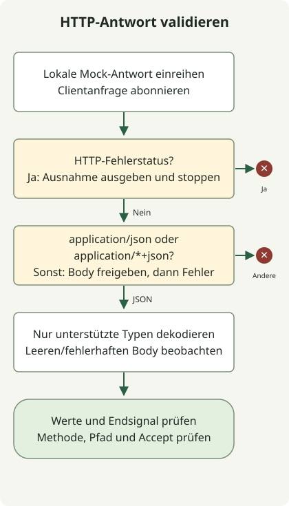

Testen Sie WebClient mit einem lokalen MockWebServer und prüfen Sie HTTP-Status, Content-Type der Antwort, Body-Dekodierung sowie Abschluss oder Fehler gemeinsam. Eine `200 OK`-Antwort mit HTML kann den Antwortvertrag des Clients verletzen, obwohl der Status Erfolg signalisiert; das Senden von `Accept: application/json` erzwingt keine JSON-Antwort. Spring dokumentiert [Tests mit einem Mock-Webserver](https://docs.spring.io/spring-framework/reference/6.2/web/webflux-webclient/client-testing.html) und dem echten HTTP-Client.

Die Tests verwenden einen echten WebClient über lokales HTTP statt eines Mocks seiner verketteten Methoden. Sie decken die unten gezeigten Antwortverträge ab; Timeout- und Wiederholungsrichtlinien für den Produktivbetrieb benötigen separate Tests.

## Verarbeitungsablauf



Der Client prüft den Status vor dem Medientyp, gibt abgelehnte Bodys frei und dekodiert unterstütztes JSON. StepVerifier prüft neben ausgegebenen Werten auch Abschluss oder Fehler.

## Ein eigenständiges Testprojekt einrichten

Die Reproduktionsumgebung besteht aus JDK 17.0.8.1, Gradle 8.4, Spring Boot **3.5.7 BOM** und MockWebServer **4.12.0**. Diese fixieren die Abhängigkeiten des Beispiels; sie sind keine Empfehlung aktueller Produktionsversionen. Dies ist ein einfaches Java-Testprojekt; eine laufende Spring-Boot-Anwendung ist nicht erforderlich.

Erstellen Sie in einem neuen Verzeichnis eine `settings.gradle` mit `rootProject.name = 'webclient-example'` sowie diese vollständige `build.gradle`:

```groovy
plugins { id 'java' }
repositories { mavenCentral() }
dependencies {
    testImplementation platform('org.springframework.boot:spring-boot-dependencies:3.5.7')
    testImplementation 'org.springframework.boot:spring-boot-starter-webflux'
    testImplementation 'org.springframework.boot:spring-boot-starter-test'
    testImplementation 'io.projectreactor:reactor-test'
    testImplementation 'com.squareup.okhttp3:mockwebserver:4.12.0'
    testRuntimeOnly 'org.junit.platform:junit-platform-launcher'
}
test { useJUnitPlatform() }
```

Die BOM ist ausdrücklich angegeben, damit die Spring- und Reactor-Abhängigkeiten auch ohne Spring-Boot-Gradle-Plugin Versionen erhalten. Passen Sie bei einer bereits von Boot verwalteten Anwendung die Testabhängigkeiten an deren ausgewählte BOM an.

## Acht Antwortverträge testen

Speichern Sie diese vollständige Klasse als `src/test/java/ExternalApiTest.java`:

```java
import java.io.IOException;
import java.time.Duration;
import java.util.concurrent.TimeUnit;
import okhttp3.mockwebserver.MockResponse;
import okhttp3.mockwebserver.MockWebServer;
import okhttp3.mockwebserver.RecordedRequest;
import org.junit.jupiter.api.AfterEach;
import org.junit.jupiter.api.BeforeEach;
import org.junit.jupiter.api.Test;
import org.springframework.http.MediaType;
import org.springframework.web.reactive.function.client.WebClient;
import reactor.core.publisher.Mono;
import reactor.test.StepVerifier;
import static org.junit.jupiter.api.Assertions.*;

class ExternalApiTest {
    private MockWebServer server;
    private WebClient client;
    record Payload(String message) {}

    @BeforeEach
    void start() throws IOException {
        server = new MockWebServer();
        server.start();
        client = WebClient.builder().baseUrl(server.url("/").toString()).build();
    }

    @AfterEach
    void stop() throws IOException {
        server.shutdown();
    }

    private Mono<Payload> fetch() {
        return client.get().uri("/employee/100")
            .accept(MediaType.APPLICATION_JSON)
            .exchangeToMono(response -> {
                if (response.statusCode().isError()) {
                    return response.createException().flatMap(Mono::error);
                }
                boolean json = response.headers().contentType()
                    .map(type -> "application".equals(type.getType())
                        && ("json".equals(type.getSubtype())
                            || type.getSubtype().endsWith("+json")))
                    .orElse(false);
                if (!json) {
                    return response.releaseBody().then(Mono.<Payload>error(
                        new IllegalStateException("Expected JSON response")));
                }
                return response.bodyToMono(Payload.class);
            });
    }

    @Test
    void rejectsHtmlEvenWhenStatusIs200() throws Exception {
        server.enqueue(new MockResponse().setResponseCode(200)
            .setHeader("Content-Type", "text/html; charset=UTF-8")
            .setBody("<html><body>Unknown failure</body></html>"));
        StepVerifier.create(fetch())
            .expectErrorMatches(error -> error instanceof IllegalStateException
                && error.getMessage().equals("Expected JSON response"))
            .verify(Duration.ofSeconds(5));
        RecordedRequest request = server.takeRequest(1, TimeUnit.SECONDS);
        assertNotNull(request);
        assertEquals("GET", request.getMethod());
        assertEquals("/employee/100", request.getPath());
        assertEquals("application/json", request.getHeader("Accept"));
    }

    @Test
    void preservesHttp500Error() {
        server.enqueue(new MockResponse().setResponseCode(500)
            .setHeader("Content-Type", "text/html")
            .setBody("<html>Unknown failure</html>"));
        StepVerifier.create(fetch())
            .expectError(org.springframework.web.reactive.function.client.WebClientResponseException.InternalServerError.class)
            .verify(Duration.ofSeconds(5));
    }

    @Test
    void decodesJson() {
        server.enqueue(new MockResponse().setResponseCode(200)
            .setHeader("Content-Type", "application/json")
            .setBody("{\"message\":\"ok\"}"));
        StepVerifier.create(fetch())
            .expectNextMatches(payload -> payload.message().equals("ok"))
            .expectComplete().verify(Duration.ofSeconds(5));
    }

    @Test
    void rejectsMissingContentType() {
        server.enqueue(new MockResponse().setResponseCode(200)
            .setBody("{\"message\":\"ok\"}"));
        StepVerifier.create(fetch())
            .expectErrorMatches(error -> error instanceof IllegalStateException
                && error.getMessage().equals("Expected JSON response"))
            .verify(Duration.ofSeconds(5));
    }

    @Test
    void rejectsMalformedJson() {
        server.enqueue(new MockResponse().setResponseCode(200)
            .setHeader("Content-Type", "application/json").setBody("{broken"));
        StepVerifier.create(fetch())
            .expectError(org.springframework.core.codec.DecodingException.class)
            .verify(Duration.ofSeconds(5));
    }

    @Test
    void decodesStructuredJsonSubtype() {
        server.enqueue(new MockResponse().setResponseCode(200)
            .setHeader("Content-Type", "application/vnd.example+json")
            .setBody("{\"message\":\"ok\"}"));
        StepVerifier.create(fetch())
            .expectNextMatches(payload -> payload.message().equals("ok"))
            .expectComplete().verify(Duration.ofSeconds(5));
    }

    @Test
    void completesWithoutPayloadForEmptyJsonBody() {
        server.enqueue(new MockResponse().setResponseCode(200)
            .setHeader("Content-Type", "application/json"));
        StepVerifier.create(fetch())
            .expectComplete().verify(Duration.ofSeconds(5));
    }

    @Test
    void rejectsNonApplicationJsonSubtype() {
        server.enqueue(new MockResponse().setResponseCode(200)
            .setHeader("Content-Type", "text/example+json")
            .setBody("{\"message\":\"ok\"}"));
        StepVerifier.create(fetch())
            .expectErrorMatches(error -> error instanceof IllegalStateException
                && error.getMessage().equals("Expected JSON response"))
            .verify(Duration.ofSeconds(5));
    }
}
```

Führen Sie dies mit ausgewähltem JDK 17 und installiertem Gradle 8.4 aus:

```sh
java -version
gradle --version
gradle --no-daemon test
```

Alle acht Tests sollten bestehen. Öffnen Sie `build/reports/tests/test/index.html` für die einzelnen Testergebnisse; die Ausgabe der Gradle-Aufgabe muss nicht jeden bestandenen Test auflisten.

| Antwort | Von diesem Beispiel gefordertes Ergebnis |
| --- | --- |
| HTTP 200, JSON-Body | Nutzdaten dekodieren. |
| HTTP 200, HTML-Body | Unerwarteten Inhaltstyp ablehnen. |
| HTTP 500, HTML-Body | HTTP-Fehlertyp bewahren. |
| HTTP 200, Content-Type fehlt | Nicht angegebenes Antwortformat ablehnen. |
| HTTP 200, fehlerhaftes JSON | Dekodierfehler melden. |
| HTTP 200, `application/vnd.example+json` | Kompatible JSON-Nutzdaten dekodieren. |
| HTTP 200, leerer JSON-Body | Ohne Ausgabe von Nutzdaten abschließen. |
| HTTP 200, `text/example+json` | Medientyp außerhalb von application ablehnen. |

Das Verhalten bei leerem Body ist ein bewusster Vertrag dieses Beispiels. Wenn Ihr Endpunkt Nutzdaten erfordert, ergänzen Sie `switchIfEmpty(Mono.error(...))` und ändern Sie den Test so, dass er den Anwendungsfehler erwartet.

<span id="why-status-and-decoding-are-checked-separately"></span>

## Warum kann HTTP 200 die Antwortvalidierung trotzdem nicht bestehen?

`fetch()` behandelt Fehlerstatus, bevor das Format erfolgreicher Antworten geprüft wird. `createException()` bewahrt HTTP 500 als `WebClientResponseException.InternalServerError`. Ein Verbindungsfehler folgt gewöhnlich stattdessen dem Pfad `WebClientRequestException`; er ist keine HTTP-Antwort des Servers.

Bei einem Nichtfehlerstatus akzeptiert der Code die Medientypen `application/json` und `application/*+json` und überlässt danach dem Decoder die Body-Validierung. Ein falscher Content-Type und fehlerhaftes JSON erzeugen daher unterschiedliche Fehler. Dies ist ein Beispielvertrag, keine vollständige Richtlinie für Weiterleitungen oder jeden Erfolgsstatus.

Beim Ablehnen einer erfolgreichen Antwort gibt der Code den Body frei, bevor er den Anwendungsfehler meldet. Verarbeiten oder behandeln Sie den Body bei `exchangeToMono` innerhalb des Callbacks; [Springs exchange-Dokumentation](https://docs.spring.io/spring-framework/reference/6.2/web/webflux-webclient/client-exchange.html) erläutert, dass ein nicht konsumierter Body nach Abschluss freigegeben wird.

`setBody(html)` sendet HTML direkt. Würde dieser String zuvor als JSON serialisiert, änderte sich die getestete Antwort. Die Assertions zur aufgezeichneten Anfrage prüfen außerdem die tatsächlich gesendete Methode, den Pfad und den Header `Accept`.

`verify(Duration.ofSeconds(5))` begrenzt die Wartezeit jedes Tests. Es konfiguriert keine Verbindungs- oder Antwort-Timeouts des Produktionsclients. Ergänzen Sie Transport-Timeout- und Wiederholungstests gemäß Ihrem API-Vertrag; diese acht Fälle decken sie nicht ab.

Alle acht Tests bestanden in der oben genannten Reproduktionsumgebung. In diesem Repository wiederholt `python3 scripts/check_webclient_example.py` diese Prüfung. Stellen Sie bei einem Projekt über die Jakarta-Grenze hinweg die [Spring-Boot-Migrationsbasis](/en/posts/2023-09-08-springboot3-migration/) her, bevor Sie das Clientverhalten ändern.

Diese Clienttests verwenden einen lokalen Mock-Server; sie prüfen keine statischen Dateien einer bereitgestellten Anwendung. Paketiert die Anwendung Vue-Apps, prüft das [Gradle-Beispiel zur Frontend-Paketierung](/en/posts/2021-07-23-multiple-gradle-build/) die ausführbare JAR und deren HTML-/JavaScript-Antworten. Die beiden Beispiele fixieren unterschiedliche Umgebungen und sollten erst nach Abstimmung ihrer Abhängigkeiten kombiniert werden.

MockWebServer-API-Referenz: [OkHttp-4.12.0-Quellcode und Beispiele](https://github.com/square/okhttp/tree/parent-4.12.0/mockwebserver).

Für Zeitgrenzen und Wiederholungszahlen fahren Sie mit den [WebClient-Tests für Timeouts und begrenzte Wiederholungen](/en/posts/2026-10-30-webclient-timeout-retry/) fort. Dieses Beispiel wiederholt ausschließlich GET-Antworten mit Status 503 und trennt Grenzen pro Versuch vom Gesamtbudget der Wiederholungen.
