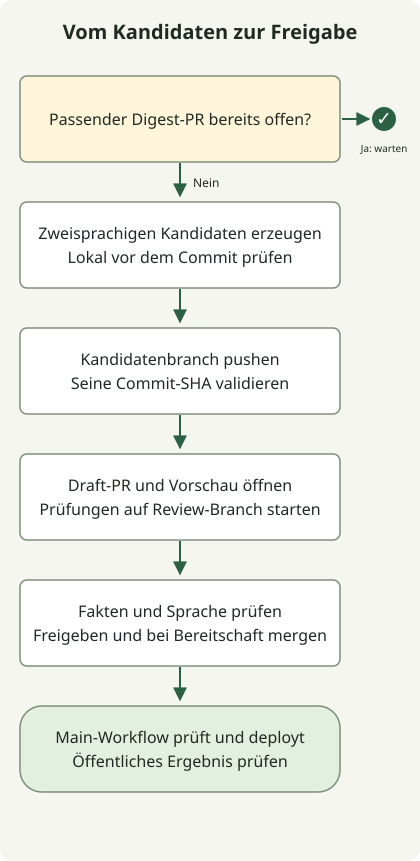

Ein Inhaltsgenerator sollte einen Prüfkandidaten erzeugen. In diesem Repository führen erfolgreiche Generierung und CI zu einem Draft-PR; die Veröffentlichung folgt über eine separate Zusammenführung und den Pages-Workflow des Hauptbranches.

Die Jekyll-Pipeline vom April schrieb Markdown und pushte generierte Inhalte. Die Website verwendet inzwischen Astro, speichert neue zweisprachige Digests als JSON und hält den Kandidaten bis zur Prüfung von `main` fern. Vorhandene `_posts`-Dateien und Ruby-Werkzeuge beschreiben die frühere Website, nicht den aktuellen Veröffentlichungsbefehl.

## Dem Kandidaten-Commit folgen



Der [Inhaltsworkflow](https://github.com/youdozi/youdozi.github.io/blob/main/.github/workflows/dev-content-pipeline.yml) führt Generierung nur auf `main` aus. Zuerst prüft er auf einen offenen PR mit `content/digest-review-` aus diesem Repository. Existiert einer, pausiert er einen weiteren Kandidaten einschließlich eines manuellen Vorschaulaufs, bis dieser PR zusammengeführt oder geschlossen wird.

Ohne ausstehenden Kandidaten sammelt und bereitet `scripts/generate_digest.py` englische und koreanische Fassungen vor. Eine generierte Datei muss `npm run check` und `npm run build` bestehen, bevor ein Commit auf einen neuen Prüfbranch gepusht wird. Der gemeinsame Validator prüft anschließend diese generierte Commit-SHA; der Review-Job setzt erfolgreiche Generierung und Validierung voraus. Dies folgt GitHubs [Verhalten bei Job-Abhängigkeiten](https://docs.github.com/en/actions/how-tos/write-workflows/choose-what-workflows-do/use-jobs).

Der Review-Job rendert die Nachweise, erstellt einen Draft-PR, ergänzt die Vorschau-URL und startet ausdrücklich den Website-Workflow auf dem Prüfbranch. Dieser Branch lässt sich prüfen, ohne die Bedingung für das Produktionsdeployment zu erfüllen. Auch die [Token-Ereignisregeln](https://docs.github.com/en/actions/concepts/security/github_token) sind wichtig, wenn Automatisierung einen anderen Workflow auslöst; leiten Sie einen Lauf nicht allein aus einer erfolgreichen API-Anfrage ab.

## Die Prüflogik ohne GitHub-Aufrufe ausführen

Verwenden Sie Node 24 und führen Sie `npm ci` in einem Checkout dieses Repositorys aus. Speichern Sie die folgende vollständige Datei als `review-contract.mjs` im Repository-Stamm und führen Sie dann Folgendes aus:

```sh
node review-contract.mjs
```

Dieses Testprogramm liest die tatsächliche Workflow-YAML, führt ihre beiden JavaScript-Snippets mit lokalen Mocks aus und prüft fünf Fälle ausstehender PRs sowie die Reihenfolge Erstellen/Aktualisieren/Dispatch. Sein Mock bietet keine Merge-Operation. Es führt weder Workflow-YAML aus noch erzeugt es einen echten Digest oder tätigt API-Aufrufe.

### `review-contract.mjs`

```javascript
import assert from 'node:assert/strict';
import { readFileSync } from 'node:fs';
import YAML from 'yaml';

const workflow = YAML.parse(readFileSync('.github/workflows/dev-content-pipeline.yml', 'utf8'));
const { generate, validate, review } = workflow.jobs;
assert.equal(generate.if, "github.ref == 'refs/heads/main'");
assert.deepEqual(review.needs, ['generate', 'validate']);
assert.equal(validate.with.ref, '${{ needs.generate.outputs.commit_sha }}');
assert.equal(validate.uses, './.github/workflows/site-checks.yml');
assert.equal(workflow.jobs.publish, undefined);

const AsyncFunction = Object.getPrototypeOf(async function () {}).constructor;
const pendingScript = generate.steps.find(step => step.id === 'pending').with.script;
const runPending = new AsyncFunction('github', 'context', 'core', pendingScript);
const context = { repo: { owner: 'example', repo: 'blog' } };
const summary = { addRaw() { return this; }, async write() {} };
const cases = [
    [[], false],
    [[{ head: { repo: { full_name: 'example/blog' }, ref: 'content/digest-review-1' }, html_url: 'mock' }], true],
    [[{ head: { repo: { full_name: 'other/blog' }, ref: 'content/digest-review-1' } }], false],
    [[{ head: { repo: { full_name: 'example/blog' }, ref: 'content/manual-1' } }], false],
    [[{ head: { repo: null, ref: 'content/digest-review-1' } }], false],
];
for (const [pulls, expected] of cases) {
    let exists;
    const github = { rest: { pulls: { list() {} } }, paginate: async () => pulls };
    const core = { summary, setOutput(key, value) { if (key === 'exists') exists = value; } };
    await runPending(github, context, core);
    assert.equal(exists, expected);
}

const calls = [];
const github = { rest: {
    pulls: {
        async create(payload) { calls.push(['create', payload]); return { data: { number: 42, html_url: 'mock-pr' } }; },
        async update(payload) { calls.push(['update', payload]); },
    },
    actions: { async createWorkflowDispatch(payload) { calls.push(['dispatch', payload]); } },
} };
const core = { summary, setOutput() {} };
const requireMock = name => {
    assert.equal(name, 'node:fs');
    return { readFileSync: () => 'Mock review body' };
};
const script = review.steps.find(step => step.id === 'pr').with.script;
const runReview = new AsyncFunction('require', 'github', 'context', 'core', 'process', script);
await runReview(requireMock, github,
    { ...context, serverUrl: 'https://github.com', runId: 7 }, core,
    { env: { REVIEW_BRANCH: 'content/digest-review-7-1' } });
assert.deepEqual(calls.map(call => call[0]), ['create', 'update', 'dispatch']);
assert.equal(calls[0][1].draft, true);
assert.equal(calls[0][1].base, 'main');
assert.equal(calls[0][1].head, 'content/digest-review-7-1');
assert.equal(calls[2][1].workflow_id, 'site-quality-gates.yml');
assert.equal(calls[2][1].ref, calls[0][1].head);
console.log('5 pending-PR cases and the mocked draft/create-update-dispatch sequence passed.');
```

Die geprüfte Ausgabe lautet:

```text
5 pending-PR cases and the mocked draft/create-update-dispatch sequence passed.
```

Die fünf Eingaben unterscheiden keinen ausstehenden PR, einen passenden lokalen Digest-PR, einen PR eines anderen Repositorys, einen anderen lokalen Branch und ein fehlendes Head-Repository. Ein bestandenes Testprogramm belegt diese ausgewählten Skriptverträge, nicht GitHub-Token-Berechtigungen, Branch-Schutz, Quellenrichtigkeit oder den gesamten gehosteten Workflow.

## Einen Kandidaten anfordern und über die Veröffentlichung entscheiden

Wählen Sie unter **Actions → Dev Content Pipeline → Run workflow** den Branch `main`. Lassen Sie `preview` deaktiviert, um einen Prüfkandidaten vorzubereiten. Aktivieren Sie es für den Trockenlauf mit `--dry-run --force --max-items 2`; dieser committet keinen Kandidaten. Ein bereits ausstehender Digest pausiert die Generierung weiterhin. GitHub dokumentiert die [Steuerelemente zur manuellen Workflow-Ausführung](https://docs.github.com/en/actions/how-tos/manage-workflow-runs/manually-run-a-workflow).

Öffnen Sie den Draft-PR und seine zweisprachige Vorschau. Prüfen Sie Quelldatum, ursprüngliche Aussage samt Belegen, Übersetzungsumfang, Links und Veröffentlichungswürdigkeit des Eintrags. Automatische Code- und Schemaprüfungen können diese redaktionelle Entscheidung nicht treffen. Ändern Sie den Kandidaten bei Bedarf, bestätigen Sie die Prüfungen des resultierenden Commits, markieren Sie ihn dann als bereit und führen Sie ihn bei genehmigter Veröffentlichung zusammen. Das bloße Bereitmarkieren eines Entwurfs deployt ihn nicht.

Der [Artikel zu Qualitätsprüfungen](/en/posts/2026-04-07-jekyll-quality-gates-proof-html-bundler-audit/) erklärt, warum ein grüner PR-Lauf das Deployment zu Recht überspringen kann und was nach dem Merge zu prüfen ist. Für die frühere Ruby-Umgebung siehe den [Jekyll-Fehlerbehebungsbericht](/ko/posts/2026-04-07-ruby-rbenv-jekyll-build-troubleshooting/), derzeit auf Koreanisch verfügbar.
