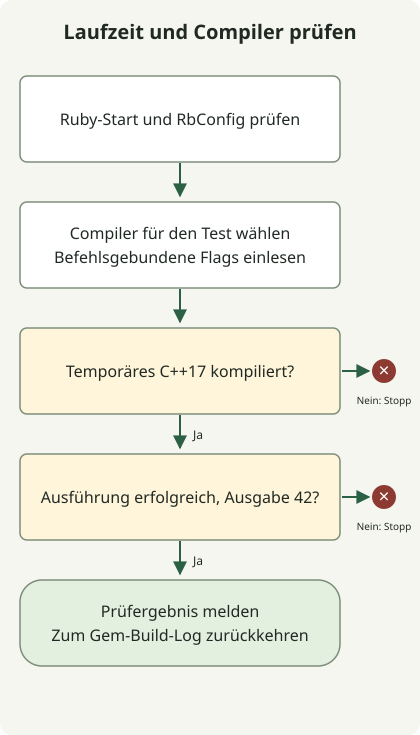

Trennen Sie den Ruby-Start von der Kompilierung nativer Erweiterungen. Ein funktionierendes `ruby --version` belegt nicht, dass ein C++-Compiler seine Header findet; ein erfolgreiches eigenständiges C++-Programm belegt wiederum nicht, dass die Erweiterung eines Gems kompiliert.

Der ursprüngliche Bericht betraf den Ruby-Bibliothekspfad eines anderen Benutzers und ein macOS-SDK-/Headerproblem. Das sind verschiedene Fehlerarten. Die folgende Diagnose bewahrt diese Unterscheidung, ohne Ruby zu deinstallieren, Command Line Tools zu ändern oder RbConfig global zu überschreiben. Die aktuelle Website verwendet Astro; diese Prüfungen betreffen die erhaltenen Ruby-Werkzeuge.

## Bei der fehlerhaften Ebene beginnen



Vergleichen Sie zuerst das ausgewählte Ruby mit seiner gespeicherten Build-Konfiguration:

```sh
command -v ruby
ruby --version
rbenv which ruby
ruby -rrbconfig -e 'puts RbConfig.ruby; puts RbConfig::CONFIG.values_at("CXX", "CPPFLAGS", "CXXFLAGS")'
```

Wenn Ruby selbst wegen einer fehlenden Bibliothek nicht startet, untersuchen Sie vor einer Gem-Installation diesen Interpreter und seine Bibliotheksverknüpfungen. Unter macOS kann `otool -L` die von `rbenv which ruby` gewählte ausführbare Datei prüfen. Installieren Sie nicht allein wegen eines fehlgeschlagenen nativen Gems jede Ruby-Version neu.

[RbConfig](https://docs.ruby-lang.org/en/3.2/RbConfig.html) stellt die Build-Konfiguration des Interpreters bereit. In der getesteten Ruby3.2.2-Umgebung war `CXX` auf `false` gesetzt, während ein ausdrücklich ausgewähltes `c++` mit passenden Header-Flags laufen konnte. Diese Beobachtung betrifft diesen Interpreter und Host, nicht jede rbenv-Installation. Ruby3.2 hat inzwischen sein [Supportende erreicht](https://www.ruby-lang.org/en/downloads/branches/); dies ist die Diagnose einer alten Umgebung, keine unterstützte Ausgangsbasis.

## Ohne Änderung der Ruby-Konfiguration kompilieren

Speichern Sie dieses vollständige Skript, das nur die Ruby-Standardbibliothek verwendet, als `native_probe.rb`:

```ruby
require 'rbconfig'
require 'open3'
require 'shellwords'
require 'tmpdir'
require 'json'

compiler = Shellwords.split(ENV.fetch('CXX', 'c++'))
abort 'CXX must name a compiler' if compiler.empty?
flags = Shellwords.split(ENV.fetch('PROBE_CXXFLAGS', ''))
Dir.mktmpdir('ruby-cxx-probe-') do |root|
  source = File.join(root, 'probe.cpp')
  binary = File.join(root, 'probe')
  File.write(source, "#include <iostream>\nint main() { std::cout << 42 << '\\n'; }\n")
  _out, error, status = Open3.capture3(*compiler, '-std=c++17', *flags, source, '-o', binary)
  abort "C++ compilation failed:\n#{error}" unless status.success?
  output, error, status = Open3.capture3(binary)
  abort "Probe failed: #{error}" unless status.success? && output == "42\n"
  puts JSON.generate('ruby' => RUBY_VERSION, 'configured_cxx' => RbConfig::CONFIG['CXX'],
                     'probe_compiler' => compiler, 'output' => output.strip, 'result' => 'passed')
end
```

Führen Sie es mit dem für die Prüfung gewählten Compiler aus:

```sh
ruby native_probe.rb
```

Das Skript kompiliert ein temporäres C++17-Programm und verlangt als Ausgabe exakt `42`. `CXX` wählt den Prüfbefehl; `PROBE_CXXFLAGS` liefert ausschließlich dessen Flags. Zum Vergleich meldet es Rubys konfigurierten CXX und ersetzt ihn nicht. Ein leeres `CXX`, ein Kompilierfehler oder eine unerwartete Ausgabe führt zu einem Exit-Code ungleich null.

Auf dem getesteten Mac scheiterte der Standardaufruf, weil `iostream` nicht gefunden wurde. Nach Prüfung des gewählten SDK und Bestätigung seines vorhandenen Header-Verzeichnisses ließen die folgenden, nur für diesen Befehl geltenden Flags die Prüfung bestehen:

```sh
probe_sdk="$(xcrun --show-sdk-path)"
test -d "$probe_sdk/usr/include/c++/v1"
PROBE_CXXFLAGS="-isysroot $probe_sdk -isystem $probe_sdk/usr/include/c++/v1" ruby native_probe.rb
```

Dieser Pfad wurde auf jenem Mac getestet. Er ist keine universelle SDK-Reparatur; Pfade mit Leerzeichen erfordern korrekt zitierte Tokens innerhalb des Flag-Werts. Beginnen Sie mit `xcode-select -p` und `xcrun --show-sdk-path`; installieren Sie kein in einem alten Beispiel genanntes CLT-Paket. Apples [Leitfaden zu den Kommandozeilenwerkzeugen](https://developer.apple.com/library/archive/technotes/tn2339/_index.html) erläutert das gewählte Entwicklerverzeichnis und die SDK-Werkzeuge.

## Zum eigentlichen Gem-Fehler zurückkehren

Eine bestandene Prüfung grenzt die Untersuchung ein; die Erweiterung kann weiterhin andere Flags, Header, Bibliotheken oder ABI-Anforderungen verwenden. Bewahren Sie das Build-Log des fehlgeschlagenen Gems auf und vergleichen Sie den tatsächlich aufgerufenen Befehl. `scripts/ruby_cxx_fix.rb` dieses Repositorys ändert beim ausdrücklichen Laden RbConfig-Werte innerhalb des Ruby-Prozesses; sein Homebrew-Fallback ist hostspezifisch. Wenden Sie eine solche Umgehung erst nach Abgleich des Fehlers an; bewahren Sie vorhandene RUBYOPT-Optionen, statt sie blind zu überschreiben.

Der lokale Erfolg der Prüfung installierte Ruby nicht neu und baute die nativen Gems der alten Website nicht erneut. Verwenden Sie für die nächste Ebene das [isolierte Jekyll-Bundle mit zwei Seiten](/en/posts/2023-09-04-jekyll-install/). Für die Prüfungen der aktiven Website siehe den [Astro-Qualitätsleitfaden](/en/posts/2026-04-07-jekyll-quality-gates-proof-html-bundler-audit/).
