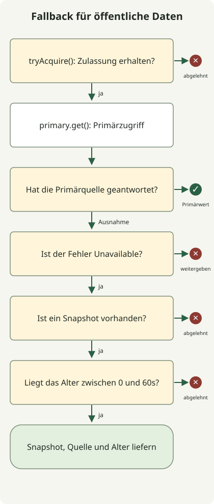

Bei einem Ausfall sollte **Fallback eine Antwort auf einem vorab festgelegten, akzeptablen Qualitätsniveau und zu tragbaren Systemkosten liefern**. Sie könnten einen Empfehlungsbereich weglassen oder öffentliche Lesedaten innerhalb einer vereinbarten Altersgrenze zurückgeben. Erfolg zu melden, obwohl das Zahlungsergebnis unbekannt ist, oder bei Cache-Ausfall jede Anfrage an die DB zu senden, schafft andere Probleme.

Dieser Artikel ist ein Entwurfsleitfaden für Entwickler von HTTP-APIs im Betrieb. Anschließend an die Überlastkontrollen des [Artikels zur 10k-RPS-Architektur](/ko/posts/2026-10-31-jdk-10k-rps-architecture/) behandelt er die Antworten bei Ausfällen. Das Java-Beispiel führt eine Fallback-Richtlinie ohne externen Server aus; es misst weder Durchsatz noch Wiederherstellung nach einem Produktionsausfall.

## Unterschiedliche Fehler erlauben unterschiedliche Ergebnisse

Legen Sie zuerst fest, was vom normalen Ergebnis reduziert werden darf. Die folgenden Entwürfe sind Beispiele; tatsächliche Altersgrenzen und Umfang reduzierter Funktionalität müssen Ihrem Dienstvertrag folgen.

| Fehler | Akzeptable Alternative | Wann stoppen oder begrenzen? |
| --- | --- | --- |
| Verzögerung oder Ausfall der Empfehlungs-API | Optionale Empfehlungen weglassen oder vorbereitete allgemeine Empfehlungen verwenden | Zentrale Produktlesezugriffe nicht in dieselbe Warteschlange stellen |
| Fehler beim Lesen einer öffentlichen Produktbeschreibung | Letzte erfolgreiche Daten desselben Produkts und derselben Sprache samt Aktualisierungszeit zurückgeben | Höchstalter überschritten, keine Daten oder falscher Schlüssel |
| Gesamter Cache nicht verfügbar | Begrenzte Quelllesezugriffe, freigegebene lokale Kopie oder Ablehnung überzähliger Anfragen | Keine unbegrenzte Umgehung jenseits der DB-Verbindungs- und Parallelitätsbudgets |
| Authentifizierungs- oder Autorisierungsprüfung scheitert | Temporären Fehler zurückgeben, ohne die geschützte Operation auszuführen | Fehler nicht mit fehlender Berechtigung verwechseln oder durch Zugriffsfreigabe ersetzen |
| Antwort nach Zahlungs- oder Bestellanfrage verloren | Status abfragen und mit derselben Operationskennung abgleichen | Nicht von Fehlschlag ausgehen und neue Zahlung erzeugen oder Erfolg erfinden |
| Alternativer Server verwendet dieselbe DB | Nur innerhalb separat geprüfter Kapazität wechseln | Serverwechsel beseitigt keinen Engpass in der gemeinsamen DB |

Trennen Sie korrektheitskritische Pfade wie Autorisierung, endgültige Preisbildung und Bestandsabzug von einfachen Lesezugriffen auf veraltete Daten. Ein Zahlungsstatus „wird geprüft“ ist nur sinnvoll, wenn sich die Anfrage tatsächlich verfolgen und abfragen lässt. Das Umbenennen einer Nachricht oder Antwort verwaltet kein ungeklärtes Ergebnis.

AWS nennt unzureichend getestete seltene Pfade und zusätzliche Probleme durch Alternativen unter den [Fallback-Risiken verteilter Systeme](https://aws.amazon.com/builders-library/avoiding-fallback-in-distributed-systems/). Führen Sie Fallback-Pfade wie normale Pfade aus und prüfen Sie, ob sie von denselben Ressourcen abhängen.

## Was leisten Timeouts, Wiederholungen und Circuit Breaker jeweils?

Ein Timeout begrenzt die Wartezeit des Aufrufers. **Das Ende dieser Wartezeit bedeutet nicht, dass die entfernte Operation oder Zahlung abgebrochen wurde.** Eine Wiederholung versucht dieselbe Operation erneut; Failover wechselt zu einem anderen Replikat. Fallback wechselt zu einer reduzierten Antwort oder einer anderen Verarbeitungsmethode. Ein Circuit Breaker blockiert nach angesammelten Fehlern unter festgelegten Bedingungen Aufrufe einer Abhängigkeit; eine separate Richtlinie bestimmt, welche Alternativantwort sicher ist.

Die Gesamtfrist einer Anfrage muss Verbindungsaufbau, Wartezeiten im Verbindungspool, Antwortwartezeiten, Wiederholungen und alternative Verarbeitung einschließen. Beträgt das Gesamtbudget beispielsweise 300ms und verbrauchte der erste Aufruf 250ms, können Sie nicht weitere 250ms warten. Diese Zahlen veranschaulichen die Idee und sind keine empfohlenen Einstellungen. Prüfen Sie auch, was der Timeout jeder Stufe in Ihrem Client tatsächlich umfasst.

Wie der [AWS-Leitfaden zu Wiederholungen](https://aws.amazon.com/builders-library/timeouts-retries-and-backoff-with-jitter/) erläutert, erhöhen Wiederholungen die Last, und Nebenwirkungen können selbst bei ausbleibender Antwort bereits eingetreten sein. Weisen Sie die Wiederholungsverantwortung einer Ebene zu und begrenzen Sie Restzeit und Versuchszahl bei vorübergehenden Fehlern nur, wenn eine Wiederholung sicher ist. Exponentielles Backoff und Jitter verteilen gleichzeitige Wiederholungen, erhöhen aber nicht die Kapazität einer ausgelasteten DB.

## Java-Beispiel: nur freigegebene öffentliche Daten für begrenzte Zeit zurückgeben

Das folgende Beispiel liest **eine feste öffentliche Produktbeschreibung**. Es bevorzugt die normale Antwort und verwendet die letzte erfolgreiche Kopie nur für als `Unavailable` eingestufte Abhängigkeitsfehler. Die Kopie darf höchstens 60 Sekunden alt sein; ein zukünftiger Zeitstempel wird abgelehnt. Die Grenze von 2 und das Fenster von 60 Sekunden sind Demonstrationsrichtlinien. Mehrere Produkte, Sprachen oder Mandanten erfordern separate Schlüssel; verwenden Sie dieses Beispiel mit festen Daten nicht unverändert als Cache authentifizierter Benutzerdaten.



Das Diagramm zeigt die Entscheidungen in `read()`. Jeder Pfad, der eine Zulassung erhält, gibt sie über `finally` zurück, unabhängig davon, ob er ein Primärergebnis liefert oder eine Ausnahme wirft. Timeouts, Circuit Breaker und Cache-Aktualisierung sind nicht implementiert. Ein echter HTTP-Adapter darf nur freigegebene Fehler wie Verbindungsfehler und Timeouts in `Unavailable` übersetzen. Werden 401, 403, 404, Schemafehler und Programmierfehler in dieselbe Ausnahme umgewandelt, verändert dies die Bedeutung dieser Richtlinie.

Speichern Sie dies als `FallbackDemo.java`. Es läuft mit JDK 21 oder neuer ohne externe Abhängigkeiten.

```java
import java.time.Clock;
import java.time.Duration;
import java.time.Instant;
import java.time.ZoneOffset;
import java.util.concurrent.Semaphore;
import java.util.function.Supplier;

public class FallbackDemo {
    record Snapshot(String value, Instant observedAt) {}
    record Reply(String value, String source, long ageSeconds) {}
    static class Unavailable extends RuntimeException {}
    static class Rejected extends RuntimeException {
        Rejected(String reason) { super(reason); }
    }

    static final class Catalog {
        private final Semaphore slots = new Semaphore(2);
        private final Clock clock;
        private final Duration maxAge = Duration.ofSeconds(60);

        Catalog(Clock clock) { this.clock = clock; }

        Reply read(Supplier<String> primary, Snapshot snapshot) {
            if (!slots.tryAcquire()) throw new Rejected("capacity");
            try {
                try {
                    return new Reply(primary.get(), "primary", 0);
                } catch (Unavailable failure) {
                    if (snapshot == null) throw new Rejected("missing");
                    Duration age = Duration.between(
                            snapshot.observedAt(), clock.instant());
                    if (age.isNegative() || age.compareTo(maxAge) > 0) {
                        throw new Rejected("age");
                    }
                    return new Reply(snapshot.value(), "snapshot", age.toSeconds());
                }
            } finally {
                slots.release();
            }
        }
    }

    static void rejected(String reason, Runnable action) {
        try {
            action.run();
        } catch (Rejected e) {
            if (!reason.equals(e.getMessage())) throw new AssertionError(e);
            System.out.println("rejected=" + reason);
            return;
        }
        throw new AssertionError("Expected rejection: " + reason);
    }

    public static void main(String[] args) {
        Instant now = Instant.parse("2026-10-31T00:00:00Z");
        Catalog catalog = new Catalog(Clock.fixed(now, ZoneOffset.UTC));
        Snapshot recent = new Snapshot("saved-description", now.minusSeconds(30));
        Supplier<String> down = () -> { throw new Unavailable(); };

        System.out.println(catalog.read(() -> "live-description", recent));
        System.out.println(catalog.read(down, recent));
        System.out.println(catalog.read(down,
                new Snapshot("boundary", now.minusSeconds(60))));
        rejected("age", () -> catalog.read(down,
                new Snapshot("old", now.minusSeconds(60).minusNanos(1))));
        rejected("age", () -> catalog.read(down,
                new Snapshot("future", now.plusSeconds(1))));
        rejected("missing", () -> catalog.read(down, null));

        try {
            catalog.read(() -> { throw new IllegalStateException("schema"); }, recent);
            throw new AssertionError("Unexpected fallback");
        } catch (IllegalStateException expected) {
            System.out.println("propagated=" + expected.getMessage());
        }

        // Hold both permits through nested calls; the third call must not run.
        catalog.read(() -> catalog.read(() -> {
            rejected("capacity", () -> catalog.read(() -> {
                throw new AssertionError("Primary ran without a permit");
            }, recent));
            return "inner";
        }, recent).value(), recent);
        System.out.println(catalog.read(() -> "recovered", recent));
    }
}
```

```sh
javac --release 21 FallbackDemo.java
java FallbackDemo
```

Die folgende Ausgabe wurde mit Zulu JDK `21.0.1+12-LTS` erzielt.

```text
Reply[value=live-description, source=primary, ageSeconds=0]
Reply[value=saved-description, source=snapshot, ageSeconds=30]
Reply[value=boundary, source=snapshot, ageSeconds=60]
rejected=age
rejected=age
rejected=missing
propagated=schema
rejected=capacity
Reply[value=recovered, source=primary, ageSeconds=0]
```

`source=snapshot` und `ageSeconds` sind Anwendungsmetadaten, die dem Client reduzierte Qualität vermitteln. Sie implementieren nicht den HTTP-Header `Age`. Der Höchstaltersvergleich verwendet eine präzise `Duration`; nur das angezeigte Alter wird auf ganze Sekunden reduziert.

[Semaphores `tryAcquire()`](https://docs.oracle.com/en/java/javase/21/docs/api/java.base/java/util/concurrent/Semaphore.html) scheitert ohne Warten, wenn keine Zulassung verfügbar ist. Dieses Beispiel schließt Fallback-Antworten in dieselbe Zulassungsgrenze ein und gibt daher bei bestehender Sättigung nicht einmal eine Kopie zurück. Soll im Produktivbetrieb ein günstiger, kopienspezifischer Pfad erlaubt sein, geben Sie auch diesem eine eigene Grenze. Die verschachtelten Aufrufe zeigen deterministisch die Erschöpfung der Zulassungen; sie sind kein paralleler Lasttest.

Das Beispiel implementiert weder Speicherung und Aktualisierung erfolgreicher Lesezugriffe noch Speichergrenzen und Verdrängung, Anfragebündelung oder Wiederherstellung von Kopien nach einem Neustart. Aktualisieren Sie Kopien im Betrieb nur aus erfolgreichen Lesezugriffen und **schreiben Sie den gespeicherten Zeitstempel beim Zurückgeben einer Kopie nicht neu**. Eine Aktualisierung bei jeder Fallback-Antwort kann einen alten Wert unbegrenzt akzeptabel halten. Langlebige Kopien benötigen außerdem eine Aktualitätsrichtlinie, die Uhrkorrekturen berücksichtigt.

## Auch Bedingungen für das Ausfallende festlegen

[Google SREs Leitfaden zur Überlastbehandlung](https://sre.google/sre-book/handling-overload/) erläutert, dass eine Fehlerantwort notwendig sein kann, wenn selbst eine reduzierte Antwort zu teuer ist. Machen Zulassungsablehnung oder fehlende gültige Kopie den Dienst vorübergehend unzugänglich, können Sie gemäß HTTP-Vertrag 503 verwenden. Bei verlässlichem Wiederholungszeitpunkt können Sie `Retry-After` senden; der Header allein verhindert jedoch keinen Clientansturm. 504 bedeutet, dass ein Gateway oder Proxy keine rechtzeitige Antwort eines vorgeschalteten Servers erhielt; es ist kein Code für jeden Anwendungstimeout. [RFC 9110](https://www.rfc-editor.org/rfc/rfc9110.html#name-server-error-5xx)

Alle Anfragen beim Schließen eines Circuit Breakers sofort zur Primärquelle zurückzusenden kann einen sich erholenden Server erneut überlasten. Prüfen Sie seinen Zustand mit begrenzten halb offenen Testaufrufen und erhöhen Sie dann den Verkehr schrittweise; begrenzen Sie dabei auch Snapshot-Aktualisierungen und Cache-Neubefüllung. Definieren Sie im Voraus, wann die Ausweitung gestoppt oder zur vorherigen Stufe zurückgekehrt wird, falls normale Antwortlatenz, Fehlerrate, DB-Verbindungswartezeiten oder Warteschlangenrückstau akzeptable Bereiche überschreiten. Bestimmen Sie konkrete Anteile und Beobachtungszeiträume durch tatsächliche Lasttests.

Wählen Sie zur ersten Einführung einen optionalen Lesepfad und injizieren Sie Abhängigkeitsfehler. Prüfen Sie dann fehlende Kopien, die zulässige Altersgrenze, zukünftige Zeitstempel, vollständige Zulassungssättigung, nicht klassifizierte Ausnahmen und die Wiederherstellung der Abhängigkeit. Testen Sie auf echten Servern außerdem langsame Antworten, erschöpfte Verbindungspools, vollständigen Cache-Ausfall, gleichzeitigen Ausfall von Primär- und Fallback-Pfad sowie gleichzeitige Wiederholungen bei Wiederherstellung.

Trennen Sie normale Ergebnisse, Fallback-Ergebnisse, Ablehnungen und Fehler in den Betriebsmetriken. Nur auf die HTTP-200-Quote zu schauen kann einen Ausfall verbergen, bei dem die meisten Antworten veraltet sind. Erfassen Sie Fallback-Antwortanteil, Datenalter, Fehler je Abhängigkeit, Zulassungsablehnungen und laufende Anfragen gemeinsam. **Unterscheiden Sie Anfragen, die die Geschäftsfunktion tatsächlich abschließen, von solchen mit reduzierter Qualität**, um zu beurteilen, ob Fallback die Ausfallfolgen verringerte.
