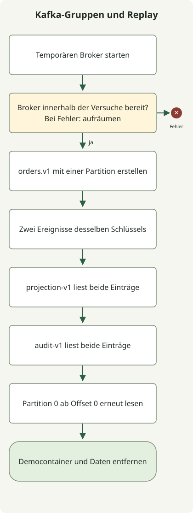

**Kafka-Event-Streaming hält Aufzeichnungen von Tatsachen in einem Log fest und lässt mehrere Consumer sie von ihren eigenen Positionen aus lesen und verarbeiten.** Versandvorbereitung und Analyse können Bestellereignisse unabhängig lesen; gespeicherte Aufzeichnungen lassen sich mit neuer Logik erneut verarbeiten. Ein Ereignis in Kafka zu speichern und eine externe DB oder Zahlung genau einmal zu ändern sind jedoch getrennte Aufgaben.

Dieser Artikel richtet sich an Entwickler mit HTTP-API- und Datenbankkenntnissen. Er verbindet Topics, Partitionen und Consumer-Gruppen und führt anschließend Veröffentlichung, unabhängigen Konsum und Replay in lokalem Kafka aus. Im Mittelpunkt stehen **Consumer-Positionen und die Bedeutung erneuter Verarbeitung nach Fehlern**, nicht die Implementierung von Aggregationen, Fenstern oder Joins in Kafka Streams.

## Wie unterscheidet sich Event-Streaming von einer Arbeitswarteschlange?

Ein Ereignis ist eine bereits eingetretene Tatsache, etwa „eine Bestellung wurde erstellt“. Die Unterscheidung von einem Befehl für eine bestimmte Aktion wie „Versand starten“ erlaubt mehreren Consumern, dieselbe Aufzeichnung für ihre eigenen Geschäftsaufgaben zu nutzen. Kafka kann Arbeit innerhalb einer Gruppe auch wie eine Warteschlange verteilen, doch das Konsumieren löscht eine Aufzeichnung nicht sofort. Andere Gruppen und Replay-Jobs können sie innerhalb der Aufbewahrungsrichtlinie erneut lesen. [Einführung in Apache Kafka](https://kafka.apache.org/intro/)

| Begriff | Rolle | Beim Entwurf festzulegen |
| --- | --- | --- |
| Producer | Schreibt Ereignisse nach Kafka | Schlüssel, Ereignis-IDs, Schemas, Behandlung von Veröffentlichungsfehlern |
| Topic | Logischer Strom zusammengehöriger Ereignisse | Ereignisbedeutung, Aufbewahrungs- und Kompaktierungsrichtlinien, Zugriffsrechte |
| Partition | Teilung eines geordneten Logs | Ordnungsumfang, Schlüsselverteilung, paralleler Durchsatz |
| Consumer-Gruppe | Menge von Consumern mit derselben Geschäftsaufgabe | Gruppen-ID, Verarbeitungs- und Commit-Zeitpunkt, Wiederverarbeitungsrichtlinie |
| Offset | Position einer Aufzeichnung in einer Partition | Bis wohin gelesen wurde und wo fortzusetzen ist |

Lesen beispielsweise die Gruppen `shipping-v1` und `analytics-v1` das Topic `orders.v1`, können beide Geschäftsaufgaben dieselben Ereignisse unabhängig empfangen. Werden Versand- und Analyse-Consumer stattdessen derselben Gruppe zugeordnet, teilen sie die Aufzeichnungen untereinander auf; damit ist keine der Aufgaben für den Empfang aller Ereignisse konfiguriert.

Bei gewöhnlichen Gruppenabonnements wird eine Partition einem Consumer innerhalb einer Gruppe zugewiesen. Fünf Consumer in einer Gruppe, die 3 Partitionen liest, erhalten nicht alle eine Partition. Zuweisungen anderer Gruppen sind unabhängig. Dieser Artikel verwendet gewöhnliche Gruppenabonnements mit `KafkaConsumer`, getrennt von Modellen gemeinsamer Nutzung einzelner Aufzeichnungen. [KafkaConsumer-Gruppenabonnements](https://kafka.apache.org/41/javadoc/org/apache/kafka/clients/consumer/KafkaConsumer.html)

## Bei wichtiger Reihenfolge mit dem Schlüssel beginnen

Kafka definiert die Reihenfolge **innerhalb einer Partition**. Ist die Abfolge der Zustandsänderungen einer Bestellung wichtig, verwenden Sie zunächst die Bestell-ID als Schlüssel, damit sie derselben Partition zugeordnet werden. Ein Schlüssel bestimmt die Zuordnung; eine Ereignis-ID erkennt Duplikate. Sie haben unterschiedliche Zwecke. Teilen mehrere Ereignisse derselben Bestellung dieselbe Ereignis-ID, können auch berechtigte spätere Ereignisse als Duplikate verworfen werden.

Auch die Zuordnung desselben Schlüssels erfordert konsistente Schlüsselserialisierung, Partitionierung und Partitionsanzahl. Eine höhere Partitionsanzahl kann das Ziel späterer Aufzeichnungen ändern; prüfen Sie daher deren Reihenfolge relativ zu früheren. Unbegrenzte parallele Ausführung nach dem Lesen einer Partition verändert ebenfalls die Abschlussreihenfolge. Die Kafka-Log-Reihenfolge entspricht auch nicht immer der fachlichen Ereigniszeitfolge. Verspätete Ereignisse mehrerer Publisher benötigen fachliche Versionen, Ereigniszeiten und Regeln für Verarbeitung außerhalb der Reihenfolge.

Ein stark beanspruchter Schlüssel, etwa ein Kunde mit dem Großteil aller Ereignisse, kann Last auf einer Partition konzentrieren. Statt eine Ordnungseinheit willkürlich in kleinere Schlüssel zu teilen, untersuchen Sie den nötigen Ordnungsumfang zusammen mit den Verarbeitungskosten.

## Lokal ausführen: zwei Gruppen lesen dieselben Aufzeichnungen, danach Replay

Das folgende Beispiel verwendet die im Apache-Image `apache/kafka:4.1.2` enthaltenen Werkzeuge. Es benötigt Bash und laufendes Docker; beim ersten Lauf muss das Image geladen werden. Broker und CLI laufen im selben Container, sodass kein Host-Port veröffentlicht wird. Übungsdaten werden beim Stoppen des Containers entfernt. Diese Funktionsdemonstration verwendet 1 Broker, 1 Partition und den Replikationsfaktor 1. [Offizielle Docker-Anleitung](https://kafka.apache.org/41/getting-started/docker/)



Das Diagramm zeigt die erfolgreiche Ausführungsreihenfolge des Skripts. Bei Bereitschafts- oder Befehlsfehlern stoppt es und bereinigt beim Beenden den Übungscontainer, sofern dessen Erstellung erfolgreich war. Die beiden Gruppenlesevorgänge und ein direktes Replay laufen nacheinander. Externe DB-Verarbeitung und manuelle Offset-Commits sind nicht implementiert.

Speichern Sie dies als `kafka-demo.sh` und führen Sie `bash kafka-demo.sh` aus.

```sh
#!/usr/bin/env bash
set -euo pipefail

kafka_image=apache/kafka:4.1.2
kafka_name="kafka-stream-demo-$$-$RANDOM"
docker run -d --name "$kafka_name" "$kafka_image" >/dev/null
trap 'docker rm -f "$kafka_name" >/dev/null 2>&1 || true' EXIT

ready=false
for ((attempt=0; attempt<30; attempt++)); do
  if docker exec "$kafka_name" /opt/kafka/bin/kafka-topics.sh \
      --bootstrap-server localhost:9092 --list >/dev/null 2>&1; then
    ready=true
    break
  fi
  sleep 1
done
if [ "$ready" != true ]; then
  docker logs "$kafka_name" >&2
  exit 1
fi

docker exec "$kafka_name" /opt/kafka/bin/kafka-topics.sh \
  --bootstrap-server localhost:9092 --create --topic orders.v1 \
  --partitions 1 --replication-factor 1 >/dev/null

docker exec -i "$kafka_name" /opt/kafka/bin/kafka-console-producer.sh \
  --bootstrap-server localhost:9092 --topic orders.v1 \
  --producer-property acks=all --producer-property enable.idempotence=true \
  --property parse.key=true --property key.separator=: <<'EVENTS'
order-101:{"eventId":"evt-1","type":"OrderCreated","schemaVersion":1}
order-101:{"eventId":"evt-2","type":"PaymentConfirmed","schemaVersion":1}
EVENTS

for group in projection-v1 audit-v1; do
  printf 'group=%s\n' "$group"
  docker exec "$kafka_name" /opt/kafka/bin/kafka-console-consumer.sh \
    --bootstrap-server localhost:9092 --topic orders.v1 --group "$group" \
    --from-beginning --max-messages 2 --timeout-ms 15000 \
    --property print.key=true --property 'key.separator=|'
done

printf 'replay=partition-0-offset-0\n'
docker exec "$kafka_name" /opt/kafka/bin/kafka-console-consumer.sh \
  --bootstrap-server localhost:9092 --topic orders.v1 \
  --partition 0 --offset 0 --max-messages 2 --timeout-ms 15000 \
  --property print.key=true --property 'key.separator=|'
```

Dies ist die mit Docker Engine `24.0.5` und `apache/kafka:4.1.2` geprüfte Standardausgabe. Jeder Consumer-Befehl schreibt außerdem separat `Processed a total of 2 messages` auf die Standardfehlerausgabe.

```text
group=projection-v1
order-101|{"eventId":"evt-1","type":"OrderCreated","schemaVersion":1}
order-101|{"eventId":"evt-2","type":"PaymentConfirmed","schemaVersion":1}
group=audit-v1
order-101|{"eventId":"evt-1","type":"OrderCreated","schemaVersion":1}
order-101|{"eventId":"evt-2","type":"PaymentConfirmed","schemaVersion":1}
replay=partition-0-offset-0
order-101|{"eventId":"evt-1","type":"OrderCreated","schemaVersion":1}
order-101|{"eventId":"evt-2","type":"PaymentConfirmed","schemaVersion":1}
```

Jede Gruppe las beide Ereignisse, und das abschließende direkte Replay las dieselben zwei Aufzeichnungen. Dies bestätigt, dass Konsum durch eine Gruppe weder Lesen einer anderen Gruppe noch Log-Replay verhindert. Mit nur einer Partition prüft es weder Reihenfolge zwischen Partitionen noch parallele Zuweisung innerhalb einer Gruppe.

Das Beispiel prüft Konsum durch Konsolenwerkzeuge mit der Standard-Auto-Commit-Einstellung. Es implementiert weder eine Anwendung, die nach der Geschäftsverarbeitung manuell committet, noch testet es Fehler zwischen Verarbeitung und Commit. JSON-Schemavalidierung der Eingabe, externe DB- oder Zahlungsaktualisierungen und Verarbeitung während Rebalances sind ebenfalls nicht implementiert.

## Garantiert ein Offset-Commit den Geschäftsabschluss?

Nein. Die aktuelle Position eines Consumers kann beim Empfang von Aufzeichnungen durch `poll()` voranschreiten; die nach Neustart verwendete **committete Position** ist jedoch separat. Nach Abschluss von Offset 10 committet man bei sequenzieller Verarbeitung gewöhnlich 11 als nächste Leseposition. Verwalten Sie bei mehreren Partitionen die Abschlussbereiche je Partition. Offsets bilden wegen Löschung, Transaktionen und weiterer Faktoren nicht unbedingt eine lückenlose Folge ganzzahlig nummerierter Aufzeichnungen. [KafkaConsumer-Positionen und Commits](https://kafka.apache.org/41/javadoc/org/apache/kafka/clients/consumer/KafkaConsumer.html)

| Ausführungsreihenfolge und Fehlerstelle | Mögliches Ergebnis nach Neustart | Erforderliche Behandlung |
| --- | --- | --- |
| Offset committen → vor DB-Änderung beenden | Geschäftsaktualisierung fehlt, weil diese Änderung übersprungen wird | Commit-Reihenfolge an die erforderliche Zustellungssemantik anpassen |
| DB-Änderung abschließen → vor Offset-Commit beenden | Dasselbe Ereignis wird erneut zugestellt und verarbeitet | Idempotente Verarbeitung oder Deduplizierung |
| Nach Fehlern einzelner Aufzeichnungen eine spätere Position committen | Fehlgeschlagene Aufzeichnungen können übersprungen werden | Nur den zusammenhängenden erfolgreich verarbeiteten Bereich committen |
| Partition einem anderen Consumer zuweisen | Vorhandene Arbeit kann sich mit der des neuen Eigentümers überschneiden | Arbeit des früheren Eigentümers stoppen und doppelte externe Auswirkungen verhindern |

Ein Consumer, der eine externe DB aktualisiert, kann beispielsweise die Eindeutigkeit von `(처리기 ID, eventId)` prüfen und die eigentliche Geschäftsänderung in **derselben DB-Transaktion** anwenden. Wird nur die Verarbeitungsmarkierung zuerst gespeichert und scheitert danach die eigentliche Änderung, kann die nächste Zustellung fälschlich als Duplikat gelten. Wird die Markierung dagegen nach der Änderung separat gespeichert, kann ein Fehler dazwischen eine doppelte Änderung verursachen. Aufrufe anderer externer APIs gehören nicht automatisch zu dieser DB-Transaktion; auch diese APIs benötigen daher Idempotenzschlüssel und Ergebnisprüfung.

`enable.idempotence` des Producers behandelt doppelte Log-Einträge durch Producer-Wiederholungen; es beseitigt nicht jeden Fall, in dem eine Anwendung dasselbe Geschäftsereignis zweimal als neue Veröffentlichung publiziert. Auch `acks=all` garantiert nicht unabhängig von anderen Einstellungen Schutz vor Datenverlust. Untersuchen Sie Replikationsfaktor, `min.insync.replicas` und tatsächlichen ISR-Zustand gemeinsam. Die obige Einzelbrokerübung prüft keine Toleranz gegen Brokerverlust. [Producer-Konfiguration](https://kafka.apache.org/41/configuration/producer-configs/)

Unterscheiden Sie Verarbeitung, die mit Kafka-Transaktionen Eingabe-Offsets und Ausgabe-Topic-Aufzeichnungen kombiniert und mit `read_committed` konsumiert, von genau einmaligen externen DB- oder Zahlungswirkungen. Ohne Mitwirkung externer Systeme macht Kafka nicht alles zu Exactly-once. [Kafka-Zustellungssemantik und Transaktionen](https://kafka.apache.org/41/design/design/)

## Wiederholungen und Replay als normale Betriebspfade entwerfen

Begrenzen Sie bei vorübergehenden externen Fehlern Wiederholungen nach Anzahl, Gesamtzeit und Parallelität. Blockiert ein dauerhaft fehlschlagendes Ereignis die gesamte Partition, erwägen Sie einen aufgeschobenen Verarbeitungspfad; prüfen Sie jedoch, ob das Vorziehen späterer Ereignisse im ursprünglichen Ablauf die fachliche Reihenfolge verletzt. Ein fehlgeschlagenes Ereignis in ein separates DLQ-Topic zu senden schließt die Geschäftsaufgabe nicht ab. Bewahren Sie ursprüngliche Ereignis-ID, Fehlergrund, Schemaversion, Wiederverarbeitungsverantwortung und Lösungsfrist auf und behandeln Sie Fehler zwischen DLQ-Schreiben und Fortschreiben des Eingabe-Offsets.

Auch ein Producer, der DB-Commit und Kafka-Veröffentlichung separat ausführt, kann dazwischen scheitern. Eine Möglichkeit ist, DB-Änderung und Outbox-Aufzeichnung in derselben Transaktion zu speichern und anschließend zuzustellen; Consumer müssen doppelte Zustellung weiterhin behandeln. Kafka hinzuzufügen legt Quell-DB und Log nicht in eine gemeinsame Transaktion. [Transactional-Outbox-Muster](https://docs.aws.amazon.com/prescriptive-guidance/latest/cloud-design-patterns/transactional-outbox.html)

`--from-beginning` setzt eine Gruppe mit gültiger committeter Position nicht bedingungslos zurück. Die Übung verwendet neue Gruppen; der letzte Schritt gibt Partition und Start-Offset direkt an, statt eine Gruppe zurückzusetzen. Betriebliches Replay, das die Position einer bestehenden Gruppe ändert, benötigt ein separates Verfahren: Stoppen Sie zuerst Consumer und prüfen Sie Ziel, Bereich und externe Auswirkungen. Auch Replay mit einer neuen Gruppe kann Zahlungen oder Benachrichtigungen erneut auslösen; daher sind Ausgabeisolierung oder eine Idempotenzrichtlinie nötig. [Consumer-Konfiguration zum Offset-Zurücksetzen](https://kafka.apache.org/41/configuration/consumer-configs/)

Bleibt die Verarbeitung länger als die Aufbewahrungsdauer zurück, können benötigte Aufzeichnungen bereits gelöscht sein. Auch Log-Kompaktierung bewahrt nicht jeden historischen Zustand eines Schlüssels. Definieren Sie den Replay-Bereich zusammen mit Aufbewahrungs- und Kompaktierungsrichtlinien sowie der Fähigkeit, die benötigten Schemas zu interpretieren.

Wählen Sie für die erste Einführung einen Geschäftsablauf und prüfen Sie neben normaler Verarbeitung auch Beendigung nach DB-Aktualisierung und vor Commit, Neustarts, Rebalances, ungültige Schemas, langsame externe Abhängigkeiten und doppelte Auswirkungen beim Replay. `lag` ist die Differenz zwischen einer gewählten Endposition und einer Consumer- oder committeten Position; legen Sie daher die verwendeten Positionen fest. Beobachten Sie neben Lag die Verzögerung vom Ereigniseintritt bis zur Geschäftsaktualisierung, Verarbeitungsfehler, Wiederholungen, DLQ, Rebalances, Brokerspeicher und Replikationszustand, um „Aufzeichnungen lesen“ von „Geschäftsaufgabe abschließen“ zu unterscheiden.
