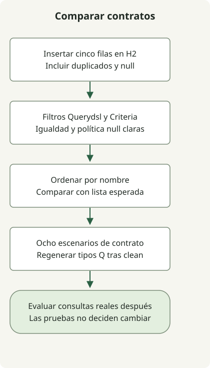

Elige la herramienta de consultas según lo que necesites expresar y verificar. Una pausa entre versiones puede motivar una investigación, pero no demuestra que el reemplazo conserve el comportamiento de consultas de la aplicación.

La preocupación original de 2023 es anterior a la posterior [versión Querydsl 5.1.0](https://github.com/querydsl/querydsl/releases/tag/QUERYDSL_5_1_0). Una etiqueta demuestra que esa versión existe; evalúa por separado el repositorio, las coordenadas de los artefactos y la compatibilidad de la línea que adoptarás. El ejemplo fija un entorno de reproducción, no recomienda una versión actual para producción.

## Comparar un predicado representativo



Inserta las mismas cinco filas, crea ambos predicados y comprueba resultados esperados explícitos. Las pruebas cubren esta entidad en H2. Una decisión de migración también requiere las uniones, proyecciones, paginación y comportamiento de base de datos que usa realmente tu aplicación.

Las [Specifications de Spring Data JPA](https://docs.spring.io/spring-data/jpa/reference/3.5/jpa/specifications.html) combinan predicados Criteria y los ejecutan mediante `JpaSpecificationExecutor`. Para filtros sencillos del repositorio puede bastar sin sustituir el modelo de persistencia JPA.

## Añadir tres archivos al ejemplo de Querydsl

Empieza con los cinco archivos del [proyecto completo de Jakarta Querydsl](/en/posts/2023-09-09-springboot3-querydsl/), incluido `Employee.getName()`. La reproducción usa Java17, Gradle8.4, Boot3.5.7, Querydsl5.1.0 Jakarta y H2. Añade los tres archivos completos siguientes; no mezcles esta configuración con los ejemplos independientes de Boot4 de la guía.

### `src/main/java/example/EmployeeRepository.java`

```java
package example;

import org.springframework.data.jpa.repository.JpaRepository;
import org.springframework.data.jpa.repository.JpaSpecificationExecutor;

public interface EmployeeRepository extends JpaRepository<Employee, Long>,
        JpaSpecificationExecutor<Employee> {}
```

### `src/main/java/example/EmployeeSpecs.java`

```java
package example;

import org.springframework.data.jpa.domain.Specification;

public final class EmployeeSpecs {
    private EmployeeSpecs() {}

    public static Specification<Employee> named(String name) {
        if (name == null) throw new IllegalArgumentException("Use withoutName for null");
        return (root, query, builder) -> builder.equal(root.get("name"), name);
    }

    public static Specification<Employee> withoutName() {
        return (root, query, builder) -> builder.isNull(root.get("name"));
    }
}
```

### `src/test/java/example/QueryStrategyTest.java`

```java
package example;

import java.util.Arrays;
import java.util.List;
import com.querydsl.core.types.Predicate;
import com.querydsl.jpa.impl.JPAQueryFactory;
import org.junit.jupiter.api.BeforeEach;
import org.junit.jupiter.api.Test;
import org.springframework.beans.factory.annotation.Autowired;
import org.springframework.boot.test.autoconfigure.orm.jpa.DataJpaTest;
import org.springframework.boot.test.autoconfigure.orm.jpa.TestEntityManager;
import org.springframework.dao.InvalidDataAccessApiUsageException;
import org.springframework.data.domain.Sort;
import org.springframework.data.jpa.domain.Specification;

import static org.assertj.core.api.Assertions.*;

@DataJpaTest
class QueryStrategyTest {
    @Autowired TestEntityManager entityManager;
    @Autowired EmployeeRepository employees;
    final QEmployee employee = QEmployee.employee;

    @BeforeEach
    void seed() {
        for (String name : Arrays.asList("Alice", "Bob", "Alice", "A_%", null)) {
            entityManager.persist(new Employee(name));
        }
        entityManager.flush();
    }

    void equivalent(Predicate predicate, Specification<Employee> specification,
                    List<String> expected) {
        var querydsl = new JPAQueryFactory(entityManager.getEntityManager())
                .select(employee.name).from(employee).where(predicate)
                .orderBy(employee.name.asc()).fetch();
        var criteria = employees.findAll(specification, Sort.by("name"))
                .stream().map(Employee::getName).toList();
        assertThat(querydsl).containsExactlyElementsOf(expected);
        assertThat(criteria).containsExactlyElementsOf(expected);
    }

    @Test
    void exactEqualityPreservesDuplicates() {
        equivalent(employee.name.eq("Alice"), EmployeeSpecs.named("Alice"),
                List.of("Alice", "Alice"));
    }

    @Test
    void missingValueReturnsNoRows() {
        equivalent(employee.name.eq("Missing"), EmployeeSpecs.named("Missing"), List.of());
    }

    @Test
    void wildcardCharactersAreLiteralForEquality() {
        equivalent(employee.name.eq("A_%"), EmployeeSpecs.named("A_%"), List.of("A_%"));
    }

    @Test
    void andCanEliminateAllRows() {
        equivalent(employee.name.eq("Alice").and(employee.name.eq("Bob")),
                EmployeeSpecs.named("Alice").and(EmployeeSpecs.named("Bob")), List.of());
    }

    @Test
    void orKeepsMatchesAndDuplicatesInOrder() {
        equivalent(employee.name.eq("Alice").or(employee.name.eq("Bob")),
                EmployeeSpecs.named("Alice").or(EmployeeSpecs.named("Bob")),
                List.of("Alice", "Alice", "Bob"));
    }

    @Test
    void nullRequiresAnExplicitPredicate() {
        equivalent(employee.name.isNull(), EmployeeSpecs.withoutName(),
                Arrays.asList((String) null));
    }

    @Test
    void stringAttributeTypoFailsAtRuntime() {
        Specification<Employee> typo = (root, query, builder) ->
                builder.equal(root.get("missingName"), "Alice");
        assertThatThrownBy(() -> employees.findAll(typo))
                .isInstanceOf(InvalidDataAccessApiUsageException.class);
    }

    @Test
    void equalityHelpersRejectNull() {
        assertThatThrownBy(() -> employee.name.eq((String) null))
                .isInstanceOf(IllegalArgumentException.class);
        assertThatThrownBy(() -> EmployeeSpecs.named(null))
                .isInstanceOf(IllegalArgumentException.class);
    }
}
```

Ejecuta desde la raíz del proyecto con JDK17 seleccionado:

```sh
gradle --version
gradle --no-daemon clean test
```

El proyecto tiene ahora diez pruebas: las dos comprobaciones originales de Querydsl y ocho de comparación y contratos. En las seis comparaciones de resultados, ambas implementaciones deben coincidir con una lista definida independientemente; coincidir entre sí no basta. Repite `clean test` para comprobar también que se regeneran los tipos Q.

| Caso | Resultado esperado |
| --- | --- |
| Nombre igual a Alice | Alice dos veces; se mantienen duplicados |
| Nombre inexistente | Ninguna fila |
| Nombre igual a `A_%` | Ese valor literal, no un patrón LIKE |
| Alice AND Bob | Ninguna fila |
| Alice OR Bob | Alice, Alice, Bob ordenados por nombre |
| Predicado null explícito | Un nombre null |

## Conservar los contratos que difieren

El `employee.name` generado por Querydsl es un miembro Java. En este ejemplo de Specification, `root.get("name")` usa un atributo de texto, por lo que la errata deliberada `missingName` compila y falla cuando el repositorio la ejecuta. Esto no significa que las Specifications deban usar cadenas: el [metamodelo estático de JPA](https://docs.spring.io/spring-data/jpa/reference/3.5/jpa/specifications.html) es otra opción.

El auxiliar `named` del ejemplo rechaza null explícitamente, y la llamada de igualdad de Querydsl también. Usa los predicados separados `withoutName()`/`isNull()` para valores null. Es la política de entrada del ejemplo; no conviertas silenciosamente null en un filtro ausente durante una migración real.

| Herramienta | Qué evaluar |
| --- | --- |
| Querydsl JPA | Tipos Q generados, formas de consultas JPA y compatibilidad del procesador |
| JPA Specification | Filtros Criteria reutilizables e integración del repositorio |
| [jOOQ](https://www.jooq.org/doc/latest/manual/getting-started/use-cases/jooq-as-a-sql-builder-without-codegeneration/) | DSL centrado en SQL y modelado del esquema; generación opcional |
| [Jdbi](https://jdbi.org/) | Consultas JDBC y mapeo de resultados |
| [Doma](https://docs.domaframework.org/en/latest/) | Procesamiento en compilación, plantillas SQL y API Criteria |

Estas herramientas operan en capas distintas. La prueba no compara jOOQ, Jdbi ni Doma, no mide rendimiento ni establece equivalencia con una base de producción. Antes de cambiar, añade tus uniones, ordenación, paginación, política de null y casos transaccionales reales; comprueba la base elegida y las licencias de los artefactos seleccionados.

La [guía de aprendizaje de Spring Boot](/en/categories/springboot/) conecta la preparación del proyecto, las comprobaciones de persistencia, las pruebas HTTP y el empaquetado. Cada artículo registra sus propias versiones de reproducción.
