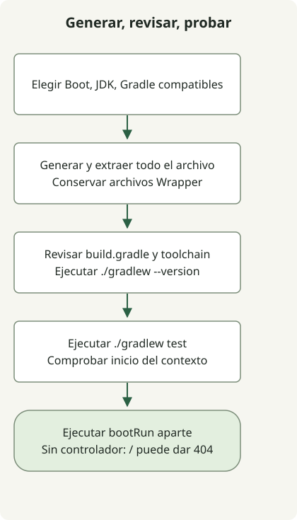

Tras crear un proyecto con Spring Initializr, pruébalo con el Gradle Wrapper generado antes de depender del IDE. Trata la generación, resolución de dependencias, compatibilidad del JDK y arranque como comprobaciones separadas para localizar mejor los fallos.

Este ejemplo usa un proyecto Gradle Groovy con Boot 4.1.2 y Java 17, generado realmente por [start.spring.io](https://start.spring.io/) el 27 de octubre de 2026. Su Wrapper seleccionó Gradle 9.8.2. Los valores predeterminados y versiones disponibles del servicio cambian; no supongas que esta combinación seguirá disponible indefinidamente.

## Flujo de procesamiento



Genera el archivo completo antes de ejecutar su Wrapper. Una prueba de contexto y una aplicación HTTP ejecutada por separado demuestran cosas diferentes.

## Elegir la configuración del proyecto

| Ajuste | Ejemplo | Significado |
| --- | --- | --- |
| Project / Language | Gradle - Groovy / Java | Herramientas de compilación y lenguaje fuente |
| Spring Boot | 4.1.2 | Versión final disponible al generar este ejemplo |
| Java / Packaging | 17 / Jar | Herramientas del código fuente y empaquetado |
| Group / Artifact | example / demo | Identificadores del proyecto |
| Package name | example.demo | Paquete de la aplicación |
| Dependencies | Spring Web | Dependencias de un endpoint HTTP |

Pulsa Generate en la interfaz o descarga el archivo con esta URL. **Confirma que cada comando termina correctamente antes de ejecutar el siguiente.** Usa un directorio vacío para evitar sobrescribir un proyecto existente.

```sh
curl --fail --show-error --location 'https://start.spring.io/starter.zip?type=gradle-project&language=java&bootVersion=4.1.2&baseDir=demo&groupId=example&artifactId=demo&name=Demo&packageName=example.demo&packaging=jar&javaVersion=17&dependencies=web' --output demo.zip
unzip demo.zip
cd demo
./gradlew --version
./gradlew test
```

La API de generación puede rechazar una versión cuando el servicio deje de ofrecerla. Consulta los [metadatos actuales del servicio](https://start.spring.io/metadata/client) y la [referencia de Initializr](https://docs.spring.io/initializr/docs/current/reference/html/), y selecciona versiones compatibles de Boot, JDK y Gradle conjuntamente. Sustituir silenciosamente el ejemplo por los últimos valores predeterminados cambia sus condiciones de reproducción.

## Inspeccionar cuatro archivos principales generados

Estos son los cuatro archivos principales con formato simplificado. El archivo completo también incluye scripts, JAR y ajustes del Wrapper y archivos de recursos. Copiar solo estos cuatro archivos en un directorio vacío no crea `./gradlew`.

### `settings.gradle`

```groovy
rootProject.name = 'demo'
```

### `build.gradle`

```groovy
plugins {
    id 'java'
    id 'org.springframework.boot' version '4.1.2'
    id 'io.spring.dependency-management' version '1.1.7'
}
group = 'example'
version = '0.0.1-SNAPSHOT'
java {
    toolchain { languageVersion = JavaLanguageVersion.of(17) }
}
repositories { mavenCentral() }
dependencies {
    implementation 'org.springframework.boot:spring-boot-starter-webmvc'
    testImplementation 'org.springframework.boot:spring-boot-starter-webmvc-test'
    testRuntimeOnly 'org.junit.platform:junit-platform-launcher'
}
tasks.named('test') { useJUnitPlatform() }
```

### `src/main/java/example/demo/DemoApplication.java`

```java
package example.demo;

import org.springframework.boot.SpringApplication;
import org.springframework.boot.autoconfigure.SpringBootApplication;

@SpringBootApplication
public class DemoApplication {
    public static void main(String[] args) {
        SpringApplication.run(DemoApplication.class, args);
    }
}
```

### `src/test/java/example/demo/DemoApplicationTests.java`

```java
package example.demo;

import org.junit.jupiter.api.Test;
import org.springframework.boot.test.context.SpringBootTest;

@SpringBootTest
class DemoApplicationTests {
    @Test
    void contextLoads() {}
}
```

El proyecto Boot 4.1.2 generado usa `spring-boot-starter-webmvc` y `spring-boot-starter-webmvc-test`. Parte de la configuración generada para la versión elegida en lugar de mezclar fragmentos de distintas generaciones de Boot. Los [requisitos de Boot 4.1.2](https://docs.spring.io/spring-boot/4.1/system-requirements.html) especifican Java 17 o posterior y Gradle 8.x desde 8.14, o 9.x.

## Distinguir pruebas y arranque de la aplicación

Que `contextLoads()` pase significa que arranca el contexto de pruebas. Sin controlador todavía, una respuesta 404 de `/` no indica un fallo de arranque. Ejecuta la aplicación por separado y detenla con Ctrl+C en ese terminal.

```sh
./gradlew bootRun
```

Registra juntos el `build.gradle` generado y los [archivos de Gradle Wrapper](https://docs.gradle.org/current/userguide/gradle_wrapper.html). La versión de Gradle es independiente de la versión Java en `java.toolchain`. Usa `./gradlew --version` para inspeccionar la JVM que ejecuta Gradle y distinguirla del JDK elegido para compilar y ejecutar la aplicación.

Continúa con [abrir el proyecto en IntelliJ y servir HTTP](/en/posts/2023-09-10-springboot-intellij-import/). Consulta el [historial de Spring Boot y las relaciones entre versiones](/en/posts/2023-09-13-springboot-history/) para entender por qué Boot y Framework tienen números de versión distintos.
