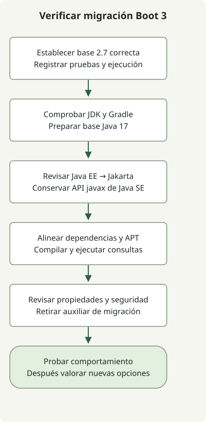

Inicia una migración de Spring Boot 2.7 a 3.0 con una base 2.7 funcional y comprueba después Java 17, el cambio de espacios de nombres Java EE a Jakarta y la compatibilidad de bibliotecas y ejecución. La [guía oficial de migración a 3.0](https://github.com/spring-projects/spring-boot/wiki/Spring-Boot-3.0-Migration-Guide) describe esta secuencia. Compilar correctamente no demuestra por sí solo que los mapeos de datos, autorización o configuración sean correctos.

Esta es una **guía de migración de 2.7 a 3.0** que conserva el tema original de 2023. No recomienda desplegar Boot 3.0 hoy. Elige una versión destino soportada para una actualización real y sigue las guías de migración intermedias.

## Flujo de procesamiento



Este es el orden de comprobaciones propuesto en el artículo. Los comandos inspeccionan el entorno; no migran automáticamente una aplicación o base de datos.

## 1. Establecer una base 2.7 funcional

Actualiza una aplicación 2.x antigua a la última versión 2.7.x antes del cambio de versión principal. Guarda un resultado de pruebas correcto y registra el wrapper, la JVM de compilación y las dependencias. En un proyecto Gradle con su wrapper existente, empieza con:

```sh
java -version
./gradlew --version
./gradlew clean test
./gradlew dependencies --configuration runtimeClasspath
```

Repite las mismas comprobaciones después de actualizar. En una compilación multiproyecto, ejecuta los informes de dependencias en el módulo de aplicación, por ejemplo `./gradlew :app:dependencies --configuration runtimeClasspath`. El nombre del módulo debe coincidir con tu proyecto.

Una base útil ejercita persistencia, autenticación, serialización, trabajos programados y llamadas HTTP salientes. Para este último límite, las [pruebas WebClient con MockWebServer local](/en/posts/2023-09-19-springboot-test-webclient/) ofrecen un punto de partida reproducible.

## 2. Cambiar juntos los imports y dependencias Java EE

Boot 3.0 requiere Java 17 y Spring Framework 6. Los paquetes Java EE como `javax.persistence` y `javax.servlet` pasan a `jakarta.persistence` y `jakarta.servlet`. Los paquetes Java SE como `javax.sql` y `javax.crypto` conservan sus nombres.

| Uso existente | Acción de migración |
| --- | --- |
| `javax.persistence.Entity` | Usa `jakarta.persistence.Entity` y dependencias JPA compatibles. |
| `javax.servlet.Filter` | Usa `jakarta.servlet.Filter` y dependencias servlet compatibles. |
| `javax.sql.DataSource` | Conserva el nombre del paquete Java SE. |
| `javax.crypto.Cipher` | Conserva el nombre del paquete Java SE. |

Inspecciona el grafo resuelto además de los imports. Por ejemplo, `./gradlew dependencyInsight --dependency javax.servlet-api --configuration runtimeClasspath` ayuda a localizar un artefacto servlet antiguo. Un informe vacío no demuestra que toda la aplicación haya migrado: revisa las demás bibliotecas y configuraciones que realmente usa. Consulta los [informes de dependencias de Gradle](https://docs.gradle.org/current/userguide/viewing_debugging_dependencies.html).

En Querydsl JPA, [alinea los artefactos JPA y del procesador de anotaciones](/en/posts/2023-09-09-springboot3-querydsl/) y elige su variante Jakarta cuando esa línea de artefactos la requiera. Confirma que se generan los tipos Q esperados y que se ejecutan consultas representativas. `configureEach` de Gradle controla la configuración de tareas; no convierte una dependencia Java EE incompatible en Jakarta.

## 3. Comprobar propiedades renombradas y autorización

Para un proyecto Gradle gestionado por Boot, la guía oficial ofrece un auxiliar temporal de propiedades:

```groovy
dependencies {
    runtimeOnly 'org.springframework.boot:spring-boot-properties-migrator'
}
```

Arranca la aplicación en un entorno de pruebas, lee los diagnósticos de inicio y actualiza las propiedades afectadas. Retira el auxiliar al terminar la migración. No sustituye la lectura de los cambios de configuración de la versión destino.

Boot 3.0 también usa Spring Security 6. La guía sugiere una transición a Spring Security 5.8 en Boot 2.7 antes de pasar a 6.0. Prueba solicitudes permitidas, denegadas y sin autenticar, además de despachos error/forward si la aplicación servlet los usa; no tomes un arranque correcto como prueba de autorización.

## 4. Tratar los hilos virtuales como un cambio separado

La opción de hilos virtuales llegó en **Boot 3.2 con JDK 21**, no como una función de Boot 3.0:

```properties
spring.threads.virtual.enabled=true
```

Es un límite histórico de versiones, no una recomendación para elegir Boot 3.2 hoy. Primero comprueba que funciona la migración de espacios de nombres y dependencias. Después evalúa los hilos virtuales según la versión elegida, los pools de conexiones y los supuestos de thread-local. La opción sola no demuestra mejoras de rendimiento. [Explicación de Spring sobre Boot 3.2](https://spring.io/blog/2023/09/09/all-together-now-spring-boot-3-2-graalvm-native-images-java-21-and-virtual).

Las funciones preliminares de JDK también tienen restricciones de versión propias. El [ejemplo de compatibilidad de String Templates](/en/posts/2023-09-23-jdk-21-string-templates/) muestra por qué activar opciones preview no resuelve genéricamente una actualización.

<span id="decide-whether-the-application-is-ready"></span>

## ¿Cómo saber si la migración está lista?

| Comprobación | Evidencia que recoger |
| --- | --- |
| Compilación y código generado | Compilación correcta con wrapper, tipos Q esperados y versiones de dependencias resueltas. |
| Comportamiento de ejecución | Pruebas correctas de persistencia, autenticación y HTTP representativo. |
| Configuración | Propiedades actualizadas y sin necesidad del auxiliar de migración. |
| Despliegue | El artefacto pasa las comprobaciones en un entorno representativo. |

Los comandos son una secuencia de diagnóstico para tu proyecto, no el resultado de una migración realizada en tu aplicación. Conserva el artefacto y la configuración previos para revertir. Migrar de versión principal facilita el mantenimiento, pero la seguridad sigue dependiendo de las versiones y configuración concretas desplegadas.
