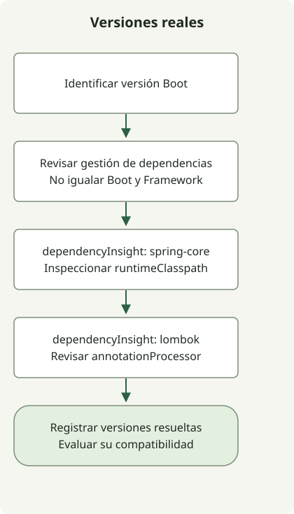

Spring Boot y Spring Framework son proyectos distintos con versiones diferentes. Boot añade autoconfiguración, gestión de dependencias y empaquetado ejecutable a Framework. Por eso interpretar Boot 3.1 como Framework 6.1 no es fiable; inspecciona el BOM de la versión Boot elegida y el grafo de dependencias resuelto.

## Flujo de procesamiento



El flujo resume la inspección de dependencias, no una cronología. Boot, Framework y Lombok tienen versiones y configuraciones de dependencias independientes.

## Cambios de versiones finales seleccionadas

Esta cronología destaca cambios funcionales, no enumera todas las versiones. Distingue la primera versión final de la compatibilidad JDK ampliada en parches posteriores.

| Spring Boot | Primera versión final | Cambios seleccionados y anuncio oficial |
| --- | --- | --- |
| 1.2 | 2014-12-11 | [`@SpringBootApplication` y soporte Servlet 3.1](https://spring.io/blog/2014/12/11/spring-boot-1-2-0-released/) |
| 1.3 | 2015-11-16 | [DevTools, autoconfiguración de caché y JAR directamente ejecutables](https://spring.io/blog/2015/11/16/spring-boot-1-3-0-released/) |
| 1.4 | 2016-07-28 | [Análisis de fallos de arranque y mejor soporte de pruebas](https://spring.io/blog/2016/07/28/spring-boot-1-4-released/) |
| 2.0 | 2018-03-01 | [Framework 5.0, base Java 8 y soporte web reactivo](https://spring.io/blog/2018/03/01/spring-boot-2-0-goes-ga/) |
| 3.0 | 2022-11-24 | [Framework 6.0, base Java 17, Jakarta e imágenes nativas](https://spring.io/blog/2022/11/24/spring-boot-3-0-goes-ga/) |
| 3.1 | 2023-05-18 | [Integración de Testcontainers y Docker Compose en desarrollo](https://spring.io/blog/2023/05/18/spring-boot-3-1-0-available-now/) |
| 3.2 | 2023-11-23 | [Soporte de hilos virtuales, RestClient y JdbcClient](https://spring.io/blog/2023/11/23/spring-boot-3-2-0-available-now/) |
| 4.0 | 2025-11-20 | [Framework 7, modularización, JSpecify y versiones de API](https://spring.io/blog/2025/11/20/spring-boot-4-0-0-available-now/) |

Por ejemplo, la [lista de dependencias gestionadas de Boot 3.1.0](https://docs.spring.io/spring-boot/docs/3.1.0/reference/html/dependency-versions.html) especifica `spring-core` 6.0.9. No se exige que coincidan las versiones menores de Boot y Framework. También es incorrecto asociar Boot 2.4 con una rama Framework 5.4 inexistente.

## Starters, BOM y plugins de compilación

Un starter agrupa dependencias necesarias para una función. Un BOM gestiona versiones; no añade automáticamente todas las bibliotecas de la lista. El plugin Boot proporciona tareas como `bootRun` y empaquetado de JAR ejecutables.

Para Gradle, la [guía de gestión de dependencias Boot](https://docs.spring.io/spring-boot/4.1/gradle-plugin/managing-dependencies.html) describe el plugin dependency-management y el soporte BOM nativo. Aplicar solo el plugin Boot no garantiza que todas las configuraciones Gradle acepten dependencias sin versión. Comprueba también configuraciones separadas, como procesadores de anotaciones.

## Inspeccionar las versiones reales del proyecto

Ejecuta estos comandos en el proyecto final de las guías de [Initializr](/en/posts/2023-09-07-springboot-initializer/) y [Lombok](/en/posts/2023-09-15-springboot-intellij-lombok/).

```sh
./gradlew dependencyInsight --configuration runtimeClasspath --dependency spring-core
./gradlew dependencyInsight --configuration annotationProcessor --dependency lombok
```

El ejemplo local resuelve Boot 4.1.2, `spring-core` 7.0.10 y Lombok 1.18.48. Los números distintos corresponden a proyectos distintos. `dependencyInsight` muestra la versión seleccionada y las rutas o reglas responsables, útil para investigar conflictos. Estos valores registran el ejemplo, no valores futuros predeterminados ni una combinación universal.

La cronología no es una tabla actual de soporte. Al crear o actualizar un proyecto, comprueba por separado los requisitos de la versión, compatibilidad y política de soporte. Consulta [migración a Java 17 y Jakarta](/en/posts/2023-09-08-springboot3-migration/) para Boot 3 o [comprobaciones IntelliJ y Gradle](/en/posts/2023-09-10-springboot-intellij-import/) para ejecución local.
