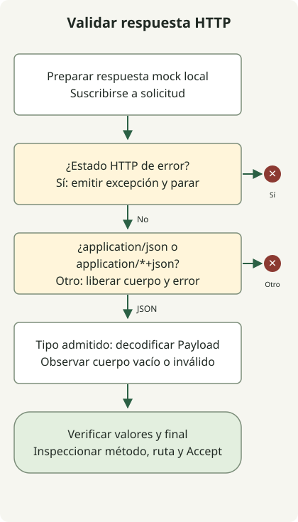

Prueba WebClient con MockWebServer local y comprueba juntos el estado HTTP, Content-Type, decodificación y finalización o error. Una respuesta `200 OK` con HTML puede incumplir el contrato aunque el estado indique éxito; enviar `Accept: application/json` no exige una respuesta JSON. Spring documenta las [pruebas con servidor simulado](https://docs.spring.io/spring-framework/reference/6.2/web/webflux-webclient/client-testing.html) y cliente HTTP real.

Las pruebas usan WebClient real sobre HTTP local, no un mock de su cadena de métodos. Cubren los contratos siguientes; las políticas de timeout y reintentos de producción requieren pruebas aparte.

## Flujo de procesamiento



El cliente comprueba el estado antes del tipo, libera cuerpos rechazados y decodifica JSON admitido. StepVerifier comprueba finalización o error además de los valores emitidos.

## Preparar un proyecto de pruebas independiente

El entorno es JDK 17.0.8.1, Gradle 8.4, Spring Boot **3.5.7 BOM** y MockWebServer **4.12.0**. Fijan las dependencias del ejemplo, no recomiendan versiones actuales. Es un proyecto Java de pruebas normal; no necesita una aplicación Boot arrancada.

En un directorio nuevo, crea `settings.gradle` con `rootProject.name = 'webclient-example'` y este `build.gradle` completo:

```groovy
plugins { id 'java' }
repositories { mavenCentral() }
dependencies {
    testImplementation platform('org.springframework.boot:spring-boot-dependencies:3.5.7')
    testImplementation 'org.springframework.boot:spring-boot-starter-webflux'
    testImplementation 'org.springframework.boot:spring-boot-starter-test'
    testImplementation 'io.projectreactor:reactor-test'
    testImplementation 'com.squareup.okhttp3:mockwebserver:4.12.0'
    testRuntimeOnly 'org.junit.platform:junit-platform-launcher'
}
test { useJUnitPlatform() }
```

El BOM es explícito para que Spring y Reactor tengan versiones incluso sin el plugin Gradle de Boot. Si Boot ya gestiona la aplicación, adapta las dependencias de pruebas a su BOM elegido.

## Probar ocho contratos de respuesta

Guarda esta clase completa como `src/test/java/ExternalApiTest.java`:

```java
import java.io.IOException;
import java.time.Duration;
import java.util.concurrent.TimeUnit;
import okhttp3.mockwebserver.MockResponse;
import okhttp3.mockwebserver.MockWebServer;
import okhttp3.mockwebserver.RecordedRequest;
import org.junit.jupiter.api.AfterEach;
import org.junit.jupiter.api.BeforeEach;
import org.junit.jupiter.api.Test;
import org.springframework.http.MediaType;
import org.springframework.web.reactive.function.client.WebClient;
import reactor.core.publisher.Mono;
import reactor.test.StepVerifier;
import static org.junit.jupiter.api.Assertions.*;

class ExternalApiTest {
    private MockWebServer server;
    private WebClient client;
    record Payload(String message) {}

    @BeforeEach
    void start() throws IOException {
        server = new MockWebServer();
        server.start();
        client = WebClient.builder().baseUrl(server.url("/").toString()).build();
    }

    @AfterEach
    void stop() throws IOException {
        server.shutdown();
    }

    private Mono<Payload> fetch() {
        return client.get().uri("/employee/100")
            .accept(MediaType.APPLICATION_JSON)
            .exchangeToMono(response -> {
                if (response.statusCode().isError()) {
                    return response.createException().flatMap(Mono::error);
                }
                boolean json = response.headers().contentType()
                    .map(type -> "application".equals(type.getType())
                        && ("json".equals(type.getSubtype())
                            || type.getSubtype().endsWith("+json")))
                    .orElse(false);
                if (!json) {
                    return response.releaseBody().then(Mono.<Payload>error(
                        new IllegalStateException("Expected JSON response")));
                }
                return response.bodyToMono(Payload.class);
            });
    }

    @Test
    void rejectsHtmlEvenWhenStatusIs200() throws Exception {
        server.enqueue(new MockResponse().setResponseCode(200)
            .setHeader("Content-Type", "text/html; charset=UTF-8")
            .setBody("<html><body>Unknown failure</body></html>"));
        StepVerifier.create(fetch())
            .expectErrorMatches(error -> error instanceof IllegalStateException
                && error.getMessage().equals("Expected JSON response"))
            .verify(Duration.ofSeconds(5));
        RecordedRequest request = server.takeRequest(1, TimeUnit.SECONDS);
        assertNotNull(request);
        assertEquals("GET", request.getMethod());
        assertEquals("/employee/100", request.getPath());
        assertEquals("application/json", request.getHeader("Accept"));
    }

    @Test
    void preservesHttp500Error() {
        server.enqueue(new MockResponse().setResponseCode(500)
            .setHeader("Content-Type", "text/html")
            .setBody("<html>Unknown failure</html>"));
        StepVerifier.create(fetch())
            .expectError(org.springframework.web.reactive.function.client.WebClientResponseException.InternalServerError.class)
            .verify(Duration.ofSeconds(5));
    }

    @Test
    void decodesJson() {
        server.enqueue(new MockResponse().setResponseCode(200)
            .setHeader("Content-Type", "application/json")
            .setBody("{\"message\":\"ok\"}"));
        StepVerifier.create(fetch())
            .expectNextMatches(payload -> payload.message().equals("ok"))
            .expectComplete().verify(Duration.ofSeconds(5));
    }

    @Test
    void rejectsMissingContentType() {
        server.enqueue(new MockResponse().setResponseCode(200)
            .setBody("{\"message\":\"ok\"}"));
        StepVerifier.create(fetch())
            .expectErrorMatches(error -> error instanceof IllegalStateException
                && error.getMessage().equals("Expected JSON response"))
            .verify(Duration.ofSeconds(5));
    }

    @Test
    void rejectsMalformedJson() {
        server.enqueue(new MockResponse().setResponseCode(200)
            .setHeader("Content-Type", "application/json").setBody("{broken"));
        StepVerifier.create(fetch())
            .expectError(org.springframework.core.codec.DecodingException.class)
            .verify(Duration.ofSeconds(5));
    }

    @Test
    void decodesStructuredJsonSubtype() {
        server.enqueue(new MockResponse().setResponseCode(200)
            .setHeader("Content-Type", "application/vnd.example+json")
            .setBody("{\"message\":\"ok\"}"));
        StepVerifier.create(fetch())
            .expectNextMatches(payload -> payload.message().equals("ok"))
            .expectComplete().verify(Duration.ofSeconds(5));
    }

    @Test
    void completesWithoutPayloadForEmptyJsonBody() {
        server.enqueue(new MockResponse().setResponseCode(200)
            .setHeader("Content-Type", "application/json"));
        StepVerifier.create(fetch())
            .expectComplete().verify(Duration.ofSeconds(5));
    }

    @Test
    void rejectsNonApplicationJsonSubtype() {
        server.enqueue(new MockResponse().setResponseCode(200)
            .setHeader("Content-Type", "text/example+json")
            .setBody("{\"message\":\"ok\"}"));
        StepVerifier.create(fetch())
            .expectErrorMatches(error -> error instanceof IllegalStateException
                && error.getMessage().equals("Expected JSON response"))
            .verify(Duration.ofSeconds(5));
    }
}
```

Ejecuta con JDK 17 seleccionado y Gradle 8.4 instalado:

```sh
java -version
gradle --version
gradle --no-daemon test
```

Deben pasar las ocho pruebas. Abre `build/reports/tests/test/index.html` para ver cada resultado; la salida de Gradle no tiene que listar cada prueba aprobada.

| Respuesta | Resultado exigido por el ejemplo |
| --- | --- |
| HTTP 200, cuerpo JSON | Decodificar los datos. |
| HTTP 200, cuerpo HTML | Rechazar el tipo inesperado. |
| HTTP 500, cuerpo HTML | Conservar el tipo de error HTTP. |
| HTTP 200, sin Content-Type | Rechazar el formato sin especificar. |
| HTTP 200, JSON malformado | Informar de un error de decodificación. |
| HTTP 200, `application/vnd.example+json` | Decodificar JSON compatible. |
| HTTP 200, cuerpo JSON vacío | Completar sin emitir datos. |
| HTTP 200, `text/example+json` | Rechazar el tipo de medio que no es application. |

El comportamiento de cuerpo vacío es un contrato deliberado. Si tu endpoint exige datos, añade `switchIfEmpty(Mono.error(...))` y cambia la prueba para esperar el error de aplicación.

<span id="why-status-and-decoding-are-checked-separately"></span>

## ¿Por qué HTTP 200 puede fallar la validación?

`fetch()` trata estados de error antes de inspeccionar el formato correcto. `createException()` conserva HTTP 500 como `WebClientResponseException.InternalServerError`. Un fallo de conexión suele seguir `WebClientRequestException`; no es una respuesta HTTP del servidor.

Con un estado sin error, el código acepta `application/json` y `application/*+json` y deja al decodificador validar el cuerpo. Un Content-Type incorrecto y JSON malformado producen así errores distintos. Es un contrato de ejemplo, no una política completa de redirecciones o todos los estados correctos.

Al rechazar una respuesta correcta, libera el cuerpo antes de informar del error de aplicación. Con `exchangeToMono`, consume o trata el cuerpo dentro del callback; la [documentación exchange de Spring](https://docs.spring.io/spring-framework/reference/6.2/web/webflux-webclient/client-exchange.html) explica que un cuerpo no consumido se libera al completar.

`setBody(html)` envía HTML directamente. Serializar antes la cadena como JSON cambiaría la respuesta probada. Las aserciones de la solicitud registrada comprueban también método, ruta y cabecera `Accept` enviados realmente.

`verify(Duration.ofSeconds(5))` limita la espera de cada prueba. No configura los timeouts de conexión o respuesta del cliente de producción. Añade pruebas de transporte y reintentos según tu contrato API; estos ocho casos no las cubren.

Las ocho pruebas pasaron en el entorno indicado. En este repositorio, `python3 scripts/check_webclient_example.py` repite la comprobación. Para un proyecto que cruza a Jakarta, establece la [base de migración Spring Boot](/en/posts/2023-09-08-springboot3-migration/) antes de cambiar el cliente.

Estas pruebas usan un servidor simulado local; no comprueban archivos estáticos desplegados. Si la aplicación empaqueta Vue, el [ejemplo de empaquetado frontend Gradle](/en/posts/2021-07-23-multiple-gradle-build/) comprueba el JAR ejecutable y sus respuestas HTML/JavaScript. Los ejemplos fijan entornos distintos y no deben combinarse sin alinear dependencias.

Referencia MockWebServer: [código fuente y ejemplos OkHttp 4.12.0](https://github.com/square/okhttp/tree/parent-4.12.0/mockwebserver).

Para límites de tiempo y reintentos, continúa con las [pruebas WebClient de timeout y reintentos limitados](/en/posts/2026-10-30-webclient-timeout-retry/). Ese ejemplo solo reintenta respuestas GET con estado 503 y separa los límites de cada intento del presupuesto total.
