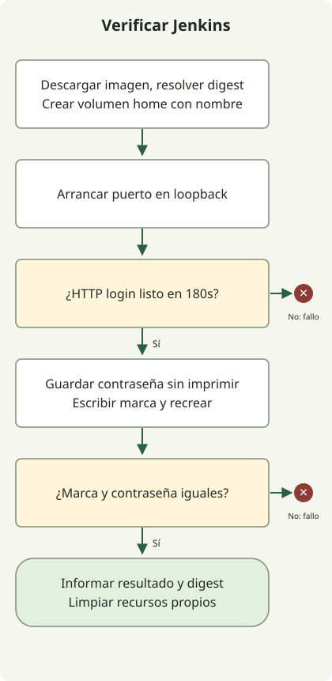

Inicia Jenkins con un volumen home con nombre, verifica HTTP y recrea el contenedor con el mismo volumen. Alcanzar la pantalla de configuración demuestra el arranque; un segundo inicio comprueba que los datos sobreviven al reemplazo.

Una etiqueta móvil puede apuntar después a otra imagen. Resuelve la imagen una vez para el experimento y mantén privada la contraseña inicial. La prueba desechable informa comparaciones sin imprimirla.

## Fijar la imagen para un experimento



Usa Python3 y Docker con contenedores Linux. Las [instrucciones de la imagen Jenkins](https://github.com/jenkinsci/docker/blob/master/README.md) describen `jenkins/jenkins` y su directorio home. La prueba parte de `jenkins/jenkins:lts-jdk21`, lo descarga y resuelve su digest de repositorio. Cada controlador usa ese digest sin consultar de nuevo la etiqueta móvil. Registra digest y versión Jenkins al reproducir; la etiqueta no fija una versión permanente.

La [publicación de puertos Docker](https://docs.docker.com/engine/network/port-publishing/) determina quién accede al puerto. El script solicita `127.0.0.1::8080` para elegir un puerto de host en loopback y comprueba la asignación. No publica un puerto de agente ni monta el socket Docker. Es una prueba local del controlador, no una instalación de agentes de compilación Docker o un servicio HTTPS remoto.

## Ejecutar la prueba completa

Guarda el archivo completo como `jenkins_lab.py`. Crea su propio volumen y contenedores con nombres únicos. El gestor de contexto los elimina al terminar, incluso si falla la comprobación de preparación o datos. No sustituyas el volumen por uno de producción en este ejemplo desechable.

### `jenkins_lab.py`

```python
import http.client
import json
import os
import subprocess
import time
import urllib.error
import urllib.request
import uuid


class DockerLab:
    def __init__(self):
        self.prefix = 'jenkins-proof-' + uuid.uuid4().hex[:12]
        self.containers, self.volumes = [], []

    def cli(self, *args):
        return subprocess.check_output(['docker', *args], text=True, stderr=subprocess.PIPE).strip()

    def volume(self):
        name = f'{self.prefix}-home-{len(self.volumes)}'
        existing = subprocess.run(['docker', 'volume', 'inspect', name], capture_output=True)
        if existing.returncode == 0:
            raise RuntimeError('Refusing an existing volume')
        self.cli('volume', 'create', name)
        self.volumes.append(name)
        return name

    def __enter__(self):
        self.cli('info')
        requested = os.environ.get('JENKINS_IMAGE', 'jenkins/jenkins:lts-jdk21')
        self.cli('pull', requested)
        self.image = self.cli('image', 'inspect', requested, '--format', '{{index .RepoDigests 0}}')
        if '@sha256:' not in self.image:
            raise RuntimeError('Expected a pulled repository digest')
        self.home = self.volume()
        return self

    def start(self, volume=None):
        name = f'{self.prefix}-controller-{len(self.containers)}'
        self.cli('run', '-d', '--name', name, '-p', '127.0.0.1::8080',
                 '--mount', f'type=volume,source={volume or self.home},target=/var/jenkins_home', self.image)
        self.containers.append(name)
        port = self.cli('port', name, '8080/tcp')
        if not port.startswith('127.0.0.1:'):
            raise RuntimeError('Expected a loopback binding')
        deadline = time.monotonic() + 180
        while time.monotonic() < deadline:
            try:
                with urllib.request.urlopen(f'http://{port}/login', timeout=5) as response:
                    self.version = response.headers.get('X-Jenkins')
                    if response.status == 200 and self.version and b'Jenkins' in response.read():
                        return name
            except (urllib.error.URLError, TimeoutError, ConnectionError, http.client.HTTPException):
                pass
            time.sleep(2)
        raise RuntimeError('Jenkins login was not ready within 180 seconds')

    def password(self, name):
        return self.cli('exec', name, 'cat', '/var/jenkins_home/secrets/initialAdminPassword')

    def marker(self, name):
        return self.cli('exec', name, 'cat', '/var/jenkins_home/lab-marker')

    def __exit__(self, *_):
        for name in reversed(self.containers):
            subprocess.run(['docker', 'rm', '-f', name], capture_output=True)
        for name in reversed(self.volumes):
            subprocess.run(['docker', 'volume', 'rm', name], capture_output=True)


if __name__ == '__main__':
    with DockerLab() as lab:
        first = lab.start()
        password = lab.password(first)
        assert password, 'Missing initial password'
        lab.cli('exec', first, 'sh', '-c', 'printf kept > /var/jenkins_home/lab-marker')
        lab.cli('rm', '-f', first)
        second = lab.start()
        assert lab.marker(second) == 'kept'
        assert lab.password(second) == password
        print(json.dumps({'image': lab.image, 'jenkins': lab.version, 'recreated': True,
                          'markerPersisted': True, 'passwordPersisted': True, 'result': 'passed'}))
```

Ejecuta con un daemon Docker funcional:

```sh
python3 jenkins_lab.py
```

Cada uno de los dos arranques espera hasta 180 segundos HTTP200 en `/login`, una cabecera `X-Jenkins` y un cuerpo con `Jenkins`. Reintenta reinicios de conexión, fallos HTTP temporales y negociaciones HTTP incompletas dentro del plazo. Escribe un marcador y lee privadamente la contraseña, reemplaza el primer contenedor y compara ambos valores. Un resultado con `recreated`, `markerPersisted`, `passwordPersisted` y `result: passed` indica que pasan estas comprobaciones. El JSON registra también digest y versión real; no hace falta inventar una transcripción de descarga.

La prueba no desbloquea Jenkins, instala plugins, completa la cuenta de administrador ni ejecuta trabajos. La preparación se refiere al HTTP de acceso, no a la configuración terminada. En un Mac sin motor Docker activo, inícialo antes; el CLI solo no puede ejecutar la prueba.

## Separar instalación y persistencia

Para instalación interactiva, sigue el [asistente oficial](https://www.jenkins.io/doc/book/installing/docker/) y crea una cuenta administradora. Lee la contraseña inicial del `/var/jenkins_home/secrets/initialAdminPassword` de tu controlador; no reutilices valores de ejemplo ni publiques logs que la contengan. Este script limpia deliberadamente la prueba y no conserva una instalación interactiva.

Un [volumen Docker con nombre](https://docs.docker.com/engine/storage/volumes/) puede sobrevivir al contenedor, pero no es una copia de seguridad: perderlo implica perder sus datos. La [prueba de copia y restauración de volumen detenido](/en/posts/2026-10-27-jenkins-home-backup-restore/) continúa con la misma imagen y otro volumen destino. Para la publicación de este blog, consulta el [flujo Astro Draft PR](/en/posts/2026-04-07-jekyll-github-actions-content-pipeline/); Jenkins no lo sustituye.
