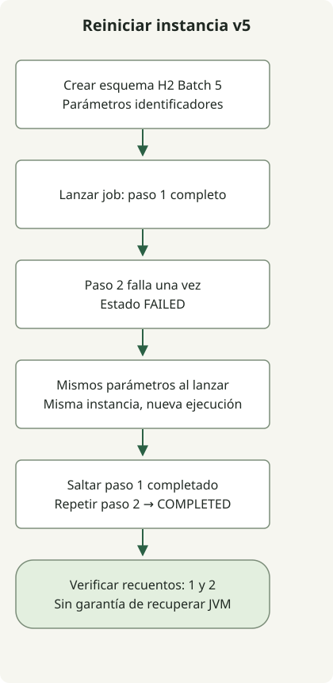

Migrar a Spring Batch 5 exige comprobar esquema de metadatos, formato de parámetros Job persistidos, contextos de ejecución y política de reinicio junto a las dependencias. Eliminar primero columnas con datos o sustituir solo códigos de tipo por clases no completa una migración de datos.

El artículo cubre pasar a Batch 5, no adoptar la versión principal más reciente. La [guía oficial 5.0](https://github.com/spring-projects/spring-batch/wiki/Spring-Batch-5.0-Migration-Guide) define los aspectos de migración; el ejemplo comprueba ejecución en Batch 5.

## Flujo de procesamiento



Resume la prueba v5 con esquema nuevo, no una migración v4. Una segunda ejecución de la misma instancia repite el paso fallido; el completado sigue completado.

## Antes de cambiar un repositorio existente

Batch 5 requiere Java 17 o posterior. Migra las API Java EE `javax.*` a Jakarta sin reemplazar las API Java SE como `javax.sql.DataSource`.

`TYPE_CD` y las columnas por tipo de la tabla antigua difieren de la representación nueva `PARAMETER_TYPE` y `PARAMETER_VALUE`. Cambiar solo `LONG` por `java.lang.Long` no conserva ni reinterpreta correctamente LONG, DOUBLE y DATE existentes. Ensaya la conversión en una copia usando la base y versión Batch destino. Localiza los [scripts de esquema y migración específicos en el Core JAR](https://docs.spring.io/spring-batch/reference/5.2/schema-appendix.html). Reejecutar un script de esquema nuevo sobre tablas productivas no sustituye la migración.

La guía documenta [restricciones de acceso histórico](https://github.com/spring-projects/spring-batch/wiki/Spring-Batch-5.0-Migration-Guide#historical-data-access-implications): algunas llamadas JobExplorer v5 pueden fallar al leer ejecuciones v4. Espera que las instancias v4 fallidas se reinicien correctamente en v4 o se abandonen por decisión de negocio antes de migrar. No supongas que v5 reinicia directamente una ejecución v4 fallida. Comprueba aparte la serialización de contextos.

## Elegir el punto de partida

- **Repositorio Batch 4 existente:** respalda y ensaya conversión de esquema, parámetros y contextos en una copia. Resuelve las instancias v4 fallidas en v4. El ejemplo no convierte ni reinicia un repositorio v4.
- **Repositorio Batch 5 nuevo:** ejecuta pruebas de parámetros tipados, instancia completada y paso fallido. Comprueban tres comportamientos en un esquema H2 nuevo, dentro de un proceso.
- **Aplicación Boot con trabajos Batch:** decide si Boot o la configuración Batch explícita controla preparación e inicialización. El ejemplo usa configuración Spring explícita, no autoconfiguración Boot.

Si también actualizas la versión principal de Boot, establece la [base Java y Jakarta](/en/posts/2023-09-08-springboot3-migration/) aparte de la migración del repositorio.

## Comprobar un repositorio Batch 5 nuevo

La reproducción usa Gradle 8.4/JDK 17.0.8.1, Batch 5.2.4 y H2 2.3.232 gestionados por Boot BOM 3.5.7. Fijan evidencia de ejecución, no recomendaciones actuales. Guarda los tres archivos en un directorio vacío.

El proyecto crea directamente un contexto Spring de pruebas sin arrancar Boot. Usa `@EnableBatchProcessing` y proporciona DataSource y gestor transaccional. No extiende también `DefaultBatchConfiguration`; la [documentación Java](https://docs.spring.io/spring-batch/reference/5.2/job/java-config.html) los describe como alternativas.

### `settings.gradle`

```groovy
rootProject.name = 'batch5-restart-example'
```

### `build.gradle`

```groovy
plugins { id 'java' }
repositories { mavenCentral() }
dependencies {
    testImplementation platform('org.springframework.boot:spring-boot-dependencies:3.5.7')
    testImplementation 'org.springframework.batch:spring-batch-core'
    testImplementation 'org.springframework:spring-jdbc'
    testImplementation 'com.h2database:h2'
    testImplementation 'org.junit.jupiter:junit-jupiter'
    testRuntimeOnly 'org.junit.platform:junit-platform-launcher'
}
test { useJUnitPlatform() }
```

### `src/test/java/example/BatchRestartTest.java`

```java
package example;

import java.util.Date;
import java.util.Set;
import java.util.concurrent.atomic.AtomicBoolean;
import java.util.concurrent.atomic.AtomicInteger;
import javax.sql.DataSource;

import org.junit.jupiter.api.AfterEach;
import org.junit.jupiter.api.BeforeEach;
import org.junit.jupiter.api.Test;
import org.springframework.batch.core.BatchStatus;
import org.springframework.batch.core.Job;
import org.springframework.batch.core.JobExecution;
import org.springframework.batch.core.JobParameters;
import org.springframework.batch.core.JobParametersBuilder;
import org.springframework.batch.core.Step;
import org.springframework.batch.core.configuration.annotation.EnableBatchProcessing;
import org.springframework.batch.core.job.builder.JobBuilder;
import org.springframework.batch.core.launch.JobLauncher;
import org.springframework.batch.core.repository.JobInstanceAlreadyCompleteException;
import org.springframework.batch.core.repository.JobRepository;
import org.springframework.batch.core.step.builder.StepBuilder;
import org.springframework.batch.repeat.RepeatStatus;
import org.springframework.beans.factory.annotation.Qualifier;
import org.springframework.context.annotation.AnnotationConfigApplicationContext;
import org.springframework.context.annotation.Bean;
import org.springframework.context.annotation.Configuration;
import org.springframework.jdbc.core.JdbcTemplate;
import org.springframework.jdbc.datasource.DataSourceTransactionManager;
import org.springframework.jdbc.datasource.embedded.EmbeddedDatabase;
import org.springframework.jdbc.datasource.embedded.EmbeddedDatabaseBuilder;
import org.springframework.jdbc.datasource.embedded.EmbeddedDatabaseType;
import org.springframework.transaction.PlatformTransactionManager;

import static org.junit.jupiter.api.Assertions.*;

class BatchRestartTest {
    AnnotationConfigApplicationContext context;
    Config config;
    JobLauncher launcher;
    Job job;

    @BeforeEach
    void open() {
        context = new AnnotationConfigApplicationContext(Config.class);
        config = context.getBean(Config.class);
        launcher = context.getBean(JobLauncher.class);
        job = context.getBean(Job.class);
    }

    @AfterEach
    void close() { context.close(); }

    JobParameters parameters() {
        return new JobParametersBuilder()
                .addLong("run.id", 1L)
                .addString("source", "example")
                .addDouble("ratio", 1.5)
                .addDate("day", new Date(0))
                .toJobParameters();
    }

    @Test
    void completedJobPersistsTypedParameters() throws Exception {
        JobExecution execution = launcher.run(job, parameters());
        assertEquals(BatchStatus.COMPLETED, execution.getStatus());
        var jdbc = new JdbcTemplate(context.getBean(DataSource.class));
        var types = jdbc.queryForList("select PARAMETER_TYPE from BATCH_JOB_EXECUTION_PARAMS", String.class);
        assertEquals(Set.of("java.lang.Long", "java.lang.String", "java.lang.Double", "java.util.Date"), Set.copyOf(types));
        assertEquals(4, types.size());
        assertEquals("1", jdbc.queryForObject("select PARAMETER_VALUE from BATCH_JOB_EXECUTION_PARAMS where PARAMETER_NAME = 'run.id'", String.class));
    }

    @Test
    void completedInstanceRejectsSameIdentifyingParameters() throws Exception {
        assertEquals(BatchStatus.COMPLETED, launcher.run(job, parameters()).getStatus());
        assertThrows(JobInstanceAlreadyCompleteException.class, () -> launcher.run(job, parameters()));
        assertEquals(1, config.firstRuns.get());
        assertEquals(1, config.secondRuns.get());
    }

    @Test
    void failedInstanceRestartsOnlyItsFailedStep() throws Exception {
        config.failOnce.set(true);
        JobExecution failed = launcher.run(job, parameters());
        assertEquals(BatchStatus.FAILED, failed.getStatus());
        JobExecution restarted = launcher.run(job, parameters());
        assertEquals(BatchStatus.COMPLETED, restarted.getStatus());
        assertEquals(failed.getJobInstance().getInstanceId(), restarted.getJobInstance().getInstanceId());
        assertNotEquals(failed.getId(), restarted.getId());
        assertEquals(1, config.firstRuns.get());
        assertEquals(2, config.secondRuns.get());
    }

    @Configuration
    @EnableBatchProcessing
    static class Config {
        final AtomicInteger firstRuns = new AtomicInteger();
        final AtomicInteger secondRuns = new AtomicInteger();
        final AtomicBoolean failOnce = new AtomicBoolean();

        @Bean(destroyMethod = "shutdown")
        EmbeddedDatabase dataSource() {
            return new EmbeddedDatabaseBuilder().generateUniqueName(true)
                    .setType(EmbeddedDatabaseType.H2)
                    .addScript("org/springframework/batch/core/schema-h2.sql").build();
        }

        @Bean
        PlatformTransactionManager transactionManager(DataSource dataSource) {
            return new DataSourceTransactionManager(dataSource);
        }

        @Bean
        Step firstStep(JobRepository repository, PlatformTransactionManager transactionManager) {
            return new StepBuilder("first", repository).tasklet((contribution, chunkContext) -> {
                firstRuns.incrementAndGet();
                return RepeatStatus.FINISHED;
            }, transactionManager).build();
        }

        @Bean
        Step secondStep(JobRepository repository, PlatformTransactionManager transactionManager) {
            return new StepBuilder("second", repository).tasklet((contribution, chunkContext) -> {
                secondRuns.incrementAndGet();
                if (failOnce.getAndSet(false)) throw new IllegalStateException("fixture failure");
                return RepeatStatus.FINISHED;
            }, transactionManager).build();
        }

        @Bean
        Job job(JobRepository repository, @Qualifier("firstStep") Step first,
                @Qualifier("secondStep") Step second) {
            return new JobBuilder("migrationCheck", repository).start(first).next(second).build();
        }
    }
}
```

## Ejecutar e interpretar las comprobaciones

```sh
gradle --no-daemon clean test
```

Las tres pruebas comprueban parámetros tipados persistidos en H2 nuevo, rechazo de una instancia completada con los mismos parámetros identificadores y nueva ejecución de la misma instancia fallida repitiendo solo su Step fallido. El primer Step se ejecuta una vez y el segundo dos. Los contadores viven en un proceso: no demuestra recuperación tras reiniciar JVM ni efectos externos exactamente una vez.

El ejemplo **no convierte una base v4 a v5**. Para producción, establece primero respaldo y recuperación; comprueba después valores por tipo, acceso histórico, contextos y reinicio de negocio en una copia. Pasar pruebas con esquema nuevo no demuestra compatibilidad con datos existentes.

Al aplicar esto a Boot hay otra consideración: la [guía Batch de Boot](https://docs.spring.io/spring-boot/3.5/how-to/batch.html) indica que añadir `@EnableBatchProcessing` o extender `DefaultBatchConfiguration` desactiva la autoconfiguración y su inicialización de esquema. Decide entre conservarla o asumir control directo.

Para decisiones de ejecución relacionadas, consulta [funciones finales y preview de JDK 21](/en/posts/2023-09-20-jdk-21-release/). Para entradas de configuración tipadas, consulta [leer un puerto YAML desde shell](/en/posts/2021-07-27-parse-yaml/).
