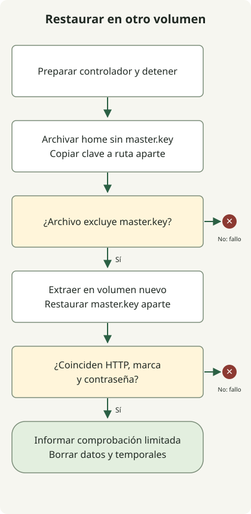

Verifica una copia restaurándola en un volumen nuevo y arrancando Jenkins desde él. La existencia del archivo no demuestra que el controlador pueda usarlo.

La prueba detiene un controlador nuevo sin otro uso antes de copiar home. Guarda master.key separado, restaura el archivo privado en otro volumen recién creado, arranca el mismo digest y comprueba marcador y contraseña inicial original sin imprimir ninguno de los valores de contraseña. No prueba producción, trabajos activos ni migraciones de plugins.

## Detener, copiar, restaurar y arrancar



La [guía Jenkins](https://www.jenkins.io/doc/book/system-administration/backing-up/) distingue contenido y validación de recuperación. La fuente detenida evita copiar mientras escribe el controlador. No es una instantánea coordinada de bases externas, agentes u otros escritores.

Usa el `jenkins_lab.py` completo de la [prueba de recreación](/en/posts/2023-09-28-jenkins-docker-install/) y guarda el segundo archivo al lado. Requiere Python3 y Docker activo con contenedores Linux.

### `jenkins_restore.py`

```python
import json
import tempfile
from jenkins_lab import DockerLab

with DockerLab() as lab, \
        tempfile.TemporaryDirectory(prefix='jenkins-private-backup-') as backup, \
        tempfile.TemporaryDirectory(prefix='jenkins-private-key-') as keys:
    original = lab.start()
    password = lab.password(original)
    assert password, 'Missing initial password'
    lab.cli('exec', original, 'sh', '-c', 'printf restored > /var/jenkins_home/lab-marker')
    lab.cli('stop', '-t', '30', original)
    lab.cli('run', '--rm', '--user', '0:0', '--entrypoint', 'sh',
            '--mount', f'type=volume,source={lab.home},target=/source,readonly',
            '--mount', f'type=bind,source={backup},target=/backup',
            '--mount', f'type=bind,source={keys},target=/keys', lab.image,
            '-c', 'set -e; umask 077; tar -C /source --exclude=./secrets/master.key -czpf /backup/home.tgz .; cp -p /source/secrets/master.key /keys/master.key')
    members = lab.cli('run', '--rm', '--user', '0:0', '--entrypoint', 'tar',
                      '--mount', f'type=bind,source={backup},target=/backup,readonly', lab.image,
                      '-tzf', '/backup/home.tgz')
    assert './secrets/master.key' not in members.splitlines()
    restored_home = lab.volume()
    lab.cli('run', '--rm', '--user', '0:0', '--entrypoint', 'tar',
            '--mount', f'type=bind,source={backup},target=/backup,readonly',
            '--mount', f'type=volume,source={restored_home},target=/restore', lab.image,
            '-xzpf', '/backup/home.tgz', '-C', '/restore')
    lab.cli('run', '--rm', '--user', '0:0', '--entrypoint', 'cp',
            '--mount', f'type=bind,source={keys},target=/keys,readonly',
            '--mount', f'type=volume,source={restored_home},target=/restore', lab.image,
            '-p', '/keys/master.key', '/restore/secrets/master.key')
    restored = lab.start(restored_home)
    assert lab.marker(restored) == 'restored'
    assert lab.password(restored) == password
    print(json.dumps({'image': lab.image, 'jenkins': lab.version, 'sourceStopped': True,
                      'restoredToNewVolume': True, 'masterKeyExcluded': True, 'keyCopiedSeparately': True, 'markerRestored': True,
                      'passwordRestored': True, 'result': 'passed'}))
```

Ejecuta:

```sh
python3 jenkins_restore.py
```

Los contenedores auxiliares reemplazan entrypoint por herramientas de copia y no arrancan otro Jenkins. Usan root solo para conservar propietario y permisos. El archivo debe excluir master.key y otro auxiliar la restaura antes de arrancar. La fuente se monta en solo lectura tras detenerse; el destino es otro volumen creado por la prueba. El digest es el seleccionado al entrar.

Un resultado correcto tiene `sourceStopped`, `restoredToNewVolume`, `markerRestored`, `passwordRestored`, `masterKeyExcluded`, `keyCopiedSeparately` y `result: passed`. La restauración debe pasar también HTTP de `DockerLab.start`. Igualar la contraseña inicial comprueba ese secreto, no administración completa ni todos los plugins de credenciales.

## Tratar el archivo como datos del controlador

Es un ejercicio desechable. Excluye `secrets/master.key`, copiada aparte y aplicada tras extraer. Otros secretos permanecen en el archivo. Ambos directorios temporales son privados y se eliminan al salir. No lo subas como artefacto CI, registres en Git ni uses como política productiva.

En producción, la [guía de clave Jenkins](https://www.jenkins.io/doc/book/system-administration/backing-up/) exige tratar `master.key` aparte. Decide recuperación de clave, cifrado, retención, acceso, almacenamiento externo y estado externo antes de adoptar el proceso. El archivo temporal local no tiene esas garantías de durabilidad.

El controlador restaurado también se elimina al terminar. Permite repetir, pero pasar marcador, secreto y HTTP no demuestra recuperación de cada trabajo, plugin, credencial o integración. Añade carga representativa y descifrado de secretos al ensayo planificado del sistema real.
