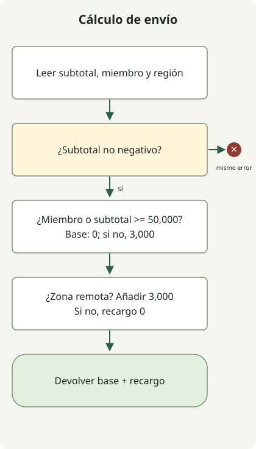

**Refactorizar con un agente IA empieza definiendo comportamiento y alcance y comprobando el resultado con ejecución y diff.** Una función más corta o «pruebas aprobadas» no basta. Revisa valores, excepciones y efectos externos, y si se debilitó la verificación.

Es una guía independiente de herramientas para quienes conocen Git y pruebas. No presupone interfaz ni modelo. Los prompts son ejemplos redactados para adaptar, no transcripciones de productos ni mediciones. Los resultados ejecutados de Java se identifican aparte.

## ¿Qué incluir en la primera solicitud?

[Martin Fowler define refactorización](https://refactoring.com/) como cambiar estructura interna preservando comportamiento observable. Si hace falta cambiar política o corregir errores, sepáralo para evaluar diferencias entre resultados.

Proporciona archivos, llamadas, pruebas, convenciones y comandos reales. En vez de leer todo sin condiciones, empieza por rutas necesarias. Pedir primero comportamiento y evidencias sin editar reduce cambios que crecen por malentendidos.

La política siguiente son **requisitos ilustrativos**, no una política real ni informe de incidente.

| Condición | Comportamiento que conservar |
| --- | --- |
| Subtotal negativo | Lanzar `IllegalArgumentException("subtotal")` |
| Miembro o subtotal de al menos 50,000 KRW | Envío base 0 KRW |
| En otro caso | Envío base 3,000 KRW |
| Isla o zona remota | Añadir 3,000 KRW aunque la base sea gratis |

Puedes escribir la primera solicitud así. Supón que el código completo posterior está en `ShippingRefactorDemo.java`. Para practicar, copia primero el cuerpo de `before()` en `after()`. El código completo incluye la refactorización terminada para comparar.

```text
Lee before(), after() y main() en ShippingRefactorDemo.java y solo analiza.
No modifiques archivos todavía.

Objetivo: reducir ramas anidadas de after() conservando el cálculo de before().
Los importes de entrada están en KRW y usan long.
Comprueba tipo y mensaje de excepción para negativos, límite de 50,000 KRW,
y combinaciones de envío base gratis y recargo remoto.

Aporta evidencia de código del comportamiento, pruebas ya cubiertas,
casos límite adicionales y un cambio mínimo solo en after().
No adivines ni cambies políticas ambiguas.
```

Aquí interesa comportamiento por condición y ubicaciones de cambio, no un plan abstracto. «Los miembros siempre pagan 0 KRW» contradice el recargo remoto y debe corregirse antes de implementar.

## Hacer un cambio pequeño y comparar

**Separa cálculo base y recargo** de ramas duplicadas. Conserva entradas, salidas y excepciones sin interfaz de estrategia ni capa de configuración. Un cambio pequeño centra la revisión en estructura sin política nueva. [Guía Google](https://google.github.io/eng-practices/review/developer/small-cls.html)



El diagrama muestra `after()`, no el interior de IA. `before()` y `after()` son ilustrativos; `main()` comprueba expectativas explícitas y compara. Ejecuta con JDK 21 o posterior sin dependencias externas.

```java
public class ShippingRefactorDemo {
    static final long FREE_THRESHOLD = 50_000;
    record Case(long subtotal, boolean member, boolean remote, long expected) {}

    static long before(long subtotal, boolean member, boolean remote) {
        if (subtotal < 0) throw new IllegalArgumentException("subtotal");
        if (member) {
            if (remote) return 3_000;
            return 0;
        }
        if (subtotal >= 50_000) {
            if (remote) return 3_000;
            return 0;
        }
        if (remote) return 6_000;
        return 3_000;
    }

    static long after(long subtotal, boolean member, boolean remote) {
        if (subtotal < 0) throw new IllegalArgumentException("subtotal");
        long base = (member || subtotal >= FREE_THRESHOLD) ? 0 : 3_000;
        long surcharge = remote ? 3_000 : 0;
        return base + surcharge;
    }

    static void equal(long actual, long expected) {
        if (actual != expected) {
            throw new AssertionError("expected=" + expected + ", actual=" + actual);
        }
    }

    public static void main(String[] args) {
        Case[] examples = {
            new Case(0, false, false, 3_000),
            new Case(49_999, false, false, 3_000),
            new Case(50_000, false, false, 0),
            new Case(0, true, false, 0),
            new Case(49_999, false, true, 6_000),
            new Case(50_000, false, true, 3_000),
            new Case(0, true, true, 3_000),
            new Case(Long.MAX_VALUE, false, true, 3_000)
        };
        for (Case c : examples) {
            equal(before(c.subtotal(), c.member(), c.remote()), c.expected());
            equal(after(c.subtotal(), c.member(), c.remote()), c.expected());
        }
        System.out.println("examples=" + examples.length);

        int comparisons = 0;
        long[] amounts = {0, 1, 49_999, 50_000, 50_001, Long.MAX_VALUE};
        for (long subtotal : amounts) {
            for (boolean member : new boolean[] {false, true}) {
                for (boolean remote : new boolean[] {false, true}) {
                    equal(after(subtotal, member, remote), before(subtotal, member, remote));
                    comparisons++;
                }
            }
        }
        System.out.println("comparisons=" + comparisons);

        int rejected = 0;
        for (boolean refactored : new boolean[] {false, true}) {
            try {
                if (refactored) after(-1, false, false);
                else before(-1, false, false);
                throw new AssertionError("Negative amount was accepted");
            } catch (IllegalArgumentException e) {
                if (!"subtotal".equals(e.getMessage())) throw new AssertionError(e);
                rejected++;
            }
        }
        System.out.println("negative-inputs=" + rejected);
    }
}
```

```sh
javac --release 21 ShippingRefactorDemo.java
java ShippingRefactorDemo
```

La salida se obtuvo con Zulu JDK `21.0.1+12-LTS`. Tanto la inicial con el mismo cuerpo en `after()` y `before()` como la terminada produjeron esto.

```text
examples=8
comparisons=24
negative-inputs=2
```

En vez de `assert` Java, desactivable según `-ea`, lanza `AssertionError` directamente al diferir. Los recuentos son casos y combinaciones definidos, no cobertura de todo el código productivo.

Al solicitar implementación, conecta condiciones verificadas con alcance y comandos.

```text
Refactoriza solo after() conservando el contrato de envío establecido.
No cambies before(), main(), expectativas ni FREE_THRESHOLD.
Conserva entradas, salidas, tipos y mensajes de excepción; no añadas dependencias ni capas.
Si necesitas cambios fuera del archivo, explica motivos sin aplicarlos.

Ejecuta javac --release 21 ShippingRefactorDemo.java y java ShippingRefactorDemo.
Aporta comandos reales, códigos de salida, salida observada y diff.
Si falla, acota y corrige condición y causa; no borres controles ni ajustes expectativas para aprobar.
```

Si el entorno no edita ni ejecuta, aplica el parche y comandos tú. «No cambiar» comunica alcance; no sustituye permisos de herramientas ni restricciones de archivos.

## ¿Pasar pruebas equivale a conservar comportamiento?

Comprueba 8 expectativas, 24 combinaciones y excepciones negativas de ambos métodos. No prueba equivalencia de todo `long`. Usar solo `before()` puede conservar defectos; añade expectativas independientes y requisitos. Si encuentras un defecto, decide aparte si corregirlo y qué cambiará.

Puedes introducir un contraejemplo. Cambiar `subtotal >= FREE_THRESHOLD` en `after()` a `subtotal > FREE_THRESHOLD` excluye pedidos no miembros de exactamente 50,000 KRW de envío base gratis. La comprobación debe fallar.

La copia temporal con solo ese límite cambiado falló con `AssertionError: expected=0, actual=3000`. Confirma detectar un error concreto, no todos. La mutación no está en el código final.

En un proyecto revisa además excepciones, consultas y transacciones DB, cantidad y orden de llamadas, serialización y liberación. Pasar una función pura no verifica DB ni HTTP. Si buscas rendimiento, mide aparte con entradas y entorno fijos.

## Empezar la revisión final por los cambios

Inspecciona diff y resultados antes de la descripción. Busca archivos innecesarios, pruebas eliminadas u omitidas, excepciones ocultas y dependencias ajenas. `git diff --check` comprueba espacios y similares, no negocio.

Para una revisión separada da requisitos, código previo y posterior, diff y evidencia, no el éxito declarado. Las revisiones también fallan: contrasta cada observación con código y requisitos. [GitHub sobre límites](https://docs.github.com/en/copilot/responsible-use/agents) explica esas imprecisiones.

```text
Revisa sin modificar el cambio.
Entrada: requisitos de envío, código antes y después, diff, comandos y resultados reales.

Busca contraejemplos que cambien valores, excepciones, límite de 50,000 KRW o recargos remotos.
Comprueba desviaciones de alcance y debilitamiento de pruebas.
Para cada hallazgo indica ubicación, entrada, diferencia observable y evidencia.
No afirmes haber ejecutado controles que no ejecutaste.
```

Entrega brevemente estructura cambiada, comportamiento conservado, pruebas reales y pendientes. Si falla, refuerza entrada y expectativa y acota la corrección; divide cambios grandes. **Un tamaño que permita explicar por qué se conserva comportamiento** sigue siendo una unidad útil con IA.
