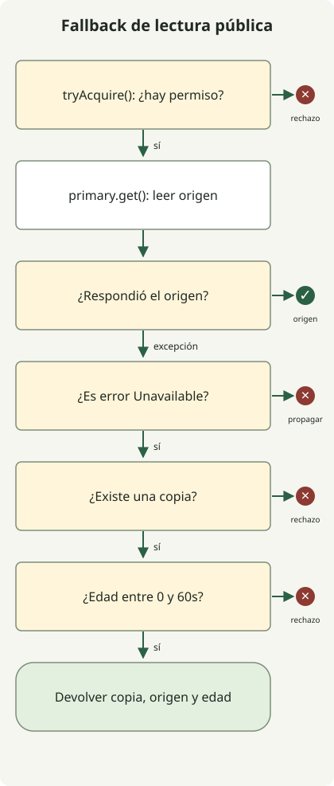

Durante una incidencia, **fallback debe ofrecer calidad previamente aceptada a un coste asumible**. Puedes omitir recomendaciones o devolver datos públicos dentro de una edad acordada. Informar éxito con resultado de pago desconocido o enviar todo a DB al fallar caché crea otros problemas.

Es una guía para desarrolladores que operan API HTTP. Tras el control de sobrecarga del [artículo de arquitectura 10k RPS](/ko/posts/2026-10-31-jdk-10k-rps-architecture/), trata qué respuestas devolver durante fallos. Java ejecuta la política sin servidor externo; no mide capacidad ni recuperación productiva.

## Cada fallo permite resultados distintos

Decide primero qué reducir del resultado normal. Son ejemplos de diseño; límites de edad y reducción funcional deben seguir el contrato del servicio.

| Fallo | Alternativa aceptable | Cuándo detener o limitar |
| --- | --- | --- |
| Demora o fallo de recomendaciones | Omitir recomendaciones opcionales o usar generales preparadas | No poner lecturas principales de productos en la misma cola |
| Fallo al leer descripción pública | Últimos datos correctos del mismo producto e idioma con fecha | Edad máxima superada, ausencia o clave incorrecta |
| Toda la caché indisponible | Lecturas limitadas del origen, copia local permitida o rechazo del exceso | Sin desvío ilimitado más allá del presupuesto DB y concurrencia |
| Falla autenticación o autorización | Error temporal sin realizar operación protegida | No confundir fallo con falta de permisos ni permitir acceso como alternativa |
| Respuesta perdida tras pago o pedido | Consultar estado y reconciliar con el mismo ID de operación | No suponer fallo creando otro pago ni inventar éxito |
| Alternativa usa la misma DB | Cambiar solo dentro de capacidad verificada aparte | Cambiar servidor no resuelve el cuello de la DB común |

Separa autorización, precio final y descuento de existencias de simples lecturas antiguas. «En comprobación» solo tiene sentido si realmente sigues y consultas el pago. Renombrar una respuesta no gestiona un resultado sin resolver.

AWS describe pruebas insuficientes de rutas raras y problemas añadidos entre los [riesgos del fallback distribuido](https://aws.amazon.com/builders-library/avoiding-fallback-in-distributed-systems/). Ejecuta esas rutas como las normales y revisa recursos comunes.

## ¿Qué hacen timeouts, reintentos y circuit breakers?

Un timeout limita la espera. **Terminarla no significa cancelar la operación remota o el pago.** Reintentar repite la operación; failover cambia de réplica. Fallback pasa a respuesta reducida u otro tratamiento. Un circuit breaker bloquea llamadas bajo condiciones tras acumular fallos; otra política decide la alternativa segura.

El plazo total incluye conexión, espera de pool, respuesta, reintentos y alternativa. Si el presupuesto es 300ms y el primer intento usa 250ms, no puedes esperar otros 250ms. Son cifras ilustrativas, no ajustes recomendados. Comprueba qué incluye cada timeout real.

Como explica [AWS](https://aws.amazon.com/builders-library/timeouts-retries-and-backoff-with-jitter/), reintentos añaden carga y pudo haber efectos aunque fallara la respuesta. Asigna responsabilidad a una capa, limita tiempo y número y reintenta solo fallos temporales de operaciones seguras. Backoff exponencial y jitter distribuyen reintentos, no amplían una DB saturada.

## Ejemplo Java: datos públicos permitidos durante tiempo limitado

Lee **una descripción pública fija**. Prefiere la respuesta normal y usa la última copia solo para fallos `Unavailable`. La copia no supera 60 segundos y se rechazan fechas futuras. El límite 2 y ventana de 60 segundos son demostrativos. Varios productos, idiomas o tenants necesitan claves distintas; no lo reutilices sin cambios para datos autenticados.



El diagrama muestra `read()`. Cada ruta libera el permiso mediante `finally` al devolver o fallar. No implementa timeouts, circuit breakers ni actualización. El adaptador HTTP debe convertir a `Unavailable` solo fallos permitidos, como conexión y timeout. Convertir 401, 403, 404, errores de esquema y programación a lo mismo cambia la política.

Guarda como `FallbackDemo.java`. Ejecuta con JDK 21 o posterior sin dependencias externas.

```java
import java.time.Clock;
import java.time.Duration;
import java.time.Instant;
import java.time.ZoneOffset;
import java.util.concurrent.Semaphore;
import java.util.function.Supplier;

public class FallbackDemo {
    record Snapshot(String value, Instant observedAt) {}
    record Reply(String value, String source, long ageSeconds) {}
    static class Unavailable extends RuntimeException {}
    static class Rejected extends RuntimeException {
        Rejected(String reason) { super(reason); }
    }

    static final class Catalog {
        private final Semaphore slots = new Semaphore(2);
        private final Clock clock;
        private final Duration maxAge = Duration.ofSeconds(60);

        Catalog(Clock clock) { this.clock = clock; }

        Reply read(Supplier<String> primary, Snapshot snapshot) {
            if (!slots.tryAcquire()) throw new Rejected("capacity");
            try {
                try {
                    return new Reply(primary.get(), "primary", 0);
                } catch (Unavailable failure) {
                    if (snapshot == null) throw new Rejected("missing");
                    Duration age = Duration.between(
                            snapshot.observedAt(), clock.instant());
                    if (age.isNegative() || age.compareTo(maxAge) > 0) {
                        throw new Rejected("age");
                    }
                    return new Reply(snapshot.value(), "snapshot", age.toSeconds());
                }
            } finally {
                slots.release();
            }
        }
    }

    static void rejected(String reason, Runnable action) {
        try {
            action.run();
        } catch (Rejected e) {
            if (!reason.equals(e.getMessage())) throw new AssertionError(e);
            System.out.println("rejected=" + reason);
            return;
        }
        throw new AssertionError("Expected rejection: " + reason);
    }

    public static void main(String[] args) {
        Instant now = Instant.parse("2026-10-31T00:00:00Z");
        Catalog catalog = new Catalog(Clock.fixed(now, ZoneOffset.UTC));
        Snapshot recent = new Snapshot("saved-description", now.minusSeconds(30));
        Supplier<String> down = () -> { throw new Unavailable(); };

        System.out.println(catalog.read(() -> "live-description", recent));
        System.out.println(catalog.read(down, recent));
        System.out.println(catalog.read(down,
                new Snapshot("boundary", now.minusSeconds(60))));
        rejected("age", () -> catalog.read(down,
                new Snapshot("old", now.minusSeconds(60).minusNanos(1))));
        rejected("age", () -> catalog.read(down,
                new Snapshot("future", now.plusSeconds(1))));
        rejected("missing", () -> catalog.read(down, null));

        try {
            catalog.read(() -> { throw new IllegalStateException("schema"); }, recent);
            throw new AssertionError("Unexpected fallback");
        } catch (IllegalStateException expected) {
            System.out.println("propagated=" + expected.getMessage());
        }

        // Hold both permits through nested calls; the third call must not run.
        catalog.read(() -> catalog.read(() -> {
            rejected("capacity", () -> catalog.read(() -> {
                throw new AssertionError("Primary ran without a permit");
            }, recent));
            return "inner";
        }, recent).value(), recent);
        System.out.println(catalog.read(() -> "recovered", recent));
    }
}
```

```sh
javac --release 21 FallbackDemo.java
java FallbackDemo
```

La salida se obtuvo con Zulu JDK `21.0.1+12-LTS`.

```text
Reply[value=live-description, source=primary, ageSeconds=0]
Reply[value=saved-description, source=snapshot, ageSeconds=30]
Reply[value=boundary, source=snapshot, ageSeconds=60]
rejected=age
rejected=age
rejected=missing
propagated=schema
rejected=capacity
Reply[value=recovered, source=primary, ageSeconds=0]
```

`source=snapshot` y `ageSeconds` comunican degradación al cliente como metadatos. No implementan la cabecera HTTP `Age`. La comparación usa `Duration` preciso; solo la edad mostrada se reduce a segundos enteros.

[`tryAcquire()` de Semaphore](https://docs.oracle.com/en/java/javase/21/docs/api/java.base/java/util/concurrent/Semaphore.html) falla sin esperar si no hay permiso. La alternativa cuenta en el mismo límite y no devuelve ni copia al saturarse. Si permites una ruta barata separada para copias, limítala también. Las llamadas anidadas agotan permisos determinísticamente; no son carga concurrente.

No implementa almacenamiento y actualización de lecturas, límites y expulsión, agrupación ni recuperación tras reiniciar. Actualiza copias solo con lecturas correctas y **no cambies la fecha al devolverlas**. Renovarla siempre puede aceptar un valor antiguo eternamente. Copias duraderas necesitan política que contemple ajustes de reloj.

## Definir también cuándo termina la incidencia

[Google SRE sobre sobrecarga](https://sre.google/sre-book/handling-overload/) explica que puede requerirse error si ni una respuesta degradada es asumible. Si rechazo o falta de copia impiden servicio, usa 503 según el contrato. Puedes enviar `Retry-After` con un momento fiable, pero no evita por sí solo una avalancha. 504 significa que gateway o proxy no recibió a tiempo al upstream, no cualquier timeout. [RFC 9110](https://www.rfc-editor.org/rfc/rfc9110.html#name-server-error-5xx)

Devolver todo al origen al cerrar el circuit breaker puede derribarlo otra vez. Comprueba con sondas half-open limitadas y aumenta gradualmente, limitando actualizaciones y relleno. Define cuándo parar o retroceder si latencia, errores, espera DB o cola exceden rangos. Determina proporciones y ventanas con carga real.

Para empezar, elige una lectura opcional e inyecta fallos. Comprueba copias ausentes, límite de edad, fechas futuras, saturación de admisión, excepciones sin clasificar y recuperación. En servidores reales prueba lentitud, pool agotado, fallo total de caché, fallo simultáneo principal y alternativo y reintentos simultáneos al recuperar.

Separa resultados normales, alternativos, rechazos y fallos. Solo HTTP 200 puede ocultar una incidencia de respuestas antiguas mayoritarias. Observa proporción alternativa, edad, fallos por dependencia, rechazos y solicitudes en curso. **Distingue completar la función de negocio de atender con calidad reducida** para juzgar el impacto del fallback.
