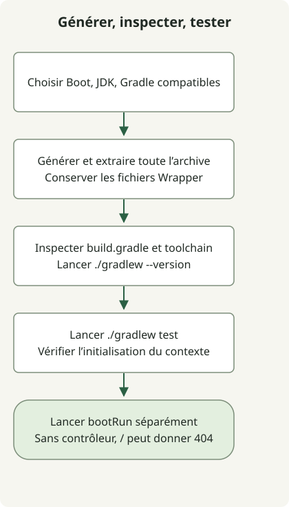

Après avoir créé un projet avec Spring Initializr, testez-le avec le Gradle Wrapper généré avant de vous fier à l’IDE. Vérifiez séparément la génération, la résolution des dépendances, la compatibilité du JDK et le démarrage de l’application pour localiser plus facilement les échecs.

Cet exemple utilise un projet Boot 4.1.2, Java 17, Gradle Groovy réellement généré par [start.spring.io](https://start.spring.io/) le 27 octobre 2026. Son Wrapper a sélectionné Gradle 9.8.2. Les valeurs par défaut et les versions disponibles du service évoluent ; ne supposez pas que cette combinaison restera disponible indéfiniment.

## Déroulement du traitement



Générez l’archive complète avant d’exécuter son Wrapper. Un test de contexte et une application HTTP exécutée séparément établissent des choses différentes.

## Choisir les paramètres du projet

| Paramètre | Exemple | Signification |
| --- | --- | --- |
| Projet / Langage | Gradle - Groovy / Java | Outils de construction et langage source |
| Spring Boot | 4.1.2 | Une version finale disponible lors de la génération de cet exemple |
| Java / Empaquetage | 17 / Jar | Chaîne d’outils source et empaquetage |
| Group / Artifact | example / demo | Identifiants du projet |
| Nom du package | example.demo | Package de l’application |
| Dépendances | Spring Web | Dépendances pour un point d’accès HTTP |

Cliquez sur Generate dans l’interface ou téléchargez l’archive avec cette URL. **Confirmez la réussite de chaque commande avant d’exécuter la suivante.** Utilisez un répertoire de travail vide pour éviter d’écraser un projet existant.

```sh
curl --fail --show-error --location 'https://start.spring.io/starter.zip?type=gradle-project&language=java&bootVersion=4.1.2&baseDir=demo&groupId=example&artifactId=demo&name=Demo&packageName=example.demo&packaging=jar&javaVersion=17&dependencies=web' --output demo.zip
unzip demo.zip
cd demo
./gradlew --version
./gradlew test
```

L’API de génération peut refuser une version lorsque le service cesse de la proposer. Consultez les [métadonnées actuelles du service](https://start.spring.io/metadata/client) et la [référence Initializr](https://docs.spring.io/initializr/docs/current/reference/html/), puis sélectionnez ensemble des versions Boot, JDK et Gradle compatibles. Remplacer silencieusement l’exemple par les dernières valeurs par défaut modifie ses conditions de reproduction.

## Inspecter quatre fichiers générés essentiels

Voici les quatre fichiers essentiels avec une mise en forme simplifiée. L’archive complète comprend aussi les scripts Wrapper, le JAR Wrapper et ses paramètres, ainsi que les ressources. Copier uniquement ces quatre fichiers dans un répertoire vide ne crée pas `./gradlew`.

### `settings.gradle`

```groovy
rootProject.name = 'demo'
```

### `build.gradle`

```groovy
plugins {
    id 'java'
    id 'org.springframework.boot' version '4.1.2'
    id 'io.spring.dependency-management' version '1.1.7'
}
group = 'example'
version = '0.0.1-SNAPSHOT'
java {
    toolchain { languageVersion = JavaLanguageVersion.of(17) }
}
repositories { mavenCentral() }
dependencies {
    implementation 'org.springframework.boot:spring-boot-starter-webmvc'
    testImplementation 'org.springframework.boot:spring-boot-starter-webmvc-test'
    testRuntimeOnly 'org.junit.platform:junit-platform-launcher'
}
tasks.named('test') { useJUnitPlatform() }
```

### `src/main/java/example/demo/DemoApplication.java`

```java
package example.demo;

import org.springframework.boot.SpringApplication;
import org.springframework.boot.autoconfigure.SpringBootApplication;

@SpringBootApplication
public class DemoApplication {
    public static void main(String[] args) {
        SpringApplication.run(DemoApplication.class, args);
    }
}
```

### `src/test/java/example/demo/DemoApplicationTests.java`

```java
package example.demo;

import org.junit.jupiter.api.Test;
import org.springframework.boot.test.context.SpringBootTest;

@SpringBootTest
class DemoApplicationTests {
    @Test
    void contextLoads() {}
}
```

Le projet Boot 4.1.2 généré utilise `spring-boot-starter-webmvc` et `spring-boot-starter-webmvc-test`. Partez de la configuration générée pour la version choisie au lieu de mélanger des fragments de différentes générations Boot. Les [exigences de Boot 4.1.2](https://docs.spring.io/spring-boot/4.1/system-requirements.html) indiquent Java 17 ou ultérieur et Gradle 8.x à partir de 8.14, ou 9.x.

## Distinguer les tests du démarrage de l’application

Un `contextLoads()` réussi signifie que le contexte de test démarre. En l’absence de contrôleur, une réponse 404 de `/` n’indique pas un échec de démarrage. Exécutez l’application séparément et arrêtez-la avec Ctrl+C dans ce terminal.

```sh
./gradlew bootRun
```

Versionnez ensemble le `build.gradle` généré et les [fichiers Gradle Wrapper](https://docs.gradle.org/current/userguide/gradle_wrapper.html). La version Gradle est distincte de la version Java dans `java.toolchain`. Utilisez `./gradlew --version` pour inspecter la JVM exécutant Gradle et distinguez-la du JDK choisi pour compiler et exécuter l’application.

Poursuivez avec [l’ouverture du projet dans IntelliJ et le service HTTP](/en/posts/2023-09-10-springboot-intellij-import/). Consultez [l’historique des releases Spring Boot et les relations entre versions](/en/posts/2023-09-13-springboot-history/) pour comprendre les numéros de version différents de Boot et Framework.
