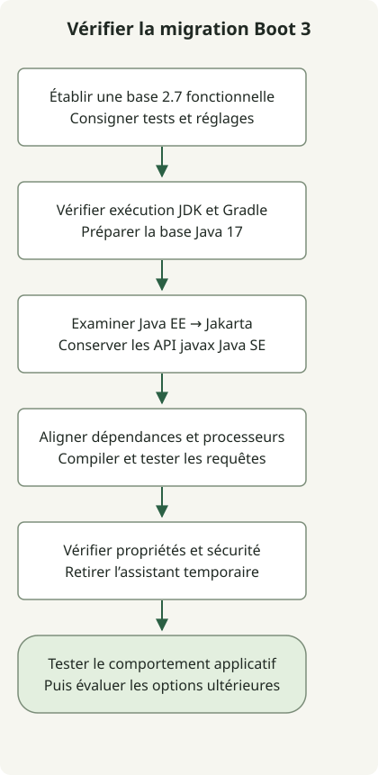

Commencez une migration Spring Boot 2.7 vers 3.0 avec une base 2.7 fonctionnelle, puis vérifiez l’exigence Java 17, les changements d’espaces de noms Java EE vers Jakarta et la compatibilité des bibliothèques et de l’environnement d’exécution. Le [guide officiel de migration 3.0](https://github.com/spring-projects/spring-boot/wiki/Spring-Boot-3.0-Migration-Guide) décrit cet ordre. Une compilation réussie ne suffit pas à établir la correction des mappings de base de données, de l’autorisation ou de la configuration.

Il s’agit d’un **guide de migration de 2.7 vers 3.0** qui conserve le sujet d’origine de 2023. Il ne recommande pas de déployer Boot 3.0 aujourd’hui. Pour une vraie mise à niveau, choisissez une version cible prise en charge et suivez les guides de migration intermédiaires.

## Déroulement du traitement



Voici l’ordre des contrôles de migration proposé par l’article. Les commandes inspectent l’environnement ; elles ne migrent pas automatiquement une application ou une base de données.

## 1. Établir une base 2.7 fonctionnelle

Mettez une ancienne application 2.x à jour vers la dernière release 2.7.x avant de tenter le changement de version majeure. Conservez un résultat de test réussi et consignez le Wrapper, la JVM de construction et les dépendances. Pour un projet Gradle avec son Wrapper existant, commencez par :

```sh
java -version
./gradlew --version
./gradlew clean test
./gradlew dependencies --configuration runtimeClasspath
```

Exécutez les mêmes contrôles après la mise à niveau. Dans une construction multiprojet, générez les rapports de dépendances du module applicatif, par exemple `./gradlew :app:dependencies --configuration runtimeClasspath`. Le nom du module doit correspondre à votre projet.

Une base utile exerce la persistance, l’authentification, la sérialisation, les tâches planifiées et les appels HTTP sortants. Pour cette dernière frontière, les [tests WebClient avec un MockWebServer local](/en/posts/2023-09-19-springboot-test-webclient/) constituent un point de départ reproductible.

## 2. Modifier ensemble les imports Java EE et les dépendances

Boot 3.0 nécessite Java 17 et Spring Framework 6. Les packages Java EE tels que `javax.persistence` et `javax.servlet` deviennent `jakarta.persistence` et `jakarta.servlet`. Les packages Java SE tels que `javax.sql` et `javax.crypto` conservent leurs noms.

| Usage existant | Action de migration |
| --- | --- |
| `javax.persistence.Entity` | Utiliser `jakarta.persistence.Entity` et des dépendances JPA compatibles. |
| `javax.servlet.Filter` | Utiliser `jakarta.servlet.Filter` et des dépendances servlet compatibles. |
| `javax.sql.DataSource` | Conserver le nom du package Java SE. |
| `javax.crypto.Cipher` | Conserver le nom du package Java SE. |

Inspectez le graphe résolu en plus des imports. Par exemple, `./gradlew dependencyInsight --dependency javax.servlet-api --configuration runtimeClasspath` aide à localiser un ancien artefact servlet. Un rapport vide ne prouve pas que toute l’application a migré : inspectez les autres bibliothèques et configurations réellement utilisées. Voir les [rapports de dépendances Gradle](https://docs.gradle.org/current/userguide/viewing_debugging_dependencies.html).

Pour Querydsl JPA, [alignez les artefacts JPA et processeur d’annotations](/en/posts/2023-09-09-springboot3-querydsl/) et sélectionnez leur variante Jakarta lorsque cette branche d’artefacts l’exige. Confirmez que le traitement des annotations génère les types Q attendus et que des requêtes représentatives s’exécutent. Le `configureEach` de Gradle contrôle la configuration des tâches ; il ne peut pas transformer une dépendance Java EE incompatible en dépendance Jakarta.

## 3. Vérifier les propriétés renommées et le comportement d’autorisation

Pour un projet Gradle géré par Boot, le guide officiel de migration propose un assistant temporaire pour les propriétés :

```groovy
dependencies {
    runtimeOnly 'org.springframework.boot:spring-boot-properties-migrator'
}
```

Démarrez l’application dans un environnement de test, lisez les diagnostics de démarrage et mettez les propriétés concernées à jour. Retirez l’assistant une fois la migration terminée. Il ne remplace pas la lecture des changements de configuration de la version cible.

Boot 3.0 utilise aussi Spring Security 6. Le guide suggère une transition par Spring Security 5.8 sur Boot 2.7 avant de passer à 6.0. Testez les requêtes autorisées, refusées et non authentifiées, ainsi que les dispatchs error/forward lorsque l’application servlet les utilise ; un démarrage réussi ne sert pas de test d’autorisation.

## 4. Traiter les threads virtuels comme un changement distinct

Le paramètre Boot des threads virtuels est apparu dans **Boot 3.2 avec JDK 21**, et non comme fonctionnalité de Boot 3.0 :

```properties
spring.threads.virtual.enabled=true
```

C’est une limite historique de version, pas une recommandation de choisir Boot 3.2 aujourd’hui. Établissez d’abord que la migration des espaces de noms et dépendances fonctionne. Évaluez ensuite les threads virtuels selon la version choisie, les pools de connexions et les hypothèses liées aux variables locales de thread. Le paramètre seul ne prouve aucun gain de performance. [L’explication Spring sur Boot 3.2](https://spring.io/blog/2023/09/09/all-together-now-spring-boot-3-2-graalvm-native-images-java-21-and-virtual).

Les fonctionnalités de langage en preview du JDK ont aussi leurs propres contraintes de version. L’[exemple de compatibilité String Templates](/en/posts/2023-09-23-jdk-21-string-templates/) montre pourquoi activer les options preview ne résout pas toutes les difficultés de mise à niveau.

<span id="decide-whether-the-application-is-ready"></span>

## Comment savoir si la migration est prête ?

| Contrôle | Éléments à recueillir |
| --- | --- |
| Construction et code généré | Construction Wrapper réussie, types Q attendus et versions résolues des dépendances. |
| Comportement à l’exécution | Tests de persistance, d’authentification et HTTP représentatifs réussis. |
| Configuration | Propriétés mises à jour et assistant de migration devenu inutile. |
| Déploiement | L’artefact à déployer passe les contrôles dans un environnement représentatif. |

Les commandes forment une séquence de diagnostic pour votre projet, et ne sont pas le résultat d’une migration effectuée sur votre application. Gardez disponibles l’artefact et la configuration antérieurs pour revenir en arrière. Une migration majeure facilite la maintenance, mais la sécurité dépend toujours des versions exactes déployées et de leur configuration.
