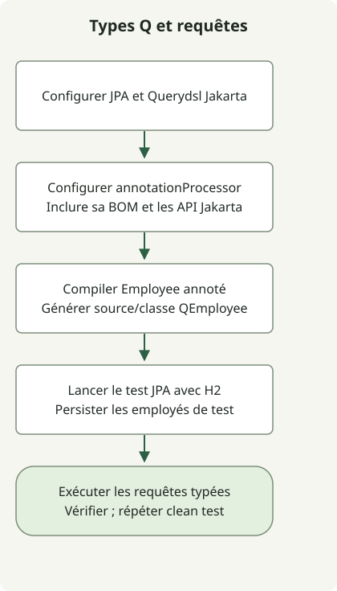

Pour générer les types Q de Querydsl JPA sur Spring Boot 3, alignez les versions et classifiers `jakarta` de `querydsl-jpa` et `querydsl-apt`, configurez le traitement des annotations, puis vérifiez une construction propre et un test de requête en base. Les [notes de release 5.0](https://github.com/querydsl/querydsl/releases/tag/QUERYDSL_5_0_0) documentent la prise en charge des classifiers Jakarta. Conserver les chemins par défaut de Gradle pour les sources générées évite de configurer les compilations principale et de test pour écrire dans le même répertoire.

Ce guide développe l’exemple coréen d’origine de 2023 en une configuration exécutable. Les versions ci-dessous figent l’environnement de reproduction ; elles ne recommandent pas des dépendances actuelles pour la production.

## Déroulement du traitement



Le processeur génère QEmployee pendant la compilation principale. Le test H2 exécute ensuite une requête avec ces types générés.

## Environnement de reproduction et configuration Gradle complète

| Composant | Version de reproduction |
| --- | --- |
| JDK / Gradle | 17.0.8.1 / 8.4 |
| BOM Spring Boot | 3.5.7 |
| Querydsl JPA / APT | 5.1.0, tous deux avec le classifier `jakarta` |
| Hibernate / H2 | 6.6.33.Final / 2.3.232, gérés par la BOM |

Créez ces cinq fichiers dans un nouveau répertoire. Ce projet de test utilise le plugin Java et la BOM Boot ; il n’a pas besoin du plugin Gradle Boot. Dans une application Boot existante, ajoutez uniquement les dépendances nécessaires à côté de la gestion des dépendances sélectionnée.

### `settings.gradle`

```groovy
rootProject.name = 'querydsl-jakarta-example'
```

### `build.gradle`

```groovy
plugins { id 'java' }
repositories { mavenCentral() }
dependencies {
    implementation platform('org.springframework.boot:spring-boot-dependencies:3.5.7')
    implementation 'org.springframework.boot:spring-boot-starter-data-jpa'
    implementation 'com.querydsl:querydsl-jpa:5.1.0:jakarta'

    annotationProcessor platform('org.springframework.boot:spring-boot-dependencies:3.5.7')
    annotationProcessor 'com.querydsl:querydsl-apt:5.1.0:jakarta'
    annotationProcessor 'jakarta.persistence:jakarta.persistence-api'
    annotationProcessor 'jakarta.annotation:jakarta.annotation-api'

    testImplementation 'org.springframework.boot:spring-boot-starter-test'
    testRuntimeOnly 'com.h2database:h2'
    testRuntimeOnly 'org.junit.platform:junit-platform-launcher'
}
test { useJUnitPlatform() }
```

Gradle résout `annotationProcessor` séparément des classpaths habituels de compilation et d’exécution. L’exemple applique donc aussi la BOM à la configuration du processeur et fournit explicitement les API Jakarta Persistence et Annotation. Une dépendance dans `implementation` n’est pas automatiquement disponible pour le processeur. Voir la [documentation du plugin Java de Gradle](https://docs.gradle.org/current/userguide/java_plugin.html).

## Créer l’application et l’entité

La classe d’application permet au test JPA de découvrir sa configuration Boot. Aucun processus serveur distinct n’est nécessaire pour le test.

### `src/main/java/example/Application.java`

```java
package example;

import org.springframework.boot.SpringApplication;
import org.springframework.boot.autoconfigure.SpringBootApplication;

@SpringBootApplication
public class Application {
    public static void main(String[] args) {
        SpringApplication.run(Application.class, args);
    }
}
```

### `src/main/java/example/Employee.java`

```java
package example;

import jakarta.persistence.Entity;
import jakarta.persistence.GeneratedValue;
import jakarta.persistence.GenerationType;
import jakarta.persistence.Id;

@Entity
public class Employee {
    @Id
    @GeneratedValue(strategy = GenerationType.IDENTITY)
    private Long id;
    private String name;

    public String getName() { return name; }

    protected Employee() {}

    public Employee(String name) {
        this.name = name;
    }
}
```

`Employee` utilise `jakarta.persistence`. N’écrivez pas vous-même `QEmployee` : le processeur d’annotations génère le type référencé par le test ci-dessous.

## Interroger avec le type Q généré

### `src/test/java/example/EmployeeQueryTest.java`

```java
package example;

import com.querydsl.jpa.impl.JPAQueryFactory;
import org.junit.jupiter.api.Test;
import org.springframework.beans.factory.annotation.Autowired;
import org.springframework.boot.test.autoconfigure.orm.jpa.DataJpaTest;
import org.springframework.boot.test.autoconfigure.orm.jpa.TestEntityManager;

import static org.assertj.core.api.Assertions.assertThat;

@DataJpaTest
class EmployeeQueryTest {
    @Autowired
    private TestEntityManager entityManager;

    @Test
    void findsEmployeeByName() {
        entityManager.persistAndFlush(new Employee("Alice"));
        entityManager.persistAndFlush(new Employee("Bob"));
        QEmployee employee = QEmployee.employee;
        var names = new JPAQueryFactory(entityManager.getEntityManager())
            .select(employee.name).from(employee)
            .where(employee.name.eq("Alice")).fetch();
        assertThat(names).containsExactly("Alice");
    }

    @Test
    void returnsNoRowsForMissingName() {
        entityManager.persistAndFlush(new Employee("Alice"));
        QEmployee employee = QEmployee.employee;
        var names = new JPAQueryFactory(entityManager.getEntityManager())
            .select(employee.name).from(employee)
            .where(employee.name.eq("Missing")).fetch();
        assertThat(names).isEmpty();
    }
}
```

`@DataJpaTest` utilise H2 présent dans le classpath de cet exemple. Chaque test s’exécute dans une transaction annulée ensuite. Après l’insertion des données avec `persistAndFlush`, le `QEmployee` généré permet deux contrôles : une correspondance exacte de nom et une requête sans ligne retournée. Voir le [guide de test JPA de Spring Boot](https://docs.spring.io/spring-boot/3.5/reference/testing/spring-boot-applications.html#testing.spring-boot-applications.autoconfigured-spring-data-jpa-tests).

Ces tests vérifient cette entité et cette requête sur H2. Ils ne vérifient ni le dialecte SQL, ni la collation, ni le verrouillage, ni les migrations de votre base de production.

## Exécuter et inspecter les fichiers générés

Sélectionnez JDK 17 et utilisez une installation Gradle 8.4. Exécutez depuis la racine du projet :

```sh
java -version
gradle --version
gradle --no-daemon clean test
```

Vérifiez ces artefacts générés et le rapport de test :

```text
build/generated/sources/annotationProcessor/java/main/example/QEmployee.java
build/classes/java/main/example/QEmployee.class
build/reports/tests/test/index.html
```

Les deux tests ont réussi avec cette configuration. Une répétition de `clean test` a régénéré le type Q et réussi les deux tests à nouveau. Pour un projet existant avec Gradle Wrapper, utilisez sa version sélectionnée via `./gradlew clean test`.

Le type Q généré dans cet exemple importe `javax.annotation.processing.Generated`, une API Java SE de `java.compiler`. Cet import n’a pas besoin d’un remplacement Jakarta. [API Generated du JDK 17](https://docs.oracle.com/en/java/javase/17/docs/api/java.compiler/javax/annotation/processing/Generated.html).

<span id="troubleshoot-missing-or-duplicate-q-types"></span>

## Pourquoi les types Q manquent-ils ou sont-ils générés deux fois ?

| Symptôme | Premier contrôle |
| --- | --- |
| `QEmployee` est introuvable | Vérifier le résultat CLI de `clean compileJava`, les dépendances du processeur et les imports `jakarta.persistence` de l’entité. |
| Le processeur ne trouve pas les API Persistence | Vérifier que les API Jakarta requises sont sur le chemin du processeur, séparément du classpath normal. |
| Un type incompatible `javax.persistence.EntityManager` apparaît | Vérifier la concordance des versions et des classifiers Jakarta des deux artefacts Querydsl. |
| Types Q en double, ou construction réussie uniquement après clean | Retirer les sources Q écrites à la main et les chemins générés partagés ; inspecter la configuration des sorties principale et de test. |
| La CLI réussit mais l’IDE ne voit pas les types Q | Vérifier la synchronisation Gradle, la délégation des constructions et le traitement des annotations de l’IDE. |

L’exemple n’ajoute aucune configuration personnalisée `sourceSets`, `JavaCompile` ou `clean` pour les fichiers générés. Si un chemin personnalisé est nécessaire, séparez les sorties principale et de test. `configureEach` contrôle la configuration différée des tâches ; il ne corrige pas la compatibilité des dépendances Jakarta. [Évitement de configuration Gradle](https://docs.gradle.org/current/userguide/lazy_configuration.html).

Pour l’ordre global de mise à niveau, voir le [guide de migration Spring Boot 3](/en/posts/2023-09-08-springboot3-migration/). Pour les frontières HTTP sortantes, utilisez les [tests WebClient et MockWebServer](/en/posts/2023-09-19-springboot-test-webclient/).

## Comparer avant de changer d’outil de requête

La classe Employee complète comprend un getter pour comparer les résultats du repository sous forme de noms. Ajoutez les trois fichiers de la [comparaison Querydsl et Specification](/en/posts/2023-09-05-querydsl-no-release/) pour exécuter huit contrôles supplémentaires sur la même entité. Les deux tests d’origine ci-dessus restent dans ce projet de dix tests. Cela compare certains prédicats H2, et non tous les comportements de base de données. Le [guide Spring Boot](/en/categories/springboot/) relie les étapes de configuration et de test environnantes.
