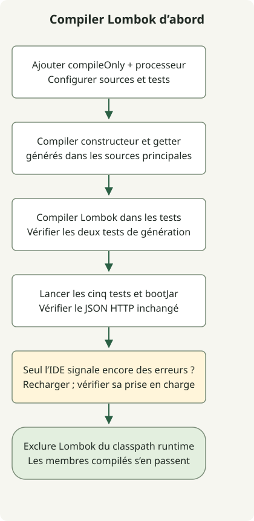

Si les méthodes Lombok semblent manquer, exécutez d’abord `./gradlew clean test` pour déterminer si la construction échoue aussi. La prise en charge de l’IDE aide l’éditeur à reconnaître les membres générés ; la configuration du processeur d’annotations Gradle les génère pendant la compilation. Aucune ne remplace l’autre.

Cet exemple poursuit le [projet Initializr](/en/posts/2023-09-07-springboot-initializer/) et l’[exemple HTTP](/en/posts/2023-09-10-springboot-intellij-import/). Il utilise Boot 4.1.2, Gradle 9.8.2 et JDK 17 ; la BOM a sélectionné Lombok 1.18.48. Cela consigne une combinaison fonctionnelle sans garantir la compatibilité de chaque association JDK/Lombok.

## Déroulement du traitement



Vérifiez séparément les constructeurs et getters générés pendant les compilations principale et de test. Corrigez leur reconnaissance par l’IDE après la réussite des tests Wrapper.

## Configurer la compilation Gradle

Ajoutez ce bloc au `build.gradle` existant, en évitant les déclarations en double si elles sont déjà présentes.

```groovy
dependencies {
    compileOnly 'org.projectlombok:lombok'
    annotationProcessor 'org.projectlombok:lombok'
    testCompileOnly 'org.projectlombok:lombok'
    testAnnotationProcessor 'org.projectlombok:lombok'
}
```

La [configuration officielle Gradle](https://projectlombok.org/setup/gradle) sépare les dépendances de compilation et les processeurs des sources principales et de test. Les deux déclarations de test ne sont nécessaires que si les sources de test utilisent elles-mêmes des annotations Lombok. Les tests ci-dessous exercent également ce chemin.

Les déclarations sans version fonctionnent ici car le projet applique le plugin Boot et `io.spring.dependency-management`, qui [importe la BOM Boot](https://docs.spring.io/spring-boot/4.1/gradle-plugin/managing-dependencies.html). Dans un projet Gradle simple, utilisez la même version explicite compatible dans les déclarations nécessaires ou configurez séparément leur gestion des dépendances.

## Utiliser le constructeur et le getter générés

Ajoutez `Greeting`, remplacez le contrôleur existant par cette version, conservez les tests HTTP et ajoutez la classe de test propre à Lombok.

### `src/main/java/example/demo/Greeting.java`

```java
package example.demo;

import lombok.Getter;
import lombok.RequiredArgsConstructor;

@Getter
@RequiredArgsConstructor
public class Greeting {
    private final String message;
}
```

### `src/main/java/example/demo/GreetingController.java`

```java
package example.demo;

import org.springframework.web.bind.annotation.GetMapping;
import org.springframework.web.bind.annotation.RestController;

@RestController
public class GreetingController {
    @GetMapping("/greeting")
    public Greeting greeting() {
        return new Greeting("Hello, Gradle");
    }
}
```

### `src/test/java/example/demo/LombokGenerationTest.java`

```java
package example.demo;

import lombok.Getter;
import lombok.RequiredArgsConstructor;
import org.junit.jupiter.api.Test;

import static org.junit.jupiter.api.Assertions.*;

class LombokGenerationTest {
    @Getter
    @RequiredArgsConstructor
    static class Expected {
        private final String message;
    }

    @Test
    void mainSourceConstructorAndGetterAreGenerated() {
        assertEquals("Hello, Gradle", new Greeting("Hello, Gradle").getMessage());
    }

    @Test
    void testSourceConstructorAndGetterAreGenerated() {
        assertEquals("test fixture", new Expected("test fixture").getMessage());
    }
}
```

```sh
./gradlew clean test bootJar
./gradlew dependencyInsight --configuration annotationProcessor --dependency lombok
```

Il y a maintenant cinq tests : un test de contexte, deux tests HTTP et deux tests de génération Lombok. Ils appellent les constructeurs et getters générés dans les sources principales et de test. `/greeting` doit toujours retourner le même JSON, ce qui vérifie aussi la sérialisation via le getter généré.

Lombok étant `compileOnly`, le JAR exécutable de cet exemple ne l’inclut pas comme bibliothèque d’exécution. Installer uniquement un plugin d’IDE ne fait pas réussir la compilation Gradle. Ajouter Lombok comme dépendance d’exécution `implementation` n’est pas nécessaire pour utiliser le getter déjà compilé dans cette configuration.

## Quand seul l’IDE signale des erreurs

Si les tests Wrapper réussissent, rechargez le projet Gradle. [JetBrains indique](https://www.jetbrains.com/help/idea/annotation-processors-support.html) que l’import des processeurs depuis les fichiers de construction active automatiquement le traitement des annotations. Modifier manuellement une case à cocher n’est donc pas une étape universellement nécessaire.

Vérifiez ensuite la prise en charge de Lombok et l’activation du plugin pour votre version d’IDE avec le [guide Lombok IntelliJ](https://projectlombok.org/setup/intellij). Ne généralisez pas qu’une édition exige toujours une installation manuelle alors qu’une autre l’intègre toujours. Déterminez aussi si l’IDE utilise son compilateur ou délègue les constructions à Gradle.

Si Gradle échoue aussi pour des membres générés manquants, recherchez `compileOnly` sans `annotationProcessor`. Si seuls les tests échouent, inspectez les deux configurations de test. Le vérificateur de reproduction confirme l’échec de compilation lorsque le processeur principal ou celui de test est retiré séparément, puis les restaure et vérifie à nouveau la réussite des cinq tests. Les interactions avec l’interface de l’IDE sortent du périmètre de ces vérifications d’exécution.
